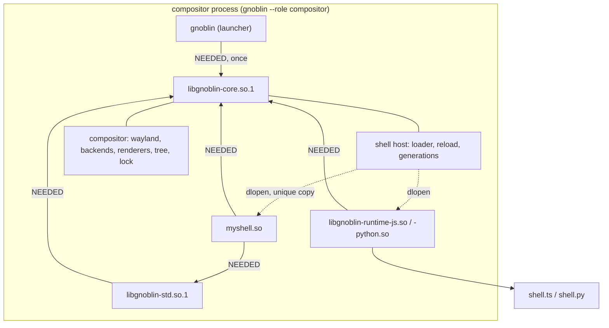

# Modular framework: core, std and shells

Status: design, lane Architect, branch `rust-compositor` (PR #339, draft). Written against `origin/rust-compositor` at
`17e44ef17`. The proof spike behind the linking, panic, reload and upgrade claims is recorded in
`design/modular-framework-spike.md`; every claim marked "spike" cites a command and output there. Claims marked
`[INFERENCE]` were read from code or knowledge and not run.

The owner's specification (condensed in `local://modular-brief.md` and the lane brief) is the authority. This file turns it
into crate names, an ABI, a loader, a discovery rule, a reload protocol, a migration order and a lane breakdown. Section 2
is the one decision list; the owner may overrule any row.

## 1. What changes, in one page

Today one executable `gnoblin` holds every role, the shell is a separate process (`--role runtime`, QuickJS) that talks to the
compositor over the owner socket, and the desktop policy (fallback window manager, built-in fades, portal dialogs, bell,
magnifier) is compiled into the compositor.

After this work:

- `libgnoblin-core.so.1` holds the compositor machinery, the shell host (loader, hot reload, supervision) and a small C ABI.
  `gnoblin` becomes a thin launcher that links it dynamically and also keeps the guardian and services roles.
- A shell is a module the shell host loads: a `.so` (any language that can export one symbol), or a `.py`, `.js`, `.mjs`,
  `.ts`, `.mts` file run by a language runtime library (`libgnoblin-runtime-python.so`, `libgnoblin-runtime-js.so`) that is
  itself a native module on the same ABI.
- The shell runs on its own thread inside the compositor process by default. `[shell] isolate = true` (or `--isolate`) runs the
  same host in a guardian-supervised child over today's owner socket.
- The ABI is addressed by schema names (classes, properties, methods, signals), not one C function per schema member. A new
  schema member needs no ABI change and no new symbol.
- `libgnoblin-std.so.1` (optional) holds the policy and the OOP desktop API: the fallback window manager, the default
  providers, then Client, Collection, Workspace, layouts, bindings, animation and styling. It links core and nothing links it
  back.
- Rust shells depend on the SDK crates `gnoblin-core` and `gnoblin-std`. They contain extern declarations and safe wrappers,
  never a copy of the implementation.

The wire contract does not change: the shell edits the node tree, claims chords and reads events. What changes is where the
transport ends (in-process queue instead of a socket) and who owns policy (std instead of core).

## 2. Decisions

One list. "Brief" is `local://modular-brief.md`. A row marked CHANGED differs from the brief. A row marked **Resolved** records a
choice the main agent made on the owner's behalf; the owner may still overrule it.

| #   | Decision                                                                                                                                                                                                                                                                            | Trade-off and what the owner can overrule                                                                                                                                                                                                                                                                                                                                                                                                                                                                                                                                                                                                                                                                      |
| --- | ----------------------------------------------------------------------------------------------------------------------------------------------------------------------------------------------------------------------------------------------------------------------------------- | -------------------------------------------------------------------------------------------------------------------------------------------------------------------------------------------------------------------------------------------------------------------------------------------------------------------------------------------------------------------------------------------------------------------------------------------------------------------------------------------------------------------------------------------------------------------------------------------------------------------------------------------------------------------------------------------------------------- |
| D1  | In-process shell on its own thread is the default; `isolate` runs the same host out of process.                                                                                                                                                                                     | Matches the spec (one core copy, no IPC latency). A native shell segfault ends the session. `isolate = true` restores today's containment. Overrule: make `isolate` the default (costs one frame of latency and a second core mapping in the child). **Resolved:** yes, in-process is the default (owner decision recorded by Main; the owner may still overrule).                                                                                                                                                                                                                                                                                                                                             |
| D2  | The core exports five direct symbols and one versioned function table (`gnoblin_get_api`). Everything else is reached through the table.                                                                                                                                            | A table gives additive growth, soft feature probing by `size`, and one place to generate. A direct symbol per verb gives ELF symbol versioning for free but a shell built against 1.1 then fails to load on 1.0 instead of degrading. Spike (6) shows both outcomes.                                                                                                                                                                                                                                                                                                                                                                                                                                           |
| D3  | The ABI is schema-addressed: classes, properties, methods and signals are interned by name at run time (`catalog_*`).                                                                                                                                                               | New schema members need no ABI change; per-member C functions would grow the table with every schema edit. Cost: a name lookup at start-up (cached by the SDK) and untyped values at the boundary; the SDKs and `gnoblin.d.ts` generate the typed layer. The catalog lists every namespace including the owner-only `tree`: it is metadata, not authority. The in-process shell host is the owner by construction, a module's operations are still decided by the owner socket's peer check and the observer rules, and `gnoblin-schema/tests/owner_only_tree.rs` lists `gnoblin-core-impl/build.rs` as an owner path while keeping every client-side crate, portal and service on the catalog without `tree`. |
| D4  | The tree mirror and the per-tick transaction builder live in core (one implementation). Language libraries query them through `node_get`/`node_children` and write through `write_*`.                                                                                               | One implementation for every language and no per-language mirror drift. Cost: the JS runtime's own mirror (`gnoblin-tree-client` inside `gnoblin-js`) is replaced by ABI calls in Phase 6, which is the largest single rewrite in the plan.                                                                                                                                                                                                                                                                                                                                                                                                                                                                    |
| D5  | CHANGED. SDK crate naming: `gnoblin-core` and `gnoblin-std` are the SDK crates (extern declarations and safe wrappers). The implementation crates are `gnoblin-core-impl` and `gnoblin-std-impl` (cdylib).                                                                          | The spec makes shells depend on `gnoblin-core = "1"`. The brief named the SDK `gnoblin-sdk`. Cost: "core" names two things; docs say "the core library" (`libgnoblin-core`) and "the core SDK crate". Section 4.2.                                                                                                                                                                                                                                                                                                                                                                                                                                                                                             |
| D6  | SONAMEs and installed file names use hyphens: `libgnoblin-core.so.1`, `libgnoblin-std.so.1`, set by the linker `-soname` argument and by dist renaming. Runtime modules are installed as `libgnoblin-runtime-js.so` and `libgnoblin-runtime-python.so` under `$libdir/gnoblin/`.    | Cargo derives artifact names from `[lib] name`, which cannot contain a hyphen, so the build emits `libgnoblin_core_impl.so` and `libgnoblin_std_impl.so` (build-internal underscore names); the spec names the installed files with hyphens and dist renames to match. **Resolved:** hyphens, as the spec says. Overrule: one-line change of the soname argument and the dist rename.                                                                                                                                                                                                                                                                                                                          |
| D7  | CHANGED. The lock card stays in core. The brief moved it to std.                                                                                                                                                                                                                    | A locked session with a dead or absent shell and no card is a black screen with no way back. It is the compositor's own recovery path and about 14 KB. Overrule: move it to std behind a provider and accept that a core-only shell must supply a lock screen. **Resolved:** the lock card stays in core.                                                                                                                                                                                                                                                                                                                                                                                                      |
| D8  | CHANGED. `gnoblin-js` stays a client-side crate. It is not linked into core and `client-side-isolation` does not change for it. It becomes `libgnoblin-runtime-js.so`, a module that speaks only the ABI.                                                                           | The scout report said `gnoblin-js` must leave `CLIENT_SIDE`. It need not: the runtime library is dlopened, never linked into the compositor. The deps graph keeps its strongest rule.                                                                                                                                                                                                                                                                                                                                                                                                                                                                                                                          |
| D9  | CHANGED. Renderers (`gnoblin-render-gles`, `-software`, `-vulkan`) and display backends stay inside `libgnoblin-core.so`, selected at run time. The spec's `libgnoblin-renderer-*.so` is not built in this plan.                                                                    | A renderer behind a C vtable puts an indirection on the hottest path and needs a stable GPU-object ABI that nobody asked for. Spec section 4 says not every module must be unloadable. Overrule: a later lane can split a renderer behind the existing traits. **Resolved:** renderers stay in core.                                                                                                                                                                                                                                                                                                                                                                                                           |
| D10 | CHANGED. Tree classes `camera`, `tween`, `effect`, `view`, `canvas` stay in core. They are the compositor's retained scene, not std's Camera2D/3D and timelines, which are objects built on them.                                                                                   | Removing them breaks the schema and the renderer. A shell that never creates one is a shell "with no scene graph"; example 8 proves it. Overrule is not realistic.                                                                                                                                                                                                                                                                                                                                                                                                                                                                                                                                             |
| D11 | The compositor-owned fade-in, fade-out and placement tween become a `MotionPolicy` setting. Core's default is none (instant). Std's installer sets today's 200 ms values.                                                                                                           | A core-only shell gets honest instant windows. The default desktop keeps its look because the packaged default shell links std. Overrule: keep the 200 ms default in core.                                                                                                                                                                                                                                                                                                                                                                                                                                                                                                                                     |
| D12 | The Python runtime is PyO3 against the system libpython, inside `libgnoblin-runtime-python.so`, one build per distro Python. RustPython and hand-written C-API code are rejected. Section 10.1.                                                                                     | Widest compatibility (C extensions, pip). Cost: a package per Python minor. Subinterpreters are not used for reload (PyO3 support is partial); reload purges user modules and re-runs the entry in a fresh namespace.                                                                                                                                                                                                                                                                                                                                                                                                                                                                                          |
| D13 | Import specifiers: `gnoblin-core` is the host bridge, `gnoblin-std` (and `gnoblin-std/<path>`) is the stock OOP library, installed as data files. The old `gnoblin` and `gnoblin/<path>` specifiers are removed.                                                                    | 0.2.0 is unreleased, so a clean cutover is cheap; an alias would be a shim. Cost: every doc example and the starter change in one commit. Overrule: keep `gnoblin` as an alias for `gnoblin-std`. **Resolved:** clean cutover to the `gnoblin-core` and `gnoblin-std` specifiers, no alias.                                                                                                                                                                                                                                                                                                                                                                                                                    |
| D14 | CHANGED. The conventional user shell name is `shell.<ext>`, so `init.ts`/`init.js` are renamed `shell.ts`/`shell.js` and `GNOBLIN_CONFIG` becomes `GNOBLIN_SHELL`. `config.toml` is new and holds only `[shell]`.                                                                   | The spec names `shell.so/py/js/ts` and `GNOBLIN_SHELL`. Today `init.ts` is both the shell and the configuration document source; config.toml does not exist in the Rust tree. Cost: docs, `gnoblinctl config init`, 16 test references. Overrule: accept both names. **Resolved (Main, built in lane Discovery): clean cutover to `shell.*` and `GNOBLIN_SHELL`, no alias; the owner may overrule.**                                                                                                                                                                                                                                                                                                           |
| D15 | Ambiguity is an error that lists the candidates; inside one tier a shell named `default` wins, otherwise exactly one candidate must exist.                                                                                                                                          | Spec allows "a deterministic documented rule". An error is easier to explain than an ordering. Cost: a user with `shell.so` and `shell.ts` sees an error once and fixes it. **Built in lane Discovery (`gnoblin-shell-discovery`): the rule applies per directory (each `XDG_DATA_DIRS` entry decides on its own), two forms of one name (`foo.so` and `foo.py`) are an ambiguity even for `default`, and a candidate whose launcher target is missing still counts as a candidate.**                                                                                                                                                                                                                          |
| D16 | Native hot reload copies the `.so` to a unique path, `dlopen`s it, and never `dlclose`s a retired generation. Core links with `-z nodelete`.                                                                                                                                        | Unloading code that a callback, a thread or a TLS destructor may still reach is the known crash source. Cost: one idle mapped copy per reload, bounded at 32 (then a reload is refused: restart), logged and shown; opt-in unload is proven, off. Section 17.                                                                                                                                                                                                                                                                                                                                                                                                                                                  |
| D17 | A retired generation's ABI calls return `E_RETIRED` and do nothing. Registrations are owned by a generation context and removed with it.                                                                                                                                            | Makes "no stale call into freed state" a property of the core instead of a convention shells must follow. Spike (5) proves it with a canary.                                                                                                                                                                                                                                                                                                                                                                                                                                                                                                                                                                   |
| D18 | The ABI major is 1 from the first commit, but the ABI is explicitly unstable until 0.2.0 ships. After that, minors are additive only and `abi.lock` in the ABI crate enforces it in CI.                                                                                             | The SONAME says `.1` per the spec, while the product is `0.2.0-alpha.0`. Overrule: SONAME `.0` until release. **Resolved:** SONAME `.1` now.                                                                                                                                                                                                                                                                                                                                                                                                                                                                                                                                                                   |
| D19 | The four SDK crates are structured to be published: `gnoblin-core-abi`, `gnoblin-core`, `gnoblin-macros`, `gnoblin-std`. SDK semver major equals the ABI major; a newer SDK on an older core degrades per function. They keep `publish = false` until the owner approves a release. | Cargo's `gnoblin-core = "1"` then always means "ABI 1, any minor". Cost: four crates leave the "never uploaded" rule in the workspace manifest. Overrule: keep them unpublished and vendor them (worse for authors). **Resolved:** keep `publish = false` for now; publishing a crate is an external action that needs the owner's approval, so the crates are laid out to be publishable and nothing is uploaded.                                                                                                                                                                                                                                                                                             |
| D20 | The custom shader pass (core gap G8) reverses owner decision O7 ("no user shader pass"). It is scheduled as the last step of Phase 7 (M7.9) and flagged to the owner.                                                                                                               | Needed for "control of rendering"; a WGSL effect kind is the narrow way. Overrule: leave it out; shells then render only through canvas, view and the three effects. **Resolved:** scheduled last, after every other Phase 7 step, so the owner can still veto it before any shader code lands.                                                                                                                                                                                                                                                                                                                                                                                                                |
| D21 | XR stays the out-of-process `extensions/gnoblin-xr` program (J7's first sentence stands; its "no `.so`" clause is reversed for everything else).                                                                                                                                    | An OpenXR runtime loads client code into the calling process and `xrWaitFrame` blocks (`design/xr-extension.md:105-107`). Overrule: an XR std library behind the ABI is possible later and is not planned here.                                                                                                                                                                                                                                                                                                                                                                                                                                                                                                |

**D7, proven end to end.** The JS library is two packages: the stock lock screen lives in `gnoblin-std`, so a shell that imports
only `gnoblin-core` draws none. The card in core is what keeps such a session from being a black screen with no way back, and
`crates/gnoblin/tests/js_lock_core_only.rs` proves it against the real compositor (the lock taken through the tree, keys on
the seat path of a real keyboard, the PAM test double). With a shell whose entry imports only `gnoblin-core` and holds the tree (it
places a window, which the tree shows), and with no shell at all: no lock screen is drawn, the card takes the password, an
empty and a wrong one never unlock, the right one does, a window that had the keyboard hears none of it and hears keys again
after the unlock. Everything the compositor told a core-only shell, and the tree after every key, holds neither the password
nor its bytes. What a core-only shell must know about the lock is nothing: it does not engage, beat or authenticate, and the
card appears. It took no change to the product. A stock shell whose screen throws, hangs or crashes is `js_lock_failures.rs`,
which still passes after the split. Release build, 20 runs, from the cover proven to the password accepted: a core-only shell
1.137 to 1.180 s (1 s of grace plus the half second the page allows), no shell 0.079 to 0.117 s; the page says what a core-only shell must know (`docs/session-lock.md`, "A shell on gnoblin-core only"), which is nothing. The takeover tests of the stock screen (`js_lock_boundary.rs`, `js_lock_bound.rs`) had stayed on
a shell with an empty `shell.ts`, which the split left without a lock screen; they now import `gnoblin-std`.

### 2.1 Reversals recorded

These earlier decisions said the opposite of what this plan does. Each gets a retraction note in its own file in the first
commit of Phase 1 (migration step M0.3), pointing here.

| Earlier decision                                                                                                                                      | What it said                                                                                                              | What replaces it                                                                                                                                                                                                                                      |
| ----------------------------------------------------------------------------------------------------------------------------------------------------- | ------------------------------------------------------------------------------------------------------------------------- | ----------------------------------------------------------------------------------------------------------------------------------------------------------------------------------------------------------------------------------------------------- |
| `design/rust-compositor.md` D6 (`:1902-1923`, "Native plugins: WASM modules"), tier-5 table row (`:75-78`)                                            | Third-party native code is WebAssembly, "not native libraries".                                                           | Shells are native `.so` modules or interpreted scripts on a stable C ABI. WebAssembly stays a non-goal (spec section 11). `gnoblin-wasm` is already deleted.                                                                                          |
| `design/rust-compositor.md` D22 option C (`:2898`, "In-process native plugins ... Rejected") and open decision 4 (`:3106`, "never for third parties") | A fault ends the session and Rust has no stable ABI.                                                                      | Both objections are answered: the ABI is C with a catch at every boundary (section 5.7), and isolation is opt-in (D1). D22 as a whole was already retracted (survey 16.3); this closes the one row still read as policy.                              |
| `design/rust-compositor.md` process table (`:164-188`)                                                                                                | "`--role compositor` ... runs no scripts"; "`--role runtime`" is the JavaScript role; "The roles stay in one executable". | The compositor process runs the shell host and so may run scripts and native shell code. `--role runtime` becomes `--role shell` (the isolated host). Roles stay in one executable; that executable now links a shared core.                          |
| `design/monolithic-compositor.md` acceptance (`:46`, "A fresh session install contains one compositor executable")                                    | One executable, nothing else of ours.                                                                                     | One executable `gnoblin` plus `libgnoblin-core.so.1` (required), `libgnoblin-std.so.1` and the runtime modules (optional). Still one compositor executable and no `gnoblin-mutter`. The file is legacy Mutter text; the note is added, not rewritten. |
| `design/js-runtime.md` J7 (`:61-63`) and `design/js-spec-native.md:341` ("there is no `.so`")                                                         | XR is an out-of-process program; "not a `.so` loaded into any process".                                                   | Only the XR sentence stands (D21). A `.so` shell is now a first-class shell.                                                                                                                                                                          |
| `design/js-runtime.md` J6 (`:55-59`), lock-screen trust note (`:79-80`)                                                                               | Layouts and bindings run "in the JS process"; the shell is the user's own process.                                        | A script shell runs on the shell thread inside the compositor by default. The lock-screen trust note changes: the lock card (D7) and the lease logic still protect a locked session from a hung shell; a crashed in-process shell ends the session.   |
| `docs/typescript-shell.md:114-115`                                                                                                                    | "The TypeScript shell is the only shell" and "the copy built into the binary".                                            | TypeScript is one of four languages; the stock library is installed data (D13).                                                                                                                                                                       |

### 2.2 Files that assume the old model

From `agent://ScoutPackaging` section 3, checked against the tree. Each is changed or deliberately kept by the migration step named.

| File or doc                                                                                                                                                                                                          | Assumes                                                                         | Step                                          |
| -------------------------------------------------------------------------------------------------------------------------------------------------------------------------------------------------------------------- | ------------------------------------------------------------------------------- | --------------------------------------------- |
| `crates/gnoblin/src/main.rs:9-17,34-42`, `src/role.rs:3-6,29,47-51`                                                                                                                                                  | four roles, one flag                                                            | M4.3                                          |
| `crates/gnoblin/tests/roles.rs:49,70,98-116`                                                                                                                                                                         | the role list, the three flags, `--role compositor`                             | M4.3                                          |
| `crates/gnoblin/tests/{guardian,js_guardian,js_lock*,js_runtime_role,js_shell,backend_selection}.rs`                                                                                                                 | `CARGO_BIN_EXE_gnoblin`, `--role runtime`, `GNOBLIN_CONFIG` (16 uses in crates) | M3.6, M4.3                                    |
| `crates/gnoblin/Cargo.toml:26-33`, `xtask/src/deps.rs:146-164,758-775` (`BINARY_ROOTS`, `binary-roots`)                                                                                                              | binary names compositor, session, js, services                                  | M2.7                                          |
| `xtask/src/deps.rs:34-69` (`FOUNDATION`, `ENGINE`), `:121-126` (`CLIENT_SIDE`)                                                                                                                                       | every crate is in a named set; new crates are unconstrained                     | M0.2                                          |
| `crates/gnoblin-session/src/supervisor.rs:566-570`, `plan.rs:161-175`                                                                                                                                                | runtime role is a `--role runtime` child                                        | M4.4                                          |
| `crates/gnoblin-js/src/host_api.rs:252-259`                                                                                                                                                                          | version sidecar found through `current_exe()`                                   | M6.2                                          |
| `crates/gnoblin-js/src/{stock.rs:3,18, build.rs:15-59}`                                                                                                                                                              | stock library embedded in the binary                                            | M6.3                                          |
| `crates/gnoblin-js/src/bytecode.rs:36-40,117-146`                                                                                                                                                                    | cache key from the lockfile versions of the linked engine                       | M6.4                                          |
| `crates/gnoblin-js/src/watch.rs`                                                                                                                                                                                     | extension filter `.ts/.mts/.js/.mjs`                                            | M5.5                                          |
| `crates/gnoblin-config/src/locate.rs`                                                                                                                                                                                | `GNOBLIN_CONFIG`, `init.ts`, `init.js`                                          | M4.2                                          |
| `Cargo.toml:3-8,119-126,232-237`, `CONTRIBUTING.md:111-115`                                                                                                                                                          | `unsafe_code = forbid`, comments on who links rquickjs                          | M2.1                                          |
| `justfile:100-103`, `xtask/src/dist.rs:81-150`, tests `:704-741`, `xtask/src/main.rs:21-38`                                                                                                                          | plain file copies of executables; no libs, headers, `.pc`, symlinks             | M2.9                                          |
| `xtask/src/native_libs.rs`, `scripts/ci-install-system-libraries.sh`, `.github/workflows/rust.yml`                                                                                                                   | `-sys` classification, jobs                                                     | M2.9, M7                                      |
| `design/dist-status.md:26-39`                                                                                                                                                                                        | install table (already stale against `dist.rs`)                                 | M2.9                                          |
| `design/rust-compositor.md:164-188, 1785, 1802, 1902-1930, 2898, 3105-3106`; `design/monolithic-compositor.md`; `design/js-runtime.md:55-63,79-80`; `design/js-spec-native.md:341`; `design/xr-extension.md:105-107` | the reversed decisions of section 2.1                                           | M0.3                                          |
| `docs/typescript-shell.md:114-115`, `docs/bring-your-own-shell.md`, `docs/build-a-desktop.md`, `docs/config/configure/config-files.md`, `docs/guides/files_and_load_order.md`                                        | one shell, `init.ts`, `GNOBLIN_CONFIG`                                          | M8.5                                          |
| `design/docs-parity/allow.toml`, `xtask/src/docs_parity.rs:21-26`                                                                                                                                                    | docs parity reads the TypeScript surface only                                   | M8.5                                          |
| `scripts/build-packages.sh`, `pkgsmith/*`, `nix/`, `design/{distribution,release-packaging}.md`                                                                                                                      | legacy Mutter build; none builds Rust                                           | untouched: Rust packaging is new (section 11) |
| `xtask/layout-allow.toml`, `xtask/dupes-allow.toml`                                                                                                                                                                  | per-crate waivers keyed by `crate::Type`; moves stale them                      | M1.x, as each type moves                      |

## 3. Layers



Three layers, the dependency arrow always pointing down: shells -> std -> core. A core-only shell links core alone and never maps std
(spike (3): `readelf -d` shows NEEDED `libgnoblin-core.so.1` only among ours). Language runtime libraries are ordinary modules on
the same ABI: they are not linked into core and not special to the loader beyond file-extension dispatch.

## 4. Crates

### 4.1 Graph

New crates in bold. Existing crates keep their directory and name; only the classification column changes where stated. `impl`
crates are the only place `unsafe` and `#[unsafe(no_mangle)]` live outside the existing FFI shims.

| Crate                                                                                                                                                                                                                               | Kind                               | Depends on (workspace crates)                                                                                     | Role                                                                                                                                                                                                                                       |
| ----------------------------------------------------------------------------------------------------------------------------------------------------------------------------------------------------------------------------------- | ---------------------------------- | ----------------------------------------------------------------------------------------------------------------- | ------------------------------------------------------------------------------------------------------------------------------------------------------------------------------------------------------------------------------------------ |
| **`gnoblin-core-abi`**                                                                                                                                                                                                              | rlib, SDK tier, publishable        | none (`gnoblin-schema` as a build-dependency only)                                                                | `#[repr(C)]` types, error codes, the function-table struct, version constants, `exports.txt`, `abi.lock`, generated schema constants and the C header.                                                                                     |
| **`gnoblin-macros`**                                                                                                                                                                                                                | proc-macro, SDK tier, publishable  | none                                                                                                              | `#[gnoblin::main]`, `#[gnoblin::on(...)]`. Emits the `gnoshell_entry_v1` descriptor and the panic-catching trampolines.                                                                                                                    |
| **`gnoblin-core`**                                                                                                                                                                                                                  | rlib, SDK tier, publishable        | `gnoblin-core-abi`, `gnoblin-macros`                                                                              | Safe Rust API for shell authors. `extern "C"` declarations, `build.rs` link stub, `Gnoblin`, `Node`, `Window`, events. Never names the implementation.                                                                                     |
| **`gnoblin-std`**                                                                                                                                                                                                                   | rlib, SDK tier, publishable        | `gnoblin-core`, `gnoblin-core-abi`                                                                                | Safe Rust API over `libgnoblin-std.so.1`: `prelude`, `Workspace`, `Layout`, `Binding`, `Camera`. Same link-stub technique.                                                                                                                 |
| **`gnoblin-shell-discovery`**                                                                                                                                                                                                       | rlib, foundation                   | none                                                                                                              | Pure: XDG paths, `config.toml [shell]`, launcher files, tiers, ambiguity, error text, `--list-shells` rows. No I/O beyond reading files it is handed.                                                                                      |
| **`gnoblin-shell-host`**                                                                                                                                                                                                            | rlib, client side                  | `gnoblin-core-abi`, `gnoblin-log` (as built: the tree, model and proto crates stay with the language runtimes)    | Language-neutral host: generation contexts, registration tables, dispatch loop, the native loader with its bounded retire list, stage/commit/abandon and swap, strikes, spawn ownership, watcher. Generic over the event type. Section 17. |
| **`gnoblin-wm-api`**                                                                                                                                                                                                                | rlib, foundation                   | `gnoblin-types`                                                                                                   | The window-manager provider trait, `WmEffect`, `WmOptions`/`FocusMode`/`DragConstraint` (moved from `gnoblin-wayland/src/policy.rs`).                                                                                                      |
| **`gnoblin-std-wm`**                                                                                                                                                                                                                | rlib, std                          | `gnoblin-wm-api`, `gnoblin-types`                                                                                 | The fallback window manager (`fallback.rs`), cascade placement. Pure. The default provider.                                                                                                                                                |
| **`gnoblin-core-impl`**                                                                                                                                                                                                             | cdylib + rlib, impl                | `gnoblin-compositor`, `gnoblin-shell-host`, `gnoblin-core-abi`, `gnoblin-shell-discovery`, `gnoblin-log`          | `libgnoblin-core.so.1`. Implements every ABI function, `gnoblin_main`, the in-process `TreeLink`, provider adapters. Owns the SONAME and the link flags (`-z nodelete`, `-z defs`).                                                        |
| **`gnoblin-std-impl`**                                                                                                                                                                                                              | cdylib + rlib, impl                | `gnoblin-core` (SDK), `gnoblin-std-wm`, `gnoblin-wm-api`, `gnoblin-animation`, `gnoblin-a11y`, `gnoblin-core-abi` | `libgnoblin-std.so.1`. Std's own C table (`gnoblin_std_get_api`), registers the default providers into core through the ABI, then Workspace/layouts (Phase 7).                                                                             |
| **`gnoblin-runtime-js`**                                                                                                                                                                                                            | cdylib, impl                       | `gnoblin-core` (SDK), `gnoblin-js`                                                                                | `libgnoblin-runtime-js.so`. Exports `gnoruntime_entry_v1`; QuickJS and oxc are linked here, no longer in `gnoblin` or `gnoblinctl` check paths.                                                                                            |
| **`gnoblin-runtime-python`**                                                                                                                                                                                                        | cdylib, impl                       | `gnoblin-core` (SDK), `gnoblin-std` (SDK, optional feature)                                                       | `libgnoblin-runtime-python.so`. PyO3; provides the built-in module `gnoblin._core` and `gnoblin._std`.                                                                                                                                     |
| **`examples/*`**                                                                                                                                                                                                                    | cdylib members                     | SDK crates                                                                                                        | The 18 required examples (section 12). Workspace members so `cargo build --workspace` builds them.                                                                                                                                         |
| `gnoblin-compositor`                                                                                                                                                                                                                | rlib, engine root (unchanged name) | unchanged, minus std policy crates after M1                                                                       | Composition root. Gains `inproc_shell` (the in-process `TreeLink`). No longer linked by the `gnoblin` binary.                                                                                                                              |
| `gnoblin` (bin)                                                                                                                                                                                                                     | bin, launcher                      | `gnoblin-session`, `gnoblin-services`, `gnoblin-compat-host`, `gnoblin-shell-discovery`, `gnoblin-log`            | Guardian and services roles; dynamic link to core for `compositor` and `shell` roles. No `gnoblin-compositor`, no `gnoblin-js`.                                                                                                            |
| `gnoblin-js`                                                                                                                                                                                                                        | rlib, client side (unchanged)      | unchanged in Phase 2; `gnoblin-shell-host` shares its reload code from M2.6; ABI client from M6.2                 | The JS engine: QuickJS, oxc, loader, stock library. Linked only into `gnoblin-runtime-js` and `gnoblinctl check/types`.                                                                                                                    |
| `gnoblin-wayland`, `-render`, `-backend*`, `-input*`, `-xwayland`, `-pipewire-export`, `-lock*`, `-output`, `-capture`, `-cursor`, `-secret`, `-log`, `-model`, `-proto`, `-schema`, `-types`, `-config`, `-client`, `-tree-client` | unchanged                          | unchanged                                                                                                         | Core machinery, statically inside `libgnoblin-core.so`.                                                                                                                                                                                    |
| `gnoblin-animation`, `gnoblin-a11y`, `gnoblin-paint`, `gnoblin-portal*`                                                                                                                                                             | unchanged                          | unchanged                                                                                                         | Classified std (a11y, portal UI) or core (animation easing under the scene tweens, paint under canvases). `gnoblin-portal-ui` becomes std-impl's slot provider in M1.9.                                                                    |

Removed edges: `gnoblin` -> `gnoblin-compositor`, `gnoblin` -> `gnoblin-js`, `gnoblin-compositor` -> any std-policy crate (after M2.10).

### 4.2 The `gnoblin-core` naming problem

Requirements that collide: shells write `gnoblin-core = "1"` in `Cargo.toml` (SDK); the artifact must be `libgnoblin-core.so.1`
(core library); one Cargo workspace cannot hold two packages named `gnoblin-core`.

Solution, in three parts:

1. **Package names.** The SDK crate is `gnoblin-core` (lib name `gnoblin_core`, rlib). The implementation crate is
   `gnoblin-core-impl` (lib name `gnoblin_core_impl`, `crate-type = ["cdylib", "rlib"]`). Same pair for std: `gnoblin-std` and
   `gnoblin-std-impl`.
2. **Artifact name is independent of the crate name.** The SONAME is a link argument (`-Wl,-soname,libgnoblin-core.so.1` from
   `gnoblin-core-impl/build.rs`). Cargo emits `libgnoblin_core_impl.so`; dist installs it as `libgnoblin-core.so.1.<minor>.<patch>`
   with the SONAME symlinks. There is precedent for an install-time rename: `pam_gnoblin_keyring.so` in `xtask/src/dist.rs`.
   Giving the implementation the lib name `gnoblin_core` would collide with the SDK in `cargo doc` output and in `--extern` names for
   any crate that sees both; the rename avoids it.
3. **The link-time name `-lgnoblin-core` resolves to a stub, not to the implementation.** Section 4.3.

Rust users never see `-impl`: they write `use gnoblin_core as gnoblin;` (the std prelude re-exports that alias, so
`#[gnoblin::main]` works) and `gnoblin-core = "1"`.

### 4.3 Cargo build order, and why it is not a problem

Problem: the `gnoblin` launcher and every SDK crate must link `-lgnoblin-core`, but Cargo has no artifact dependency on a cdylib
(`-Z bindeps` is unstable), and a build script runs before the dependency it would link is built.

Mechanism: **link against a generated stub that carries the SONAME.** Each linker (launcher `build.rs`, SDK `build.rs`) writes a tiny
C file defining the exported symbols listed in `gnoblin-core-abi/exports.txt`, runs `cc -shared -Wl,-soname,libgnoblin-core.so.1`
into `OUT_DIR`, and passes `-L OUT_DIR -lgnoblin-core`. The result records `NEEDED libgnoblin-core.so.1` and nothing else of
ours; at run time the dynamic loader resolves that name to the real installed core. No build ordering exists, so `cargo build -p
myshell` works on a machine that has no core built, and a shell author with an installed `-dev` package can set
`GNOBLIN_CORE_LIB_DIR` (or rely on pkg-config) to link the real library instead.

Costs, measured in the spike (results table, rows 2 and 3, and the "order" output): one extra `cc` run per linking crate (18 ms for a
three-symbol stub); a dependency on a C compiler, present wherever Rust links because rustc drives the link through `cc` (the spike's
linker was `rust-lld` behind it); and one invariant to test: the stub's symbol list must equal the real export list, which `xtask dist-check`
does by comparing `nm -D` of the real core with `exports.txt`. Running the launcher in the build tree needs the real core named
`libgnoblin-core.so.1` next to it (cargo emits `libgnoblin_core_impl.so`), so `cargo xtask stage` (and `just run`) builds
`-p gnoblin-core-impl -p gnoblin` and copies or symlinks it under the SONAME; the launcher's `build.rs` sets `-rpath $ORIGIN`. `cargo build -p gnoblin`
alone succeeds (0.5 s in the spike) and does not build the cdylib; the launcher then fails with the loader's own message,
`libgnoblin-core.so.1: cannot open shared object file`, which names the file. `cargo build --workspace` builds both.

Rejected alternatives:

- **A normal dependency edge from the launcher on the `cdylib`+`rlib` crate.** Measured: cargo then builds the cdylib too, but into
  `target/debug/deps/libgnoblin_core_impl.so` (not uplifted, not named by the SONAME), and compiles the implementation as an rlib for the
  dependent as well. In the real tree that is the whole compositor compiled as an rlib nobody links. It also needs an `impl` edge that
  `core-through-abi` forbids. It does not remove the need for the stub, because the link still needs a file called `libgnoblin-core.so`.
- A nested `cargo build` from `build.rs`: a second target directory, lock contention, doubled compile time.
- `dlopen` from the launcher with no NEEDED: fails the spec's "NEEDED once" check and hides a missing core until run time.

### 4.4 xtask dependency rule changes (`xtask/src/deps.rs`)

All edits land in M0.2 (new sets and rules, no crates yet, so nothing fails) and are completed in M2.7.

| Rule or set                            | Change                                                                                                                                                                                                                                                                                                                                                        |
| -------------------------------------- | ------------------------------------------------------------------------------------------------------------------------------------------------------------------------------------------------------------------------------------------------------------------------------------------------------------------------------------------------------------- |
| `FOUNDATION`                           | add `gnoblin-core-abi`, `gnoblin-wm-api`, `gnoblin-shell-discovery`.                                                                                                                                                                                                                                                                                          |
| new `SDK` set                          | `gnoblin-core-abi`, `gnoblin-macros`, `gnoblin-core`, `gnoblin-std`.                                                                                                                                                                                                                                                                                          |
| new `sdk-isolation`                    | an SDK crate names only SDK crates among workspace crates (build-dependency on `gnoblin-schema` allowed for `gnoblin-core-abi`). Guarantees a shell never compiles compositor code or a foundation crate into itself.                                                                                                                                         |
| new `IMPL` set, `impl-sealed`          | `gnoblin-core-impl`, `gnoblin-std-impl`, `gnoblin-runtime-js`, `gnoblin-runtime-python`: no crate may depend on an impl crate except as a dev-dependency (tests) and except `gnoblin-core-impl` -> its own lower crates.                                                                                                                                      |
| new `impl-unsafe`                      | only impl crates, `gnoblin-core`, `gnoblin-macros`, and the existing FFI crates may omit `[lints] workspace = true`; each must restate the clippy table with `unsafe_code = "deny"` (the pattern at `Cargo.toml:119-124`).                                                                                                                                    |
| `ENGINE`                               | unchanged; `gnoblin-wm-api` is foundation, so `engine-isolation` still bans engine-to-engine edges and `gnoblin-wayland` -> `gnoblin-wm-api` is a foundation edge.                                                                                                                                                                                            |
| `CLIENT_SIDE`                          | add `gnoblin-shell-host`. `gnoblin-js` stays (D8). New edge `gnoblin-compositor` -> `gnoblin-shell-host` is allowed (clients are hosted by the compositor, not the reverse).                                                                                                                                                                                  |
| `binary-roots` / `BINARY_ROOTS`        | `gnoblin-session`, `gnoblin-services`, `gnoblin-shell-discovery`; remove `gnoblin-compositor`, `gnoblin-js`. New rule `core-through-abi`: the `gnoblin` binary may reach the compositor only through the stub link; no `gnoblin-core-impl` edge exists either.                                                                                                |
| new `std-below-core`                   | no foundation, engine, client-side or SDK(core) crate depends on `gnoblin-std*`, `gnoblin-wm-api` excepted (it is core-side by design). `gnoblin-std-wm` depends on `gnoblin-wm-api` and `gnoblin-types` only. As built (M1.8): `gnoblin-compositor` names a std crate only as an `optional` dependency that its `std-providers` feature enables; section 21. |
| `cursor-isolation`, portal rules       | unchanged. `PORTAL_ALLOWED` gets `gnoblin-std-impl` in M1.9 (the portal dialog UI crate is std's).                                                                                                                                                                                                                                                            |
| `log-features`                         | a cdylib counts as a binary for the sinks: `gnoblin-core-impl` may enable `init` (it installs the log for the compositor process). Add `IMPL` to the exemption.                                                                                                                                                                                               |
| new `profile-unwind` (not a deps rule) | `xtask` fails if any `[profile.*]` sets `panic = "abort"`; the SDK `build.rs` fails the shell build when `CARGO_CFG_PANIC=abort`.                                                                                                                                                                                                                             |
| `layout`, `dupes`                      | `xtask/layout-allow.toml` gets the stub `build.rs` paths if they name `src/`; ABI structs that mirror `Rect`/`Point` must reuse `gnoblin-types` or carry a `dupes-allow.toml` row (`gnoblin_core_abi::Rect`: one waiver, justified by `repr(C)`). Moved types (M1) restate their rows.                                                                        |
| `native-libs`                          | add `pyo3`/`pyo3-ffi` (Python runtime) as `NATIVE` with `libpython3-dev` in `scripts/ci-install-system-libraries.sh`; QuickJS stays classified.                                                                                                                                                                                                               |
| new `abi-lock` check                   | `cargo xtask abi-check`: `crates/gnoblin-core-abi/abi.lock` (sorted exports, table field names/offsets, struct sizes, error codes) must be a prefix of the regenerated manifest. Additive diffs update the lock in the same commit; removals fail.                                                                                                            |
| new `dist-check`                       | section 11.                                                                                                                                                                                                                                                                                                                                                   |

## 5. The C ABI

### 5.1 Shape

Two sides, both in `gnoblin-core-abi`:

- **Direct exports of `libgnoblin-core.so.1`**, listed in `exports.txt`. Nothing else is visible: rustc's own export script for a cdylib
  already ends in `local: *`, so `nm -D --defined-only` shows these and no `__rust_*`, no `rust_eh_*`. The core does **not** add a version script
  of its own: the spike (1) shows `rust-lld` rejecting the second script with `attempt to reassign symbol ... to version 'GNOBLIN_1'` and leaving the
  symbols unversioned anyway. `xtask dist-check` enforces "exactly `exports.txt`" instead.

    | Symbol                                                                     | Purpose                                                                                                                                                                                         |
    | -------------------------------------------------------------------------- | ----------------------------------------------------------------------------------------------------------------------------------------------------------------------------------------------- |
    | `gnoblin_abi_version(u32 *major, u32 *minor, u32 *patch)`                  | What the installed core is. Never fails.                                                                                                                                                        |
    | `gnoblin_get_api(u32 want_major, u32 built_minor, const GnoblinApi **out)` | Returns the function table. Refuses a different major with `E_ABI` and a last-error text naming both. A newer `built_minor` than the core's still succeeds; `size` tells which functions exist. |
    | `gnoblin_last_error(char *buf, size_t cap)`                                | Thread-local text of the last failure on this thread; returns the full length. Usable when `gnoblin_get_api` itself failed.                                                                     |
    | `gnoblin_main(int argc, char **argv)`                                      | Launcher entry (`--role compositor` and `--role shell`). Runs discovery, loads the shell, drives the loop, returns the exit code.                                                               |
    | `gnoblin_catalog_hash(void)`                                               | 64-bit hash of the schema catalog this core was built with. Cheap compatibility probe for generated SDK constants.                                                                              |

- **`GnoblinApi`**, a `#[repr(C)]` struct of function pointers whose first four fields are `size`, `major`, `minor`, `reserved`.
  Fields are appended, never moved, retyped or removed within a major. A caller checks a field with
  `offset_of(field) + size_of(field) <= api.size`. A newer core hands an older SDK a longer table, and an older core hands a newer
  SDK a shorter one; spike (6) runs both directions.

Why a table rather than one exported symbol per function (D2): the generator, the Python and JS runtimes, and the C header all
walk one struct; a function added in 1.3 is invisible to a shell built against 1.2 instead of changing its load behaviour; and
the exported-symbol surface that `nm` checks stays five lines long.

### 5.2 Handles, identity and ownership

| Thing                           | Representation                                                                                                   | Lifetime and validity                                                                                                                                           |
| ------------------------------- | ---------------------------------------------------------------------------------------------------------------- | --------------------------------------------------------------------------------------------------------------------------------------------------------------- |
| Generation context `GnoblinCtx` | `u64`, generation-tagged (`index:40, generation:24`).                                                            | Made by the loader, passed to the shell's `init`. Every table function takes it first. After the generation retires every call returns `E_RETIRED` (D17).       |
| Node                            | `u64` tree `NodeId`, the schema's id (zero is nil, never reused in one shell instance, `tree_mirror.rs:NodeId`). | Valid until the node is destroyed; a destroyed id returns `E_NO_SUCH_NODE`, never another node. Survives generation swaps (nodes belong to the shell instance). |
| Registration `GnoblinReg`       | `u64`, generation-tagged.                                                                                        | Owned by the context that made it. Removed by `remove(reg)` or with the context. A removed handle returns `E_STALE`.                                            |
| Class, property, method, signal | `u32` ids from `catalog_*`.                                                                                      | Valid for the life of the process; resolved by name, so an id is only meaningful against the core that issued it. The SDK resolves names once per `Gnoblin`.    |
| Pending call `GnoblinPending`   | `u64`.                                                                                                           | Resolved once through its callback; cancelled with its context.                                                                                                 |
| Process `GnoblinProc`           | `u64`.                                                                                                           | Owned by the generation that spawned it unless adopted (identical argv and options) by the next one, as `host_process` does today.                              |

Ownership rules, in force for every function:

1. No Rust type crosses the boundary: no `String`, `Vec`, `Box<dyn _>`, `Result`, `Option<Box<_>>`. Strings are `(ptr, len)` UTF-8,
   not NUL-terminated.
2. **Inputs are borrowed for the call.** Core copies what it keeps. The shell may free its argument the moment the call returns.
3. **Outputs are transient or owned, and the signature says which.** A `const T *` or `GnoblinStr` returned by a query is valid until the
   next ABI call on the same thread (it points into a per-thread arena). A `GnoblinBuf` is owned by the caller and freed by
   `buf_free`. Callback arguments are transient: valid until the callback returns.
4. **Each side frees what it allocated.** The workspace sets no `#[global_allocator]`, but the shell and the core are separate
   cdylibs with separate libstd copies; core never frees shell memory and the shell never frees core memory. The shell's `user`
   pointer and its `drop_user` callback are the one pairing: the core calls `drop_user(user)` exactly once, when the registration
   ends, on the shell thread, while the generation's code is still mapped (D16 guarantees it).
5. Values use one tagged struct, `GnoblinValue { u32 size; u32 kind; ... }`, one kind per `value_kind` of the schema (bool, int, uint,
   double, text, node, list, texts, effects, bytes) plus `secret`. The schema has no unions, so `kind` selects the fields
   (`messages.toml:299`). The `effects` list is an array of the `effect` record type, generated from the schema.
6. Structs passed in start with `u32 size` set by the caller; the core reads only that many bytes and defaults the rest. Structs
   passed out start with a `size` the core fills. This is the rule that makes a field addition source- and binary-compatible.

### 5.3 Errors

Every table function returns `i32`: zero is success, negative is an error code. Functions that return a handle return zero for
failure. The text is in `last_error`, per thread, UTF-8, and is never overwritten by a successful call.

| Code | Name             | Meaning                                                                                                            |
| ---- | ---------------- | ------------------------------------------------------------------------------------------------------------------ |
| 0    | `OK`             |                                                                                                                    |
| -1   | `ERR`            | Failure; see last error.                                                                                           |
| -2   | `PANIC`          | A panic was caught at this boundary (either side). The core logged it with the generation, function and message.   |
| -3   | `UNSUPPORTED`    | The function or catalog member is not in this core (older minor, or member removed from the schema).               |
| -4   | `ABI`            | Major mismatch or malformed `size`.                                                                                |
| -5   | `LOAD`           | A module failed to load or initialise (loader errors).                                                             |
| -6   | `STALE`          | A handle that was removed or whose generation has ended.                                                           |
| -7   | `RETIRED`        | The calling generation has been retired; the call did nothing.                                                     |
| -8   | `NO_SUCH_NODE`   | Node id not in the mirror (destroyed or never existed).                                                            |
| -9   | `NO_SUCH_MEMBER` | Class, property, method or signal not in the catalog, or not a member of that class.                               |
| -10  | `TYPE`           | A value of the wrong `kind` for the member.                                                                        |
| -11  | `REFUSED`        | The compositor refused it (the schema's refusal codes: `shell-already-attached`, stale serial, locked, not owner). |
| -12  | `THREAD`         | A shell-thread-only function was called from another thread.                                                       |
| -13  | `BUSY`           | A single-holder resource is taken (second tree attach, second claim of one chord).                                 |
| -14  | `TIMEOUT`        | A deadline passed (boot wait, init budget).                                                                        |

The refusal strings the compositor already produces (`wire::code`) are carried verbatim in the last-error text after a `REFUSED`.

### 5.4 Threads

Three kinds of thread meet at the ABI:

| Thread            | What runs there                                                                                                    | Rule                                                                                                                                                |
| ----------------- | ------------------------------------------------------------------------------------------------------------------ | --------------------------------------------------------------------------------------------------------------------------------------------------- |
| Compositor thread | Smithay, calloop, the frame, the scene. Applies queued transactions at frame start (4 ms budget, `tree_frame.rs`). | **Never runs shell code.** A hung or slow shell cannot stall a frame; the lock-card lease (`LOCK_UI_LEASE_MS` 2 s) lapses and the card takes over.  |
| Shell thread      | Every shell callback, `init`, `shutdown`, timers, the dispatch loop. One per shell instance.                       | The shell sees a single-threaded world. All table functions except those marked ANY are shell-thread only; elsewhere they return `E_THREAD`.        |
| Other threads     | Threads the shell starts, the watcher, services.                                                                   | May call only `log`, `post`, `wake_fd`, `last_error`, `buf_free`. To act on the shell's world, `post(ctx, fn, user)` a closure to the shell thread. |

Callback delivery model: the compositor publishes each frame's `TreeBatch` and events into the shell's mailbox (a lock-free queue
plus an eventfd) from the compositor thread; the shell thread drains it in `dispatch`. Delivery order is arrival order, one
batch per frame is applied to the mirror before any callback of that batch runs, and callbacks of one event run in registration order.
Callbacks run to completion on the shell thread; there is no re-entrancy into `dispatch`. `remove` and `remove_owner` called
from inside a callback defer the `drop_user` call until that callback returns (spike core does this). Transactions are queued from
the shell thread with `TreeQueue::submit`, which is `Send + Clone` and wakes the frame loop (`tree_frame.rs:507-557`), exactly as the
IPC dispatcher uses it today.

A shell that owns its own event loop (tokio, GLib) sets `foreign_loop` in its entry descriptor, receives `wake_fd`, and calls
`dispatch(ctx, 0)` when it is readable. Default shells never see the loop.

Budgets: `init` has a 5 s wall deadline (`BOOT_WAIT`, today's constant). Native code cannot be interrupted, so a callback that runs
longer than 2 s is logged once with the registration and generation, counted as a strike against the generation (the existing
`JsSupervisor` policy: three strikes in 30 s latch `Degraded` and the last good generation is kept after a reload), and visible in
`gnoblinctl shell status`. Script runtimes keep their own interrupt budgets inside the runtime module.

### 5.5 Callback registration and removal by generation

Every registering function takes `ctx`; the core records the owner in the registration. There is no owner argument to get wrong.

- `on_signal`, `on_change`, `on_node_created`, `on_node_destroyed`, `timer_add`, `on_shutdown`, `claim_*` (seat claims),
  `subscribe`, `provider_register` and `spawn` all create registrations owned by the context.
- **Staged registrations are inactive.** During a reload, registrations made by the new generation's `init` are recorded but receive
  nothing until commit; abandon discards them without a call.
- At retire the core runs the context's `on_shutdown` hooks, removes every registration (calling each `drop_user`), releases its seat
  claims, cancels its pending calls and timers, then marks the context retired. Spike (5): after retire, 5 events delivered; the old
  generation's call counter stays at its pre-retire value and its drop counter equals its registration count.
- An event already dequeued for a registration that has since been removed is not delivered (removed-before-call check in the dispatch loop).

### 5.6 Secret text

`GnoblinValue` kind `secret` and the `secret`-flagged schema members carry `{ptr, len}`. On the way in, the core copies the bytes into a
`SecretText` (`gnoblin-secret`, zeroed on drop, `Debug` redacted) and the SDK zeroes its own buffer after the call (`Secret::new`
takes ownership of a `Vec<u8>` or `&mut [u8]`). On the way out, the compositor sends a secret only to the shell holding the member's
claim and only as a `secret` value; a callback that receives one must copy it out before returning (it is transient and zeroed by
the core after the callback). Log lines, `last_error` and trace output never contain the bytes of any value whose member the schema
marks `secret`; they print `<redacted N bytes>`. The wire's `FLAG_SENSITIVE` bit is the same schema-derived table
(`envelope.rs`).

### 5.7 Panics and exceptions

`panic = "unwind"` is required for core and shells (D1 consequence: the JS strike policy depends on unwinding through host frames,
`supervisor.rs:1-6`). Rust 1.81 and later abort when a panic leaves an `extern "C"` function, so containment is built in layers:

1. **Every core export and table function** body runs inside `catch_unwind` (`guard()` in the spike). A panic becomes `E_PANIC`, a
   `last_error` text and a log line from the core's logger. Spike (4): `selftest_panic` returns `-2` and
   `panic in core export selftest_panic: selftest panic inside the core export` appears on stderr.
2. **Every callback the shell hands the core** is a trampoline generated by the SDK (`gnoblin-macros`, or `tramp<F>` in the spike).
   It wraps the user closure in `catch_unwind` _inside the shell's own libstd_, reports the message through `report_panic(ctx, ...)` so the
   core's logger records it with the generation, and returns `E_PANIC`. A panic never unwinds across two libstd copies. Spike (4):
   `PANIC in shell generation N: boom from the shell callback`, then the core line `callback of registration R panicked; contained`,
   and the next event is still delivered.
3. The core also wraps each callback call in `catch_unwind`, so a callback declared `extern "C-unwind"` by a non-SDK shell still cannot take
   the dispatch loop down.
4. **Other languages.** The Python and JS runtimes convert an exception into a logged error plus `E_PANIC` at their own boundary
   (the existing `call_budgeted` and error remapping in `gnoblin-js`). A C shell must not longjmp or unwind through the table.
5. The panic hook (`gnoblin-log/init.rs:130`) is process-global and lives in the core. A shell's libstd has its own hook slot, which the
   SDK points at `report_panic`, so a panic outside a trampoline (a shell thread) is also logged by the core.
6. A segfault, abort or stack overflow in native shell code is not containable in process. It ends the compositor, and with a session lock
   engaged the session ends (fail closed: the guardian's `EndsSession` policy for the compositor). `isolate` exists for this.

### 5.8 Versioning and compatibility policy

| Change                                         | Allowed in a minor?           | How                                                                                                                                             |
| ---------------------------------------------- | ----------------------------- | ----------------------------------------------------------------------------------------------------------------------------------------------- |
| New table field (function)                     | yes                           | Appended; `size` grows; the SDK probes with `offset_of`.                                                                                        |
| New schema class or member                     | yes                           | No ABI change. Appears in the catalog; old SDKs ignore it. `catalog_hash` differs.                                                              |
| New error code, new `kind` value, new flag bit | yes                           | Callers must treat unknown codes as `ERR` and unknown kinds as `UNSUPPORTED`.                                                                   |
| New exported symbol                            | yes, rarely                   | Appended to `exports.txt` and `abi.lock`; a shell that references it will not load on an older core (clear `ld.so` text). Prefer a table field. |
| Reorder, resize, retype, or remove a field     | no (major)                    | A removed function keeps its slot as a stub returning `E_UNSUPPORTED` until the next major.                                                     |
| Change the meaning of an existing call         | no (major)                    |                                                                                                                                                 |
| Schema member removed                          | no (schema's own deprecation) | `E_NO_SUCH_MEMBER` at run time; the schema's version rule applies (`version.rs`: caret rule).                                                   |

SDK crates: semver major equals the ABI major. An SDK built against 1.3 that finds a 1.1 core runs; functions added in 1.2 and 1.3 return
`E_UNSUPPORTED` through safe wrappers that return `Result` (`Err(Unsupported)`). The SDK checks `gnoblin_abi_version` at `init` and, on a
major mismatch, the shell fails to load with `incompatible ABI: this shell was built for gnoblin ABI 1.x; the installed core is 2.0`.
`abi.lock` (D18, M2.1) is the CI-enforced contract; a golden shell `.so` built from the first ABI commit is kept under
`tests/modular/golden/` (small, regenerated only by an owner, hash in the file) and run against every later core (example 12).

### 5.9 Function families

Names are table fields. `T` = thread (`S` shell thread, `A` any). Return `i32` unless stated. The full signatures are generated into
`include/gnoblin/core.h`; this table fixes the surface.

| Family      | Function                                                                                        | T   | Notes                                                                                                                                                                                         |
| ----------- | ----------------------------------------------------------------------------------------------- | --- | --------------------------------------------------------------------------------------------------------------------------------------------------------------------------------------------- |
| Lifecycle   | `ctx_info(ctx, GnoblinCtxInfo *)`                                                               | S   | Generation number, module path, language, reload count, state dir, whether `isolate`.                                                                                                         |
|             | `log(ctx, level, msg, len)`                                                                     | A   | Goes to `gnoblin-log` with the generation as the target. The only ABI function for output.                                                                                                    |
|             | `report_panic(ctx, msg, len)`                                                                   | A   | Used by trampolines.                                                                                                                                                                          |
|             | `on_shutdown(ctx, cb, user, drop)` -> reg                                                       | S   | Runs at retire and at exit, before registrations are removed.                                                                                                                                 |
|             | `request_reload(ctx)`, `request_exit(ctx, code)`                                                | A   | Posted to the host.                                                                                                                                                                           |
| Memory      | `buf_free(GnoblinBuf *)`, `value_free(GnoblinValue *)`                                          | A   | For owned outputs only.                                                                                                                                                                       |
| Catalog     | `catalog_class(ctx, name, len)` -> class id                                                     | S   | Interns a class name.                                                                                                                                                                         |
|             | `catalog_member(ctx, class, kind, name, len, GnoblinMember *)`                                  | S   | Property, method or signal; fills id, `value_kind`, flags (`animated`, `readonly`, `secret`), argument kinds.                                                                                 |
|             | `catalog_each(ctx, class, kind, cb, user)`                                                      | S   | Enumerates members; used by the runtimes to build their objects.                                                                                                                              |
| Tree read   | `tree_attach(ctx, mode)`                                                                        | S   | `holder` or `observer`; `E_BUSY` if another holder (`shell-already-attached`). Blocks up to the boot wait for the snapshot.                                                                   |
|             | `node_exists`, `node_class`, `node_parent`, `node_children(GnoblinNodes *)`                     | S   | Mirror reads.                                                                                                                                                                                 |
|             | `node_get(ctx, node, prop, GnoblinValue *)`                                                     | S   | Reads through the per-tick overlay, so a write in this tick is visible (as `TxBuilder` does).                                                                                                 |
| Tree write  | `write_create(ctx, class, GnoblinNode *)`, `write_destroy`, `write_insert(parent, node, index)` | S   | Implicit per-tick transaction, committed when the dispatch cycle ends; one in flight; stale retries up to 3 (`JsShell` rule).                                                                 |
|             | `write_set(ctx, node, prop, const GnoblinValue *, seconds)`                                     | S   | `seconds > 0` on an `animated` property starts the compositor tween.                                                                                                                          |
|             | `write_call(ctx, node, method, args, n, cb, user, drop)` -> pending                             | S   | Methods: `window.focus/close`, `screen.apply`, `seat.claim`, ... Answer arrives through `cb`.                                                                                                 |
|             | `flush(ctx, cb, user, drop)` -> pending                                                         | S   | Commit now; `cb` gets the serial or the refusal.                                                                                                                                              |
| Events      | `on_signal(ctx, node_or_0, class, signal, cb, user, drop)` -> reg                               | S   | `node = 0` means any node of the class. Covers `chord`, `gesture`, `pointer_chord`, `event` (window requests), `destroyed`, `lock.requested`.                                                 |
|             | `on_change(ctx, node_or_0, class, prop, cb, user, drop)` -> reg                                 | S   | Property observation from the change batches.                                                                                                                                                 |
|             | `on_node_created(ctx, class, cb, user, drop)` -> reg                                            | S   | Windows appearing (`client_created`).                                                                                                                                                         |
|             | `remove(reg)`, `remove_owner` is internal                                                       | S   | `drop_user` is deferred while the callback runs.                                                                                                                                              |
| Verbs       | `call(ctx, ns, object, member, args, n, cb, user, drop)` -> pending                             | S   | `gnoblin` namespace: `session.logout/power`, `config.commit/current/reload`, `idle.hold`, slot claims and answers. Names resolved from the schema like tree members.                          |
|             | `subscribe(ctx, ns, object, signal, cb, user, drop)` -> reg                                     | S   | `session.reload_requested`, `lock_state_changed`, `request` signals.                                                                                                                          |
| Loop        | `dispatch(ctx, timeout_ms)`, `wake_fd(ctx)`                                                     | S/A | Foreign-loop mode only.                                                                                                                                                                       |
|             | `post(ctx, fn, user)`                                                                           | A   | Run `fn(user)` on the shell thread.                                                                                                                                                           |
|             | `timer_add(ctx, ms, repeat, cb, user, drop)` -> reg                                             | S   |                                                                                                                                                                                               |
| Processes   | `spawn(ctx, argv, n, GnoblinSpawn *, on_exit, user, drop)` -> proc                              | S   | Ownership per generation, adoption on identical argv, process group (`host_process` semantics).                                                                                               |
|             | `proc_kill(proc, signal)`                                                                       | S   |                                                                                                                                                                                               |
| State       | `state_put(ctx, key, bytes, len, version)`, `state_get(ctx, key, GnoblinBuf *, u32 *version)`   | S   | Retained across reloads of this shell instance, dropped at restart; 16 MiB cap.                                                                                                               |
| Providers   | `provider_register(ctx, kind, const void *vtable, user)` -> reg                                 | S   | Kinds: `WM` (core gap G2), `SLOT_UI` (portal dialogs). A provider is owned by the generation or, for std's defaults, by the std context. Vtables are C structs defined in `gnoblin-core-abi`. |
| Policy      | `setting_set(ctx, key, GnoblinValue *)`, `setting_get`                                          | S   | Compositor policy knobs that are not tree members (`window.motion`, see G3).                                                                                                                  |
| Diagnostics | `stats(ctx, GnoblinStats *)`                                                                    | A   | Callbacks, strikes, retired generations, stale calls rejected.                                                                                                                                |

About 40 functions. Seat input grabs, cursor control, frame policy and layer geometry (gaps G4 to G7) add no function: they are schema members
(`seat.grab`, `seat.cursor`, `window.frame_policy`, ...) reached by `write_call`/`write_set`.

### 5.10 Shell entry descriptor and module kinds

A native shell exports one symbol, `gnoshell_entry_v1`, returning a pointer to a static `ShellEntry` (spike): `abi_major`,
`abi_minor_built`, `init(api, ctx)`, `shutdown(ctx)`, optional `stats`, a label and flags (`foreign_loop`). The prefix is `gnoshell_`,
not `gnoblin_`, so "the core's symbols are the only `gnoblin_*` in the process" is a checkable invariant. The SDK's `build.rs` passes a
version script that exports only that symbol (a shell has no rustc-script conflict only because the SDK passes the one script; the spike's shell crates do exactly this), so `nm -D --defined-only myshell.so` shows one line.

A language runtime exports `gnoruntime_entry_v1` returning a `RuntimeEntry` with `abi_major`, `name`, the extensions it handles, and
`start(api, ctx, script_path)` / `shutdown(ctx)`. A runtime is loaded with the same unique-copy `dlopen` path and sits between the loader
and the script: the generation's context belongs to the runtime module, and the runtime creates a fresh interpreter generation inside
it (section 8.2).

## 6. Module loader and language dispatch

Lives in `gnoblin-shell-host` (logic) and `gnoblin-core-impl` (the `dlopen`/`dlsym` shims, the only `unsafe`).

Detection takes the resolved file and decides by content first and extension second. Nothing reads a shebang.

| Step | Test                                                                   | Result                                                                                                                                                                                                             |
| ---- | ---------------------------------------------------------------------- | ------------------------------------------------------------------------------------------------------------------------------------------------------------------------------------------------------------------ |
| 1    | `language = "..."` in the launcher file or `[shell]`                   | wins; one of `native`, `python`, `js`, `ts`.                                                                                                                                                                       |
| 2    | the first four bytes are `\x7fELF`                                     | native (covers `libx.so`, `libx.so.1`, `target/debug/libmyshell.so`).                                                                                                                                              |
| 3    | extension `.so`                                                        | native (an unreadable file is a `LOAD` error, not a language error).                                                                                                                                               |
| 4    | `.py` -> python; `.js`, `.mjs` -> js; `.ts`, `.mts` -> ts (js runtime) | runtime `libgnoblin-runtime-<lang>.so`.                                                                                                                                                                            |
| 5    | any other extension `.X`                                               | look for `libgnoblin-runtime-X.so` in the runtime directories; if present it is the runtime (adding Lua needs no change to gnoblin). Otherwise the error lists the known extensions and the `language =` override. |

Runtime directories, in order: `$GNOBLIN_RUNTIME_DIR`, `<core libdir>/gnoblin/` (found with `dladdr` on a core symbol, so a relocated prefix
works). There is no other search and no registry.

Native load, step by step (this is what the spike runs):

1. Copy the module to `$XDG_RUNTIME_DIR/gnoblin/<pid>/gen-<n>-<name>` (mode 0700 directory; `/tmp` fallback with `O_EXCL`).
2. `dlopen(copy, RTLD_NOW | RTLD_LOCAL)`. The copy is unlinked immediately; the mapping keeps the inode. `RTLD_LOCAL` keeps a shell's symbols out
   of the global scope, so two generations never interpose. Core, being a NEEDED of the launcher, is already global.
3. `dlsym("gnoshell_entry_v1")`; absent -> `LOAD` error "not a gnoblin shell".
4. Check `abi_major == core major`. A descriptor built against a newer minor than the core is accepted: the shell probes the table's `size`.
5. Call `init(api, ctx)` under `catch_unwind` with the 5 s deadline. A non-zero return, a panic or a timeout is a load failure; whatever `init`
   registered is removed with its context.
6. A failed or retired module is never `dlclose`d (D16), and the number kept is bounded (section 17). A module that wants unloading may export `gnoshell_unload_safe`; `try_unload` honours it only when the policy allows (default off).

Same-path `dlopen` returns the same handle and shares statics (spike (5): "same path twice: handles equal = true"), which is why a reload
must copy.

## 7. Discovery

Implemented once in `gnoblin-shell-discovery`, used by the launcher (so errors appear before a compositor starts), by core
(`--list-shells`, reload), and by `gnoblinctl shell list`.

### 7.1 Command line

```text
gnoblin [--shell NAME] [--watch] [--isolate] [--list-shells] [PATH]
```

`PATH` is always a path (relative to the working directory, so `./myshell.so` and `myshell.py` both work). `--shell NAME` is always a
name. The two together are a usage error. `--watch` with no `PATH` watches whichever shell discovery selects. `--role` stays for the
guardian's children and is hidden from `--help`'s shell section. A bare word with no `/` that is not an existing file is an error that
says `did you mean --shell NAME?`.

### 7.2 Tiers

First tier that yields exactly one shell wins; a tier that yields several is an ambiguity error (7.4); a tier that yields none is skipped.

| Tier | Source                                                                                                                         | Name or path resolution                                                                                                                                                                             |
| ---- | ------------------------------------------------------------------------------------------------------------------------------ | --------------------------------------------------------------------------------------------------------------------------------------------------------------------------------------------------- |
| 1    | CLI `PATH`, or `--shell NAME`                                                                                                  | `PATH` as given. `NAME` resolved in tiers 5, 6 and 7 (the packaged default is the shell named `default`). A name found nowhere is an error; discovery does not fall through on an explicit request. |
| 2    | `GNOBLIN_SHELL`                                                                                                                | Contains `/` -> a path (relative to the working directory). Otherwise a name, as `--shell`. Set but empty -> ignored. Set and unresolvable -> error, no fall through.                               |
| 3    | `$XDG_CONFIG_HOME/gnoblin/config.toml`, `[shell] default = "name"` or `[shell] path = "..."`                                   | `default` is a name (tiers 5, 6 and 7). `path` is absolute, `~/...`, or relative to the directory holding `config.toml`. Both keys set -> error. Unresolvable -> error.                             |
| 4    | `$XDG_CONFIG_HOME/gnoblin/shell.so`, `shell.py`, `shell.js`, `shell.mjs`, `shell.ts`, `shell.mts`                              | The files that exist. `shell.so` and `shell.ts` together are an ambiguity.                                                                                                                          |
| 5    | `$XDG_DATA_HOME/gnoblin/shells/` (default `~/.local/share`)                                                                    | Entries of 7.3. Several distinct names -> the one named `default` wins; else ambiguity.                                                                                                             |
| 6    | each `$XDG_DATA_DIRS` entry in order (default `/usr/local/share:/usr/share`), `/gnoblin/shells/`                               | Each directory is its own sub-tier; the first with any entry decides, by the tier-5 rule. This is XDG precedence: an earlier directory shadows a later one.                                         |
| 7    | the packaged default: `<prefix>/share/gnoblin/default-shell/shell.<ext>`, with `<prefix>` taken from the executable's location | Not looked up through `XDG_DATA_DIRS`, so a relocated or `/opt` prefix still finds it. It is what `gnoblin` runs on a fresh install.                                                                |

`$XDG_CONFIG_HOME`, `$XDG_DATA_HOME` and the entries of `$XDG_DATA_DIRS` follow the rule that was in `locate.rs`: a relative value is invalid and
ignored; the defaults are `$HOME/.config`, `$HOME/.local/share` and `/usr/local/share:/usr/share`. `config.toml` has one table, `[shell]`, with keys
`default`, `path`, `language` and `isolate`; unknown keys are a warning, not an error. `isolate` is the only key read when the shell came from a
higher tier, and a `config.toml` that cannot be parsed is then a warning; it is an error only when the lookup reaches tier 3. `[shell] language`
overrides detection for the shell that tier 3 selects. A path that is a directory holding `shell.<ext>`, or a `name.toml` launcher, is accepted
wherever a path is (tiers 1 to 3), and a file that starts with the ELF magic is native whatever it is called.

### 7.3 Installed shell entries

In a `shells/` directory a shell is one of: a module file (`name.so`, `name.py`, `name.js`, `name.mjs`, `name.ts`, `name.mts`), a directory
`name/` containing `shell.<ext>` (for multi-file Python or TypeScript shells), a symlink to either, or a **launcher file** `name.toml`:

```toml
# /usr/share/gnoblin/shells/tiler.toml: a lightweight reference, not a manifest. Every key is optional but one path key.
module = "tiler/libtiler.so"      # relative to <core libdir>/gnoblin/shells/ (arch-correct, multiarch-safe)
# path = "/opt/tiler/shell.py"    # alternative: absolute, or relative to this file
# language = "native"             # only to override detection
description = "A tiling shell"
```

The name is the file stem (the link's own name for a symlink, the directory name for a directory). Two entries with one name in one directory (`foo.so`
and `foo.py`, or `foo.toml` and `foo.ts`) are an ambiguity inside that directory. The same name in an earlier tier shadows a later one;
`--list-shells` prints the shadowed copy marked `shadowed`. A relative `path` in a launcher is relative to the directory of the launcher file itself
with symlinks resolved, so a link to a launcher in a source tree keeps working; `module` needs the library directory, which the launcher supplies
(`Environment::module_dir`, found with `dladdr`) because discovery cannot. A launcher whose target is missing is still a candidate, with the
reason attached: it takes part in the ambiguity rule, and choosing it is an error that names the target.

### 7.4 `--list-shells`, errors

`gnoblin --list-shells` prints one row per entry in all tiers, in precedence order, exit 0, and marks the one that would run:

```text
NAME      TIER  LANGUAGE  DEFAULT  LOCATION
tiler     5     native    yes      /home/kieran/.local/share/gnoblin/shells/tiler.toml -> .../libtiler.so
lines     6     python             /usr/share/gnoblin/shells/lines.py
default   7     ts                 /usr/share/gnoblin/default-shell/shell.ts   (packaged)
```

Failure text is one block, exit 1, and the compositor never starts (the guardian sees the exit and reports it; no blank screen):

```text
gnoblin: no shell found.

Looked in this order:
  1. command line            not given
  2. GNOBLIN_SHELL           not set
  3. /home/k/.config/gnoblin/config.toml   missing
  4. /home/k/.config/gnoblin/shell.{so,py,js,mjs,ts,mts}   none present
  5. /home/k/.local/share/gnoblin/shells/  empty
  6. /usr/local/share/gnoblin/shells/  missing;  /usr/share/gnoblin/shells/  empty
  7. /usr/share/gnoblin/default-shell/shell.*   not installed

Run a shell directly:     gnoblin ./myshell.so
Pick an installed shell:  gnoblin --shell NAME    (gnoblin --list-shells)
Set a default:            [shell] default = "NAME"  in /home/k/.config/gnoblin/config.toml
```

An ambiguity prints `several shells are equally preferred:` and the candidate list (name, where it is, `-> target` for a launcher or a
directory, and the language), then, for an ambiguity found by the tiers, the same "Looked in this order" block (the ambiguous tier says `N shells`,
later tiers `not reached`), then the same three remedies; an ambiguity in an explicit request has no such block. A named shell that does not
exist prints `no shell named "x"`, the nearest installed name when one is within two edits, the installed shells with where they are, and
the directories it looked in. A bare word with no `/` that is not a file prints `Did you mean --shell word?`. The texts are pinned word for word
by `crates/gnoblin-shell-discovery/tests/errors.rs`; the launcher prints `gnoblin: ` before the `Display` of `DiscoveryError`. A
shell that loads but fails (`init` error, ABI
mismatch, missing library) prints the loader's text: for a missing library, the `dlopen` message verbatim plus `readelf -d` NEEDED
hint; for an ABI mismatch, both versions; for a script exception, the remapped `file:line:column`.

Argumentless `gnoblin` and `gnoblin ./x` run the identical code path from the point where the tiers have produced a module (spec 5.4): the
only difference is which tier answered.

## 8. Hot reload

### 8.1 Native modules

Trigger: `--watch` (inotify on the module file and, for a launcher file, its target; 100 ms quiet debounce, the existing `ConfigWatcher`
constants) or `session.reload_requested` or `gnoblinctl shell reload`. The reload runs on the shell thread between dispatches.

1. Stage: unique copy, `dlopen`, entry check, `begin_stage` (the existing rollback mark: pending writes, claims, spawns, canvases are
   recorded so they can be dropped).
2. `init(ctx_new)` under the 5 s budget. Registrations are staged (inactive).
3. Failure at step 1 or 2: `abandon_stage`, remove the new context's registrations, keep the old generation untouched, log
   `reload of /x/libmyshell.so failed, still running generation 3: <reason>`. The failed library stays mapped (retire list); the next change retries.
   Nothing a failed `init` already did outside the ABI (spawned a process, wrote a file) is undone, and the log says so (spec 6.4).
4. Commit: run the old context's `on_shutdown` hooks; release the old claims and send the new claims behind the releases in one transaction
   (the "release first, claim behind" order of `shell/mod.rs:337-401`); activate the new context's registrations; adopt spawns with identical
   argv; `reconcile(previous)`.
5. Retire the old context: remove its registrations (each `drop_user` runs), mark it `RETIRED` so any call from its code returns `E_RETIRED`,
   push its library handle on the retire list. **No `dlclose`**, and a reload past the retire limit is refused before anything is copied (section 17). The core itself is `-z nodelete`.
6. Log `generation 4 active (3 retired, 0 stale calls rejected)`.

Spike (5) exercised steps 1, 2, 4, 5 and the failure branch with a canary: old generation's `calls` = 1 before retire and 1 after retire plus 5 further
events (0 stale calls); its `drops == registrations` (1 == 1); `/proc/self/maps` shows two shell copies and one core. Spike also shows `dlopen` of the same path twice
returns one handle.

State carried across: **compositor-owned** state (Wayland connections, surfaces, buffers, outputs, devices, windows and their nodes) is
untouched because it never lived in the shell. **Shell-instance** state survives: the tree mirror, the node-id space, canvases and UI nodes
the shell made (nodes are owned by the instance, not the generation, as today's `HostState` does), the retained `state_*` store, the dialog
slot claim. **Generation** state dies: callbacks, timers, claims, pending calls, script heaps. A generation re-finds its nodes by `name`
through `write_create(class)` with a `name` property, which adopts an existing node of that class and name instead of creating a second;
nodes of the previous generation that the new one did not adopt by the end of `init` and that are flagged `ephemeral` are destroyed.
std objects (Workspace, scenes, cameras) survive when std keeps them in its context, which belongs to the std library, not the generation
(std is loaded once and never reloaded).

Threads a shell starts keep running old code, which is safe because the library is never unmapped; their ABI calls return `E_RETIRED`. The
SDK's `Shell::spawn_thread` joins them in `on_shutdown`.

### 8.2 Scripts

Python, JavaScript and TypeScript use the same stage/commit/abandon protocol, with a fresh runtime generation as the reload unit:

| Language   | Unit of reload                                                                                                                                                                                                             | Watch set                                                                                                 | Notes                                                                                                                                        |
| ---------- | -------------------------------------------------------------------------------------------------------------------------------------------------------------------------------------------------------------------------- | --------------------------------------------------------------------------------------------------------- | -------------------------------------------------------------------------------------------------------------------------------------------- |
| JavaScript | A new QuickJS `Runtime` and `Context` (what `generation/mod.rs` does today).                                                                                                                                               | Every file the loader read (`JsLoadState.files`), plus the stock library directory.                       | Import confinement under the shell's directory stays.                                                                                        |
| TypeScript | The same, with oxc stripping on load; the bytecode cache key is the content SHA plus the runtime module's version.                                                                                                         | As JavaScript; extensions `.ts` `.mts` `.js` `.mjs`.                                                      | A syntax or type-strip error is a failed stage.                                                                                              |
| Python     | The same interpreter; user modules (those whose `__file__` is under the shell's directory) are removed from `sys.modules`, a new `__main__`-like namespace is made, the entry re-run. Callbacks are removed by generation. | The entry file and every `sys.modules[*].__file__` under the shell directory, recomputed after each load. | Sub-interpreters are not used (D12). State held by C extensions is not reset; `gnoblin --isolate --watch` restarts the host process instead. |

The watcher's extension filter (`watch.rs`) is widened to `.py` and `.so`/launcher `.toml` in M5.5.

### 8.3 What is not hot-reloaded

The core library, a renderer or backend, and the ABI major (spec 6.5). A package update of `libgnoblin-core.so.1` takes effect at the next
start of `gnoblin`, with the shell unchanged (example 12).

### 8.4 Tooling

`cargo xtask watch-shell PROJECT [--once] [--release] [--debounce MS] [-- CARGO_ARGS...]` is the developer loop (built in lane Reload; a
`gnoblinctl shell watch` can wrap it later). It builds the project with `BuildStep`, watches its Rust source and manifests with the
shell host's watcher, and rebuilds on change. **The trigger is the library file.** A running compositor holds a `ModuleWatch` on the
module it loaded (`--watch`, Startup lane) and requests a reload when the file changes, so the tool needs no socket, no trigger file and
no second process to talk to. A failed build leaves the library as it was, so the running shell stays; the tool prints the compiler's
output and keeps it in a `ReloadController` for `gnoblinctl shell status`. The compositor never runs cargo.

## 9. Core and std

### 9.1 The rule

Core holds mechanism and a minimal safe default. Anything that decides what the desktop _looks like or does by convention_ is std. A
test for each item: can a complete tiling shell (example 8) be written without it? If yes and the compositor still works, it is std.

### 9.2 Core gaps, prioritised

From `agent://ScoutCore`, re-checked against the tree. "Where" is the file the change lives in. G-numbers are used by the lanes.

| Pri | Gap                                                                                                                         | Where it lives                                                                                                                                                                                                                                                                                                                                                                                  | Needed by                                 |
| --- | --------------------------------------------------------------------------------------------------------------------------- | ----------------------------------------------------------------------------------------------------------------------------------------------------------------------------------------------------------------------------------------------------------------------------------------------------------------------------------------------------------------------------------------------- | ----------------------------------------- |
| P0  | G1 Loadable shell ABI and host                                                                                              | new `gnoblin-core-abi`, `gnoblin-shell-host`, `gnoblin-core-impl`; in-process link in `gnoblin-compositor/src/ipc/tree_host.rs` neighbour `inproc_shell.rs`                                                                                                                                                                                                                                     | everything                                |
| P0  | G2 Window-manager provider replaces `Scene::shell_places()` (17 call sites)                                                 | `gnoblin-render/src/scene.rs:487-545` (the flag is renamed `holder_attached` and kept as scene state), `gnoblin-backend/src/render/compose.rs:1127-1438,1344-1360,2149,2249,2651`, `compose/lock_ui.rs:122`, `gnoblin-wayland/src/{state.rs, window_request.rs, interactive.rs, lock_card.rs, xwayland.rs, protocols/zxdg_decoration_v1.rs}`, `gnoblin-compositor/src/ipc/tree_host.rs:154,197` | examples 1, 8; no-provider behaviour      |
| P0  | G3 Compositor-owned animation becomes a setting (`window.motion`: `map_fade_ms`, `unmap_fade_ms`, `retarget_ms`, default 0) | `gnoblin-backend/src/render/compose.rs:1532,1546,1626,3121-3133`, `compose/motion.rs:8,46,364`                                                                                                                                                                                                                                                                                                  | a shell with its own animation            |
| P1  | G4 Shell input grabs: `seat.grab(scope)` / `seat.ungrab`, and pointer-button claims                                         | expose `gnoblin-input/src/router.rs:303-312` (`begin_grab`/`end_grab`); `gnoblin-wayland/src/state.rs:3169` (`grab_local`); schema `seat.toml`; `keyboard.rs:752`, `pointer_chord.rs`                                                                                                                                                                                                           | example 6, interactive move/resize in std |
| P1  | G5 Per-surface frame and presentation policy: `window.frame_policy` (`auto`/`hold`/`rate`), a presentation-timestamp event  | `gnoblin-wayland/src/state.rs:2691-2725` (frame callbacks), the `wp_presentation_time` handler; schema `window.toml`/`surface.toml`                                                                                                                                                                                                                                                             | a shell that suspends hidden windows      |
| P1  | G6 Geometry overrides for layer surfaces and popups                                                                         | `gnoblin-wayland/src/protocols/zwlr_layer_shell_v1.rs`, `popup.rs`, `compose.rs set_window_surfaces`; schema `surface.toml`                                                                                                                                                                                                                                                                     | example 8 (own panels)                    |
| P1  | G7 Cursor control: `seat.cursor` (image, hotspot, hide)                                                                     | `gnoblin-cursor`, `compose.rs:813 set_cursor`, schema `seat.toml`                                                                                                                                                                                                                                                                                                                               | a shell that draws its own pointer        |
| P2  | G8 Custom shader pass: an effect kind carrying WGSL                                                                         | `gnoblin-render/src/effect.rs:6-7`, `transaction.rs:214-216`, `gnoblin-render-frame/src/shader/mod.rs:13-16`, GLES/Vulkan program modules. Reverses owner decision O7 (D20). Scheduled as M7.9, last in Phase 7, and flagged to the owner (D20).                                                                                                                                                | "control of rendering"                    |
| P2  | G9 Per-output scanout or render-target request on `Backend`                                                                 | `gnoblin-backend/src/lib.rs`                                                                                                                                                                                                                                                                                                                                                                    | later                                     |
| P2  | G10 Built-in UI out of core: portal dialogs, bell, magnifier wiring                                                         | section 9.3. The lock card stays (D7).                                                                                                                                                                                                                                                                                                                                                          | example 17                                |
| P2  | G11 Workspace remnants: the `seat.workspaces` published list and `WmOptions` publication                                    | `gnoblin-wayland/src/state.rs:449-450,2402-2432`, `compose.rs:374-384,2045-2070`. The `workspace` tree class is already gone from the schema (`17e44ef17`); these two are config pass-through, left in place until std has its own configuration.                                                                                                                                               | cleanup after Phase 7                     |
| P2  | G12 Shell watchdog and metrics (callback duration, strikes, queue depth)                                                    | `gnoblin-shell-host`, `gnoblinctl shell status`                                                                                                                                                                                                                                                                                                                                                 | operability                               |

G2 is the one that changes behaviour. Today `shell_places()` is one boolean set when a shell attaches (`tree_host.rs:155`) and cleared on detach
(`:197`). Every decision site picks between "the shell decides" and "the Rust fallback decides". After G2 there are exactly two deciders and one
rule:

```text
decider(window) = Shell      if unlocked && a holder is attached && the window has a node     (unchanged: window_request.rs:367)
                = Provider   otherwise
Provider        = the registered WM provider, or NullWm when none is registered
```

`NullWm` (in `gnoblin-wm-api`) is the minimal core behaviour: a new window is placed at the origin of the first output at its natural size, keeps
the order it arrived in, and the compositor does not change keyboard focus on click. It refuses nothing and drops no request. It is what a
core-only session without a holder does, and the only thing core tests need.

Landed in M1.1 to M1.3. `State::decider(window)` is the rule above and is the one place a window-scoped decision asks it. The scene flag is
`holder_attached`; a question about the holder alone, with no window to decide for (the lock card's lease, a control request the shell owns,
dropping a provider's effects while a shell is attached, the pointer pick), reads `holder_attached` directly and keeps the condition it had, so
the default desktop does not change. `NullWm` also keeps the record of windows and outputs the compositor reads for every provider, and it
refuses only a window that is already open or one past `MAX_WINDOWS`. A session reaches it by starting with `Config::window_manager = None`; the
default is still the stock provider until M1.5 moves it.

### 9.3 What moves out of core

The move list, exact. Sizes are from `wc -c` on `17e44ef17`.

| From                                                                                                                                                                                                                                                                          | Moves to                                                                                                                          | What stays in core                                                                                                                                                                                                                                                    | Step     |
| ----------------------------------------------------------------------------------------------------------------------------------------------------------------------------------------------------------------------------------------------------------------------------- | --------------------------------------------------------------------------------------------------------------------------------- | --------------------------------------------------------------------------------------------------------------------------------------------------------------------------------------------------------------------------------------------------------------------- | -------- |
| `gnoblin-wayland/src/policy.rs` (3.8 KB: `WmOptions`, `FocusMode`, `DragConstraint`, `NewWindowFocus`)                                                                                                                                                                        | `gnoblin-wm-api` (shared types; both core and std use them)                                                                       | the options are still read from the configuration document and published on the seat node (G11)                                                                                                                                                                       | M1.1     |
| `gnoblin-wayland/src/fallback.rs` (54.6 KB, 1424 lines: window records, cascade, focus rotation, maximise/fullscreen/minimise, output re-fit, 256-window cap)                                                                                                                 | `gnoblin-std-wm` (implements the `WindowManager` trait); `gnoblin-types/src/cascade.rs` goes with it (its only user)              | the trait, the `NullWm`, the `decider` rule, the effect applier (`apply_decided`, `state.rs:1667`)                                                                                                                                                                    | M1.5     |
| `gnoblin-wayland/src/state.rs` glue: `toplevel_created` focus-on-map (`:2232-2236`), `activate_at` raise-on-click (`:3196-3217`), `window_closed` refocus (`:1689`)                                                                                                           | provider callbacks (`open`, `activate`, `close` return `WmEffect`s)                                                               | the Smithay plumbing that turns an effect into a configure, a node write or a focus change                                                                                                                                                                            | M1.3     |
| `gnoblin-compositor/src/window_management.rs` (config -> `WmOptions`)                                                                                                                                                                                                         | `std_providers/wm.rs`, later `gnoblin-std-impl`                                                                                   | nothing: it only feeds the provider                                                                                                                                                                                                                                   | M1.6     |
| `gnoblin-compositor/src/accessibility.rs`, `bell.rs` (config -> colour filter, magnifier zoom, visual bell)                                                                                                                                                                   | `std_providers/{a11y,bell}.rs`, later `gnoblin-std-impl`                                                                          | the frame mechanisms: `gnoblin-render-frame` zoom and filter passes, the node effect that flashes; `setting_set` keys they are driven through (`a11y.filter`, `a11y.zoom`, `bell.flash`)                                                                              | M1.6     |
| `gnoblin-backend/src/render/compose/motion.rs` policy: `MOTION_MS = 200`, window retarget rules, visual-bell flash (`:7-14`)                                                                                                                                                  | `MotionPolicy` setting (G3); std's installer sets 200                                                                             | the tween driver and the fade primitives                                                                                                                                                                                                                              | M1.4     |
| `gnoblin-compositor/src/portal/{ui.rs, style.rs}` and the `gnoblin-portal-ui`/`-core`/`-consent`/`-filechooser`/`-appchooser` UI crates (egui)                                                                                                                                | std's `SLOT_UI` provider (`gnoblin-std-impl`)                                                                                     | `portal/{negotiate,outcome,queue,validate}.rs` (request queue, reply validation: the security-relevant half), the slot mechanism (`gnoblin-model/src/slot.rs`, O6). With no UI provider and no slot-claiming shell a consent request is refused `no-ui`, fail closed. | M1.7     |
| `gnoblin-a11y`, `gnoblin-animation`                                                                                                                                                                                                                                           | classification only: a11y is std; animation easing stays core (it sits below the scene tweens, `render/Cargo.toml:19`)            | -                                                                                                                                                                                                                                                                     | M0.2     |
| `gnoblin-wayland/src/interactive.rs` (20 KB: Smithay move/resize grab machinery)                                                                                                                                                                                              | stays; its start gating becomes provider-driven (G2) and its grabs become the shell-callable `seat.grab`/`window.begin_move` (G4) | the grabs                                                                                                                                                                                                                                                             | M1.3, G4 |
| **Not moved:** `lock_card.rs`, `ipc/lock_card.rs`, `compose/lock_ui.rs` (D7); `modal.rs`; `popup.rs`; `output_policy.rs`, `output_config.rs`, `output_control.rs`; `access.rs`; `observation.rs`; `pointer_chord.rs`; `tree_frame.rs`; `window_request.rs`; all `protocols/*` | -                                                                                                                                 | -                                                                                                                                                                                                                                                                     | -        |

The UI-heavy crates (`gnoblin-portal-*`) are only renamed in classification: they are std by `PORTAL_ALLOWED` today and `gnoblin-std-impl`
joins that allow list (M1.7). `gnoblin-paint` stays core (canvases are painted by the compositor).

### 9.4 The provider mechanism

Replaces `shell_places()` (the boolean) and the hard-wired `Fallback` field.

- `gnoblin-wm-api` defines `trait WindowManager` with the methods `Fallback` has today (`open`, `close`, `activate`, `raise`, `lower`,
  `set_maximised`, `set_fullscreen`, `set_minimised`, `move_resize`, `place`, `set_rect`, `move_to_output`, `output_added`, `output_removed`,
  `output_moved`, `reserve`, `may_take_focus`, `window`, `windows`, `work_area`), the argument and effect types, and `NullWm`.
- `State` holds one `Box<dyn WindowManager>` (replacing the `fallback` field). A new `State::decider(window)` implements the rule of 9.2 and is
  the only place a decision site asks "who decides".
- Registration across the library boundary uses a C vtable, not a Rust trait object (Rust has no stable ABI): `provider_register(ctx, WM,
&GnoblinWmVtable, user)` with `repr(C)` event and effect structs. Core wraps the vtable as a `WindowManager` (`ForeignWm`); std wraps its
  `gnoblin-std-wm::Fallback` as a vtable. Each provider call is per window event (not per frame), so the marshalling cost is irrelevant.
- **Who registers.** `libgnoblin-std.so.1` registers its defaults (WM provider, `SLOT_UI` provider, the `window.motion` default, the a11y and bell
  wiring) when `gnoblin_std_init` runs. That is one call, once per process, made by the std SDK the first time a shell (or the Python and JS runtimes, on `import gnoblin.std` or `gnoblin-std`) uses std; there is no ELF constructor: the packaged default shell links std, so a stock
  session registers them; a core-only shell never loads std, so none are registered and `NullWm` applies (example 17). std's context is
  separate from any generation, so these registrations survive shell reloads (spec 6.3).
- **Provider conflicts.** At most one `WM` provider is live. A second `provider_register` of the same kind from another module returns
  `E_BUSY`; a shell that wants its own WM first calls `provider_unregister`, or simply holds the tree (the Shell decider outranks any provider).
- **Between Phase 1 and Phase 2** the same code was compiled in behind the cargo feature `std-providers` of `gnoblin-compositor`, so the compositor kept working before the ABI existed. The feature and its module were deleted in M2.11 (section 28), and the `std-below-core` rule now allows no edge from the core to a std crate at all.

Failure containment for providers: a provider call is wrapped in `catch_unwind` on the compositor thread (it is std code, in-process); a panic or
a vtable returning an invalid effect swaps in `NullWm` for the rest of the session and logs once. The compositor thread never waits on a
shell, but a WM provider _is_ called on it, which is why providers are library code with a bounded cost and not shell callbacks.

## 10. Language runtimes

A runtime module is a native module that exports `gnoruntime_entry_v1` and is itself written on the SDK. Nothing about it is special to core.

### 10.1 Python

Evaluated for the system where a Python shell must run `from gnoblin import gnoblin` and use installed libraries, with hot reload.

| Option                                                                            | For                                                                                                                                                                                                                                                                                                                                       | Against                                                                                                                                                                                                                                     |
| --------------------------------------------------------------------------------- | ----------------------------------------------------------------------------------------------------------------------------------------------------------------------------------------------------------------------------------------------------------------------------------------------------------------------------------------- | ------------------------------------------------------------------------------------------------------------------------------------------------------------------------------------------------------------------------------------------- |
| **PyO3 against the system libpython, in `libgnoblin-runtime-python.so`** (chosen) | Ordinary CPython: C extensions, pip packages, the real stdlib, asyncio. Safe Rust API for the glue; the module `gnoblin._core` is a `#[pymodule]` registered with `PyImport_AppendInittab` before `Py_Initialize`. The library is dlopened only when a `.py` shell is selected, so compositors that never run Python never map libpython. | NEEDED `libpython3.N.so.1.0`: one package build per distro Python minor (as `vim` or `gdb` do). PyO3 supports sub-interpreters only partially, so reload does not use them (D12). Build needs the Python development files (`python3-dev`). |
| RustPython                                                                        | Pure Rust, no libpython, one artifact for every distro, easy sandboxing.                                                                                                                                                                                                                                                                  | Incomplete stdlib, no C extensions (no numpy, no most pip wheels), slower, a large binary (tens of MB), and a language-version drift problem. "Ordinary Python scripts and modules" is the spec's wording; this does not meet it.           |
| CPython C-API by hand                                                             | Same compatibility as PyO3, no dependency on the PyO3 crate.                                                                                                                                                                                                                                                                              | The same libpython coupling with manual reference counting and error handling in `unsafe`, for a code size PyO3 already provides. No benefit.                                                                                               |
| PyO3 `abi3`                                                                       | One build for Python >= 3.x for extension modules.                                                                                                                                                                                                                                                                                        | `abi3` helps an _extension_ loaded by Python; an _embedding_ host still links one concrete libpython. It does not remove the per-distro build, so it is not used for the runtime (it is fine for any future pip-installed helper).          |

Box facts (spike (7)): the Agent37 template is Debian 12 with Python 3.11.2, the development files (`/usr/include/python3.11`, `libpython3.11.so`, `python-3.11-embed.pc`), `cc` and `pkg-config`, so a PyO3 build works there without installing anything. `cbindgen` is absent, which is one more reason the C header is written by `gnoblin-core-abi/build.rs` and not by cbindgen.

Shape of the Python surface:

- Built-in module `gnoblin._core`: the table, node handles, `on`/`bind`/`spawn`, values converted to Python types by the schema `kind`.
- Pure-Python package `gnoblin` installed under `<datadir>/gnoblin/python/`, added to `sys.path` of the embedded interpreter only (not the
  user's system Python): `from gnoblin import gnoblin` is the singleton over `_core`; decorators (`@gnoblin.on_client_created`,
  `@gnoblin.bind("Super+Return")`) are thin wrappers over `on` and `claim`, written once in Python over the one ABI.
- `gnoblin.std` imports `gnoblin._std`, a built-in module over `libgnoblin-std.so.1`'s own table (`gnoblin_std_get_api`). When std is not
  installed the import raises `ImportError: gnoblin-std is not installed (looked for libgnoblin-std.so.1 in ...)`: example 17. A Python
  `Layout` or `Binding` subclass registers a vtable whose callbacks call the Python method (callbacks from std through the ABI, with the GIL
  taken in the trampoline).
- Exceptions: a callback's exception is logged with traceback by the runtime and returns `E_PANIC` to core; the strike counts toward the
  generation. The interpreter's own `sys.excepthook` is routed to the same log.
- Threads: the GIL is released while the shell thread waits in `dispatch`. Python threads that call `gnoblin` APIs go through `post`.

### 10.2 JavaScript and TypeScript

`gnoblin-js` (the engine, unchanged name) keeps QuickJS-ng (`rquickjs-sys`, compiled from C source by `cc`) and the oxc crates. They move out of
the `gnoblin` binary into `libgnoblin-runtime-js.so`. `gnoblinctl` keeps linking `gnoblin-js` for `check` and `types`.

- **Specifier mapping.** The resolver (`gnoblin-js/src/loader.rs`) keeps its three kinds and changes the bare ones:

    | Specifier                           | Resolves to                                                                                                                                                                                                                                                                                                                                |
    | ----------------------------------- | ------------------------------------------------------------------------------------------------------------------------------------------------------------------------------------------------------------------------------------------------------------------------------------------------------------------------------------------ |
    | `gnoblin-core`                      | A synthetic module: the host bridge (`__gnoblinHost`'s object, now backed by the ABI table through the runtime's SDK handle) and the core types. Always available.                                                                                                                                                                         |
    | `gnoblin-std`, `gnoblin-std/<path>` | The stock OOP library: today's `data/js/gnoblin/**` (52 modules), installed as data to `<datadir>/gnoblin/js/gnoblin-std/`. Located through `$GNOBLIN_STD_JS_DIR`, then `$XDG_DATA_HOME`, then `$XDG_DATA_DIRS`, then `<prefix>/share/gnoblin/js/`. A missing library is an import error: `gnoblin-std is not installed (looked in: ...)`. |
    | `./x`, `../x`, `x.ts`, `x.js`       | Files under the shell's directory; normalised, canonicalised, and refused if they leave the root (today's confinement). `./x.js` falls back to `./x.ts`.                                                                                                                                                                                   |
    | absolute path                       | only the entry the host passes.                                                                                                                                                                                                                                                                                                            |
    | anything else                       | error naming the specifier, the importing file and the two valid bare names.                                                                                                                                                                                                                                                               |

    `gnoblin` and `gnoblin/<path>` stop resolving (D13). `data/js/gnoblin/index.ts` becomes `gnoblin-std`'s index; `data/js/gnoblin/host/**` becomes the
    bridge behind `gnoblin-core`. The build-script embedding (`build.rs:15-59`, `stock.rs`) is deleted; the starter becomes the packaged default shell
    `share/gnoblin/default-shell/shell.ts`.

- **TypeScript.** `ts.rs` (oxc) strips types on first load with a source map, so errors point at `.ts` lines. The bytecode cache
  (`bytecode.rs`) is keyed by the SHA-256 of the stripped input, the runtime module's version string and the QuickJS/oxc versions baked into the
  runtime library at build time (replacing the lockfile-derived constant that assumed the binary linked the engine). Location:
  `$XDG_CACHE_HOME/gnoblin/js/`. The user compiles nothing. Imported `.ts` modules go through the same path.
- **Declarations.** `gnoblin-js-types` already generates `gnoblin.d.ts` from the schema; it is split into `gnoblin-core.d.ts` (schema, host bridge)
  and `gnoblin-std.d.ts` (from the stock sources). Both install to `<datadir>/gnoblin/types/`, and `gnoblinctl types init` writes a
  `tsconfig.json` whose `paths` map the two specifiers there. Editors work; nothing in startup type-checks.
- **Bindings.** The `__gnoblinHost` natives (`bindings/host/*`, `props.rs`) call the runtime's SDK handle (`node_get`, `write_*`, `on_signal`, `call`,
  `spawn`, `timer_add`) instead of `HostState`'s own mirror (D4). `host_process` spawn ownership and the strike policy move to `gnoblin-shell-host`
  (M2.6), which this runtime shares with every other language.
- **Isolated mode.** The same runtime module loads in the `--role shell` child; there the shell host's link is the socket `TreeLink` and
  nothing in the module changes.

## 11. Distribution and install layout

`xtask dist install` today copies plain files and records a sha256 per file in `share/gnoblin/install-manifest` (`dist.rs:28-31`). It learns four
things: a `libdir` (default `lib`; a distro passes `lib64` or a multiarch triplet), symlinks as an install kind (the manifest records the link
target), a rename between build name and install name (the `pam_gnoblin_keyring.so` precedent), and generated files (`.pc`, header).

| Installed path (prefix `/usr`)                                                                                                                                        | Source                                                                        | Package role                                    |
| --------------------------------------------------------------------------------------------------------------------------------------------------------------------- | ----------------------------------------------------------------------------- | ----------------------------------------------- |
| `bin/gnoblin`, `bin/gnoblinctl`                                                                                                                                       | build dir                                                                     | runtime                                         |
| `lib/<libdir>/libgnoblin-core.so.1.<minor>.<patch>`                                                                                                                   | `libgnoblin_core_impl.so` from `gnoblin-core-impl`, renamed                   | runtime (`gnoblin-core`)                        |
| `lib/<libdir>/libgnoblin-core.so.1` -> the file above (the SONAME link)                                                                                               | symlink                                                                       | runtime                                         |
| `lib/<libdir>/libgnoblin-core.so` -> `libgnoblin-core.so.1` (the linker name)                                                                                         | symlink                                                                       | development                                     |
| `lib/<libdir>/libgnoblin-std.so.1.<minor>.<patch>`, `.so.1`, `.so`                                                                                                    | `gnoblin-std-impl`, same scheme                                               | runtime (`gnoblin-std`, optional) / development |
| `lib/<libdir>/gnoblin/libgnoblin-runtime-js.so`                                                                                                                       | `gnoblin-runtime-js`, renamed                                                 | runtime (optional)                              |
| `lib/<libdir>/gnoblin/libgnoblin-runtime-python.so`                                                                                                                   | `gnoblin-runtime-python`, renamed                                             | runtime (optional, depends on python3)          |
| `lib/<libdir>/gnoblin/shells/`                                                                                                                                        | modules that launcher files reference                                         | a shell's own package                           |
| `include/gnoblin/core.h`, `core_schema.h`, `std.h`                                                                                                                    | generated by `gnoblin-core-abi/build.rs` from `abi.lock` types and the schema | development                                     |
| `lib/pkgconfig/gnoblin-core.pc`, `gnoblin-std.pc`                                                                                                                     | generated by dist                                                             | development                                     |
| `share/gnoblin/shells/*.toml`                                                                                                                                         | launcher files (7.3)                                                          | per shell package                               |
| `share/gnoblin/default-shell/shell.ts`                                                                                                                                | today's `data/js/starter/init.ts`, renamed                                    | runtime                                         |
| `share/gnoblin/js/gnoblin-std/**`                                                                                                                                     | `data/js/gnoblin/**`                                                          | runtime (std JS)                                |
| `share/gnoblin/python/gnoblin/**`                                                                                                                                     | `data/python/gnoblin/**` (new)                                                | runtime (python)                                |
| `share/gnoblin/types/**`                                                                                                                                              | generated declarations                                                        | development                                     |
| existing items (`libexec/xdg-desktop-portal-gnoblin`, `lib/security/pam_gnoblin_keyring.so`, `lib/pam.d`, `lib/systemd/user`, `share/wayland-sessions`, portal files) | unchanged                                                                     | unchanged                                       |

`gnoblin-core.pc` carries `Name`, `Version: <abi minor>.<patch>`, `Libs: -L${libdir} -lgnoblin-core`, `Cflags: -I${includedir}`, and
`Requires.private` for nothing (the SDK needs no C library). A prefix that is not on the loader's search path gets an `$ORIGIN/../<libdir>` RPATH on
`bin/gnoblin` (set by the launcher `build.rs` with `-Wl,-rpath,$ORIGIN/../lib`), so `cargo xtask dist install --prefix ~/gnoblin` runs without
`LD_LIBRARY_PATH`. A distro prefix needs no RPATH (`/usr/lib` is searched).

**`xtask dist-check`** (also `just dist-check`; the checks of `agent://ScoutPackaging` section 2, with the mechanisms the spike proved):

| Check                                                                                                              | Command it wraps                                |
| ------------------------------------------------------------------------------------------------------------------ | ----------------------------------------------- |
| core has `SONAME libgnoblin-core.so.1`, flag `NODELETE`                                                            | `readelf -d`                                    |
| core's defined dynamic symbols equal `exports.txt`; no `__rust_*`, no `rust_eh_personality`                        | `nm -D --defined-only`                          |
| `bin/gnoblin` has `NEEDED libgnoblin-core.so.1` exactly once and no `libgnoblin-std`                               | `readelf -d`                                    |
| a core-only shell has NEEDED core and no std; defines no `gnoblin_*`, only `gnoshell_entry_v1`                     | `readelf -d`, `nm -D --defined-only`            |
| a std shell has NEEDED std and core; std has NEEDED core                                                           | `readelf -d`                                    |
| `ldd` on the installed tree reports no `not found`                                                                 | `ldd`                                           |
| minimum glibc symbol version                                                                                       | `objdump -T` (the `build-packages.sh:128` line) |
| run `gnoblin` with a test shell and count `libgnoblin-core` mappings in `/proc/<pid>/maps`: exactly 1              | the runtime half; a test, not a static check    |
| `.pc` files parse, and `pkg-config --libs gnoblin-core` links a trivial C program that calls `gnoblin_abi_version` | `pkg-config`, `cc`                              |

The tools are not assumed: spike (7) records which exist on the Agent37 template. Where one is missing the check uses the `object` crate inside
xtask (pure Rust ELF reading) instead of shelling out; the run-time half has no such dependency.

## 12. The 18 required examples

Sources live in `examples/<NN>-<name>/` as workspace members (Rust) or plain files. Tests live in `crates/gnoblin/tests/modular/<NN>_<name>.rs`
(one cargo test target, `modular`), using the existing `crates/gnoblin/tests/support/` session harness: real binary, headless backend, a
`wayland-client` test client, the log reader. Each test builds nothing; `cargo build --workspace` has already produced the example artifacts.

| #   | Example                                                     | Language      | Test directory and what it asserts                                                                                                                                                                 | Phase |
| --- | ----------------------------------------------------------- | ------------- | -------------------------------------------------------------------------------------------------------------------------------------------------------------------------------------------------- | ----- |
| 1   | Minimal Rust shell, core only                               | Rust          | `modular/01_core_only`: windows are placed by the shell; `readelf -d` NEEDED is core only; `nm -D` defines only `gnoshell_entry_v1`; `/proc/PID/maps` one core, no std.                            | 3     |
| 2   | Rust shell using `gnoblin_std::prelude`                     | Rust          | `modular/02_rust_std`: Workspace and a layout arrange two clients; NEEDED std then core.                                                                                                           | 7     |
| 3   | Python shell using std abstractions                         | Python        | `modular/03_python_std`: `from gnoblin.std import Workspace`; clients arranged; `libpython` mapped, std mapped.                                                                                    | 7     |
| 4   | JavaScript ES-module shell                                  | JS            | `modular/04_js_esm`: `import { gnoblin } from "gnoblin-core"; import { Workspace } from "gnoblin-std"` plus a relative import.                                                                     | 6     |
| 5   | TypeScript shell with types and imports/exports             | TS            | `modular/05_ts_types`: three files, types erased, a source-mapped runtime error points at the `.ts` line; `gnoblinctl check` passes on the shell with the installed declarations.                  | 6     |
| 6   | Custom Rust tiling layout                                   | Rust          | `modular/06_rust_layout`: a `Layout` implementation arranges N clients as asserted rectangles after clients open and close.                                                                        | 7     |
| 7   | Custom input binding entirely in a scripting language       | TS and Python | `modular/07_script_binding`: a chord claimed in the script runs a script closure that moves a window; no Rust or C code of the example.                                                            | 6     |
| 8   | Shell with no workspaces and no scene graph                 | Rust          | `modular/08_no_workspace_scene`: a tiler of raw `window` nodes, no non-window node created (asserted from the tree), no std mapped.                                                                | 3     |
| 9   | Native shell dynamically linked to installed libraries      | Rust          | `modular/09_dynamic_link`: a shell linking std and core from the installed prefix; `ldd` clean; one core mapping while std and the shell are both loaded.                                          | 7     |
| 10  | Rust hot reload without disconnecting Wayland clients       | Rust          | `modular/10_rust_reload`: a client's connection and surface survive two reloads; the new behaviour is observed; the old generation's canary stays flat; `drops == registrations`.                  | 5     |
| 11  | Python and TypeScript hot reload                            | Py, TS        | `modular/11_script_reload`: edit the file and an imported module; behaviour changes; no duplicate listener (a counter); a stale module cache would fail it.                                        | 6     |
| 12  | Library upgrade without recompiling an ABI-compatible shell | Rust          | `modular/12_abi_upgrade`: golden shell `.so` (built from the first ABI) runs against a core rebuilt with ABI minor +1 (a function added); and the reverse for degradation (spike (6)).             | 8     |
| 13  | Argumentless `gnoblin` discovers a user shell               | any           | `modular/13_discover_user`: `shell.so` under a test `XDG_CONFIG_HOME`; `gnoblin` runs it; the log names tier 4.                                                                                    | 4     |
| 14  | Select a system-installed shell by name                     | any           | `modular/14_by_name`: a launcher file in a test `XDG_DATA_DIRS`; `gnoblin --shell NAME`; `--list-shells` row asserted.                                                                             | 4     |
| 15  | Several shells discovered                                   | any           | `modular/15_several`: two equal candidates -> exit 1 with the exact candidate list; with `default` present it wins; a `config.toml` default overrides; tier order golden.                          | 4     |
| 16  | Clear failure when no shell exists                          | -             | `modular/16_none`: empty XDG dirs and no packaged default -> exit 1, the exact error text of 7.4, no compositor started, no blank screen.                                                          | 4     |
| 17  | Correct operation without gnoblin-std installed             | Rust, Py, JS  | `modular/17_no_std`: a prefix with no `libgnoblin-std.so.1`: the core-only shell runs; a Python or JS shell that imports std gets the exact error text; no provider registered, `NullWm` in force. | 7     |
| 18  | Recovery from a failed reload                               | Rust          | `modular/18_failed_reload`: a replacement whose `init` errors, one that panics, one truncated file: the old generation keeps serving; log names the reason; a later good reload works.             | 5     |

Lifetime and compatibility tests beyond the 18 (`crates/gnoblin-core-impl/tests/` and `crates/gnoblin-shell-host/tests/`): stale-callback canary
across a reload; `drop_user` exactly once; a call from a retired generation returns `E_RETIRED` and changes nothing; `E_THREAD` from a wrong
thread; panic in a callback contained and the next event delivered; one core mapping with a shell, a std shell and a runtime module loaded;
`gnoblin_get_api(2, ...)` refused with both versions in the text; a shell built against a newer minor degrading per function.

## 13. Migration order

Every step is one small commit (a few files). After every step: the workspace builds, `cargo xtask deps/layout/dupes/logging` pass, and the compositor
works (the existing session tests in `crates/gnoblin/tests/` and `crates/gnoblin-compositor/tests/` are the regression). Gates run on boxes, never
here. "Behaviour" lists the one thing the step makes true.

### Phase 0: preparation

| Step | Change                                                                                                                                                                             | Behaviour                                          |
| ---- | ---------------------------------------------------------------------------------------------------------------------------------------------------------------------------------- | -------------------------------------------------- |
| M0.1 | Root `Cargo.toml`: state `panic = "unwind"` for `profile.dev` and `profile.release` with the reason; `xtask` rejects `panic = "abort"`.                                            | The unwinding assumption is checked, not implicit. |
| M0.2 | `xtask/src/deps.rs`: sets and rules of 4.4 (`SDK`, `IMPL`, `sdk-isolation`, `impl-sealed`, `impl-unsafe`, `std-below-core`, classification of `gnoblin-a11y`), with no crates yet. | Rules exist and pass on the current tree.          |
| M0.3 | Retraction notes in the files of 2.1 and the `rust-compositor.md` process table; this design file is final.                                                                        | The record matches the plan.                       |

### Phase 1: core without std (compositor works throughout)

| Step | Change                                                                                                                                                                                                                                                | Behaviour                                                                                          |
| ---- | ----------------------------------------------------------------------------------------------------------------------------------------------------------------------------------------------------------------------------------------------------- | -------------------------------------------------------------------------------------------------- |
| M1.1 | New crate `gnoblin-wm-api`; move `policy.rs` types and the fallback's argument and effect types (`Open`, `Standing`, `FallbackEffect` -> `WmEffect`, `FallbackRefusal`, `Window`). `gnoblin-wayland` depends on it. `dupes-allow.toml` rows restated. | No behaviour change.                                                                               |
| M1.2 | `trait WindowManager` in `gnoblin-wm-api`; `Fallback` implements it; `State.fallback` becomes `Box<dyn WindowManager>`.                                                                                                                               | No behaviour change.                                                                               |
| M1.3 | `State::decider()`, replacing the 17 `shell_places()` call sites (list in G2); `Scene::shell_places` renamed `holder_attached`; `NullWm` added; interactive/activate/focus-on-map calls go through the provider.                                      | Core test: a provider-less session places a window at the origin; with a holder the shell decides. |
| M1.4 | `MotionPolicy` setting in `compose.rs`/`motion.rs`, still defaulting to today's 200 ms; internal `setting_set`.                                                                                                                                       | No behaviour change; a test sets 0 and gets instant windows.                                       |
| M1.5 | New crate `gnoblin-std-wm`; `fallback.rs` and `cascade.rs` move into it; `gnoblin-compositor` gains feature `std-providers` (default on) that registers `Fallback`.                                                                                   | Same behaviour with the feature on.                                                                |
| M1.6 | `window_management.rs`, `accessibility.rs`, `bell.rs` move into `gnoblin-compositor/src/std_providers/` behind the feature, driven through `setting_set` keys.                                                                                        | Same behaviour with the feature on.                                                                |
| M1.7 | Portal dialog UI behind a `UiProvider` trait; `ui.rs` and `style.rs` move into `std_providers/portal_ui.rs`; no provider means refuse `no-ui`.                                                                                                        | Same behaviour with the feature on.                                                                |
| M1.8 | CI job `core-only`: `cargo test -p gnoblin-compositor -p gnoblin-wayland --no-default-features`.                                                                                                                                                      | **Phase 1 acceptance:** core builds and its tests pass with no std code compiled.                  |
| M1.9 | Gaps G4, G5, G6, G7, each its own commit with schema + golden catalog + tests (`seat.grab`/`ungrab`, `window.frame_policy`, layer/popup overrides, `seat.cursor`). G8 is M7.9.                                                                        | New schema members; no existing behaviour changes.                                                 |

### Phase 2: dynamic libraries and ABI

| Step  | Change                                                                                                                                                                                                                      | Behaviour                                                                      |
| ----- | --------------------------------------------------------------------------------------------------------------------------------------------------------------------------------------------------------------------------- | ------------------------------------------------------------------------------ |
| M2.1  | `gnoblin-core-abi`: types, errors, table struct (lifecycle, memory, catalog), `exports.txt`, `abi.lock`, header generation; `xtask abi-check`; the unsafe-opt-out comment in `Cargo.toml` updated.                          | Nothing links it yet.                                                          |
| M2.2  | `gnoblin-macros` and the `gnoblin-core` SDK skeleton (stub `build.rs`, `panic` check, `Gnoblin::log`, registration wrappers).                                                                                               | Compiles; unused.                                                              |
| M2.3  | `gnoblin-core-impl`: cdylib with SONAME, nodelete, exports and the table (productised spike core: registry, queue, `guard`), plus test-shell fixtures and the spike scenarios as integration tests.                         | `libgnoblin-core.so.1` builds; tests (4), (5) of the spike pass in CI.         |
| M2.4  | `gnoblin-shell-host`: contexts, registration tables, dispatch loop, loader with unique copy and retire list; canary tests.                                                                                                  | Library only.                                                                  |
| M2.5  | `gnoblin` links core through the stub (`build.rs`, `-rpath $ORIGIN`); `xtask stage`; `dist-check` v0 (NEEDED once). The binary still runs the old roles.                                                                    | **NEEDED once** is checked in CI; behaviour unchanged.                         |
| M2.6  | Move the strike policy, `watch.rs`, `host_process` and the stage/commit protocol out of `gnoblin-js` into `gnoblin-shell-host`; `gnoblin-js` consumes them.                                                                 | JS tests (`gnoblin-js/tests`, `crates/gnoblin/tests/js_*`) are the regression. |
| M2.7  | Complete the deps rules (4.4): `binary-roots`, `CLIENT_SIDE`, `log-features`. `gnoblin-js` stays in `BINARY_ROOTS` until M6.6.                                                                                              | Rules match the tree.                                                          |
| M2.8  | `gnoblin-compositor/src/inproc_shell.rs`: shell thread, `TreeQueue` link, `TreeHooks.publish` mailbox + eventfd; tested without the binary.                                                                                 | Unused by the binary.                                                          |
| M2.9  | `xtask dist`: libdir, symlinks, rename, header, `.pc`; `dist-check` completed; install-manifest records links.                                                                                                              | `dist install` produces the table of section 11.                               |
| M2.10 | The flip: `gnoblin-core-impl` depends on `gnoblin-compositor` and `gnoblin-shell-host`; `gnoblin_main` serves `--role compositor`; the binary drops `gnoblin-compositor`. The JS runtime role is still the old socket role. | Same session; the compositor now runs inside `libgnoblin-core.so.1`.           |
| M2.11 | `gnoblin-std-impl` skeleton; provider registration through `provider_register` and the C vtables; the `std-providers` feature and its module are deleted from `gnoblin-compositor`.                                         | Default desktop unchanged; `std-below-core` rule tightened.                    |

### Phase 3: Rust shells

| Step | Change                                                                                                                                                  | Behaviour                                  |
| ---- | ------------------------------------------------------------------------------------------------------------------------------------------------------- | ------------------------------------------ |
| M3.1 | ABI families tree read/write, events, verbs, timers, spawn, state implemented in `gnoblin-core-impl` over `gnoblin-shell-host` and the in-process link. | Native shell can attach and edit the tree. |
| M3.2 | SDK safe API: `Gnoblin`, `Node`, `Window`, events, `bind`, `spawn`; `#[gnoblin::main]`.                                                                 | -                                          |
| M3.3 | `gnoblin ./x.so` (explicit path only): the compositor role loads the shell in process.                                                                  | A native shell runs.                       |
| M3.4 | Examples 1 and 8 and their tests, including the single-core-mapping check.                                                                              | Phase 3 acceptance (examples 1, 8).        |
| M3.5 | Lock and failure tests for an in-process shell: hung callback (lease lapses, card takes over), callback panic, retired-generation call.                 | Lock safety proven.                        |
| M3.6 | Guardian integration: the compositor reports `config accepted`/`ready` to the guardian on behalf of an in-process shell; restart plan for `isolate`.    | Session reports unchanged.                 |

### Phase 4: startup and discovery

| Step | Change                                                                                                                                                            | Behaviour                         |
| ---- | ----------------------------------------------------------------------------------------------------------------------------------------------------------------- | --------------------------------- |
| M4.1 | `gnoblin-shell-discovery` with tests for every tier, XDG handling, `config.toml`, launcher files, ambiguity, error text, `--list-shells` rows. (May start at M0.) | Pure library.                     |
| M4.2 | `locate.rs` and every user of it: `GNOBLIN_CONFIG` -> `GNOBLIN_SHELL`, `init.ts` -> `shell.ts`; docs, `gnoblinctl config init`, the 16 test references, scripts.  | Clean cutover.                    |
| M4.3 | Launcher CLI: `--shell`, `--watch`, `--isolate`, `--list-shells`, positional `PATH`; `--role runtime` -> `--role shell`; `tests/roles.rs` rewritten.              | New flags documented in `--help`. |
| M4.4 | Guardian resolves the shell before spawning the compositor and passes it down; isolated mode spawns `--role shell` with the socket link.                          | Examples 13-16.                   |
| M4.5 | Packaged default shell and its install path (7.2 tier 7); `--list-shells` golden tests.                                                                           | Fresh install runs a shell.       |

### Phase 5: hot reload

| Step | Change                                                                                                            | Behaviour                            |
| ---- | ----------------------------------------------------------------------------------------------------------------- | ------------------------------------ |
| M5.1 | Native reload protocol in `gnoblin-shell-host` (8.1): stage, commit, abandon, retire list, `E_RETIRED`, counters. | Reload by `gnoblinctl shell reload`. |
| M5.2 | `--watch` for native modules; example 10.                                                                         | -                                    |
| M5.3 | Failed-reload recovery; example 18.                                                                               | -                                    |
| M5.4 | Retained state, adopt-by-name, `ephemeral` nodes.                                                                 | -                                    |
| M5.5 | Watcher filter widened (`.py`, `.so`, launcher `.toml`); `gnoblinctl shell watch`.                                | -                                    |

### Phase 6: Python, JavaScript, TypeScript

| Step | Change                                                                                                                               | Behaviour                                                  |
| ---- | ------------------------------------------------------------------------------------------------------------------------------------ | ---------------------------------------------------------- |
| M6.1 | Runtime dispatch in the loader (`gnoruntime_entry_v1`, extension to library), with a minimal test runtime.                           | -                                                          |
| M6.2 | `gnoblin-runtime-js`: `gnoblin-js` behind the SDK; `__gnoblinHost` natives over the table; fix `host_api.rs` version sidecar lookup. | JS shell runs in process; old socket role still available. |
| M6.3 | `gnoblin-core`/`gnoblin-std` specifiers; stock library installed as data; starter becomes the packaged default.                      | Examples 4, 5.                                             |
| M6.4 | Bytecode cache key and location for the runtime module.                                                                              | -                                                          |
| M6.5 | `gnoblin-runtime-python`: embedding, `gnoblin._core`, the pure-Python package, generation reload.                                    | Python shell on core only.                                 |
| M6.6 | Delete the old `--role runtime` path and `JsRoleRunner` socket runner; `gnoblin-js` leaves `BINARY_ROOTS`. Examples 7, 11.           | One shell host for every language.                         |

### Phase 7: optional subsystems

`gnoblin-std-impl` grows behind its own C table; each step is independent after M7.1.

| Step | Change                                                                                                  |
| ---- | ------------------------------------------------------------------------------------------------------- |
| M7.1 | `gnoblin_std_get_api`, the std SDK crate, `prelude`, the std-side `abi.lock`.                           |
| M7.2 | Client, Collection, typed listeners, emitters.                                                          |
| M7.3 | Workspace objects, output and workspace policies.                                                       |
| M7.4 | Floating and tiling layouts; the custom `Layout` trait over a C vtable (example 6).                     |
| M7.5 | Binding classes (move, resize, swap), gesture triggers; script bindings through callbacks (example 7).  |
| M7.6 | Animation timelines, styling, borders and shadows, backdrop effects, Camera2D/3D, 2D to 3D transitions. |
| M7.7 | Python bindings of std (`gnoblin._std`); example 3.                                                     |
| M7.8 | Optional: converge the TypeScript std onto the native one (D-E of the brief; not blocking).             |
| M7.9 | The custom shader pass (G8, D20): an effect kind carrying WGSL. Scheduled last; flagged to the owner.   |

### Phase 8: examples, validation, docs

| Step | Change                                                                                                                                                                                                                    |
| ---- | ------------------------------------------------------------------------------------------------------------------------------------------------------------------------------------------------------------------------- |
| M8.1 | `examples/*` crates and scripts.                                                                                                                                                                                          |
| M8.2 | The 18 tests of section 12 (those not already added), run on Agent37 boxes.                                                                                                                                               |
| M8.3 | ABI golden shell and upgrade test; `abi-check` in CI.                                                                                                                                                                     |
| M8.4 | CI jobs: `core-only`, `dist-check`, `modular` tests; `native-libs` and the system-library script for Python.                                                                                                              |
| M8.5 | Docs: `bring-your-own-shell.md`, `build-a-desktop.md`, `typescript-shell.md`, `config-files.md`, `files_and_load_order.md`, new `rust-shell.md` and `python-shell.md`; docs-parity gates for the new surfaces; CHANGELOG. |
| M8.6 | Retire this design's "plan" status; list what shipped.                                                                                                                                                                    |

## 14. Lane breakdown

Each lane is sized for one worker, owns the files named, and has an acceptance test that passes on a box. "After" is a hard dependency; lanes with no
dependency between them may run in parallel. Merge conflicts between parallel lanes are limited to the shared files named in "Shared".

| Lane           | Phase | Steps                                                                                                           | Owns (files)                                                                                                                                                         | Relies on                              | Acceptance                                                                                                                               | After                                                                                                             |
| -------------- | ----- | --------------------------------------------------------------------------------------------------------------- | -------------------------------------------------------------------------------------------------------------------------------------------------------------------- | -------------------------------------- | ---------------------------------------------------------------------------------------------------------------------------------------- | ----------------------------------------------------------------------------------------------------------------- |
| **Prep**       | 0     | M0.1-M0.3                                                                                                       | `Cargo.toml`, `xtask/src/deps.rs`, the retraction notes                                                                                                              | this doc                               | `xtask deps` passes; notes present                                                                                                       | -                                                                                                                 |
| **WmProvider** | 1     | M1.1-M1.3                                                                                                       | `crates/gnoblin-wm-api/**`, `gnoblin-wayland/src/{policy,window_request,state,interactive,xwayland}.rs`, `gnoblin-render/src/scene.rs`, `compose.rs`, `tree_host.rs` | -                                      | existing tests green; new `NullWm` core test                                                                                             | Prep                                                                                                              |
| **StdMove**    | 1     | M1.4-M1.8                                                                                                       | `crates/gnoblin-std-wm/**`, `gnoblin-compositor/src/std_providers/**`, `portal/*`, `compose/motion.rs`                                                               | WmProvider                             | `core-only` CI job green; default session unchanged                                                                                      | WmProvider (strictly)                                                                                             |
| **CoreGaps**   | 1     | M1.9 (G4-G7, four sub-lanes G4, G5, G6, G7)                                                                     | per gap: `gnoblin-input/src/router.rs` + `seat.toml`; `state.rs:2691` + `window.toml`; layer/popup files + `surface.toml`; `gnoblin-cursor` + `seat.toml`            | WmProvider (for `state.rs` merge)      | each: schema golden updated, a test through a fake shell sets the member and observes the effect                                         | WmProvider; parallel to StdMove; the four are parallel (shared: `crates/gnoblin-schema/tests/golden/catalog.txt`) |
| **AbiCrates**  | 2     | M2.1, M2.2, M2.3                                                                                                | `crates/gnoblin-core-abi/**`, `gnoblin-macros/**`, `gnoblin-core/**`, `gnoblin-core-impl/**` (without the compositor edge), `xtask/src/abi_check.rs`                 | spike record                           | `libgnoblin-core.so.1` SONAME/exports checked; spike scenarios 3-6 pass as tests; `abi-check` green                                      | Prep; **parallel to Phase 1**                                                                                     |
| **ShellHost**  | 2     | M2.4, M2.6                                                                                                      | `crates/gnoblin-shell-host/**`; the moved parts of `gnoblin-js/src/{supervisor,watch,host_process,shell,reload}`                                                     | AbiCrates                              | canary and lifetime tests; JS regression suite green                                                                                     | AbiCrates                                                                                                         |
| **InProc**     | 2     | M2.8                                                                                                            | `gnoblin-compositor/src/inproc_shell.rs` and its tests                                                                                                               | ShellHost (trait), WmProvider (rename) | an in-process fake shell holds the tree against the real compositor; hung shell does not block a frame                                   | ShellHost, WmProvider                                                                                             |
| **Dist**       | 2     | M2.5, M2.9                                                                                                      | `xtask/src/dist.rs`, `xtask/src/dist_check.rs`, `crates/gnoblin/build.rs`, `justfile`                                                                                | AbiCrates                              | `dist install` tree matches section 11; `dist-check` green on a box                                                                      | AbiCrates; parallel to ShellHost                                                                                  |
| **Flip**       | 2     | M2.7, M2.10, M2.11                                                                                              | `crates/gnoblin/**`, `gnoblin-core-impl` compositor edge, `gnoblin-std-impl` skeleton, `xtask/src/deps.rs`                                                           | InProc, StdMove, Dist                  | the full existing session suite passes with the compositor inside `libgnoblin-core.so.1`; one core mapping; `std-providers` feature gone | InProc, StdMove, Dist (strictly sequential)                                                                       |
| **RustSdk**    | 3     | M3.1-M3.6                                                                                                       | `gnoblin-core-impl` ABI families, `gnoblin-core` safe API, `gnoblin-macros`, `examples/01`, `examples/08`, `tests/modular/{01,08}`                                   | Flip                                   | examples 1 and 8 pass; lock safety tests pass                                                                                            | Flip                                                                                                              |
| **Discovery**  | 4     | M4.1, M4.2                                                                                                      | `crates/gnoblin-shell-discovery/**`, `gnoblin-config/src/locate.rs`, docs and scripts naming `GNOBLIN_CONFIG`/`init.ts`                                              | -                                      | tier, XDG, ambiguity and error-text tests (pure)                                                                                         | **none: starts at once, parallel to everything** (M4.2 after Prep)                                                |
| **Startup**    | 4     | M4.3-M4.5                                                                                                       | `crates/gnoblin/src/**`, `gnoblin-session/**`, `crates/gnoblin/tests/roles.rs`, packaged default shell                                                               | Discovery, Flip, RustSdk (for M4.4)    | examples 13-16                                                                                                                           | Discovery, RustSdk                                                                                                |
| **Reload**     | 5     | M5.1-M5.4                                                                                                       | `gnoblin-shell-host/src/reload*`, `gnoblin-core-impl`                                                                                                                | RustSdk, ShellHost                     | examples 10, 18; stale-call tests                                                                                                        | RustSdk                                                                                                           |
| **JsRuntime**  | 6     | M6.1-M6.4, M6.6                                                                                                 | `crates/gnoblin-runtime-js/**`, `gnoblin-js/src/{bindings,loader,stock,bytecode,host_api}`, `data/js/**` moves                                                       | Reload, Startup                        | examples 4, 5, 7(ts), 11(ts), 17(js)                                                                                                     | Reload                                                                                                            |
| **PyRuntime**  | 6     | M6.5                                                                                                            | `crates/gnoblin-runtime-python/**`, `data/python/**`                                                                                                                 | Reload (and M6.1 runtime dispatch)     | a Python core-only shell runs and reloads; example 11(py)                                                                                | Reload; **parallel to JsRuntime** (shared: runtime dispatch in M6.1, owned by JsRuntime)                          |
| **StdNative**  | 7     | M7.1-M7.6 (sub-lanes: M7.2+M7.3 Client/Workspace; M7.4 layouts; M7.5 bindings; M7.6 animation/style), then M7.9 | `crates/gnoblin-std-impl/**`, `gnoblin-std/**`                                                                                                                       | RustSdk, CoreGaps (G4 for bindings)    | examples 2, 6, 9; each sub-lane has its own object tests                                                                                 | RustSdk; M7.1 first, then the sub-lanes in parallel                                                               |
| **StdPython**  | 7     | M7.7                                                                                                            | `gnoblin-runtime-python` std module, `data/python/gnoblin/std.py`                                                                                                    | PyRuntime, StdNative M7.2-M7.4         | examples 3, 17(py)                                                                                                                       | PyRuntime, StdNative                                                                                              |
| **Validation** | 8     | M8.1-M8.6                                                                                                       | `examples/**`, `crates/gnoblin/tests/modular/**`, `tests/modular/golden/**`, docs, CI workflow                                                                       | everything above                       | the 18 examples and the lifetime tests green on boxes; docs gate; `abi-check`                                                            | strictly last; M8.3 (golden ABI) may start after RustSdk                                                          |

Critical path: Prep -> WmProvider -> StdMove -> Flip -> RustSdk -> Reload -> JsRuntime -> Validation. Parallel from the first day: AbiCrates,
Discovery, and (after WmProvider) CoreGaps.

Four workers can run at once after Prep: WmProvider, AbiCrates, Discovery, and Dist's M2.9 half that does not need the core (the xtask
learns symlinks and `.pc` generation on fixture files). Fewer than that run later, because Flip is a join.

## 15. Risks and questions for the owner

Risks, most severe first:

1. **JS runtime port (D4, M6.2).** Moving `HostState`'s mirror and builder onto ABI calls is the largest rewrite and the one most likely to
   expose behavioural drift in 52 stock modules. Mitigation: `gnoblin-js`'s own test suite and `crates/gnoblin/tests/js_*` run against the
   in-process path; the old socket role stays until M6.6.
2. **In-process crash domain (D1).** A segfault in native shell code ends the session. Mitigation: `isolate`, panic containment, and the recommendation in
   docs that `--isolate` is for shells under development.
3. **Native std surface area (Phase 7).** Workspace, layouts, bindings, animation and styling are a rewrite of `data/js/gnoblin/**` into Rust behind a
   C table with vtables for user layouts and bindings. Example 6 needs the custom `Layout` vtable; its shape is the least settled part of this document.
4. **ELF and Rust cdylib specifics.** Version script together with Rust's own export list, `-z defs`, `nodelete`, TLS in retired libraries: spike (1), (3),
   (5) answer the first three; TLS destructors after retire are safe only because nothing is `dlclose`d (D16).
5. **Cargo `cc` dependency for the link stub.** Present wherever Rust links. If an environment links with `rust-lld` and no `cc`, the stub step fails with a
   message naming `GNOBLIN_CORE_LIB_DIR`.

Questions for the owner, each a row of section 2 that is a real choice. Main resolved these on the owner's behalf; the owner may still overrule any of them:

- **D1** in-process by default: yes.
- **D6** hyphenated SONAME and installed file names, `libgnoblin-core.so.1` and `libgnoblin-std.so.1`; the underscore artifact names stay build-internal.
- **D7** the lock card stays in core.
- **D9** renderers stay in core.
- **D13/D14** clean cutover to the `gnoblin-core` / `gnoblin-std` specifiers and from `init.*` / `GNOBLIN_CONFIG` to `shell.*` / `GNOBLIN_SHELL`, with no aliases.
- **D18** SONAME `.1` now.
- **D19** the SDK crates keep `publish = false`; publishing is an external action that needs the owner's approval.
- **D20** the shader pass is scheduled last in Phase 7 (M7.9) and still flagged to the owner: it reverses O7.

## 16. Implementation notes, M2.1 to M2.3

What the first ABI lane built, where it differs from the text above, and why. Resolved decisions D1, D6, D7, D9, D13, D14, D18, D19 and D20 are as Main set them: in-process default, hyphen SONAME `libgnoblin-core.so.1`, lock card and renderers in core, clean cutover of specifiers and of `init.*`, SONAME `.1` now, `publish = false` for now, and the shader pass last.

| Topic                                   | As built                                                                                                                                                                                                                                                      | Reason                                                                                                                                        |
| --------------------------------------- | ------------------------------------------------------------------------------------------------------------------------------------------------------------------------------------------------------------------------------------------------------------- | --------------------------------------------------------------------------------------------------------------------------------------------- |
| Header generation                       | `cargo xtask abi-header` renders `include/gnoblin/core.h` from `gnoblin_core_abi::reflect`, the layouts and signatures rustc computed from the same macros that declare the types. No `cbindgen`, and no source parsing.                                      | One declaration produces the Rust type, the `abi.lock` entry and the C text, so they cannot disagree. The tests compile the header with `cc`. |
| `abi.lock`                              | One entry per line, each with the ABI version that introduced it; a `released` line freezes everything up to a version. Before the release a change only makes the lock stale; after it a change is breaking. A struct that starts with `size: u32` may grow. | D18: the ABI is unstable until 0.2.0.                                                                                                         |
| Exports                                 | Five: `gnoblin_abi_version`, `gnoblin_get_api`, `gnoblin_last_error`, `gnoblin_catalog_hash` and `gnoblin_main` (added by the Flip lane, section 20).                                                                                                         | The compositor edge does not exist yet.                                                                                                       |
| Table                                   | Added `set_last_error` (a shell's `init` explains a failure), and `post` takes a `drop_user` so queued work is freed when its generation retires first. A registering function that returns zero has not adopted `user`.                                      | The loader must show the reason an `init` failed, and `post` must not leak.                                                                   |
| Error codes from handle-returning calls | The last-error text starts with the symbolic code name and a colon (`E_RETIRED: ...`).                                                                                                                                                                        | These functions return a handle, so they carry no code.                                                                                       |
| Shell exports                           | No version script. rustc already exports only `#[no_mangle]` items, and a dependency's build script cannot pass link arguments to a shell. The one `#[no_mangle]` is the entry symbol, emitted by the macro.                                                  | Section 5.10 assumed the SDK could pass a script.                                                                                             |
| `panic = "abort"`                       | Refused by `#[cfg(panic = "abort")] compile_error!` in `gnoblin-core`.                                                                                                                                                                                        | `CARGO_CFG_PANIC` in a build script does not reflect the profile.                                                                             |
| Ids                                     | A context or registration handle is a 24-bit tag over a 40-bit index that is never reused; a handle of the wrong kind or a forged value is rejected as stale.                                                                                                 | Section 5.2.                                                                                                                                  |
| Staged contexts                         | A generation is staged, active or retired. Registrations of a staged generation receive nothing; `abandon` drops them without a call.                                                                                                                         | Section 5.5 and 8.1, built ahead of the Reload lane so the swap tests exist.                                                                  |
| Owned buffers                           | `buf_free` and `value_free` free only addresses the core lent, recorded in a ledger.                                                                                                                                                                          | A forged pointer must not reach the allocator.                                                                                                |
| Test driver                             | The `test-driver` feature of `gnoblin-core-impl` adds one export, `gnoblin_test_main`, and the scenario tests run it through a fixture launcher that links the stub. `dist-check` rejects that export in a shipped core.                                      | A cdylib cannot be driven from Rust tests without a process that links it.                                                                    |
| `dist-check`                            | Reads ELF files with its own reader (cross-checked against `readelf` and `nm` in tests) instead of shelling out.                                                                                                                                              | A machine that links Rust need not have binutils.                                                                                             |
| `dist install`                          | `--libdir`, symlinks as a manifest kind (`symlink:<target>`), the versioned core file with its SONAME and linker links, generated `core.h` and `gnoblin-core.pc`. All are installed only when the core library was built.                                     | Section 11. The launcher and `xtask stage` are the Dist lane's.                                                                               |

### Implementation notes, M2.5 and M2.9 (Dist)

| Topic                   | As built                                                                                                                                                                                                                                                                                                                                                                                               | Reason                                                                                                                                                                                                         |
| ----------------------- | ------------------------------------------------------------------------------------------------------------------------------------------------------------------------------------------------------------------------------------------------------------------------------------------------------------------------------------------------------------------------------------------------------ | -------------------------------------------------------------------------------------------------------------------------------------------------------------------------------------------------------------- |
| NEEDED without a call   | `link_core_in_bins` adds `-Wl,--push-state,--no-as-needed,-lgnoblin-core,--pop-state` to the binary's link, as well as the stub link of `link_core`.                                                                                                                                                                                                                                                   | rustc links a `dylib` with `--as-needed`. The binary calls nothing in the core until the Flip lane, so without the argument the NEEDED entry would not exist. The Flip lane may switch to plain `link_core`.   |
| Run path of the binary  | `$ORIGIN:$ORIGIN/../lib:$ORIGIN/../lib64` as `DT_RUNPATH`, replaced by the build-time variable `GNOBLIN_RPATH` (empty: none). `dist install` does not patch the binary.                                                                                                                                                                                                                                | One baked string serves the build tree and `lib` or `lib64` installs. A multiarch libdir under a private prefix is not on it, and `dist-check` says so. A `/usr` package sets `GNOBLIN_RPATH=` and needs none. |
| Staging the library     | `cargo xtask stage` builds `gnoblin-core-impl`, refuses a library `check_core` would refuse and links `target/<profile>/libgnoblin-core.so.1` (SONAME) and `libgnoblin-core.so` (linker name, for `GNOBLIN_CORE_LIB_DIR`) to `libgnoblin_core_impl.so`. `gnoblin-core-impl/build.rs` makes the SONAME link too, so any build that includes the crate (`--workspace`, `cargo test --workspace`) stages. | Section 4.3 named only `xtask stage`. Without the build-script link every existing workspace build and CI job would have needed a new step before the integration tests that run `target/debug/gnoblin`.       |
| `xtask deps`            | `binary-roots` accepts `gnoblin-core-abi` as a build dependency of `gnoblin` and nothing else new.                                                                                                                                                                                                                                                                                                     | The link stub lives in the ABI crate. The Flip lane owns the rest of the rule (M2.7).                                                                                                                          |
| Shell directories       | `share/gnoblin/shells` and `<libdir>/gnoblin/shells` are made by `dist install` and recorded in the manifest with the digest `dir`; uninstall removes one only while it is empty, and install adopts one that exists.                                                                                                                                                                                  | A shell package installs into them, so they must survive our uninstall when filled, and our install when another package made them first.                                                                      |
| JavaScript data         | `data/js/gnoblin-core` and `data/js/gnoblin-std` are installed file by file under `share/gnoblin/js/`. The embedded copy is still what runs.                                                                                                                                                                                                                                                           | Section 11's layout, ahead of the JavaScript runtime port (M6.2).                                                                                                                                              |
| Loader resolution check | `dist-check` models the loader for the gnoblin libraries the launcher needs (its run path with `$ORIGIN` expanded, then the tree's own libdir when the prefix is `/usr`) and also runs `ldd` for the rest, ignoring a gnoblin library the model resolved.                                                                                                                                              | `ldd` cannot see a staged `/usr` tree or a multiarch directory, and a model alone does not see missing system libraries.                                                                                       |
| `--staged` and `--run`  | `dist-check --staged` checks `target/<profile>/gnoblin` and the staged core. `--run` runs `gnoblin --version` and `gnoblin --role compositor --help` with `LD_LIBRARY_PATH` and `LD_PRELOAD` removed.                                                                                                                                                                                                  | Proves the run path alone finds the core, in the build tree and in an install. The Startup lane changes the arguments in `check_runs` if the flags move.                                                       |

## 17. Implementation notes, M2.4 and M2.6

What the ShellHost lane built, where it differs from the text above, and why.

- **One loader, one registry.** `gnoblin-shell-host` holds the generation contexts, the registrations each one owns, the event queue
  and the dispatch loop (`generation.rs`, a `GenerationHost<E>` generic over the published event), and the native loader (`native.rs`, a
  `NativeLoader<E>`). `gnoblin-core-impl` keeps only what is specific to the C ABI: handle encoding, the function table, the
  conversion of an `extern "C"` callback and its `drop_user` into a boxed callback and release, the catalog and the buffers it
  lends. It instantiates one `GenerationHost<SignalDelivery>` and one `NativeLoader` in statics. `guard.rs` (panic containment, the
  last-error text) and `handle.rs` moved with them, because the loader needs both. The design text put the `dlopen` shims in the impl
  crate; the loader is language-neutral enough, and the only `unsafe` in the crate is its `native` module, so the whole loader
  moved and the ABI crate dependency came with it.
- **Dependencies as built.** `gnoblin-shell-host` depends on `gnoblin-core-abi`, `gnoblin-log`, `notify`, `rustix`, `serde` and `thiserror`. The
  tree client, model, proto, secret and config crates of the design table stay with the language runtimes that use them (the
  tree mirror is replaced by ABI calls in Phase 6, not by this crate). It is classified client side (`CLIENT_SIDE`): it may not
  link the compositor or an engine crate, and the compositor side may link it.
- **Retention is bounded and visible (D16).** A retired native generation stays mapped, so the host keeps a list of the libraries it
  cannot unmap (`retire.rs`). Each retirement, abandonment and failed load is logged with the running count and the mapped size; `RetainedStats`
  (`count`, `mapped_bytes`, `max_retained`, `unloaded`, with a `Display` line) is what `gnoblinctl shell status` shows once the
  in-process shell edge exists (the Reload lane wires it; the function is `host::retained_stats`). The size is the size of the
  library files, an upper bound of the address space they hold: clean file pages, shared with nothing.
    - **The limit.** After `max_retained` libraries (default 32) the next load is refused before the copy is made, with
      `32 retired shell libraries are still mapped (the limit is 32). Retired native code is never unloaded, so restart gnoblin
to reload the shell again`. The running generation is untouched and keeps serving. A limit of 0 is raised to 1. Making it a
      setting (`config.toml [shell] max_retained`) belongs with the discovery lane's `config.toml`; the loader takes a
      `RetirePolicy` today.
    - **The trade-off.** 32 reloads is hours of editing at a save a minute, and a few MB each: a `.so` shell is a development
      artefact, and a session that reloads thousands of times is a session worth restarting. The alternative, unloading, is the
      crash this design exists to avoid, so the choice is between a bounded leak and a possible fault; the bounded leak was
      chosen. Failed loads count too: a library that failed `init` is as mapped as one that ran.
    - **`try_unload` (default off).** `NativeModule::try_unload` unmaps a retired generation, once the policy sets
      `allow_unload` and only when all of these hold: the generation has retired, it holds no registration and no queued
      post (so no callback can reach its code), and the module exports `gnoshell_unload_safe` and it answers yes (it runs no
      thread and holds no TLS destructor of its own: only the shell can know). The module is consumed, because its entry
      descriptor lives in the library; a refusal hands it back with the reason (`NotAllowed`, `NotRetired`, `StillHeld`,
      `NotProven`). A library whose thread-local destructors the C library has registered stays mapped regardless: `dlclose`
      is a request, and the scenario test shows what a fixture shell does.
- **Moved out of `gnoblin-js`.** The strike policy (`supervisor.rs`: `Clock`, `SystemClock`, `ManualClock`, `StrikePolicy`, `GenerationFault`,
  `Health`, `FaultAction`, `StrikeSupervisor`), the watcher (`watch.rs`: `ConfigWatcher` takes a caller-supplied relevance test
  and a `with_extensions` helper, so `.py`, `.so` and `.toml` can be watched later), spawn ownership and adoption
  (`process/`: `Processes`, `ProcessExit`, `StreamMode` with `begin_stage`, `restage`, `end_stage`), and the reload and swap protocol (`stage.rs`). The Js
  prefixes are gone with the language: callers import the host's names. `gnoblin-js` keeps what is QuickJS: `JsStager` (stage a
  generation through `JsHost`, say where a `JsError` is) and `JsReloader` over the host's `Reloader`, and `ShellSwap`, which says
  what each step of a swap does to the JavaScript shell.
- **The protocol.** `Reloader<S: Stager, F, C>` is stage, commit and recovery; a failed stage or a rejected commit leaves the
  running generation as it was, and the supervisor decides between restaging and giving up. `RollbackSlot<M>` holds the mark a
  stage must roll back to. `swap<H: SwapHost>` runs the steps in the one order that is correct: snapshot, start the new programs,
  take the staged claims, end the old generation, release the old claims and send the new ones behind the releases in one
  transaction, install, take over, finish. A step that fails in the generation's own code is a diagnostic; a dead link stops the swap.
- **Canaries.** `crates/gnoblin-shell-host/tests/canary.rs` (stale callback after retire, `drop_user` exactly once on every path, a
  failed `init` keeping the old generation, an abandoned stage leaving no registration and running no hook, a contained panic,
  thread affinity, the mailbox bound), the unit tests of `stage.rs` and `retire.rs`, and in `gnoblin-core-impl`'s scenarios the
  retention limit and `try_unload` against real libraries.

## 18. Implementation notes, M2.8

What the InProc lane built (`gnoblin-compositor/src/inproc_shell.rs`), where it differs from the text above, and why. Nothing in the
`gnoblin` binary uses it yet; the Flip lane wires it.

- **One attach, one transaction path, one set of messages.** `ipc/tree_host.rs` no longer sends `IpcEvent`s itself. It hands each
  answer of the frame to a _route_ as a `TreeDelivery` (a published batch, the outcome of an attach with its snapshot, the answer
  to a transaction). A socket connection's deliveries go to the dispatcher, as before; a connection served in process registers a
  `LocalSink` and gets them there. `attach`, `detach` and `transact` are the same functions for both, so the single holder, the
  epoch, the snapshot, the refusals, the transaction rules, the reaping of a detached shell's nodes and `holder_attached` are the
  socket's by construction. `TreeDelivery::into_messages` decides which messages a delivery is and in which order (changes, answers,
  timed-`set` ends, events; attach answer then snapshot chunks); the dispatcher writes each as a frame (`TreeMessage::into_envelope`)
  and the in-process link reads each as a `TreeIncoming`, through the same `incoming_*` functions the socket link uses
  (`gnoblin-tree-client::tree_link`, now public). `IpcEvent`'s three tree variants became one, `IpcEvent::Tree`. The 4 ms
  `TREE_FRAME_BUDGET` and the transaction rules are untouched.
- **The link goes through the wire form.** `InProcLink::transact` converts a `TreeTx` to the wire ops (`tree_link::to_op`) and calls
  `TreeHostHandle::transact`, which converts them to a `TreeTransaction`. That is a conversion more than a direct one needs, and it is
  what keeps a refusal (`bad-value`, `not-privileged`) identical. The protobuf messages are built and not encoded.
- **The mailbox, not `TreeQueue::on_submit`.** The design text had the shell thread hold a `TreeQueue`. The queue is the compositor
  side's (transactions and reads _into_ the frame); the shell's side of the exchange is the mailbox. `InProcLink` calls the host,
  which submits to the queue, and reads a `Mailbox`: a locked deque the frame pushes into and an eventfd (`TreeLink::wait_fd`) the
  shell thread sleeps on. The frame thread only pushes: a short lock and an eventfd write, never a wait.
- **A hung shell is bounded, not just tolerated.** A mailbox that holds more than `MailboxLimits::items` (default 65 536 values:
  a batch counts its changes, events, answers and track ends, a snapshot its nodes) or that has had nothing taken for
  `MailboxLimits::stall` (the socket's own `STALL_LIMIT`, 5 s) closes, and the shell is detached exactly as the dispatcher drops a
  socket client that does not read. The count is of values and not bytes because the mailbox holds values, not frames. The check
  runs when something is pushed, so a quiet session with a hung shell holds nothing.
- **A locked session does not depend on that.** The lock lease (`LOCK_UI_LEASE_MS`) and the card are decided on the compositor thread
  and are unchanged: a shell thread that stops sending heartbeats loses the lock UI after the lease, hung or not. Tested with a shell
  thread that hangs after engaging the lock (`tests/inproc_shell.rs`).
- **The shell ends in one of four ways, and the compositor continues in all of them.** The entry returns, returns an error, panics
  (`catch_unwind` on the shell thread) or is abandoned at the compositor's exit. The thread closes the mailbox, detaches the shell
  (the hold is released, its nodes are reaped, `holder_attached` is cleared and the standard window manager, or `NullWm`, acts on
  window requests again), logs an error unless the end was a requested stop, and calls `ShellReports::ended`. A segfault or an abort
  is still not containable (section 5.7).
- **Stopping.** `Compositor::run` stops the shell when the loop returns, before the IPC server and the EIS gate: it sets
  `ShellStop`, closes the mailbox (the shell's descriptor turns readable and its `poll` fails, so a shell asleep on its link wakes),
  waits up to the stop grace (2 s, `InProcShellSpec::with_stop_grace`) and joins. A thread that does not end in the grace is
  abandoned, logged, reported as `ShellEnd::Abandoned` and its tree detached: it cannot be killed, and waiting for it would let the
  shell hold the compositor's exit hostage. The process's exit ends it.
- **API as built.** The host crate supplies an `InProcShellSpec::new(name, entry)` in `SessionConfig::shell`; the compositor owns the
  tree host (it is built inside `Compositor::run`, before the Wayland session whose frame runs its hooks), so `InProcShell::spawn`
  is crate-private and the spec is the edge. `entry` is `FnOnce(Box<dyn TreeLink>, InProcContext) -> Result<(), ShellError>`; it runs
  on the shell thread and builds whatever it likes around the link (`JsRole::over_link` takes it as is). `InProcContext` carries
  `ShellStop` and the `ShellReports` hook.
- **The guardian hook.** `ShellReports` is the interface the Startup lane fills: `autostart`, `config_accepted`, `config_rejected`
  and `ready` mirror the four reports `gnoblin-js`'s runner writes on its descriptor (`gnoblin_proto::report`), and `ended` is the
  new one. Every method defaults to nothing (`NoReports`), as a child with no report descriptor reports into the void. Which
  descriptor the compositor writes them on, and what the guardian does with them, is the Startup lane's decision.
- **In-process identities.** A shell served in process is the owner by construction and is numbered from `1 << 63`, above any
  connection the socket hands out, so one session can hold an in-process shell and socket observers at once.
- **Tests.** Unit tests in `inproc_shell.rs` drive a real shell thread against a `TreeFrame` the test thread pumps (attach,
  transaction, refusal order, return/error/panic, mailbox limit and stall detach, stop and abandon). `tests/inproc_shell.rs` runs a
  fake shell against the real compositor over both transports with one script (`tests/support/shell.rs`: a `Shell` is a socket link
  on the test thread or an in-process link on the shell thread, driven by jobs) and compares what each saw; and the hung-shell
  lock, panic, guardian-hook and shutdown tests. The lock helpers `lock_card.rs` used moved to `tests/support/lock.rs`.

## 19. Implementation notes, M3.1, M3.2 and M3.4

What the RustSdk lane built against a fake compositor, where it differs from section 5.9, and what the later lanes still need.

- **One shell side of the tree protocol.** The language-neutral part of the JavaScript shell moved into `gnoblin-tree-client`:
  `gate::TxGate` (one transaction in flight, the `stale-base` and `unknown-node` resend rules, `STALE_RETRIES`, the `failed_op`
  partition, the secret-call split, per-property coalescing), `session::boot_mirror`, and `session::TreeSession` (link, mirror,
  per-tick `TxBuilder` and gate, with `pump` and `flush`). `gnoblin-js` drives the same gate and boot; its suite is unchanged and
  green. The core holds one mirror for every language (D4). The fake compositor moved from `gnoblin-js/tests` to
  `gnoblin-testkit::compositor` and both suites use it.
- **Table additions** (all appended, `abi.lock` regenerated, ABI still unreleased): `tree_attach`, `tree_root`, `node_exists`,
  `node_class`, `node_parent`, `node_children`, `node_get`, `class_name`, `write_create`, `write_destroy`, `write_insert`,
  `write_set`, `write_call`, `flush`, `cancel`, `on_change`, `on_node_created`, `on_node_destroyed`, `claim`, `timer_add`,
  `spawn`, `proc_kill`, `state_put`, `state_get`.
- **Deviations from 5.9.** A function that returned a handle and could fail with a code (`write_call`, `flush`, `spawn`) returns
  `i32` and writes the handle through `out`. Chords, gestures, pointer claims, devices and grabs are one function, `claim`, with a
  `GnoblinClaim` spec; `remove(reg)` gives the claim up. `proc_kill` takes `ctx` first. Call arguments reach the wire as the
  schema's convention: integers, booleans and node ids as packed `i64`s, text arguments joined into the call's one text
  (`device`, a line feed, `subject`). A timed `write_set` plays a linear curve. Lists read by `node_get` are transient; text and bytes
  are owned. A property nothing wrote reads as its schema default (the catalog now carries defaults).
- **Host seam.** `host::set_tree_link_provider` gives the shell thread a `TreeLinkProvider` (not `Send`, called on the shell
  thread at `tree_attach`); `host::set_clock` and `host::reset_session` serve tests. `GenerationHost` gained a
  `LifecycleObserver` (staged, activated, retired) so the session's programs and claims follow generations: a staged generation's
  claims and spawns wait for the takeover, the old generation's claims are released and the new ones sent in the same
  transaction, and an abandoned generation leaves nothing behind. `dispatch` is one turn: pump the link (a whole batch applied
  before any callback), publish node events, answers, claim events, due timers and program exits, deliver, flush one transaction.
- **SDK.** `Gnoblin` (Rc-shared, `!Send`), `Node`, `Window` (`Client` is an alias), `Rect`, `Value`, typed `on_client_created`,
  `on_client_destroyed`, `on_title_changed`, `on_app_id_changed`, `on_window_property_changed`, `on_focus_changed`,
  `on_window_request`, `on_node_event`, `bind`, `bind_events`, `bind_pointer`, `bind_gesture`, `grab_input`, `spawn`/`command`,
  `after`/`every` (milliseconds), `flush`, `keep_state`. Subscriptions return `Subscription` (`unsubscribe`, `scoped`); dropping one
  does not unsubscribe. `#[gnoblin::main]` reads `g: &Gnoblin` as `&'static Gnoblin` so closures may use `g` without cloning it.
  Handles hold their generation's context, so a handle kept past a reload fails with `Retired`, and node ids are never reused, so
  a closed window fails with `NoSuchNode`.
- **Examples and tests.** `examples/01-minimal-core-shell` and `examples/08-no-workspaces` are workspace cdylib members using only
  `gnoblin-core`. `crates/gnoblin-core-impl/tests/examples.rs` loads each `.so` through the loader into the launcher fixture's
  process (feature `test-driver`, which now pulls the fake compositor; `deps` allows that one edge), drives windows, a closing window
  and chords, and asserts placement, tiling, no node created, `NEEDED` = the core only, one defined symbol, one core mapping, no
  std mapping, and the same compiled examples running unchanged on a core built with an added function (`next-minor`).
- **Not done here, and what the next lanes need.** `wake_fd`, verbs (`call`, `subscribe` for the `gnoblin` namespace),
  `provider_register` and `setting_*` are not implemented: verbs ride the session socket, not the tree link. Flip (M3.3, M2.10) needs
  `host::load` plus `module.activate()` on the shell thread, a `TreeLinkProvider` over the in-process `TreeQueue` link set on that
  thread before the load, a loop calling `module.dispatch(timeout)`, and `take_reload_request`/`take_exit_request`. M3.5 (lock
  tests) needs a hung callback to be observable: `dispatch` runs callbacks inline, so the compositor edge must time them
  (`LOCK_UI_LEASE_MS`) from outside the shell thread. M3.6 (guardian) needs "attached" and "init done" signals: `tree_attach` success
  and `NativeLoader::load` returning. Observer attach mode is passed to the provider only; `TreeLink::attach` carries no mode.

## 20. Implementation notes, M5.1 to M5.5 (library parts)

What the Reload lane built against the fake compositor, where it differs from section 8, and what is still missing.

- **The protocol.** `gnoblin-shell-host::reload::NativeShell` owns the running generation and runs a reload in the order of 8.1:
  stage (unique copy, `dlopen`, `init` against a rollback mark), `end` the old generation (shutdown hooks and the entry's
  `shutdown`), take over (`activate`: old claims released and new ones sent behind them in one transaction, programs adopted by
  identical argv, timers and listeners live), then retire the old generation (registrations removed, `E_RETIRED` afterwards, the
  library stays on the retire list). Any failure before the takeover is an abandon: the old generation is untouched. The retired
  generations stay readable through `NativeShell::retired` (their last counters). `NativeModule::end` is new, so the hooks of the
  old generation run before the new one takes over, and `retire` no longer runs them twice.
- **The controller.** `ReloadController` is a cloneable, thread-safe handle: `request(trigger)` (never blocks, never reloads;
  requests that arrive before the shell thread looks are one reload, the stronger trigger wins), `take_request`, `status()`
  (running generation, reloads and failures, the retire list, the last reload's text, the last failed build). The core exposes it
  as `host::reload_controller()`; the ABI's `request_reload` goes through it, `host::take_reload_request()` returns the trigger, and
  `host::native_shell(path)` builds a `NativeShell` over the core's loader. The compositor edge calls `serve_requests` between
  dispatches; `gnoblinctl shell reload` calls `request(User)` and `status()`. Neither is wired yet (Flip and Startup).
- **Failure recovery (M5.3, example 18).** Every failure keeps the old generation and has one text: `reload of PATH failed, still
running generation N: REASON`. Reasons, pinned by `crates/gnoblin-core-impl/tests/reload.rs`: `init failed (E_LOAD|E_PANIC): ...`
  (a panic's text is the panic message and its place), `cannot load the shell library: file too short|invalid ELF header` (a
  truncated or foreign file), `the shell library does not exist (...)`, `incompatible ABI: this shell was built for gnoblin ABI
2.3; the installed core is 1.0` (a major mismatch, both versions named), `incompatible ABI: the shell needs the symbol `X`,
which the installed core (ABI 1.0) does not provide ...` (a symbol the core lacks) and the same text naming `libgnoblin-core.so.N`
  for a shell linked to another core major (unit test; no such library to build here), and the refusal at the retire limit
  (before the copy). A failed build is `BuildStep::run_reporting`: the compiler's stderr goes to the log and `status`, nothing is
  requested, the shell stays. The loader now clears the last-error text before `init`, and `report_panic` keeps its message as the
  last error, so a failing `init` never shows an earlier failure's text.
- **Retained state (M5.4).** A staged generation's `init` runs against the live instance, so the session takes a mark when the
  generation is made: the tick's writes (`TreeSession::mark_tick`), the named nodes, and the state entries it replaces. Abandoning
  puts them back (a stage that flushed in `init` cannot be unsent: it keeps its named nodes and logs a warning); the takeover
  forgets the mark. New table function `node_adopt(ctx, class, name, flags, out)` (SDK `Gnoblin::adopt_node`,
  `adopt_ephemeral_node`) finds the node a generation made under a name (the same id, children and values) or makes it; `ADOPTED`
  tells which. An ephemeral node (`NODE_FLAG_EPHEMERAL`) that the next generation did not adopt in its `init` is destroyed at the
  takeover. Nodes made by `write_create` and compositor-owned nodes are never touched. `state_put`/`state_get` stay by name with the
  writer's version. A generation that wants what its predecessor writes in `on_shutdown` reads it in a `post` made in `init` (a
  post of a staged generation runs after the takeover).
- **Watching (M5.2, M5.5 library parts).** `ModuleWatch` watches the module file (and a launcher file's target, a symlink at both
  ends) and turns a change into `ReloadTrigger::Files`; `watch::shell_files()` and `with_any_extension` are the widened relevance
  sets (`.so`, `.py`, `.ts/.mts/.js/.mjs`, launcher `.toml`). `BuildStep::cargo(project)` is the build step; `cargo xtask watch-shell`
  (section 20.1) drives it. The compositor's `--watch` wiring is **not done** (Startup).
- **Example 10 and its test.** `examples/10-hot-reload` is built twice from one source in a temporary project (the two constants
  edited between the builds) and reloaded three times by the scenario driver (`gnoblin-fixture-launcher reload MODULE STEP...`,
  `driver_reload.rs`): window ids, geometry and claims are untouched, no window is made or destroyed, the badge is the same node,
  the toast is destroyed, the kept count continues (the next window uses the new step at the old count), a press counts once, the
  helper program starts once, the retired generations' counters stand still and each dropped exactly what it registered.
- **Missing for the real compositor (Flip/Validation).** The fake has no Wayland: the test proves the compositor-owned nodes are
  neither destroyed nor made again, not that a client's socket survives. The shell-requested reload is proven through the chord
  (section 20.1). Needed: the in-process edge calling `serve_requests`, `gnoblinctl shell reload|status`
  over the socket, `--watch` and the config's `max_retained`.

### 20.1 Follow-up: the chord-requested reload and `watch-shell`

- **The shell-requested reload works.** The first version of the example-10 test pressed `Super+Shift+r` straight after the scenario's `serve`
  step and saw nothing. The cause was the scenario, not the core: a new generation's claims go out with its first transaction, so until
  that turn runs the compositor still lists the old generation's chord claim, and the fake's `claim_id` returned it; the press went to a
  retired registration and was dropped. `serve` now runs the turn (as `reload` did), and `example_10_asks_for_its_own_reload_with_a_chord_even_straight_after_a_reload`
  drives the real path: key press, claim, callback, `request_reload`, controller, `serve_requests`. In a real compositor the same window
  exists for one transaction round trip after a takeover: a key pressed inside it reaches the old claim and is dropped.
- **`cargo xtask watch-shell`** is built (`xtask/src/watch_shell.rs`); the trigger is the library file, see 8.4. Its unit test runs the watch loop
  over a stand-in build command: an edit rebuilds, a broken edit leaves the library and is reported, a fix rebuilds and clears the failure.

## 21. Implementation notes, M1.5 to M1.8

What lane StdMove built, where it differs from sections 4.4, 9.3, 9.4 and 13, and why. Phase 1 is complete when `just core-only` passes: the compositor and the Wayland engine build and pass their whole suites with no std code compiled.

The `std-providers` feature, the `std_providers` module and `FocusOnMap` described below were deleted in M2.11: the providers are std's, registered through the C ABI (section 27), and `just core-only` now proves the same thing without a feature.

### 21.1 What moved

| From                                                        | To                                                                      |
| ----------------------------------------------------------- | ----------------------------------------------------------------------- |
| `gnoblin-wayland/src/fallback.rs`                           | `gnoblin-std-wm/src/fallback.rs` (`Fallback` is `pub`)                  |
| `gnoblin-types/src/cascade.rs`                              | `gnoblin-std-wm/src/cascade.rs` (private: `Fallback` was its only user) |
| `WindowManagerFactory` in `gnoblin-wayland/src/server.rs`   | `gnoblin-wm-api`; `gnoblin-wayland` re-exports it                       |
| `gnoblin-compositor/src/window_management.rs`               | `gnoblin-compositor/src/std_providers/wm.rs`                            |
| `gnoblin-compositor/src/accessibility.rs`                   | `gnoblin-compositor/src/std_providers/a11y.rs`                          |
| `gnoblin-compositor/src/bell.rs`                            | `gnoblin-compositor/src/std_providers/bell.rs`                          |
| `gnoblin-compositor/src/portal/ui.rs` and `portal/style.rs` | `gnoblin-compositor/src/std_providers/portal_ui.rs`                     |
| new                                                         | `gnoblin-compositor/src/portal/provider.rs`: `UiProvider`, `NoUi`       |

### 21.2 Decisions and deviations

- **Default provider.** `gnoblin_wayland::Config::default()` has `window_manager: None`, which is `NullWm`. The engine holds no stock provider. `Compositor::run` fills in `gnoblin_std_wm::factory()` when the configuration names none and `std-providers` is on.
- **`interactive.rs`** stays in `gnoblin-wayland`, unchanged. Section 9.3 already keeps it: its start gating is `State::decider`, and its steps end in `WindowManager::set_rect`, so `NullWm` and `Fallback` both move the window.
- **Focus on map and on click** needed no change. `may_take_focus` and `activate` have been provider calls since M1.3, and `NullWm` has no focus policy.
- **Setting keys.** `Composer::setting_set` takes `Setting::Zoom` (`a11y.zoom`), `Setting::ColourFilter` (`a11y.filter`) and `Setting::BellFlash` (`bell.flash`) beside `Setting::Motion`. The composer owns the values. `Config::settings` sets them at start and `ControlHandle::setting_set` live. `VisualBellSettings`, `VisualBellScope` and `VisualAccessibilitySettings` left the engine's public API, so each setting has one owner.
- **Motion default is not flipped.** `MotionPolicy::default()` is still 200 ms in core, and the stock providers write no `Setting::Motion`. D11 asks for an instant core default with std setting 200 ms. About 200 backend tests assume the fades, so the flip is its own change.
- **Reload.** `std_providers::commit` re-derives the window management, accessibility and bell settings from an accepted document. With the feature off a commit reads none of those sections.
- **Portal dialogs.** `PortalService` drives a `portal::UiProvider`. `PortalService::new` starts the stock UI under `std-providers` and `NoUi` otherwise. With no UI the request is refused `no-ui` before it is held, so a consent that cannot be shown is never granted.
- **Dialog style.** `portal::dialog_style` stays in core as a feature-gated call into `std_providers::portal_ui`. D7 keeps the lock card in core and it draws with the style. Without the feature the lock card, secret and polkit prompts draw the stock look.

### 21.3 Feature plumbing and the rule

- `gnoblin-compositor` has `std-providers` (default on). It enables the optional `gnoblin-std-wm` and `gnoblin-a11y`, and forwards to `gnoblin-wayland/std-providers`.
- `gnoblin-wayland/std-providers` is a test-only feature, not a default. A default there would be switched on by every crate that depends on the engine, so `--no-default-features` in `core-only` could not turn it off.
- `gnoblin-std-wm` is a development dependency of `gnoblin-wayland`, `gnoblin-xwayland` and `gnoblin-input-eis`, and a normal dependency of `gnoblin-wlcs`. `gnoblin-wayland` links it into no library.
- **`std-below-core`** now checks the one edge section 4.4 allowed: `gnoblin-compositor` names a std crate only as an `optional` dependency that its `std-providers` feature enables. Development dependencies stay exempt.
- **`core-only`** is `just core-only`, which runs `cargo test --locked -p gnoblin-compositor -p gnoblin-wayland --no-default-features`. The CI job `core-only` runs it and `just ci` includes it.

### 21.4 Tests that run under the feature only

With `std-providers` off, the Wayland engine's test sessions run `FocusOnMap`, a test-only provider in `gnoblin-wayland/tests/stock/mod.rs` (`NullWm` plus focus on map and on click). With the feature on they run the stock window manager. The 50 tests below assert policy that only the stock desktop has, so they are `cfg(feature = "std-providers")`. None was edited to pass.

Placement (windows cascade from (32, 32); `NullWm` and `FocusOnMap` use the origin), in `gnoblin-wayland/tests`:

- `dmabuf_capture.rs`: `a_gpu_buffer_in_an_offered_format_is_copied_and_the_frame_is_ready`.
- `null_wm.rs`: `the_stock_provider_cascades_the_same_two_windows`.
- `protocols.rs`: `a_pointer_constraint_waits_until_its_window_has_the_keyboard`, `a_window_remembers_its_layout`, `destroying_one_clients_window_ends_only_its_point`, `one_client_disconnecting_does_not_disturb_anothers_touch`, `two_clients_touching_at_once_each_get_only_their_own_point`, `two_windows_of_one_client_each_get_the_point_on_them`.
- `real_client.rs`: `a_second_client_takes_focus_and_a_click_switches_it_back`, `overlapping_windows_at_equal_depth_go_to_the_last_drawn_and_a_raise_moves_the_winner`, `raise_on_click_raises_the_window_pressed_in_its_exposed_part`, and the two `a_text_input_hears_one_leave_and_one_enter_when_the_keyboard_changes_windows` tests.
- `render.rs`: `overlapping_windows_are_drawn_in_stacking_order`.
- `surface_tree.rs`: `a_bar_above_the_surface_is_the_top_of_the_window`, `a_window_with_a_shadow_margin_is_placed_by_its_geometry_and_draws_its_shadow`.

Focus policy (modal handover, refusing a window with no output), in `gnoblin-wayland/tests`:

- `new_globals.rs`: `a_modal_dialog_takes_focus_from_its_parent_and_is_reported_modal`.
- `real_client.rs`: `a_window_with_no_output_to_land_on_is_not_managed`.

Focus on map and click (a core with no provider has none), in `gnoblin-compositor/tests`:

- `eis.rs`: the three tests that move a client's pointer or type into it.
- `end_to_end.rs`: `a_shell_lists_watches_and_focuses_through_gnoblinctl`.
- `ipc.rs`: `focus_completes_after_the_diff_it_caused`.
- `tree_ipc.rs`: `a_shell_write_of_the_seat_focus_moves_the_keyboard_to_that_window`.

Built-in portal dialogs (the stock `UiProvider`; the core answers `no-ui`), in `gnoblin-compositor/tests`:

- `portal_ui.rs`: the whole file, 8 tests.
- `portal_provider.rs`: the 8 tests that end in the built-in dialog.
- `portal_e2e.rs`: the 10 tests that ask the user.

New core tests:

- `portal_no_ui.rs` runs only without the feature: a consent request is refused `no-ui` over real IPC.
- `portal::provider` tests `NoUi`, in both builds.
- `ipc::portal::no_ui_tests` runs the service over `NoUi`, in both builds.
- `xwayland::core_tests` runs an X11 window's open, close and role over `NullWm`, in both builds.

## 22. Implementation notes, M7.1 to M7.5 (StdNative, first part)

What the StdNative lane built against the fake compositor, where it differs from sections 4, 5, 9 and 13, and what is not done.

### 22.1 The library, its ABI and its SDK (M7.1)

- **`gnoblin-std-abi` is a crate of its own** (decision for section 4.1's "or inside `gnoblin-core-abi`"). The arrow of the design runs one
  way: std builds on core and the core never names std. A std table declared in `gnoblin-core-abi` would compile std's types into the core's
  layout manifest and put std's churn into the core's `abi.lock`, which is the file whose stability the core promises. The leaf depends on
  `gnoblin-core-abi` for handles, `GnoblinStr`, the error codes and the declaration macros (their `$crate` paths are now relative to
  the invoking crate so another crate may use them), and is the one both `gnoblin-std-impl` and `gnoblin-std` compile. It owns
  `exports.txt` (three symbols: `gnoblin_std_abi_version`, `gnoblin_std_get_api`, `gnoblin_std_last_error`), `abi.lock` and the stub
  helper. The table `GnoblinStdApi` is versioned like the core's: a function added in a later minor is invisible to an earlier shell.
- **`gnoblin-std-impl`** is the cdylib (`libgnoblin_std_impl.so`, SONAME `libgnoblin-std.so.1`, `-z nodelete`, `-z defs`, run path
  `$ORIGIN` so the sibling core is found when the library is mapped alone). It names the core only through `gnoblin-core` (the SDK) and
  the two ABI crates, as a shell's guest: `open(ctx)` takes the generation's handle through the new `gnoblin_core::private::gnoblin_for`
  and attaches to the tree like a shell does. `readelf -d` shows NEEDED `libgnoblin-core.so.1` and nothing else of ours, `nm -D` the
  three exports and no core symbol (asserted by `crates/gnoblin-std-impl/tests/examples.rs` and by `dist-check`). `std-below-core` and
  `impl-sealed` pass: `gnoblin-std-impl` is not a Rust dependency of anything but its own tests.
- **`gnoblin-std`** is the SDK (`Std`, `Client`, `Collection`, `Workspace`, `Layout`, `Emitter`, the bindings). It links `-lgnoblin-std`
  through the same stub mechanism as the core: `gnoblin_core_abi::build_support::StubSpec` names a library, its SONAME, its exports and
  its `*_LIB_DIR` variable, and `gnoblin_std_abi::build_support::link_std` fills one in (`GNOBLIN_STD_LIB_DIR` points at a real library).
  A std shell records NEEDED `libgnoblin-std.so.1` and `libgnoblin-core.so.1`, defines only `gnoshell_entry_v1`, and the process maps one
  core, one std and one shell.
- **A shell that does not use std never loads it** (test: `a_core_only_shell_never_loads_the_std_library_even_from_a_prefix_that_has_it`
  runs example 1 from a prefix that holds `libgnoblin-std.so.1` on the loader's path and counts the mappings). There is no constructor:
  `g.std()` is the only thing that touches the library, and a shell that does not call it does not name it.
- **Example 17.** `example_17_a_core_only_shell_runs_without_the_std_library_installed` runs example 1 from a prefix with no std library;
  `example_17_a_std_shell_without_the_library_fails_naming_it` loads example 2 there and gets the loader's text, which names the file:
  `cannot load the shell library: libgnoblin-std.so.1: cannot open shared object file: No such file or directory`. A friendlier text for
  the Python and JS runtimes belongs to their lanes. `NullWm` in force without std is the provider mechanism of 9.4 and is **not built**
  (see 22.6).
- **Private prefixes.** A shell finds `libgnoblin-std.so.1` through the loader's own search: an install under `/usr` (any libdir the
  loader searches) works with nothing set. A shell in a private prefix has no run path, so it needs `LD_LIBRARY_PATH` or its own
  `-Wl,-rpath`; the tests set `LD_LIBRARY_PATH` to the prefix. This is the same limit as any dlopen'd library with dependencies.
- **xtask.** `abi-check` and `abi-header` take a target (core or std) with a lock each (`crates/gnoblin-std-abi/abi.lock`, 197 entries,
  `include/gnoblin/std.h`, which includes `core.h`); `stage` builds and links `libgnoblin-std.so.1` and `libgnoblin-std.so` beside the
  core and refuses a library `dist-check` would refuse; `dist install` installs the versioned file with its SONAME and linker links,
  `std.h` and `gnoblin-std.pc` (`Requires: gnoblin-core`); `dist-check` checks the library (SONAME, NODELETE, exact exports, NEEDED core only),
  the links, the header, the `.pc` and a C program linked through `pkg-config gnoblin-std` that reports the std ABI version. `just
dist-check` passes `--std-shell` for example 2 in all four trees. A tree without the std library is still a valid install (example 17).
  Observed on the box: `dist-check` all checks passed for the private prefix and the `lib64` stage.
- **Core additions the library needed**, all additive and in the core SDK only: `gnoblin_core::private::gnoblin_for`, `Gnoblin::window_handle`,
  `Gnoblin::on_node_created/on_node_destroyed` by class and `on_window_property_changed` by property.

### 22.2 Client, collections, listeners and emitters (M7.2)

- The object model lives in the library, one per generation (`state.rs`): clients, outputs, workspaces, desks, collections, listeners. The one
  rule about callbacks is the core's: the library never runs a shell callback inside a table call and never while it holds a borrow of its
  state; changes are announced from the turn that follows the dispatch (`turn.rs`), with the other events of that turn. A handle that
  outlives its generation fails with `Retired`.
- `Collection<T>` over clients, outputs and workspaces is live (`len`, `to_vec`, `at`, `get`, `find`, `filter`, `sorted_by`, `iter`), narrows
  with `where_(&Query)` and follows the members as they change (a tracked view announces members that stop matching), and listens with
  closures (`on_added`, `watch`, `on_removed`, `on_title_changed` and the other client events) or listener objects
  (`add_listener(ClientListener)`, `add_membership_listener(CollectionListener)`), each returning a `Subscription` (`.scoped()` for a
  guard). `Emitter<E>` is the events of a shell's own, plain Rust (listeners in order, a listener may remove itself, one added while
  emitting hears the next event).
- `Subscription` is not `#[must_use]`: `clients.on_added(..)?;` as a statement is the ordinary way to listen for the life of the shell.

### 22.3 Workspaces and policies (M7.3)

- `Workspace` (id, name, gaps, layout, clients, `show`, `show_on(output, ShowOptions::slide(..))`, `walk`, `swap`, list membership),
  `WorkspacePolicy::PerOutput` (one workspace per output, made as outputs appear and removed with them, their windows moving to one that
  stays), `OutputPolicy::{Separate, Duplicate, Extend}` as in `data/js/gnoblin-std/host/{policy,desks,displays}.ts`. A window that opens
  joins the workspace of the output the pointer is on; dialogs follow their parent; the keyboard passes to the neighbour when a window
  closes (unless the layout keeps its own record).
- The floating layout is the library's (`floating.rs`: smart, centre and cascade placement, the grid of free spots, the refit to a new work
  area). The dirty-driven pass is the TypeScript layout driver's: a layout is asked when the workspace changed, placements are tree writes,
  a placement the compositor refused or lost is written again.
- **Parity.** `floating_placement_matches_the_typescript_std` runs the same compositor script over the TypeScript std (in this process,
  through `JsShell`) and the native shell (in the launcher) and compares every window's rectangle: equal. No mismatch is accepted.

### 22.4 Layouts (M7.4)

- `Layout` is a Rust trait (`compute(&mut self, &LayoutContext) -> Vec<Placement>`, plus hooks for add, remove, area change, swap, a
  revision counter and focus handling). The SDK hands the library a C vtable (`GnoblinStdLayoutVtable` and a `user` pointer with `drop_user`)
  whose trampolines call the trait object inside `catch_unwind`; the library cannot tell it from its own floating layout. The same
  vtable is what a Python or JS runtime fills with closures: **the extension point for the scripting layouts is the vtable, and it is built**.
  A layout runs outside every lock of the library and may call back into the SDK.
- The library's tiling layouts are Rust values on that trait (`layouts.rs`): `MasterStackLayout` (ratio, master count, gap, four
  orientations), `GridLayout` (auto or fixed columns, row or column fill, gap) and `MonocleLayout`. They port
  `data/js/gnoblin-std/layouts/{master-stack,grid,monocle}.ts` line for line, including the flooring of every tile edge on its own.
  `the_native_tiling_layouts_match_the_typescript_std` switches four windows through six layouts and a close, over the TypeScript std and the
  native one, and compares all rectangles: equal. **Not ported:** `dwindle`, `strip` and `arc`: the first two keep a tree or a record of
  who sits where and ship split-resize triggers, the third answers with 3D transforms the native `Placement` has no field for. `KioskLayout` is
  an alias of `MonocleLayout`, as it is in the TypeScript library.
- **Example 6** (`examples/06-rust-layout`): a `Columns` layout over a workspace with gaps; windows open, a chord swaps two, one closes;
  every rectangle is asserted (`example_6_arranges_the_clients_of_a_workspace_in_columns_as_they_open_and_close`).

### 22.5 Pointer bindings (M7.5)

- `DragBinding` (a trait: `trigger`, `threshold`, `on_start`, `on_update`, `on_end`, `on_cancel`), `Std::bind_drag`, `ClientMoveBinding`
  (`Super+Button1`, held inside the work area by the seat's `drag_constraint`), `ClientResizeBinding` (`Super+Button3`, grip by quadrant,
  nearest side or a fixed corner, the 100 by 80 floor). The state machine is `data/js/gnoblin-core/input/pointer.ts`'s: the press records
  its origin and the window under it, the drag starts past the threshold and says where the press was, a binding that declines leaves the
  press a press, a cancel gives the window back its rectangle. Tested through the fake compositor's pointer chords
  (`pointer_drags_move_and_resize_windows_and_a_binding_of_the_shells_own_runs`): below the threshold, held in, cancelled, on nothing,
  three resizes including the stop at the smallest size, and a custom binding.
- **Not done, with reasons.** Edge snapping of a dragged window into tiled zones (needs `gnoblin-std/snap`, which has no native
  counterpart); the frame inset in the move constraint (not in the std ABI); the window's own min and max size in the resize (not read);
  floating bounds remembered after a drag; the split-resize binding of `bindings/tiling.ts` (the layouts that have a split to move are
  the unported ones); a gesture binding class over `Gnoblin::bind_gesture` (the core call exists and works, the std class does not); the competition
  between several bindings on one trigger (the SDK keeps one binding per claim). The work area is the output's rectangle.
- `ClientSwapBinding` (`Super+Button1` on a tiled window) trades places with the tile it is dropped on, decided by the release, not the
  last motion; tested on the layouts fixture (`the_native_tiling_layouts_match_the_typescript_std`, the `swapped` and `dropped_nowhere` steps).
- **Example 9** (a std shell linked to the installed libraries): `example_9_a_std_shell_links_the_installed_libraries_and_ldd_is_clean` runs `ldd`
  on the shell with the prefix as the only search path (both libraries resolve into it, nothing missing) and again without it (the std library is
  the one `ldd` reports not found); the single core mapping while std and the shell are loaded is asserted by the example 2 test.
- **Example 7** (a chord claimed in a script that runs a script closure) is TypeScript and Python by definition. What the native side
  offers it is already in the core (`bind`, `bind_pointer`) and in the layout vtable; the script bindings of std (`Binding` classes over
  the table) wait for the runtimes (M6).

### 22.6 What is missing, and what the next lanes need

- **Provider registration (9.4)** is done (M2.11, section 28): `open` registers the window manager, the portal dialogs and the settings
  observer through the core's `provider_register`, and example 17 has its "no provider registered, `NullWm` in force" assertion.
- **Animation, styling, camera (M7.6)**, **Python std (M7.7)**, **JS convergence (M7.8)** and **the shader pass (M7.9)** are not started.
  The std ABI has no function for them yet; each adds functions at the end of `GnoblinStdApi` (a minor bump) and a family in `exports.txt`
  is not needed (everything goes through `gnoblin_std_get_api`).
- **Real compositor.** Everything above is proven against the fake compositor. The examples run against the real one when Flip lands the
  compositor into `libgnoblin-core.so.1`; the parts most likely to differ are the refusal and resend of placements and the pointer's
  output for a new window.

### 22.7 Dwindle, strip, arc, carousel, dividers, snapping and gestures (lane StdLayoutsBind)

What the lane added to 22.4 and 22.5, and what it left. Everything is proven by `crates/gnoblin-std-impl/tests/tiling.rs`, which plays one script
of events (a window opens, the keyboard moves, a chord is pressed, a pointer chord is dragged, a seat property changes) twice over the same fake
compositor: to a TypeScript shell in the test process and, through the launcher's `std_script` scenario (`gnoblin-core-impl/src/driver_script.rs`),
to the native shell `shell-tiling` over the real core and the real `libgnoblin-std.so.1`. After each `step` the rectangles and the placement
properties (tiled, visible, depth, rotation, scale) of the named windows must be equal, exactly. 12 scenarios are equal; none is excused.

- **Layouts** (`gnoblin-std/src/layouts/`, ports of `data/js/gnoblin-std/layouts/*.ts`): `DwindleLayout` (the whole of the TypeScript one: every
  option, the tree, `preselect`, `toggle_split`, `swap_split`, `rotate_split`, `move_to_root`, `split_ratio`, `pseudotile`, the divider for a
  drag), `StripLayout` (column order, centring, `scroll_to`, `focus_left` and `focus_right`, the keyboard handed to a neighbour when a column
  closes), `ArcLayout` and `Carousel3dLayout` with `ring` (depth, rotation and offset in `Placement`). The dwindle and the strip are handles over
  one shared record, because their actions are called after the layout was given to a workspace. An action that changes the record calls
  `Workspace::invalidate`: the library's pass runs when something schedules it, not when a layout's own counter changes (the parity test
  found this: a toggle did nothing until the next unrelated change). `KioskLayout` stays an alias of the monocle.
- **Dividers.** `Layout` gained `find_split`, `set_split` and `reset_split`; the std ABI gained the three function types as optional tail fields
  of `GnoblinStdLayoutVtable` (a vtable of the earlier length is still taken, the tail reads as absent), `GnoblinStdSplit`, and
  `workspace_find_split`, `workspace_set_split` and `workspace_reset_split`. The library only forwards and marks the workspace dirty.
  `MasterStackLayout` offers its master and stack divider; `SplitResizeBinding` drives any divider (`Super+Button3`), moves a second divider on
  the other axis with the same drag when the layout offers one (the dwindle with `smart_resizing` off), and puts both back on a cancel.
- **Client state, snapping, frame inset, size limits** (`client_state.rs` in the library and the SDK): the table functions `client_state`,
  `client_set_state`, `client_snap` and `client_unsnap` keep, per client, the frame inset, the minimum and maximum size, the rectangle it floats
  at and the snap zone. `ClientMoveBinding` keeps the whole frame inside the work area, remembers the floating rectangle and snaps a drop within 4
  pixels of an edge when the seat's `edge_tiling` is on (`Client::snap`, `edge_zone`); `ClientResizeBinding` stops at the client's own limits
  and remembers the floating rectangle; the library's refit to a new work area honours the inset, tiles a snapped window to its zone again and
  moves the remembered floating rectangle with it. A frame provider supplies the inset and the limits (`Client::set_frame_inset`,
  `set_min_size`, `set_max_size`): nothing in the tree carries them, in the TypeScript library either.
- **Gestures** (`gesture.rs`): `GestureBinding` (`trigger` spelled `Swipe3`, `Swipe4Left`, `Pinch2In`; `on_start` may decline, then `on_update`,
  `on_end`, `on_cancel`) and `Std::bind_gesture` over `Gnoblin::bind_gesture`, with the TypeScript matcher's rules: a directed binding waits for
  12 units of swipe or 0.1 of scale, then starts only if the gesture went its way; `progress` counts 400 units or 0.5 of scale in the trigger's
  own direction. Typed `GestureEvent`, `GesturePhase`, `GestureDirection`. Covered by unit tests of the rules; **not** held to the TypeScript
  matcher by a scripted scenario.
- **Not done, with reasons.** (1) The algorithms of the new layouts live in the Rust SDK, like the master and stack, grid and monocle of
  22.4, not in `libgnoblin-std`; the owner's later steer (one generated surface for every language) wants them in the library behind a
  declarative built-in layout kind (`STD_LAYOUT_BUILTIN` with an options struct and a `workspace_layout_action` function). The pure cores
  (`Core` of `layouts/dwindle.rs` and `layouts/strip.rs`) are written over window ids and rectangles only and move as they are; the move was
  designed and not started. (2) Two bindings on one trigger, with priorities and decline, are not built: `bind_drag` and `bind_gesture` take one
  claim each, so the TypeScript layout-bound bindings are emulated by the fixture, which rebinds when it switches layout kind. (3) A gesture
  cancelled when the window under it closes. (4) `WorkspaceSlideBinding` (it needs the animation lane's transitions and timers). (5) The floating
  layout's first placement ignores the frame inset. (6) Frame inset, size limits and snap are tested natively (unit tests, and the move, resize and
  snap scenarios without an inset), not against the TypeScript library, whose host takes them from the decorations module.

### 22.8 Animation, styling and cameras (M7.6, lane StdAnimStyle)

What the lane built against the fake compositor, and what it did not. The proof is `crates/gnoblin-std-impl/tests/anim_style.rs`: one
17-step scenario (`fixtures/shell-anim` natively, the same calls as TypeScript through `JsShell`) over the fake compositor, and every
write of every step, the timed ones with duration, delay, 33-sample curve and `tween` node, must be the same list on both sides (node ids
renamed by creation order; the order within a step is not compared).

- **Two additions to the core ABI**, both additive, both std-below-core (they are what the TypeScript std already sent through the tree
  client): `write_set_timed(ctx, node, prop, value, GnoblinTiming*)` carries the curve, delay and `tween` node of a timed write (`write_set`
  keeps its straight line), and `GnoblinEffect` with `VALUE_EFFECTS` lets a shell write a node's `effects` (blur, shadow, border). The core
  SDK has `Node::set_timed` and `Node::set_effects`. `abi.lock` of both ABIs was regenerated.
- **Transitions** (`animation/`). `transition_begin` starts staging; the shell's closure runs outside every library borrow and stages writes
  with `transition_set` (checked at once), and the library's own writes (`nodes.rs`: the layout pass, the style pass) are staged too
  because `nodes::write_*` and the reads consult the thread-local staging; `transition_commit` runs those passes against the staged state,
  ends staging and sends each write as a timed one when the duration is above zero, the property is one the tree animates (`x`, `y`, `z`,
  `width`, `height`, `opacity`, `rotation`, `scale`) and the node is drawn (a node with no size has its place written at once), all joined to
  one `tween` node made for the transition. Ownership of a property, the end of a track (`tree.track_ended`), a transition that lost its last
  property, a run back to the start (start values restored), cancel (end values written, tween destroyed) and reduced motion (the seat's
  `reduced_motion`) follow `transition/engine.ts`. The finished listener is a one-shot `STD_EVENT_TRANSITION_FINISHED` notice delivered
  with the turn's other notices. The five easings are the TypeScript solver step for step.
- **Styles** (`style/`). Scopes (the root collection, a workspace's clients, a `where` selection, one client), lists replaced whole, the
  resolve per property with its origin string, `map_style` to effects (backdrop blur first, shadows last to first, borders), opacity and
  corner radius, the `notes` of what the tree cannot express, and the same limits and error texts as `style/values.ts`. Applied in the turn
  after the layout pass when the epoch or a client's layers changed. The in-place array edit and the inherited-list copy-on-write of the
  TypeScript style have no Rust equivalent (a list is read, changed and set whole). Effects are not staged: they are written at settle time.
- **Scene and cameras** (`scene/`, `camera/`). `Node`, `View` (a client), `Camera3D` (projection, metres, near, far, fov, ipd, the library-kept
  orthographic `size`) and the flat `Camera2D` (position, zoom as the node's scale, roll as its rotation), with the TypeScript checks; a write
  goes through the staging of a transition, so a camera move, zoom and roll tween. The 2D to 3D transition is a transition over `z`,
  `rotation`, `scale` of the windows and `fov` of a camera (the TypeScript std has no projection blend either; `fov` is not an animated key
  there or here, so it lands at once, as in the scenario).
- **Shape, for the generator (SdkGen).** Every function is `(ctx, ids..., value struct) -> code`. Shapes that resist generation: the tagged
  value `GnoblinStdProp` (one struct, a `kind`) and `GnoblinStdStyleEntry` (one struct for borders, shadows and four filters), the
  begin/commit pair with the shell's closure between them (`Std::transition`), and lent arrays and text (`style_list`, `style_origin`).
- **Not done, and why.** The custom shader pass (M7.9) and XR (assignment). A `View` of a workspace (`WorkspaceMirror`): it needs child
  views per window, not started. Rollback of script state after a failed transition (layout objects, arrays): the native objects have none;
  nothing is written. The workspace slide still plays a straight line (`turn.rs` `play_slide` uses `set_animated`, not the engine): moving it
  onto `transition_animate` would put its writes on the same curve and tween as the TypeScript slide, and belongs with the layouts lane's
  edits of `desks.rs`/`turn.rs`. Camera nodes and the `Camera3D` projection blend are not drawn by any renderer (nothing to interpolate).
  Not run on the real compositor: only the fake.

### 22.9 Built-in layouts, declared once (lane StdLayoutsLib)

22.7 left the tiling algorithms in the Rust SDK, which gave them to Rust shells only. They now live in `libgnoblin-std`, behind one declarative
surface, and the SDK has no algorithm left. Item (1) of 22.7's "not done" is closed by this subsection; the layouts bullet of 22.7 describes
the behaviour, which is unchanged (the 13 scenarios of `tiling.rs` are equal, exactly), and not where the code is.

- **One table.** `gnoblin_std_abi::layouts::LAYOUT_KINDS` declares every built-in kind (`master_stack`, `grid`, `monocle`, `dwindle`, `strip`,
  `arc`, `carousel`), each with its options (name, type, range, default, one line of documentation), its actions (name, arguments, answer) and
  whether it has dividers. The library validates against it and takes its defaults from it; `cargo xtask gen-sdks` reads it, so the typed
  wrapper of every language is generated, never written. An option or an action is added by one entry there and the algorithm in
  `crates/gnoblin-std-impl/src/builtin/`; no SDK changes.
- **Typed property set.** An option, an action argument and an answer are one record, `GnoblinStdOption` (`size`, `kind` of `STD_VALUE_NONE`, `BOOL`,
  `NUMBER`, `ENUM`, `NODE` or `TEXT`, `flag`, `name`, `text`, `number`, `node`); an enumeration travels as the number of its member, whose name the
  table gives. The library checks the name, the type and the range (finite, whole, at least, above) and refuses with `E_NO_SUCH_MEMBER` or `E_TYPE`
  before a layout sees a value.
- **Functions.** `workspace_set_layout_kind(workspace, kind, options)` replaces the layout; `workspace_layout_set`, `workspace_layout_get` and
  `workspace_layout_act(workspace, action, args, out)` change and read one option and run one action on the workspace's own layout (an action that
  needs a window works on the one with the keyboard, and one that changes the layout makes the workspace compute again); `workspace_layout_kind`
  says which kind a workspace has; `layout_ring` is the pure ring. The dividers keep the functions of 22.7 (`workspace_find_split`,
  `workspace_set_split`, `workspace_reset_split`), which now reach a built-in layout directly.
- **Where the pointer comes from.** The old `pointer` closure of the dwindle is the option `pointer` (`none`, `seat`, `fixed`) with
  `pointer_x` and `pointer_y` for `fixed`: a closure does not cross a table, a seat's position does.
- **The SDK.** `DwindleLayout`, `StripLayout`, `ArcLayout`, `Carousel3dLayout`, `MasterStackLayout`, `GridLayout` and `MonocleLayout` are values
  that name a kind and the options they set; their methods call `Workspace::layout_act` by action name (`DwindleLayout::new().toggle_split(&ws)`).
  `Std::ring` replaces the free function `ring`. The `Layout` trait and the vtable stay for layouts a shell writes. Unit tests of the SDK check
  that every name a wrapper sends is declared and that a default wrapper sends the table's defaults.

- **Bindings, in the library too.** The press, threshold, start-or-decline and cancel rules of `bind_drag`, and the direction and progress
  rules of `bind_gesture`, moved out of the SDK with the layouts (`crates/gnoblin-std-impl/src/bindings/`; ports of
  `data/js/gnoblin-core/input/{pointer,gesture}.ts`). `binding_drag` and `binding_gesture` take a trigger, a priority and a callback;
  `binding_builtin` starts a drag the library runs itself, `STD_BINDING_MOVE`, `RESIZE`, `SWAP` or `SPLIT_RESIZE`, with the options
  `gnoblin_std_abi::layouts::BINDING_KINDS` declares (`trigger`, `priority`, `snap`, `snap_margin`, `grip`). `remove` ends any of them. The
  frame-inset-aware move, the size-limit-aware resize, the floating rectangle, the edge snap, the tile swap and the divider drag are
  therefore the library's, and so are the callbacks' events (`GnoblinStdDragEvent`, `GnoblinStdGestureEvent`, with `progress` and `way`).
- **Two bindings on one trigger.** One claim serves every binding of a chord or of a finger count. They are asked by priority (higher first)
  and then by registration; a binding that declines leaves the drag or gesture to the next, and one whose threshold is not reached yet makes
  the ones after it wait; two of one trigger and one priority are refused with `E_BUSY`, as the TypeScript matcher refuses them.
- **A window that closes.** A drag or gesture that pressed it is cancelled once, on the binding that took it; a binding that is removed
  while it runs a drag is cancelled too. The TypeScript matcher does the same (`cancelOn`, `cancelBy`).
- **The SDK.** `DragBinding` and `GestureBinding` stay the traits for bindings a shell writes; `Std::bind_drag` takes any `IntoDragBinding`
  (the trait or one of the four library drags, whose types only name a kind and its options) and `Std::bind_gesture` is a trampoline over
  `binding_gesture`. The algorithm functions the SDK used to export (`clamp_axis`, `constrain_rect`, `resized_rect`, `edge_zone`,
  `SnapZone::rect`, the gesture trigger parser and the decision constants) are gone.
- **Proof.** `tests/tiling.rs` holds 17 scenarios equal to the TypeScript std, exactly: the 13 of 22.7, now run on the library's bindings
  and layouts; two bindings on one chord (priority, a decline falling through, a drag under the threshold, a cancel); a directed swipe
  (undecided under 12 units, then the matching binding only, its end and a cancel); a gesture cancelled when the window under it closes;
  and a resize stopped by the limits a client has (`Client::set_min_size` against `client.minSize`). The fixture also checks that a
  duplicate binding is refused. Unit tests hold the library's own rules (wire checks, the gesture rules, the move, resize and divider
  arithmetic, every kind's algorithm).
- **Not done, with reasons.** (1) The TypeScript library activates a layout's bindings while the layout is the workspace's; here a shell binds
  the drags it wants (the fixture rebinds when it switches kind), because a binding is not yet an attribute of a built-in layout kind.
  (2) Frame inset is not compared with TypeScript: there the inset is the answer of its `Decorations` module, which draws the frames, and no
  script can supply one without it; the native inset is held by the unit tests of `client_state.rs` and `fit.rs`, and the inset-aware move
  by its arithmetic. (3) `WorkspaceSlideBinding` still waits for the animation lane's transitions to be reachable from a binding. (4) A
  drag's click path (a press that never became a drag, which TypeScript hands to a click binding) has no native counterpart: no std
  binding is a click.

## 23. Implementation notes, M6.1 to M6.4

What the JsRuntime lane built, where it differs from sections 5.10, 6, 8.2 and 10.2, and what is still missing.

### 23.1 Runtime dispatch in the loader (M6.1)

- **The descriptor.** `GnoblinRuntimeEntry` (`gnoblin-core-abi`) is what `gnoruntime_entry_v1` returns: `abi_major`, `abi_minor_built`, a `name`
  (`js`), the `extensions` it runs (`js mjs ts mts`, space separated), a `version` string, and `start(api, ctx, script)`, `shutdown(ctx)`
  and three optional functions: `activate(ctx)`, `abandon(ctx)` and `turn(ctx, timeout_ms)`. The struct starts with `size` and may grow. The
  design text had `start` and `shutdown` only; the optional three are what make a script a generation of the same lifecycle as a native
  shell: `activate` and `abandon` are the loader's commit and abandon, `turn` is the runtime's own loop (below). A runtime that has no use
  for one leaves it absent. `LANG_OTHER` (5) labels the generation of a script whose language has no constant of its own.
- **Detection** is `gnoblin_shell_host::runtime::detect`, the table of section 6 as a pure function: the language a caller named, else
  `\x7fELF`, else `.so`, else the known extensions (`.py`, `.js`, `.mjs`, `.ts`, `.mts`), else the runtime library named by the extension. A
  path with no extension that is not a library is a `NoLanguage` load error that lists the known extensions and the `language =` override.
  `NativeShell::with_language` is where a launcher file's `language =` goes.
- **Runtime directories** are `$GNOBLIN_RUNTIME_DIR` and `<core libdir>/gnoblin/`, the second found with `dladdr` on code of the core, so a
  relocated prefix works. The runtime for `.ts` is `libgnoblin-runtime-js.so` (the extension names the language, the language names the
  library). A missing runtime is a `NoRuntime` error that says which file it looked for, in which directories, which extensions it knows and
  how to name a language.
- **One open runtime, many generations.** A runtime library is opened once, from a unique copy as a native shell is, and stays open for the
  life of the process: the interpreter it keeps is the shell instance's, and a reload is a new `start` with a new context inside it. This is
  the one deliberate difference from a native reload, and it is why a script reload adds **nothing** to the retire list: the library is
  mapped once, and a script generation maps nothing. (A bounded retire list that a script could exhaust would be the wrong rule for a
  language whose reload is as cheap as a save.) `NativeModule` is one type with two backings; `activate`, `dispatch`, `end`, `retire`,
  `abandon` and `try_unload` do what each backing needs, and `NativeShell` (`start`, `reload`, `serve_requests`, `stop`) is unchanged for
  both.
- **`dispatch` for a runtime with a loop.** The host's loop calls `NativeModule::dispatch(timeout)`. For a script whose runtime exports
  `turn`, that is the runtime's turn (which waits for what the runtime owns, up to the timeout), then the core's queue without waiting, so
  posts, timers and published signals still run. A negative turn ends the shell as a negative `dispatch` does.
- **The test runtime** is `gnoblin-fixture-runtime-test`: `.gnotest` scripts whose first line says what the runtime does. The tests
  (`crates/gnoblin-core-impl/tests/runtime.rs`) run the reload driver over it: dispatch by extension, the order of `start`, shutdown hook, release, `shutdown`
  and `activate` through a reload, no library kept however often it reloads, a failed `start` that leaves the serving generation, a panic
  contained in a runtime, a generation that cannot activate and is abandoned, no runtime for an extension, a library that is not a runtime, a
  file with no way to run it, a missing script, and a native shell still loading as one.

### 23.2 The relayed link (M6.2)

- **Why the JavaScript runtime does not use the node functions.** Section 10.2 has the natives call `node_get`, `write_*` and the rest in
  place of the engine's own mirror (D4). The engine's shell is 15 thousand lines over its own mirror, builder and gate, with a suite
  (`crates/gnoblin-js/tests`, 60 files) that pins what a script sees and writes; moving every native onto the node functions is a rewrite of
  that suite's subject, and it is not what putting the engine behind the runtime entry needs. The runtime keeps its mirror and the core
  gives it the compositor's link.
- **The relay.** Five table functions, appended to the table: `tree_link_open`, `tree_link_attach`, `tree_link_send`, `tree_link_recv` and
  `tree_link_fd`. The core opens the link its host provided (`TreeLinkProvider`, the in-process queue of the compositor or the fake of a
  test) and keeps no mirror for a shell that opened it; `tree_attach` and the node functions are for the other kind of shell, and the
  two are exclusive (`E_BUSY`). What crosses is bytes: `gnoblin_tree_client::relay` encodes a transaction and a batch of incoming messages
  (a one-byte format number, little-endian numbers, length-prefixed text and lists), because no Rust type crosses the ABI. A decode never
  panics: a short buffer, an unknown tag, trailing bytes and another format number are errors. The descriptor is a duplicate of the
  link's wake descriptor that the runtime owns, so its loop sleeps on the compositor's mailbox as the socket role sleeps on its socket.
- **The loop.** The runtime exports `turn`: wait for the engine's connections or its next timer (at most the host's timeout), run one engine frame, and, when
  the watcher saw a change, ask the core for a reload with `request_reload`.
- **Reload goes through the loader.** The engine's role no longer reloads itself in this mode (`JsRoleConfig::external_reload`): the watcher,
  which knows every module the generation imported, only says that a reload is wanted, and the runtime asks the host for it. The host serves
  it between turns with `NativeShell::reload`, which calls `start` with a new context: the first `start` boots the shell over the link, a
  later one evaluates the script in a staging generation beside the serving one and swaps it in only when it evaluated cleanly
  (`JsRole::reload_now`, the engine's own reload with its rollback mark). `start` therefore stages and commits in one call, and the runtime
  exports no `activate` or `abandon`: there is nothing between them to undo. The context the link and the log use moves to the new
  generation when the swap commits, so a failed reload changes nothing; `shutdown` of a generation that a reload has replaced is a no-op,
  and `shutdown` of the serving one ends the shell. A failed reload comes back through the loader's text: `reload of PATH failed, still
running generation N: PATH: init failed (E_ERR): FILE:LINE:COLUMN: MESSAGE`, at the line of the `.ts` file the author wrote.
- **A broken first load** is not a failed `start`: the role keeps its rule that a shell is never left bare, so the stock configuration runs
  and the diagnostic is logged, exactly as for a `shell.ts` in the configuration directory.
- **The log.** The log is a per-library singleton, so the engine's lines would be dropped. `gnoblin_log::forward::install` gives the runtime library a
  subscriber that hands each event to the core's `log` with the component in front (`js: ...`), so the core's filter and record apply.
- **The version sidecar** (`host_api.rs`) is found beside the prefix of the library the code runs in (`dladdr`, then every ancestor up to
  four levels, so a multiarch libdir works), then beside the executable, then in the data directories. It no longer assumes the host
  process is `gnoblin`.

### 23.3 The bytecode cache key (M6.4)

The location is unchanged: `$XDG_CACHE_HOME/gnoblin/js/qjs-<key>/`, `GNOBLIN_JS_CACHE=0` turns it off. The key, which names the directory, now
includes the runtime module's version string (`gnoblin-runtime-js <version>`, what the entry reports as `version`) beside the engine and
type-stripper versions the build read from the lock file and the crate's own version. Each entry's name is still the SHA-256 of the
stripped input, the module name and the key, so two runtime libraries that differ in any of them never read each other's files, and a
directory a different key wrote is removed when this one is first written. `JsBytecodeCache::in_dir_for` and `from_environment_for` take the
version string; the engine linked into a binary keeps an empty one.

### 23.4 Examples and tests

- **Where the tests are.** `crates/gnoblin-runtime-js/tests/shells.rs` builds the core with its test driver, the launcher fixture and the
  runtime library with nested `cargo` runs, and drives the reload scenario of the core's launcher over the fake compositor with a script as
  the module (the same `NativeShell` the compositor edge runs). It covers: example 4 (std master-stack tiling, a relative import that binds
  keys, the runtime the only extra mapping), example 5 (three files, types erased, columns and rows, an error reported at the `.ts` line of
  the file that threw), example 7 (a `KeyBinding` subclass moves a window), the TypeScript half of example 11 (edit the shell and a module it
  imports: the new module is in force, the windows are the same windows, the old generation's listener never runs again, the claim is made
  once, nothing is mapped; a broken edit is reported at its line and the running shell stays; a fix loads as the next generation) and the
  JavaScript half of example 17 (a shell that imports only `gnoblin-core` runs).
- **The scenario driver** gained `put:DEST=SRC` (replace a file the script imports), `sleep:MS` (a watcher runs on the real clock) and
  `writes:ID:KEY`. Its world's screen carries the node base's geometry beside `screen_*`, which is what a script reads as the output's.
- **Not covered here.** A real client's Wayland connection across a reload (the fake compositor has no Wayland: what is proven is that no
  window is destroyed or made again), and the session suites of `crates/gnoblin/tests` (`js_*`), which need `gnoblin ./shell.ts`.

### 23.5 What is not done, and why

- **M6.6, the cutover, is not done.** The old `--role runtime` path, `JsRoleRunner` and `gnoblin-js` in `BINARY_ROOTS` stay. The condition
  was that the in-process JavaScript shell passes every `crates/gnoblin/tests/js_*` test through the new path with the flip landed. Neither
  holds yet: the flip (`gnoblin_main`, `gnoblin ./shell.ts`) is a separate lane's open work, and the in-process role does not own the
  configuration document, commit it to the compositor, report `autostart`, `config-accepted` and `ready` to the guardian, or answer
  `gnoblinctl config reload` as `JsRoleRunner` does (it runs `owns_document: false`, over the owner socket's slot, session and idle links when
  that socket exists). Those are the runner's duties, and they need the guardian's report descriptor and the session object's
  `reload_requested` signal in the process of the compositor, which the flip's edge decides.
- **Example 5's `gnoblinctl check`** needs the installed declarations (`gnoblinctl types init` with the two specifiers, M8.5). The shell
  itself is checked here by running it.
- **Example 17 (JavaScript), the missing-std error text.** The stock library is still compiled into the runtime (M6.3's installed data is
  installed by dist and read as a fallback only), so there is no prefix without `gnoblin-std` to import from. A shell that imports only
  `gnoblin-core` runs, which is the part of the example this lane can show; `gnoblin-std is not installed (looked in: ...)` belongs with the
  step that makes the installed directory the source.
- **`dist-check`** does not yet check the runtime library (one export `gnoruntime_entry_v1`, `NEEDED` the core only).

## 24. Implementation notes, M6.5 (PyRuntime)

What the PyRuntime lane built, where it differs from sections 6, 8.2 and 10.1, and what is still missing.

### 24.1 The binding approach, and what it costs

- **PyO3 0.30 against the system libpython** (the first row of the table in 10.1), in `crates/gnoblin-runtime-python`, a `cdylib` that exports
  `gnoruntime_entry_v1` and nothing else of ours. No `abi3`: an embedding host links one concrete libpython, and `abi3` would not remove
  that. PyO3 and its four helper crates (`pyo3-ffi`, `pyo3-build-config`, `pyo3-macros`, `pyo3-macros-backend`) are the new dependencies,
  with `target-lexicon` and `heck`; the licence is `MIT OR Apache-2.0`, both on the `deny.toml` list. None is named `-sys`, so
  `native-libs` has nothing to classify; the system need is `libpython3-dev` (`python3-devel`), added to
  `scripts/ci-install-system-libraries.sh`, because `cargo build --workspace` now links `-lpython3.N`. The build needs a `python3` on the
  `PATH` (or `PYO3_PYTHON`); the tests ran on the box's Debian 12 Python 3.11.
- **The runtime is written on the SDK**, like std. It makes a `Gnoblin` for each generation with `gnoblin_core::private::gnoblin_for(ctx)` and calls
  the node, event, input, process and state functions of the table through it: no mirror, no relay. This differs from the JavaScript runtime
  (23.2), which keeps the engine's own mirror and relays the compositor's link, because that engine is a shell of 15 thousand lines. The
  Python surface is small and is exactly the SDK's, so the runtime has no copy of the tree and no compositor logic.
- **`_gnoblin_core` is a built-in module of the interpreter** (registered with `append_to_inittab!` before `Py_Initialize`), under that name and not
  `gnoblin._core`: a dotted name cannot be a PyO3 module name. The package imports it through `gnoblin/_native.py`, which turns the
  failure outside a shell into one sentence that says what to do. It is generic by name (a class, property, method or signal is named as the
  catalog names it), so the typed classes need no line of Rust.
- **libpython is made global at start.** The loader opens the runtime `RTLD_LOCAL`, so its `NEEDED` libpython would stay private and a C
  extension module (`import math`, `_json`, numpy) would fail on its first unresolved symbol. `interp.rs` finds the library with `dladdr` on
  `Py_IsInitialized` and reopens it `RTLD_NOLOAD | RTLD_GLOBAL`, which changes its visibility and maps nothing.
- **The package is found without a registry:** `$GNOBLIN_PYTHON_DIR`, then `share/gnoblin/python` (and `data/python` of a source tree) under
  each of the four nearest ancestors of the core library this process mapped (`dladdr` on a table function, which is not the runtime's
  unlinked private copy) and of the executable, then `$XDG_DATA_HOME` and `$XDG_DATA_DIRS`. It is put on the `sys.path` of the embedded
  interpreter only. `xtask dist` installs the runtime to `<libdir>/gnoblin/libgnoblin-runtime-python.so` when the build made it, and the
  package to `share/gnoblin/python/`.

### 24.2 Generations, reload and isolation

- **Staged and committed by the loader.** `start` imports the script into a fresh namespace beside the serving one and leaves it staged;
  the runtime exports `activate` and `abandon` (the optional two of 23.1), because a staged script has real state to make serving or to
  undo. `shutdown` of a replaced generation only forgets its handles; the core removes its registrations (the callbacks' `drop_user` drops the Python
  references), which is the whole of "no listener twice".
- **The loader is `gnoblin/_loader.py`.** Before a generation runs, the modules the previous one imported from beside the script are taken
  out of `sys.modules`; a meta-path finder, put in front of the path finder, finds them under the script's directory and gives them a
  loader that compiles the source every time and never reads a `.pyc` (the `.pyc` check is the source's size and its time in whole seconds,
  so an edit that keeps the size within a second would otherwise run the old code: the test edits exactly that). `__main__` is the
  generation's script while it runs. A failure of any kind (a syntax error, an exception, `SystemExit`) puts the previous modules,
  `__main__` and finder back, so the serving generation and its later `import` statements see exactly what they had. Libraries outside the
  script's directory are shared, and what a script patches in them is not undone.
- **Failure text.** The loader returns `FILE:LINE: Type: message` for the innermost frame in the shell's directory (the `SyntaxError`'s own
  place for a syntax error), which the host prints in its `reload ... failed, still running generation N` line, and the runtime logs the whole traceback.
  A callback's exception is logged the same way and the callback returns `E_PANIC` to the core (the SDK trampoline turns an unwind with a
  payload no panic hook sees into that code), so it counts as a callback failure and the next event is still delivered.
- **The watcher is the runtime's `turn`, on the real clock.** The files of the serving generation are recorded as the loader read them (time in
  nanoseconds, size, inode: so an editor's write and rename is seen, and so is a file that goes away), looked at every 100 ms, and a change
  becomes `request_reload`. After a failed reload the watch is the serving generation's files, the failed attempt's, and the script's
  directory, so a module created later is noticed and an unchanged broken file is not retried. `turn` also runs the core's dispatch with the interpreter's
  lock released, waiting at most 50 ms, so a script's own threads run while the shell waits and the host's loop is not spun.
- **Threads.** Every call goes through a thread-local on the shell thread, so another thread gets a `GnoblinError` that names `gnoblin.post`.
  `log` and `post` use a `Poster` and are the only calls that work anywhere.

### 24.3 The generated classes

The owner's steer to this lane: language SDKs are generated from the native definitions, not written per class. The Python surface is therefore the generic
`_gnoblin_core`, a hand-written base (`gnoblin/_base.py`: `Node`, `Property`, `Method`, `Signal`, which read, call and listen by name) and the typed
classes in `gnoblin/_generated/classes.py` and `.pyi`, which the SdkGen lane's `cargo xtask gen-sdks` writes from the `tree` namespace of
`gnoblin-schema`. Until that generator's first push the file is a stub of three classes. The named subscriptions of the `gnoblin` object
(`on_client_created`, `on_title_changed`, ...) are one-line aliases over `on_node_created("window")` and `on_class_property_changed("window", "title")`; they are the Python
spelling of the SDK's named subscriptions and are the part SdkGen may generate from the core table.

### 24.4 Tests and examples

`crates/gnoblin-runtime-python/tests/shells.rs` builds the core, the launcher and the runtime and drives them over the fake compositor, as the
JavaScript tests do: the runtime's ELF (the core and libpython needed, nothing of ours exported but the entry); example 8 in Python
(`examples/08-no-workspaces-py`, the same rectangles, order, terminal and "no node of its own" as the Rust example, through the launcher's
own `example08` scenario); example 7 in Python (`examples/07-script-binding/shell.py`); example 11 in Python (edit the shell and a module it
imports, the edit keeping its size: the new module is in force, the same windows, each listener ran for exactly the windows it should, one claim,
nothing mapped; a syntax error and an import-time exception each reported at their file and line with the traceback, the serving generation placing windows
through both, and a fix that loads as the next generation); a callback that raises; the tree, timers and kept state by name; example 17's core-only half and std's
`ImportError` text; and the stubs against the module's real function list (`tests/check_stubs.py`).

### 24.5 What is not done, and why

- **Example 3 and the std half of example 17 (M7.7).** `gnoblin.std` is not bound. It is to be generated from the tables of `libgnoblin-std.so.1`
  (`gnoblin-std-abi`) by the SdkGen lane; until then the module refuses the import with the text of example 17 when the library is absent and says
  the binding is missing when it is present. Python `Layout` and `Binding` subclasses (the vtable trampolines of 10.1) come with it.
- **`libpython` mapped and `gnoblin ./shell.py`** as a session test (`crates/gnoblin/tests/modular`) need the compositor's in-process shell, which the Flip lane owns.
- **`dist-check` does not yet check the runtime library** (one export, `NEEDED` the core and libpython only); the unit test of the install plan covers
  where it and the package go. The runtime also exports `PyInit__gnoblin_core` (PyO3's own symbol for the built-in module); hiding it is a linker version script.
- **Python sub-interpreters are not used** (D12): a reload is a new namespace in the one interpreter, so a C extension that keeps global state keeps it.

## 25. The SDK generator (lane SdkGen)

One generator, `cargo xtask gen-sdks [--check]` (`xtask/src/sdk/`, contract in `docs/sdk-generator.md`), writes every language SDK from the
schema catalog and the two ABI crates. This section records what the lane decided, what it built and what is left.

### 25.1 Decisions

- **Sources.** The schema catalog, `gnoblin-core-abi` and `gnoblin-std-abi`. The ABI crates already reflect themselves as data
  (`reflect`), and the std table is `object_verb`-named with the receiver as the argument named like the object, so the std object model
  (`Collection`, `Client`, `Workspace`, `Policy`) is derived from the table and needs no second description. The generator lives in
  `xtask` and not in a crate: it is build tooling, and a crate would need new dependency-rule entries for no reader.
- **One model, thin targets.** `SdkSpec` classifies every table argument (text, record, records, out value, callback with its `user` and
  `drop_user`, context) and every record field, and each target renders from that. No target parses a type string.
- **Hash.** `Catalog::fingerprint` (in `gnoblin-schema`) is the one definition; `gnoblin-core-impl`'s build script reports it as
  `gnoblin_catalog_hash`, and each generated file names it.
- **Rust.** The SDK calls the table directly, so what is generated is names and shapes: `schema::*` constants, the typed node wrappers
  (`Window`, `Seat`, ...; members the schema puts on `node` are written once on `Node`), and `ErrorKind`, which the std SDK and `gnoblin-std-impl`
  now convert through (`from_symbol`, `code`, `symbol`) instead of three hand-written tables. Generated Rust is passed through the pinned
  `rustfmt`, so it passes the same format check as hand-written code.
- **Python and TypeScript.** Typed classes and `.pyi` for the node classes (`TreeNode` is the schema's `node`, so it does not hide the runtime's
  own `Node`), `abi` constants as `IntEnum`/`IntFlag` and `as const` objects, TypeScript property, method and signal interfaces and the
  `TREE_CLASSES` run-time table. Hand-written: `_base.py` and the class library of `gnoblin-core`/`gnoblin-std`.
- **Freshness.** `gen-sdks --check` is in `just workspace-ci` and a unit test of `xtask`.

### 25.2 Not done, with the plan

The std bindings for Python and TypeScript are the owner's M7.7/M7.8 and are **not built**. What exists is the classification that
makes them one renderer: `Library::functions`, `objects()`, records with `plain`, constant groups. The rest, in order:

1. Record shapes the table needs and the model does not yet name: a pointer and its length (`GnoblinStdMembers`, the layout context's
   `children`), a `sink` with its `emit`, and a vtable record with `user` and `drop_user` (`GnoblinStdLayoutSpec`). These three make
   `collection_members`, `workspace_set_layout` and script layouts scriptable.
2. A language-neutral dynamic layer in Rust (generated): `call(table, name, &[Dyn]) -> Dyn` over the std table, so each runtime hand-writes only a
   `Dyn` to script value conversion. `gnoblin-runtime-python` and `gnoblin-runtime-js` then expose it as `gnoblin._std` and `__gnoblinStd`.
3. Python `std.py` and TypeScript `gnoblin-std/generated/` classes over those natives.
4. Migration of the TypeScript std onto the native one, oracle the existing TypeScript tests: clients and collections, listeners, workspaces,
   floating and tiling layouts, move/resize/swap bindings (ported natively already), then layouts kinds (`LAYOUT_KINDS` of
   `gnoblin-std-abi`, generated typed options and actions), animation, style, scene, lock card. Still hand-written TypeScript today: all of
   `data/js/gnoblin-std` (about 21,700 lines); blockers are 2 and 3 above and, for animation and style, the tagged value structs and the
   transition begin/commit shape that StdAnimStyle reported.
5. The Rust runtimes' own tables (`gnoblin-js/src/bindings/props.rs`, the exception classes of `gnoblin-runtime-python`) become generated
   Rust files of the same generator.

### 25.3 The std bindings, and the migration of the TypeScript std (lane SdkGenStd)

What 25.2 listed as steps 1 to 3 is built; step 4 is blocked, and the blockers are named below.

**Built.**

1. **The model names the std shapes** (`xtask/src/sdk/model.rs`): a pointer and its count is `Shape::Array` (`GnoblinStdMembers` is a record that is
   only a list; the layout context's `children` is a field), `sink` plus `emit` is `Shape::Sink`, a vtable with `user` and `drop_user` is
   `Shape::Vtable` (and the vtable record knows its functions are required or optional), `layout_ring`'s out buffer is `Arg::OutRecords`, and
   a record with a `kind` whose constants' docs say which fields each kind reads is a `Tagged` record (`GnoblinStdProp`,
   `GnoblinStdStyleEntry`, `GnoblinStdOption`). `begin` / `commit` / `abort` of one object is a `Bracket` (the transition). The
   `#![allow(dead_code)]` is gone. Every function of the table is `scriptable`; a unit test fails when one is not.
2. **The call layer** is a new crate, `gnoblin-std-dyn` (SDK and std tier: it names only the two ABI crates): `StdLib::load` opens
   `libgnoblin-std.so.1` with `dlopen` (by name, then beside the core), and `StdLib::call(ctx, "collection_len", &[Dyn])` calls any table
   function. `generated.rs` (target `std-dyn`) holds a function per table entry, a reader and a writer per record, a trampoline per callback
   typedef and per function of a vtable. A script object is a `Callable`; a failed registration frees its object (the arena), an adopted
   one is freed by the library's `drop_user`. The runtimes convert only their own values: `gnoblin-runtime-python/src/std_native.rs`
   (`gnoblin._std.call`) and `gnoblin-runtime-js/src/std_native.rs` (`__gnoblinStd.call`, a per-context table of references so a script
   function stays in its own heap; `gnoblin-js` gained `JsNative`/`ScriptIds` and `JsShell::call_script` for it).
3. **The typed classes**: `data/python/gnoblin/std.py` and `std.pyi` (the stub carries `Placement.tile`, `Workspace.create` and the
   other spellings of `_std_sugar.py`), `data/js/gnoblin-std/generated/{native,constants,records,classes,layouts,index}.ts`, and, from
   `gnoblin_std_abi::layouts::{LAYOUT_KINDS, BINDING_KINDS}`, one class per built-in layout and binding with its options as properties and its
   actions as methods (`xtask/src/sdk/layouts.rs`). The Python `gnoblin.std` ImportError stub is gone: importing it opens the library
   and raises `ImportError: gnoblin-std is not installed (looked for libgnoblin-std.so.1 in ...)` when it is not there.
4. **The hand-written layer** is small and holds no behaviour: `_std_base.py`, `_std_sugar.py` and `gnoblin-std/native.ts`.

**Proved** (`crates/gnoblin-runtime-python/tests/shells.rs`): example 3 (a Python shell with a `Layout` of its own, a listener on the clients and
a chord) over the real loader and the fake compositor gives the rectangles of example 6, the native Rust shell, at every step; the six
built-in layouts and the swap binding from Python give, step for step, the rectangles of the native `shell-layouts` fixture; a Python shell
that imports std without the library fails naming it. For TypeScript the same shells exist (`examples/03-typescript-std/`), the
natives load and open the library, and the import without the library fails naming it (`crates/gnoblin-runtime-js/tests/shells.rs`);
the two scenarios that arrange windows are written and `#[ignore]`d on B2.

**Blockers of the TypeScript half and of the migration.**

- **B2: one holder, two links.** The JavaScript runtime drives the compositor's link itself (`tree_link_open`; it keeps its own mirror),
  and the std library works on the core's tree (`tree_attach`). The core refuses the second with `E_BUSY` (`session.rs`), which a test holds.
  Opening a second link is not the answer: the compositor admits one holder (`inproc_shell.rs`, "a second holder is refused"), and the
  fake compositor of the tests gives every clone the one incoming queue, so two links starve each other (tried; the second link saw the
  snapshot and no change). What unblocks it is a core change, outside this lane's files: either the JavaScript runtime moves onto the
  node functions as Python did (the rewrite `JsRuntime` deferred, section 23), or the core serves a relayed shell and the std library from
  one attached tree (the relayed API becomes a view of the core's mirror: a snapshot replayed from it, then its changes, and the
  transactions sent through it).
- **B1: the oracle cannot reach the native path.** 42 of the 49 files of `crates/gnoblin-js/tests` drive a `JsShell` over the in-memory
  `FakeCompositor`; there is no core generation in that process, so no `__gnoblinStd`, and a TypeScript module that calls the native std
  fails every one of those tests that touches it. The tests that exercise a module natively are scenario tests of the loader
  (`runtime-js/tests/shells.rs`), so the oracle of a module has to be ported to scenarios, module by module, once B2 is gone.
- **B3: public API.** `Workspace`, `Collection` and `Client` of `gnoblin-std` are classes with TypeScript-side state (`host/state.ts`,
  the layout driver of `host/layout_driver.ts` that computes in TypeScript and writes through the host); a native-backed class keeps the
  public members, and the TypeScript `Layout`/`DragBinding` base classes stay (they are the extension API). That is a rewrite of each
  class on `gnoblin-std/native`, not a swap.

**Order, and what remains hand-written** (all of `data/js/gnoblin-std`, 21,7 thousand lines; none moved, because every row waits for B1 and B2):

| Module (TypeScript)                                                                                                                                                   | Native counterpart                                    | Also blocked by                                                     |
| --------------------------------------------------------------------------------------------------------------------------------------------------------------------- | ----------------------------------------------------- | ------------------------------------------------------------------- |
| `host/{members,membership,roots,snapshot,lifecycle}`: clients, collections, listeners                                                                                 | `collection_*`, `client_*`, `Collection.listen`       | the `gnoblin` object of `gnoblin-core` builds on the same mirror    |
| `workspace.ts`, `host/{workspace,workspaces,desks,policy,displays,show}`                                                                                              | `workspace_*`, `policy_*`, `output_workspace`         | B3                                                                  |
| `layouts/{floating,master-stack,grid,monocle,kiosk}`                                                                                                                  | `workspace_set_layout_kind`, floating spec            | the workspace above                                                 |
| `layouts/{dwindle,strip,arc}`                                                                                                                                         | the same, with their actions                          | the workspace above; `dwindle.ts` options are Hyprland's names      |
| `bindings/{move,resize,drag,tiling}`, `gestures`, `gesture_actions`                                                                                                   | `binding_builtin`, `binding_drag`, `binding_gesture`  | `DragBinding` stays as the extension class                          |
| `transition/*`, `style/*`, `scene/*`, `display/camera2d`, `snap`                                                                                                      | `transition_*`, `style_*`, `scene_*`, `client_snap`   | the host's staging (`host/staging.ts`) and rollback of script state |
| `frame/*`, `menus/*`, `ui/*`, `lock`, `alerts`, `widgets`, `panel`, `overview`, `titlebar`, `focus`, `window_state`, `reposition`, `display_manager`, `extensions/xr` | none: desktop UI and policy the library does not hold | not part of M7                                                      |

**Still open from 25.2.** Step 5 (the runtimes' own tables, `gnoblin-js/src/bindings/props.rs` and the exception classes of
`gnoblin-runtime-python`) is not done.

## 26. Implementation notes, M2.7, M2.10, M3.3, M3.5 and M3.6 (the flip)

What the Flip lane built, where it differs from the text above, and why. The compositor now runs inside `libgnoblin-core.so.1`, a native shell can be run in it by path, and the failure and guardian cases of an in-process shell are tests of the real binary.

### The flip (M2.10)

- **The fifth export.** `gnoblin_main(int argc, char **argv)` is added to `exports.txt`, `abi.lock` (`MainFn`, introduced at 1.0, the ABI being unreleased) and the generated header. It serves `--role compositor` on the calling thread and returns the process's exit code: 0 for a stop, the logout code (43) for a logout, 1 for a start that failed and 2 for a command line it does not serve. The command line is the launcher's, forwarded after the launcher's own parse: the program name, `--role compositor`, and at most one positional shell path. The core accepts nothing else, so the two parsers cannot disagree about a flag. A panic that reaches the boundary is contained (`guard`) and exits 101.
- **Where the role body went.** The body that was `crates/gnoblin/src/main.rs::compositor()` is `crates/gnoblin-core-impl/src/role.rs`, unchanged apart from where it is called. `gnoblin-core-impl` therefore depends on `gnoblin-compositor`, `gnoblin-compat-host` (the compositor role is what wires the adapters in) and `gnoblin-services` (the power backend), as well as the shell host the design listed. The design table did not name the last two.
- **The log is the library's.** The `log` and `tracing` crates are one copy per library: a subscriber the launcher installed would never see a record the compositor writes. `gnoblin_main` reads the `logging` section and installs the compositor process's log itself (`gnoblin-log` with `init`, which the `log-features` rule allows an `IMPL` crate), and the launcher installs a log only for the roles that stay in the executable. The launcher no longer names `gnoblin-compositor` for the configuration (`gnoblin-config`) or the version it prints (`gnoblin-proto`, the IPC version, which is what `gnoblin_compositor::version()` returned).
- **The launcher.** It is `crates/gnoblin/src/{main,role,core_link}.rs`. `core_link.rs` is the whole `unsafe` surface of the executable: one `extern "C"` declaration and one call (`gnoblin` is in `LINT_OPT_OUT`, restating the workspace table with `unsafe_code = "deny"`). `build.rs` calls plain `link_core`, so `link_core_in_bins` and its forced `--no-as-needed` argument (section 16) are deleted: a binary that calls the core records `NEEDED` without it.
- **Symbol hygiene held without a mechanism of its own.** With Smithay, the renderers, the compat adapters and every C-backed crate linked into the cdylib, `nm -D --defined-only libgnoblin_core_impl.so` lists exactly `gnoblin_abi_version`, `gnoblin_catalog_hash`, `gnoblin_get_api`, `gnoblin_last_error` and `gnoblin_main`: rustc's own export list for a cdylib is its `#[no_mangle]` items, and no dependency has one. `readelf -d` shows `SONAME libgnoblin-core.so.1`, `NODELETE`, and `NEEDED` of the system libraries the compositor links (libpipewire, libgbm, libseat, libudev, libinput, libxkbcommon, libpixman, libcrypto, libc, libm, libgcc_s) and none of ours. `-z defs` linked as it was. `cargo xtask stage` and `dist-check` enforce "exactly `exports.txt`" as before; no version script, `--exclude-libs` or export list was needed.

### The rules (M2.7)

`xtask/src/deps.rs`: `BINARY_ROOTS` is the guardian, the services role, the script runtime role (until M6.6) and `gnoblin-shell-discovery`; `gnoblin-compositor` is out. The launcher may also name two foundation contracts (`BINARY_FOUNDATION`: `gnoblin-config` for the `logging` section, `gnoblin-proto` for the version it prints). A new rule, `core-through-abi`, says why the compositor is out: an edge from `gnoblin` to `gnoblin-compositor` or `gnoblin-core-impl` is refused, as a build or normal dependency (a development dependency stays allowed, the existing session suites build sessions in their own process). `compat-host` lets `gnoblin-core-impl` link `gnoblin-compat-host` beside the launcher. `CLIENT_SIDE` already held `gnoblin-shell-host`, and `log-features` already exempted `IMPL`; both have a test now.

### `gnoblin ./x.so` (M3.3)

- **Command line.** A positional `PATH` on the launcher. It is made absolute and must be a file (exit 1 with the reason otherwise) and is accepted for the guardian and the compositor roles only (exit 2 otherwise). Discovery, `--shell`, `--isolate` and the rest of the CLI are the Startup lane's. The guardian passes the path to the compositor child it starts (`SupervisorConfig::shell`) and plans no runtime child (`Plan::without_runtime`): a script runtime would find the tree held, and the other children (services, the portal, the front, autostart) keep their order.
- **The shell thread** (`gnoblin-core-impl/src/native_shell.rs`) is design 19's recipe, run on the compositor's in-process shell thread: reset the thread's session, give the core the tree link the compositor made (`set_tree_link_provider` with a provider that opens that one link; the shell's first tree read, `tree_attach`, takes it), `host::load` (copy, `dlopen`, `init`), `activate`, then a loop of `dispatch(100 ms)` that ends when the compositor asks the shell to stop, when the shell asks to exit (`take_exit_request`), or when the link ends (a dispatch that fails and ran nothing). At the end the generation is retired (`shutdown` hooks, registrations removed, the library kept mapped, D16) and the session reset. The shell thread uses the Reload lane's `host::native_shell` (`start`, `dispatch`, `serve_requests`, `stop`), so a reload requested by the shell is staged, committed or abandoned between dispatches and its outcome logged; the compositor edge only drives that loop.
- **`request_exit` ends the shell, not the session.** Code 0 is a clean end; any other code is a failure of the shell (`ShellEnd::Failed`). Ending the session is `session.logout`, a verb, as it is for every shell.
- **One core mapping.** The test reads `/proc/<pid>/maps` of the compositor process: one mapping of the core library, one of the shell's unique copy, no std library.

### Failure and lock tests (M3.5)

`crates/gnoblin/tests/native_shell_failures.rs` runs the real binary against a fault fixture (`crates/gnoblin-core-impl/fixtures/shell-fault`, a shell on the SDK that does what a file in its directory says: hang, panic, exit with a code, fail its `init`; it also holds the lock screen and, from a thread of its own, calls the core after its generation retired).

| Failure                                                | What the session does                                                                                                                                                                                                                                                                                                                                                                                             | Proved by                                                                            |
| ------------------------------------------------------ | ----------------------------------------------------------------------------------------------------------------------------------------------------------------------------------------------------------------------------------------------------------------------------------------------------------------------------------------------------------------------------------------------------------------- | ------------------------------------------------------------------------------------ |
| A callback that never returns, with the session locked | The compositor's tree answers a new connection in under 2 s and a client maps a window; the lease the shell renewed lapses and the built-in card takes the password between 2 s and `CARD_WITHIN` plus slack after the shell hung. The time is read by the test, on its own clock, from the moment the shell wrote that it hung to the moment the card's log line was read, so it is not the shell's own measure. | `a_hung_callback_lets_the_lock_lease_lapse_and_the_card_takes_over_within_the_bound` |
| A callback that panics                                 | Contained at the shell's boundary and logged by the core with the generation; the shell's timer fires again and the next window is still placed by it.                                                                                                                                                                                                                                                            | `a_panic_in_a_callback_is_contained_and_the_next_event_is_delivered`                 |
| A call from a generation that retired                  | A thread of the shell calls the core after `request_exit` retired it; the core answers `Retired` and does nothing; the compositor's own window management places the next window.                                                                                                                                                                                                                                 | `a_call_from_a_generation_that_retired_is_refused_and_the_session_goes_on`           |
| The shell thread ends                                  | The tree is detached (the compositor's own window management has the windows again), the end is logged as an error, the guardian is told, the compositor is not restarted and the session does not end.                                                                                                                                                                                                           | `a_shell_that_ends_does_not_end_the_session_and_the_guardian_is_told`                |
| The shell cannot load                                  | `init` fails with its reason in the log and the session runs without the shell.                                                                                                                                                                                                                                                                                                                                   | `a_shell_that_cannot_load_is_logged_with_its_reason_and_the_session_runs_without_it` |

What is not covered here: a segfault or an abort in native shell code ends the compositor (section 5.7; `isolate` is the way back, and it is the Startup lane's), and the 2 s budget for a callback (section 5.4: logged once, a strike against the generation) is not enforced by the host; the lock lease is what protects a locked session from a hung callback, and a hung callback outside a lock only costs the shell its own events (its mailbox is bounded and detaches it, section 18).

### The guardian (M3.6)

The wire form is the report pipe's own, `gnoblin_proto::report`, written by the compositor on the descriptor it already reports its readiness on (`GuardianReports`, in `inproc_shell.rs`, shares the compositor's `Reporter` so each report is one whole write and the X11 reports interleave whole):

| Report                                                             | When                                                                                  | What the guardian does                                                                                                                                                                                                                                          |
| ------------------------------------------------------------------ | ------------------------------------------------------------------------------------- | --------------------------------------------------------------------------------------------------------------------------------------------------------------------------------------------------------------------------------------------------------------- |
| `config-accepted 0`, then `ready` with `GNOBLIN_CONFIG_REVISION=0` | the shell's `init` returned and its generation is active                              | notes `configuration revision 0 accepted`, records it as the last good revision (a native shell has no document, so the revision is 0 and no `autostart` line follows); the second `ready` is a duplicate of the compositor's own and is ignored at debug level |
| `config-rejected 0 <why>`                                          | the shell failed, panicked or was abandoned (an `init` that failed is the first case) | notes a warning and records the status; the session continues                                                                                                                                                                                                   |
| nothing                                                            | the shell returned (a clean `request_exit(0)`, or the compositor stopping)            | nothing to report                                                                                                                                                                                                                                               |

The restart plan: the compositor child is `Restart::EndsSession` as before, and nothing about an in-process shell changes that, because the shell's end is not the compositor's. The guardian therefore does not restart anything when the shell ends. Bringing a shell back is `gnoblinctl shell reload`, which needs the reload protocol (Reload lane). The services role starts in parallel with the shell and not after it, as there is no runtime child whose readiness the plan waits for.

### What running the examples for real found

The examples had only run against the fake compositor, which modelled the tree differently from the real one in three places; each is fixed where the shell meets it.

- **Chord syntax.** The compositor's chords are `<Super>Return`, each modifier in angle brackets (`gnoblin-input`'s parser refuses `Super+Return`, and the claim then fails with `a seat claim's chord does not parse`). The SDK documentation and both examples used `Super+Return`; they use the compositor's syntax now.
- **Windows are unparented.** The compositor publishes a window without a parent and a shell parents it (`design/node-core.md`, 3.2), so `Gnoblin::windows()`, which walked the root's children, listed none. The table gains `class_nodes(ctx, class, out)` (appended, `abi.lock` updated): every node of a class the compositor has published, by id. `windows()` uses it, and example 8 keeps its own master (the window the user chose) instead of relying on a stacking order the tree does not carry. The fake compositor still parents its windows under the root; the new function finds them either way.
- **A screen's size** is the node's own `width` and `height`; `screen_width` and the other `screen_*` properties are declared and never published (`design/js-critique-status.md`). Example 8 reads the node's rectangle and falls back to the `screen_*` properties.
- **A panic in `init`** now carries its message in the load's error (`init failed (E_PANIC): <message>`), where it carried none; the hook's log line with the place was already there.

### Not done here

- **M2.11** was not done by the flip; it is section 28.
- The `gnoblinctl shell reload` and watcher edges to the in-process shell: the shell thread serves `Reload` requests between dispatch turns (a shell's own `request_reload` and the chord-requested reload of example 10 reach it), but nothing in the session socket asks it yet, so `gnoblinctl shell reload` and the watcher still wait for the Startup lane's `--watch`. The 2 s callback budget, `wake_fd`, verbs, `--shell`, `--watch`, `--isolate`, `--list-shells` and discovery on the command line are the Startup and RustSdk lanes'.

## 27. Implementation notes, M4.3 to M4.5 and the reload edges (lane Startup)

What the Startup lane built, where it differs from sections 7, 8 and 13, and what running it for real found. The launcher resolves the shell, both startup forms run one loader, an isolated shell is a process of its own, and a reload reaches the in-process shell from the session socket and from a watcher. Examples 10, 11, 13, 14, 15, 16 and 18 are tests of the real binary (`crates/gnoblin/tests/startup.rs`, `reload_session.rs`, `reload_scripts.rs`).

### 27.1 The launcher and the guardian (M4.3, M4.4)

- **Command line.** `crates/gnoblin/src/role.rs` has `PATH`, `--shell NAME`, `--watch`, `--isolate`, `--list-shells`, and, under their own help heading, the guardian's children's `--role` and `--language`. A path and a name together are a clap conflict (exit 2); `--list-shells` refuses `--watch` and `--isolate`. The roles are `guardian`, `compositor`, `shell` and `services`; `--role runtime` is gone (the `runtime()` function, `Role::Runtime` and the plan's runtime child went with it, and the launcher no longer calls `JsRoleRunner`). The guardian's flags are refused with exit 2 by the roles it starts (`check_flags`). `--help` ends with the seven tiers.
- **Resolve once.** The guardian role calls `gnoblin_shell_discovery::discover` before `SupervisorConfig::from_environment` and before anything is spawned. Failures print `gnoblin: ` and the `Display` of `DiscoveryError` on standard error and exit 1 (the text of 7.4, word for word); the compositor is never started, so there is no blank screen to explain. The facts discovery reads are `Environment::from_env()` plus `module_dir`, which the launcher finds with `dladdr` on the core's `gnoblin_main` (`core_link::core_directory`, the launcher's second and last `unsafe` call; the directory is canonicalized, since the loader names the file by its run path, `<prefix>/bin/../lib/...`). The log line `shell: NAME (LANGUAGE) PATH, chosen by tier N (...), found in tier M` names the tier.
- **What is passed down.** `gnoblin_session::ShellPlan { path, language, watch, isolate }` replaces `Option<PathBuf>` in `SupervisorConfig`. In process, the compositor child is started `--role compositor [--watch] [--language L] PATH` and the plan has no shell child; isolated, the compositor is started alone and the plan's `shell` child is started `--role shell [--watch] [--language L] PATH`. `gnoblin ./x.so` and `gnoblin` differ only in which tier answered (tested: `an_explicit_path_and_a_discovered_shell_run_through_the_same_loader`). `--role compositor PATH` by hand still runs one shell in process and `--role compositor` alone runs no shell (the tests and a debugger use it); neither runs discovery.
- **The core serves two roles.** `gnoblin_main` serves `--role compositor` and `--role shell` (`gnoblin-core-impl/src/role.rs`), and accepts `--watch`, `--language L` and one path. It is the same export, so there is no ABI change and `abi.lock` is untouched.
- **`ChildKind::Runtime` is `ChildKind::Shell`.** The child's name, the role word and the privileged handover role are `shell` (`gnoblin_compositor::ipc::privileged::ROLES`; the compositor test suites that handed over `runtime` hand over `shell`). The shell child restarts under the guardian's backoff and is ready-gated, as the runtime was.

### 27.2 The isolated shell (`--isolate`, `[shell] isolate`)

`gnoblin-core-impl/src/shell_role.rs`. The shell host runs in the `--role shell` process: it adopts the descriptor the guardian inherits it (`GNOBLIN_IPC_FD`, the owner's stream), makes the version handshake, hands the stream to `SocketTreeLink` and gives that to the core as its tree provider; from there `native_shell::serve` is the same function the compositor's shell thread runs (start, report, dispatch turns, reload requests, stop). It reports to the guardian on its report descriptor with `GuardianReports` (now constructible outside the compositor), so `config accepted` and `ready` read as they do for the in-process shell, and a failure is exit 1 and a `config-rejected 0` the guardian restarts under its backoff.

`isolate_runs_the_shell_in_a_process_of_its_own_and_a_crash_in_it_does_not_take_the_compositor` proves the claim for real: the module's `gen-` copy is mapped in the shell process and not in the compositor's, a window is placed by it, an abort of the shell process leaves the compositor and the client where they were, and the guardian starts the shell again (generation 2) which places the next window. `an_isolated_shell_reloads_itself_when_its_library_is_rebuilt...` runs `--isolate --watch` through a rebuild.

### 27.3 `--list-shells`, the packaged default (M4.5)

`gnoblin --list-shells` and `gnoblinctl shell list` print `gnoblin_shell_discovery::list_shells(...).render()`. The golden tests run the binary in a private home and, for tier 7, in a private install layout (`Prefix` in `tests/support/native_shell.rs`: a copy of the binary under `<prefix>/bin`, the core linked in `<prefix>/lib`, so the launcher finds `<prefix>/share/gnoblin/default-shell` and `<prefix>/lib/gnoblin/shells` from where it is installed, as an installed one does): the full table in tier order (`example_15_the_list_is_in_tier_order...`), a launcher's `->` row (example 14), and the `(packaged)` row (`a_fresh_install_runs_the_packaged_default_found_beside_the_launcher`, which also runs it).

What a package puts in `default-shell/` is the JsCutover lane's: `shell.ts`, the starter, installed by `xtask dist` from `data/js/starter` (design 27.5 of that lane). This lane owns the lookup, the row and the run; its tests install a native shell there.

### 27.4 Reload and watch for the in-process shell

- **From the socket.** Two owner members, `shell.reload` and `shell.status` (`gnoblin-client` `wire.rs`: `ShellStatus` is generation, reload and failure counts, build failures, whether a request is pending, the last outcome and the host's own summary text). The compositor's IPC dispatcher answers them through `gnoblin_compositor::inproc_shell::ShellControl`, a trait the shell host implements over its one `ReloadController` and hands in with `InProcShellSpec::with_control` (the compositor cannot name the core). A reload is a request the shell thread takes between its dispatches, so both members answer at once; `gnoblinctl shell reload` then reads `shell.status` until a reload has run since its request and exits with that reload's result: 0 and `reloaded: generation N`, or 1 and the host's text (`reload of PATH failed, still running generation N: REASON`). `gnoblinctl shell status` prints the summary (`--json` the counters), `gnoblinctl shell list` the table, and `gnoblinctl shell watch [PATH] [--once]` is the developer loop from a terminal: it watches the module file's modification time (the discovered shell's when no `PATH` is given), waits 250 ms for it to stay quiet and reloads through the same two members. A session whose shell is not in the compositor's process answers `no-shell`.
- **From the file system (`--watch`).** `native_shell::Watching` is a thread that owns a `ModuleWatch` on the module and forwards each debounced change to the controller as `ReloadTrigger::Files`; the shell thread's loop takes it between dispatches. It exists for a native module only (`--watch` on a script does nothing extra: the language runtimes already watch the files their generation imported and ask the host for the reload, see 23.2 and 24.2, and `GNOBLIN_JS_WATCH=0` turns the JavaScript one off). A launcher file is resolved before the core sees the path, so the watch is on the target, not on the launcher; a launcher edit that changes its target needs a restart.
- **What the tests prove, with a client that stays connected.** `example_10_a_rebuilt_library_reloads_with_the_clients_connected_and_nothing_made_twice`: example 10 is built as a developer builds it (v1, and v2 with its two constants edited, in a project of its own) and swapped in under a running `gnoblin --watch`; the client's connection answers, its windows are the same nodes in the same places, the next window is placed by the new step counting on from the kept state, there is one badge node (the first generation's, adopted by name) and the ephemeral toast the new code did not adopt is gone; a second reload through `gnoblinctl shell reload` does the same and the status says generation 3 and two reloads. `example_18_replacements_that_cannot_take_over...`: an `init` that registers a listener and then fails, an `init` that panics, a file cut inside the ELF header, a file that is not a library: each is logged with its reason and `still running generation 1`, the first generation places the next window, the badge is its own, `gnoblinctl shell status` says 0 reloads committed and `shell reload` of the bad file is exit 1 with the host's text; a good build then takes over. `example_11_a_typescript_shell_...` and `..._a_python_shell_...`: an imported module is edited and the next window is placed by the new value (a stale module cache would keep the old), the old generation's listener does not place it again (each placement logs the origin it had), a broken edit is refused at its file and leaves the shell serving, and the fix loads.

### 27.5 What running it for real found

- **Example 10's chords did not parse.** The compositor's chords are `<Super>n`; the example claimed `Super+n` and `Super+Shift+r`, so the session logged `a seat claim's chord does not parse` twice and the chord reload was unreachable (as Flip found for examples 1 and 8). The example claims `<Super>n` and `<Super>r`; the keysym of Shift+r is `R`, which the router does not match against a chord written `r`, so the example does not use Shift. The fake-compositor tests of the example (`gnoblin-core-impl/tests/reload.rs`) press the same chords.
- **A program is its argument vector.** A program a listener starts with the same arguments in two generations is one program (design 8.1, "adopt spawns with identical argv"), so a reload test that counts placements by a program started per window counts wrong; the tests count log lines.
- **The Python runtime needs its package.** `GNOBLIN_PYTHON_DIR` names the directory with `gnoblin/__init__.py`; the script test sets it to `data/python`, as `crates/gnoblin-runtime-python/tests/shells.rs` does.
- **SIGSEGV from outside does not kill a Rust process.** The standard library's handler returns for a signal that is not a guard-page fault, so the isolation test aborts the shell instead.

### 27.6 Not done here

- **A reload of an isolated shell from the socket.** The members answer only for a shell in the compositor's process; an isolated shell reloads with `--watch` (tested) or by restarting its process. The guardian could relay a request (a signal to the shell child, or `session.reload_requested` to a subscribed host); neither is built.
- **A watch on a launcher file** (27.4), and a re-run of discovery on reload (the design's 7.1: reload compares the selection again). The reload loads the path the start resolved.
- **The 2 s callback budget, `wake_fd` and the verbs** are the RustSdk lane's (section 26, "Not done here").
- **The packaged default's contents** (27.3) and the deletion of `JsRoleRunner`, `gnoblin-js` in `BINARY_ROOTS` and the `gnoblin` -> `gnoblin-js` dependency are the JsCutover lane's.
- **`ProcessRole::Runtime`** was the name the isolated shell's log lines carried (`runtime/...`). It is `ProcessRole::Shell` now (section 32).

## 28. Implementation notes, M2.11 (the providers through the C ABI)

Lane StdProviders. The core carries no std code: the window manager, the portal dialogs and the visual settings that the compositor used to compile in behind `std-providers` are registered by `libgnoblin-std.so.1` through `provider_register`. A session with no std runs `NullWm` and refuses portal requests `no-ui`.

### 28.1 Who registers, and where

- `gnoblin-std-impl/src/providers.rs` registers the three providers on a context. `register_defaults` is the one entry; a kind that is already held is left to its holder (`E_BUSY`), and anything else is an error with the core's text.
- **A shell that opens std** registers on its own generation (`open`, which every shell and runtime calls). The registrations end with the generation, and a reload hands them over: the core keeps who holds each kind, and a staged generation of the same shell module (the same file) that registers while the serving one still holds the kind is not refused but waits and takes the slot when the serving one ends, so no window is left without a provider across a reload.
- **The stock session** has no shell that links std: its shell is a script runtime in another process. The compositor role with no shell argument therefore opens `libgnoblin-std.so.1` itself (`gnoblin-core-impl/src/std_host.rs`), through the new fourth export `gnoblin_std_init(ctx)`, on a context of the host's own that is active from the start and never retires, so the registrations live as long as the process and survive every shell reload (spec 6.3). std is looked for in `$GNOBLIN_STD_DIR`, beside the core and then by name through the loader. The core names no std crate: it opens a file and calls one symbol, so the core is the same bytes whether std is installed or not. A session that cannot find std says so once (`libgnoblin-std is not loaded ... NullWm ... no-ui`) and runs core-only; that is a supported install (example 17), not a failure.
- A native or script shell that is given on the command line (`gnoblin ./x.so`) decides for itself: a shell that never opens std leaves the session on `NullWm`, and the compositor does not open std behind its back.

### 28.2 The ABI

- `provider_register(ctx, kind, vtable, user, drop_user) -> reg` with `PROVIDER_WM`, `PROVIDER_UI` and `PROVIDER_CONFIG`. `vtable` is read by its own `size`; `user` is handed back to every function; `drop_user` runs once, on the compositor's thread, when the provider ends. Zero on failure with `user` not adopted (the caller frees it): `E_BUSY` for a held kind, `E_ABI` for a vtable that is too small, `E_UNSUPPORTED` for another kind. The design's `provider_unregister` is `remove(reg)`, which every registration already has.
- A registration is a host registration like a timer: it ends with its generation or with `remove`, the slot falls back (`NullWm`, `NoUi`, no observer) and the provider is dropped.
- `GnoblinWmVtable` has the twenty methods of `WindowManager` as plain functions over `repr(C)` records. The trait returns references from its reads, which no C function can, so `ForeignWm` keeps a copy of the provider's windows and outputs and refreshes it after each mutating call (two calls and at most `MAX_WINDOWS` records, once per window event and never per frame). Effects come back through a sink the core passes, so neither side frees the other's memory.
- **Containment.** Every function a library exports is `catch_unwind`ed and answers `E_PANIC`. A provider that panics, answers an error, answers a refusal the contract does not have, sends an effect that does not decode or shows a record that does not decode is dropped for the rest of the session. The window manager is replaced by `NullWm` holding what it held (`gnoblin_wm_api::hand_over`, which also serves a provider registered while windows exist), the clients are told only what changed, and the compositor logs one line. The compositor thread never waits on a shell, but it does call providers, which is why they are library code with a bounded cost.
- `setting_set(ctx, key, value)` replaces what core read from the `window-management`, `accessibility` and `compositor` sections. The keys are `a11y.zoom` (a double, at most 1 is off), `a11y.filter` (80 bytes, the 4 by 5 colour matrix, none for off), `bell.flash` (`off`, `frame` or `fullscreen`) and `wm.edge_tiling`, `wm.drag_constraint`, `wm.new_window_focus`, `wm.focus_mode`, `wm.focus_change_on_pointer_rest`, `wm.raise_on_click`, `wm.auto_raise`, `wm.auto_raise_delay`, `wm.check_alive_timeout` and the three `wm.titlebar.*` gestures. Core owns what each key does (the frame's zoom and colour passes, the bell effect, the seat policy); a document's meaning (`invert`, `2x`, `hover`) is std's. A wrong key, kind or value is `E_NO_SUCH_MEMBER`, `E_TYPE` or `E_REFUSED` with the reason.
- `PROVIDER_CONFIG` is how a provider reads the document. The core calls the observer's `apply` with the accepted document as JSON when it registers and on every accepted commit, and std turns the three sections into `setting_set` calls, every key every time so that removing a section puts its settings back. Core keeps the workspace names (`workspaces`) and everything else it reads itself.

### 28.3 The portal UI wire form: a vtable

The UI provider is a vtable, not a node-tree description. The trait has seventeen methods and each is a call with plain arguments, so each is one function of `GnoblinUiVtable`. What is not plain crosses as bytes the portal's own crate defines (`gnoblin_portal_core::wire` for a dialog, a verdict, an interface and a key; `DialogStyle::to_bytes` for the look), and what the provider hands back (a frame, the verdicts that settled) goes through a sink the core passes. A node-tree description would have made the dialogs nodes the shell could restyle, which is the shell's concern and not the provider's, and would have put a second description language into the ABI for seventeen calls. A UI provider that fails is dropped: every new request is refused `no-ui` and each admitted one settles `error(provider-failed)`, so a consent that can no longer be shown is never granted and never left waiting.

### 28.4 What moved, and the rules

- `gnoblin-compositor/src/std_providers/{wm,a11y,bell}.rs` became `gnoblin-std-impl/src/providers.rs`; `portal_ui.rs` (the dialogs) became the crate `gnoblin-std-portal`; the portal's negotiation, queue and outcome (`negotiate.rs`, `queue.rs`, `outcome.rs`) moved to `gnoblin-portal-core`, because the compositor and std both name them; the `UiProvider` trait lives in `gnoblin-portal-ui::provider`; `portal::dialog_style` stays in core and is set by std through the UI provider.
- `gnoblin-provider-wire` is the one place that knows both ends of each vtable (`export_*` for std, `Foreign*` for the core), so a change to a vtable is one change and the round trip is tested without a library boundary. It is an adapter the core and std both link, and is not itself a provider.
- `gnoblin-compositor::providers` holds the slots and the traits the compositor drives; the core library puts them in `SessionConfig::providers` when it serves. A test registers a provider in them as plain Rust.
- `std-below-core` allows no edge from `gnoblin-compositor`, `gnoblin-core-impl` or `gnoblin-provider-wire` to a std crate, as a normal or build dependency; `gnoblin-std-portal` names the portal crates and the primitives only.
- The `std-providers` feature of `gnoblin-compositor` and of `gnoblin-wayland`, the module, and the test-only `FocusOnMap` are gone; the Wayland engine's tests run `gnoblin-std-wm` as a development dependency, and the compositor's sessions register the stock providers in their own slots (`tests/support`).

### 28.5 Tests

- The round trip of each vtable and the containment of each failure: `gnoblin-provider-wire` (a provider that panics, errors or sends a bad effect becomes `NullWm` holding what it held), `gnoblin-portal-core::wire` (every dialog and verdict decodes to what was encoded, and a malformed byte string is an error).
- Registration: `gnoblin-core-impl/src/providers.rs` (busy, not adopted when refused, freed once, retire frees the slot, the reload handover, the observer hears the document it registered after, `setting_set`'s errors).
- The process: `crates/gnoblin/tests/std_providers.rs` runs the shipped binary. Example 17: a core-only shell that holds no tree, with no std loaded, leaves every window at the origin (`NullWm`). The stock session with std staged places windows with std's window manager, which cascades; the same binary and core on a prefix with no std says std is not loaded and runs `NullWm`. A portal request with no provider is refused `no-ui` by `gnoblin-compositor/tests/portal_no_ui.rs`, and `crates/gnoblin-wayland/tests/null_wm.rs` covers a provider-less session of the engine. The default desktop's suites (`gnoblin-compositor/tests`, `gnoblin-wayland/tests`) run unchanged over the stock providers.

### 28.6 Not done here

- The ABI is `1.0` and unreleased (D18), so the provider vtables are not yet frozen; the first release freezes them.
- A script shell run by path (`gnoblin ./x.ts`) registers std's providers only when it imports std (its `open`). That follows from the rule that a core-only shell never loads std, and is not a gap, but a user who runs a core-only script shell gets `NullWm`.

## 29. Implementation notes, M8.3 and M8.4 (lane AbiUpgrade)

Example 12 and the dependency validation of spec section 10, in a real session. The tests are `crates/gnoblin/tests/abi_upgrade.rs`;
the stored binaries are `tests/modular/golden/`; the policy page is `docs/abi-compatibility.md`.

### 29.1 The golden shells

- Two shells, built once against ABI 1.0: `tests/modular/golden/core-shell` (core only; a cascade of window places) and `std-shell` (std:
  `workspace_per_output`, a client watcher). Each logs `built for ABI x.y; installed core ABI a.b.c` (the std one adds std), which is how a
  test sees which library served it.
- They are a workspace of their own (`tests/modular/golden/Cargo.toml`), outside the repository's, so a repository build never rebuilds them.
  The binaries are in `bin/` (about 300 KB each: release, `opt-level = "s"`, fat LTO, symbols stripped from the file and kept in the dynamic
  table), and `golden.lock` records the ABI each was built for, the commit and schema catalog hash of the SDK sources it was compiled from, the
  toolchain, and a sha256 and size per file.
- `regenerate.sh` is the one recipe (header documents it). It refuses to write without `GNOBLIN_GOLDEN_OWNER=yes`; `--check` rebuilds into a
  scratch directory and compares. Two builds from different checkout paths on one box gave the same bytes: the build remaps the checkout and
  cargo home, removes the build id and fixes `SOURCE_DATE_EPOCH`. That is repeatability on one toolchain and not a promise across
  linkers, so the guard verifies the stored hash and does not rebuild.
- `cargo xtask abi-check` verifies the goldens on every run (`xtask/src/golden.rs`): hash and size against the lock, the dynamic facts of a
  core-only or std shell (reusing `dist_check::check_core_only_shell` and `check_std_shell`), no unlisted file in `bin/`, and that the ABI the
  lock names is one this tree has (same major, a minor not above the current).

### 29.2 The test knobs

- `next-minor` existed for the core. It now also moves the patch level (1.1 patch 1, so the file is `libgnoblin-core.so.1.1.1`), and std got the
  same feature: ABI 1.1, patch 1, one function (`uptime_ms`) appended to `GnoblinStdApi`. `gnoblin-std-impl` and `gnoblin-core-impl` forward
  them.
- `next-major` (new, both ABI crates, forwarded by the two impl crates and the core SDK) makes `ABI_MAJOR` 2 and leaves the SONAME `.1`. The
  library of another major is therefore found by shells that record `libgnoblin-core.so.1`, and the loader's own comparison does the
  refusing, which is what a real 2.0 core installed under that name would produce.
- `cargo xtask abi-check` refuses a build with any of the four switches on, naming the crate and the feature.

### 29.3 The upgrade test

- The baseline prefix is the staged tree (`cargo xtask stage`) copied into a temporary prefix as an install lays it out: `bin/gnoblin` (a copy of
  the binary under test), `lib/libgnoblin-core.so.1.<minor>.<patch>` as a real file, the SONAME link and the linker name, and the std library the
  same. The binary finds `../lib` through its run path, so a prefix holds the only libraries a process can map.
- The std shell has no run path: a shell is found by its package, and an install under `/usr` has the loader's own path. The session sets
  `LD_LIBRARY_PATH` to the prefix's `lib`, as the other std session tests do.
- The new libraries are built into `CARGO_TARGET_TMPDIR/abi-upgrade-libs` and not into the shared target directory: a build with a knob would
  replace `libgnoblin_core_impl.so`, which the staged SONAME link points at. The cost is a second compile of the core's dependencies on a clean box
  (the first run took about four minutes of the box's two cores and 3 GB of its 12).
- The builds are `next-minor` for core and std together with the 1.1 fixture shell, and `next-major` for the core alone and for std alone. Std asks the
  core for major 1, so the two knobs are never in one build.
- Seven tests, each a real session where it starts one:
    - the golden shells on the baseline (they report 1.0.0);
    - the golden shells on the next minor: they report 1.1.1, the maps show `libgnoblin-core.so.1.1.1` and `libgnoblin-std.so.1.1.1` once each, and every
      `libgnoblin*` mapping lives in the prefix;
    - the reverse: a shell built for 1.1 on the 1.0 core prints `uptime_ms=None`, on the 1.1 core `Some(..)`, and the 1.0 build of it runs on 1.1;
    - a core of major 2 refuses both golden shells with `incompatible ABI: this shell was built for gnoblin ABI 1.0; the installed core is 2.0`;
    - a std library of major 2 refuses the std shell with `E_ABI: incompatible ABI: this shell was built for gnoblin std ABI 1.0; the installed
libgnoblin-std is 2.0`;
    - the static dependency checks, and the `ldd` resolution (section 29.4).
- A refusal ends as the loader's other failures do: logged, the tree detached, the session served on by the core's own window management (a client
  maps and is seen), no panic. The process ends on a signal only by the SIGTERM the test sends.

### 29.4 Dependency validation

`readelf -d` and `nm -D` run on the golden shells and on a freshly built core-only and std shell (examples 1 and 2):

- NEEDED holds the core exactly once, std exactly for a std shell, and no other library of ours; there is no run path.
- `gnoshell_entry_v1` is the only defined symbol, and every undefined `gnoblin_` symbol is one the core exports (or a `gnoblin_std_` one, for a
  std shell).

The libraries, in the shipped build and in both knob builds:

- The SONAME is `.so.1`; the core needs nothing of ours, and std needs the core and finds it through `$ORIGIN`.
- The 1.1 core and std export exactly the symbols the 1.0 ones do: an ABI minor adds a table field, not an export.

Resolution and mappings:

- `ldd` with `LD_LIBRARY_PATH` clear resolves the launcher's core and std's core into the prefix. With the prefix on the library path both
  shells resolve there.
- `/proc/PID/maps` shows one core mapping and no std in a core-only session, and one of each with the std shell. Every `libgnoblin*` mapping lives
  in the prefix.

### 29.5 CI

- `just abi-check` was in `workspace-ci` already and now also checks the goldens. New `abi` job (names it, and starts after the xtask build alone).
- `just modular` stages the libraries and runs `abi_upgrade`, `native_shell`, `native_shell_failures` and `std_providers`; the `modular` job runs it.
  The suites also run in `just test`, so the workflow does them twice; the job exists for a clear name and a short feedback loop.
- `just native-libs` is new and part of `workspace-ci` (the xtask check existed and nothing ran it). The Python system library of M8.4 was
  already in `scripts/ci-install-system-libraries.sh` (`libpython3-dev`). `dist-check` stays a step of the `workspace` job, which built the
  tree it reuses; making it a job of its own would build the workspace a second time for nothing.
- `tests/modular/**` is in the workflow path filters.

### 29.6 Not done, and why

- The golden set is the one of ABI 1.0, which is unreleased (D18). If the 1.0 table grows before the release, the goldens still pass (a table
  only grows) and prove the older table works on the newer core, which is the claim; the release commit may add a golden of the final
  1.0 and keep these.
- Example 12 is in `crates/gnoblin/tests/abi_upgrade.rs`, a file of its own, and not `tests/modular/12_abi_upgrade.rs` of the one `modular` test
  target of section 12: that target does not exist yet. The `modular` recipe names the suites it runs and moves when they merge.
- Only the Rust SDK is covered by the golden. A script runtime is a library of ours loaded by the core, not a shell binary built against the
  ABI, so the "old binary, new libraries" claim has no counterpart for it: the language runtimes are rebuilt with the core.
- `std` is exercised at its minor and major only through the test knob's one added function; there is no std SDK wrapper for `uptime_ms`
  because nothing ships it.

## 30. Implementation notes, M6.2 leftovers, M6.3 and M6.6 (lane JsCutover)

What JsCutover built, where it differs from the text above, and why.

### The role's duties move into the runtime (M6.2, M6.6)

- **The document, the reports, the reload.** The in-process JS role keeps the configuration document the device objects write and commits it to the compositor through the in-process link. The guardian is told through two entries appended to the core's API table, `report_config(revision, document)` and `report_config_rejected(reason)` (the table is extensible and `abi.lock` records the growth: `GnoblinApi` 408 to 424 bytes). Both go to the `ShellReports` the compositor holds for an in-process shell, as the native shell's `ready` does. `gnoblinctl config reload` is answered by the generation the reload makes: with the revision it committed, or with `config-rejected` and the loader's text when the file does not load, and the revision in force stays.
- **A failing shell is a failed start.** The old role ran the stock config when `shell.ts` threw. The in-process runtime reports the load failure with file, line and column and the session continues on the compositor's own window management; the docs say so.
- **The old path is deleted, not shimmed.** `--role runtime`, `JsRoleRunner`, `JsRoleError`, `runner.rs` and the `gnoblin-js` entry of `BINARY_ROOTS` are gone. `js_runtime_role.rs` (which drove the runner on a thread) is replaced by `crates/gnoblin/tests/modular/document.rs`, which asserts the same duties on a real `gnoblin ./shell.ts` session (the process-level reload and starter scenarios are in `js_guardian.rs`): revision 1, `config.reload` answering revision 2, the refusal that keeps revision 1, a script that asks for its own reload, and the starter committing with no error in the log. `js_guardian.rs` keeps the guardian-session scenarios (`gnoblinctl config reload` reloading and refusing with the file position, the document committed as a revision, the watcher, the packaged starter as the default) on the real binary, with the shell in the compositor's process. The kill, freeze and lock-while-the-runtime-is-down scenarios of the old role have no counterpart there: the shell shares the compositor's process, and what happens when a shell fails, hangs or dies while the session is locked is `native_shell_failures.rs` and `js_lock*.rs`. The one thing the old role did that has no replacement yet is the notice that an `init.lua` with no `shell.ts` runs the stock config and names `gnoblinctl config migrate`: with no `shell.ts` the guardian now resolves no shell (or the packaged default), so the notice belongs to discovery (lane Startup).

### The stock library is data (M6.3)

`gnoblin-js` no longer embeds `data/js`. The loader serves `gnoblin-core/...` and `gnoblin-std/...` from the first directory of the stock search path that holds the package: `GNOBLIN_JS_STOCK_DIR`, then `$XDG_DATA_HOME/gnoblin/js` and `$XDG_DATA_DIRS/gnoblin/js`, then the `share/gnoblin/js` (or source-tree `data/js`) of the prefix of the core and of the executable. A missing package is `gnoblin-std is not installed (looked in: ...)`.

The workspace `.cargo/config.toml` sets `GNOBLIN_JS_STOCK_DIR` for `cargo test` in a source tree. The starter (`data/js/starter/shell.ts`) is installed as `share/gnoblin/default-shell/shell.ts`, the discovery tier Startup added; `gnoblinctl config init` writes the same text.

### Packaging

`cargo xtask stage` builds the runtime libraries and puts them in `target/<profile>/runtimes/` (`GNOBLIN_RUNTIME_DIR` finds them); it refuses a Python runtime that exports more than `gnoruntime_entry_v1`. `dist-check` checks each runtime library for the entry symbol, the `NEEDED` set (the core, plus libpython for Python), no `SONAME` (the loader opens a unique copy) and the glibc ceiling.

The Python runtime's `exports.map` makes PyO3's `PyInit__gnoblin_core` and `PyInit__gnoblin_std` local: a name given as local wins over the one rustc gave as global, and `#![allow(linker_messages)]` keeps lld's note about that from failing `clippy -D warnings`.

### Real-session tests

`crates/gnoblin/tests/modular/` is one test target with the examples that are scripts:

- 4 (JS): ES modules tile real windows, bind a chord, and map only the runtime.
- 5 (TS types): a shell of three files tiles, and an error is reported at its `.ts` line.
- 7 (script binding): a binding in TS and one in Python move a real window; libpython is mapped.
- 11 (hot reload): a shell and the module it imports reload in place in TS and Python, the client stays connected, no listener of an earlier generation fires, and a broken edit is reported at its line.
- 17 (no std): a core-only shell runs; importing std is refused with the loader's text, for JS through a stock directory with no std in it and for Python through a prefix with the launcher and the core and no std beside them.

Each asserts what the compositor's tree holds, what the process maps and what it logs.

Found on the way: a Python chord written `Super+Right` is refused by the seat (the compositor's syntax is `<Super>Right`, as example 8 of the flip already uses); example 7 in Python and the Python docs now spell the chords the compositor's way. `examples/03-python-std` still binds `Super+1`, which the fake compositor of the runtime tests accepts and a real seat does not (lane SdkGenStd).

## 31. Implementation notes, the callback budget and the SDK's spelling (lane RustSdkLeft)

What the lane built of the leftovers of M3.x and the reload edge (sections 19, 20 and 26), what it chose, and what it left.

### 31.1 The callback budget (section 5.4)

- **Where it is measured.** A native callback cannot be interrupted, so a watchdog thread of the core (`crates/gnoblin-core-impl/src/budget.rs`)
  watches it. Every callback of the shell goes through the registry's choke points (`on_signal`, every registration made through
  `registry::subscribe`, `on_shutdown`, `post`), which hold a `budget::Guard` while the shell's function runs. The watchdog sleeps until
  something is watched, wakes at the earliest limit, and counts a **strike** against the generation the moment a callback passes 2 s, while
  it is still running, so a callback that never returns is counted. It is logged once, with the registration (`timer_add`,
  `on_signal window.request`) and the generation, and once more when it returns (`returned after ...`). The bookkeeping is `Tracker`,
  pure over a `Clock`, tested with a clock the test moves (eight unit tests).
- **The policy** is `gnoblin_shell_host::supervisor::StrikeSupervisor`, the one the script runtimes use: three strikes in 30 s latch
  `Degraded`, a deliberate reload clears it, and it lapses after five minutes.
- **What Degraded changes for a native shell.** The script policy restages a faulted generation from disk; a native shell cannot be
  restaged by the host, so the rule is stated for what the host can do. While degraded, a reload the shell asked for itself
  (`request_reload`) is refused and the running generation, the last good one, keeps serving; `gnoblinctl shell reload` and a rebuilt
  library the watcher saw are deliberate retries and clear the strikes. A generation whose `init` held the shell thread past the init
  budget (5 s, the boot wait) is abandoned by a reload instead of replacing the generation that was serving
  (`LifecycleObserver::vet`, asked by `NativeShell::reload`); the first generation has no predecessor, so it only strikes.
  `LifecycleObserver` gained `init_begun`, `init_ended` and `vet` (default no-ops) for this.
- **Visible** in the log, in `host::budget_status()` and in the summary of `gnoblinctl shell status` (`callback budget 2s: N strike(s) in the
last 30 s ...; DEGRADED ...; <callback> has run for 3.1s and has not returned`).
- **Proved** by `crates/gnoblin/tests/native_shell_failures.rs` against the real binary: a hung callback is a strike while it runs and
  shows as not returned in the status; three callbacks of 2.4 s latch DEGRADED, and the status says so.
- **Not done.** The init budget is proved by unit tests of the tracker, not by a reload test with a shell whose `init` sleeps 5 s. The limits
  are the design's and are not configurable in a session (`host::set_budget_limits` is for tests).

### 31.2 The SDK's spelling

- **Chords are read one way, in the compositor.** `gnoblin-input`'s parser accepts the plus form (`Super+Return`, `Ctrl+Alt+Delete`,
  `Super+Button1`, `Super++`) as the bracket form (`<Super>Return`), so the Rust, Python and TypeScript SDKs, the configuration and the
  std library's own bindings (`Super+Button1` of `ClientMoveBinding`) all work with either spelling; `Display` still writes the bracket
  form. The Rust SDK used to canonicalise with `gnoblin_core::normalize_chord` before it claimed; section 33.4 removes it, so every SDK
  claims the text as written and the contract is the parser alone.
- Every `on_*`, `bind*`, `after` and `every` callback may return `()` or a `Result` (`CallbackResult`); an `Err` is logged as a warning that
  names the subscription. `#[gnoblin::main]` already took `fn main(g: &Gnoblin)` with no result and with any `Result<T, E: Display>`.
- `on_output_created`, `on_output_destroyed`, `on_output_changed` and `outputs()` join `on_client_*`.
- **The spec's section 3.1 shell** is `examples/02-std-prelude/examples/spec_text.rs`, run against the fake compositor by
  `example_2_spec_text_shell_places_windows_on_its_workspace_and_a_plus_form_chord_starts_a_terminal`. It cannot be the text _as written_:
  `Workspace::new` is fallible (the result is unwrapped), a closure the compositor calls later cannot borrow `workspace` from the entry
  frame (`move`), and the two registering calls return a `Result`. Everything else is the text.

### 31.3 Not done here, and why

Section 33 did the first and the last of these (`wake_fd` and the verbs; state retention in a real session). This is what the lane
left:

- **`wake_fd` and the verbs (`call`, `subscribe` of the `gnoblin` namespace)** were not implemented. Section 33 builds them: an epoll
  set for the descriptor, and a connection to the owner socket for the verbs.
- **G6, layer surfaces** (resolved by lane LayerDraw): the compositor drew no layer-shell surface at all, so a rectangle the shell
  set was configured, published and used for the work area and the surface's popups, and never drawn. The test of pixels that was
  missing (`crates/gnoblin-wayland/tests/layer_draw.rs`: a real client's solid-colour buffer read back through the screenshot path)
  failed on the tree before the change and passes after it. A layer surface is drawn at the protocol's rectangle and at the
  shell's (`placement_override`), in the protocol's order, with damage, frame callbacks and pointer picking (`design/node-core.md`,
  "Surface overrides"). Not done: the `closed` event when a surface's output goes, a fullscreen window above the `top` layer, and a
  test of `wl_surface.enter` for a layer surface.
- **State retention and adoption across two reloads in a real session (M5.4)** was not run against the real binary. Section 33.3 runs
  it.

## 32. Implementation notes, tip repairs (lane TipRepair)

Four small defects of the tip, and the full-workspace gate run on the result.

### 32.1 The std portal test

- `std_portal_names_the_portal_crates_and_the_primitives_only` listed `egui` among the crates `gnoblin-std-portal` may name. The `portal-crates` allowlist (`PORTAL_ALLOWED`) never let it: the dialogs reach egui through `gnoblin-portal-ui` and the screens in `gnoblin-portal`, and the crate's manifest has no egui edge.
- The test is wrong, not the rule. It now asserts that `portal-crates` refuses a direct egui edge, and the `std-below-core` assertions on the compositor, wayland and core-abi stay as they were. No rule was relaxed.

### 32.2 The Lua notice

- The notice for an `init.lua` that nothing reads went with the JavaScript role. `gnoblin-config` still carried `ConfigPath::lua()` with no caller.
- Discovery now owns it. `Selection::lua_config` is the `init.lua` of the config directory when the shell was chosen at tier 5 or below, and `Selection::warnings` gains one warning naming the file, what runs instead (`the stock desktop` for the packaged default, `the shell NAME` otherwise) and `gnoblinctl config migrate`. A shell the user named, a `shell.*` in the config directory and a `config.toml` choice all win silently.
- The guardian already logs every discovery warning, so the notice is in the session log once. `gnoblin_config::locate` reads the answer from the selection and keeps its own lookup only for the first login, when discovery finds no shell.
- Proved by `crates/gnoblin-shell-discovery/tests/tiers.rs` (tier by tier) and, in a real session, by `crates/gnoblin/tests/failed_start.rs::an_init_lua_nothing_reads_is_noticed_and_names_the_migration`.

### 32.3 A failed start

- **Before.** `serve` returned the loader's error and the shell thread ended. The compositor detached the tree and told the guardian `configuration revision 0 rejected: the shell failed: ...`, which was all: `shell status` said `no generation is running`, and a fixed file needed a new session.
- **The failed state.** With an in-process shell the thread now stays. `InProcContext::relink` lets go of the tree (`detach_locally`: the hold, the shell's nodes and its observation go as a closed socket's do, so the compositor's own window management has the windows) and returns a fresh link over the same mailbox, which the core's session takes through `OneLink`. The core's session is reset first, so the failed attempt's relayed link and tree are gone. `relink` refuses once the compositor stops or the mailbox closed.
- **What says so.** The shell host's `ReloadController` has a `failed` field (`record_start_failed`). `ReloadStatus` prints `state: failed` and the error, `ShellStatus::failed` carries it on the `shell.status` wire, and `gnoblinctl shell status --json` has `state` (`running`, `failed`, `stopped`) and `error`. The guardian logs `[guardian] configuration revision 0 rejected: the shell failed to start: TEXT; ...` with the file and line the loader gave.
- **What fixes it.** A reload request (`gnoblinctl shell reload`, or the watcher) goes through the shell host's ordinary `reload`, which already loads with no running generation. A reload that fails again keeps the state and the error is the new one (`reload` exits 1 with it). The watcher is a `ModuleWatch` on the entry file when `--watch` was given or the module is a script (`GNOBLIN_JS_WATCH=0` turns the script's off, as it does a running shell's); a script that fails because of an imported file is fixed by `shell reload`, as the watcher only knows imports once a generation has run.
- **Not changed.** An isolated shell has no relink: its start failure still exits with code 1 and the guardian restarts it under its back-off.
- Proved by `crates/gnoblin/tests/failed_start.rs` (TypeScript and Python: the guardian text with `shell.ts:3`, `state: failed` in `shell status`, a client window placed by the compositor, a refusing reload, the fix by `shell reload` and by saving) and, without a compositor, by the `InProcContext::relink` tests of `inproc_shell.rs`.

### 32.4 The log role

- `ProcessRole::Runtime` is `ProcessRole::Shell` (`shell` in a record's `role`, `gnoblin-shell` as the journal identifier). The role is a field of each record and of the journal entry, not part of any file name, so no file moves and no migration is needed: records written by an older build keep `runtime`. The guardian's child was already called `shell`, and the raw-capture allowlist already said `shell`; `docs/guides/logging.md` said `runtime`.
- A shell served in the compositor's process logs as `compositor`. `docs/typescript-shell.md`'s sample line says so.

### 32.5 The script examples with `Super+N`

- `examples/03-python-std/layouts.py` and `examples/03-typescript-std/layouts.ts` bind `Super+1` to `Super+6`. The chord parser accepts that spelling since lane RustSdkLeft (section 31), and `crates/gnoblin/tests/modular/std_layouts.rs` runs `gnoblin ./layouts.py` in a headless session: three real windows tile, `Super+5` gives them one rectangle, `Super+3` leaves it, and `Super+1` restores the master and stack. Example 7 was already a real-session test (`modular/script_binding.rs`).
- **Not done.** `gnoblin ./layouts.ts` (`examples/03-typescript-std`) did not reach `the script shell serves in process` in the same harness (it stayed in the failed start state); the cause was not found, and the test for it was removed rather than left failing.

## 33. Implementation notes, `wake_fd`, the verbs and retention in a real session (lane RustSdkVerbs)

What the lane built of the leftovers of section 31.3, where it differs from section 5.9, and what it proved against the real
binary. The first pass at this work was never compiled. This pass compiled it, found two mistakes in the tests and none in the
design, and added the real-session tests.

### 33.1 `wake_fd` (section 5.4)

The descriptor is an epoll set (`crates/gnoblin-core-impl/src/wake.rs`). An epoll descriptor is itself pollable and is readable
while any member is, so a shell polls one number. The members are:

- an eventfd, which `post` and every published signal or answer write, from any thread;
- a timerfd, armed for the next timer of the active generation;
- the tree link's own descriptor, while the shell is attached.

All three are level triggered, so a wake that is not served is not lost.

- **`dispatch` drains it** at the top of every turn, before it takes the mailbox. A post that lands while the turn runs signals
  again instead of being lost, and costs one spurious wake whose `dispatch(ctx, 0)` returns zero.
- **One set per process.** `wake_fd` hands every generation a duplicate of the same open file description, so a reload does not
  change what a loop polls. A retired generation is refused with `E_RETIRED`, and any thread of a live one may ask.
- **Only a shell that asked pays.** No set exists until the first `wake_fd`, and signalling before that is free.
- **Rust.** `Gnoblin::wake_fd()` and `Poster::wake_fd()` return an `OwnedFd`.
- **JavaScript.** The runtime asks for the descriptor once a script has used a verb, a signal or the std library. It hands it to
  the engine's `wait_for_input` as the extra descriptor, so an answer starts the next frame at once, not after the 16 ms wait.
- **Python.** The runtime sleeps inside the core's dispatch, which the same mailbox wakes.

What is proved:

- `loop_tests.rs` calls the table as a shell does: an external thread's post, a published signal, a timer that is not due and
  then is, four threads posting into a `poll(2)` loop that never spins, and a retired generation.
- `tests/scenarios.rs` runs the real cdylib with the fixture shell `shell-wake`. Its `init` is a `poll(2)` loop on the
  descriptor, and two threads post 40 closures. All run, the descriptor is quiet afterwards, and the poster that outlived its
  generation is refused with `Retired`.

Not done: a loop that runs inside `init` serves the posts of a staged generation, but not its timers or chords, which belong to the
active generation. A foreign-loop shell that wants timers must return from `init` and give the host the work. The host does not
read `SHELL_FLAG_FOREIGN_LOOP` yet.

### 33.2 The verbs (section 5.9)

The table has `call(ctx, object, class, method, args, n, cb, user, drop, &pending)` and `subscribe(ctx, class, signal, cb, user, drop)`.

- **Where it differs from 5.9.** The class is named as the catalog names it (`gnoblin.session`), not as a namespace and an object.
  `object` is the compositor's identity of the object, or zero for a class that has one.
- **Answers.** An answer reaches `cb` as `write_call`'s does: `E_OK` and the operation's value as JSON, or `E_REFUSED` and the
  compositor's error code. It travels through the same mailbox, in arrival order. A generation that retires takes its pending calls
  and subscriptions with it.
- **The connection.** Verbs ride the owner socket, not the tree link, so the shell instance holds one more connection for them
  (`verbs.rs`: `VerbLink`, a provider the compositor edge installs, and `OwnerSocketLink`, which connects to `$GNOBLIN_IPC_SOCKET`
  and runs a thread of its own). It opens on the first call or subscription, and a session with no owner socket fails there.
- **Holds.** A hold the shell makes (`idle.inhibit`) belongs to that connection, so the compositor gives it back when the shell ends.
- **The catalog.** `GnoblinMember` gained `arg_names`: the parameter names of a method and the field names of a signal. A signal's
  payload therefore has names and positions, and `gen-sdks` writes them as constants
  (`schema::gnoblin::session::fields::bell::COUNT`) beside the function names.

The SDKs:

- Rust has `call_verb`, `call_verb_with`, `call_verb_on` and `subscribe`.
- Python and TypeScript get typed verbs and signals _generated_ from the catalog (`xtask/src/sdk/verbs.rs`):
  `verbs.session.on_bell(fn)` and `verbs.idle.inhibit("holder", on_answer=fn)` in `_generated/verbs.py`, and
  `verbs.session.onBell(fn)` in `data/js/gnoblin-core/generated/verbs.ts`.
- What each runtime adds by hand is generic and has no verb in it: `_gnoblin_core.verb_call` and `verb_subscribe` in Python, and
  `__gnoblinCore.call`, `subscribe` and `unsubscribe` in the JavaScript runtime (`core_native.rs`). That module converts a script's
  value to the kind the catalog gives the parameter, and enters the running generation to call back, as the std library does.

What is proved against the real binary (`crates/gnoblin/tests/native_shell_verbs.rs`):

- A Rust shell calls `idle.inhibit` and gets the compositor's `done`, and the compositor's own `idle` object counts the hold.
- A verb on an object that does not exist is refused with the compositor's code, and a wrong argument list never leaves the shell.
- A Wayland client ringing `xdg_system_bell_v1` reaches the shell's subscription with the count the compositor kept: 1, then 2.
- The Python and the TypeScript shell do the same through their generated modules.

No test calls a power verb: a session with a power backend would act on it. The answer of a verb that carries a value, rather than a
bare `done`, is tested only over the scripted link of `loop_tests.rs`, because no verb of the namespace returns one that is safe to
call in a test session.

### 33.3 State retention in a real session (M5.4)

Example 10 gained a fifth habit: a thread posts to the shell through a `Poster` every 50 ms and stops when it is refused.
`reload_session.rs` runs the real binary with example 10, reloads it twice with `gnoblinctl shell reload`, and reads the compositor:

- **Kept state.** The windows placed and the presses of `<Super>n` go through both reloads. The third and fourth windows are placed
  by the next generations counting on from the first one's state, and a press after the second reload makes the badge's `z` 2.
- **Identity.** The adopted badge is the same node, once, after two reloads. The Wayland client's connection answers a round trip
  after each.
- **No stale call.** The poster of generation 1, and then of generation 2, is refused with `Retired` when its generation is
  replaced, and the closure it posted then never ran. The poster of generation 3, which serves, is not refused.
- **No stale chord.** One press is counted by exactly one listener, so no chord of a retired generation runs.

### 33.4 The SDK's spelling

`gnoblin_core::normalize_chord` is deleted. The compositor's parser is the contract (section 31.2), so the Rust SDK claims a chord
as the shell wrote it. A shell that wrote one chord in two spellings across a reload holds two claims for the length of the swap,
as it does with any other registration.

The fake-compositor driver (`driver_examples.rs`) no longer rewrites a plus-form chord into the bracket form.
`crates/gnoblin/tests/native_shell_spelling.rs` proves the plus form in a real session for a Rust shell (the fixture `shell-plus`),
a Python shell and a TypeScript shell. The chord typed on a virtual keyboard reaches the shell, which starts the stand-in terminal.

### 33.5 Not done here

- The verbs that need a power backend (`suspend`, `poweroff`, `reboot`, `hibernate`) were not called against a real session.
- The TypeScript runtime's older `gnoblin.session` (the `begin(verb)` bridge over the owner socket) and the new `verbs.session` are
  two doors to the same compositor objects. Moving the first onto the second is a cleanup for the lane that owns `gnoblin-js`.

- **`wake_fd` and the verbs (`call`, `subscribe` of the `gnoblin` namespace)** are not implemented. `wake_fd` needs an epoll set over an
  eventfd, a timerfd and the link's descriptor, written from `publish` and `post` and drained by `dispatch`; the design of it is in the
  notes of this lane but no code is left in the tree. The verbs need a `VerbLink` over the owner socket (`gnoblin_client::Client`) and a
  feed of its answers and signals into the mailbox; the catalog already carries `gnoblin.session` and its signals, but not the signals'
  field names, so the feed needs them first.
- **G6, layer surfaces**: the compositor draws no layer-shell surface at all (`surface_shell.rs`, `design/node-core.md`: "the compositor
  does not draw layer surfaces; their buffers are not in the scene"), so a rectangle the shell sets is configured, published and used for
  the work area and the surface's popups, and never drawn. This was established by reading the composer and the layer-shell module, not by
  a test of pixels, and no fix was made: drawing them needs the layer's buffer in the frame (below the windows for `background` and
  `bottom`, above them for `top` and `overlay`), damage on commit, frame callbacks and pointer picking, which is a lane of its own.
- **State retention and adoption across two reloads in a real session (M5.4)** was not run against the real binary. The fake-compositor
  test of example 10 remains the proof (section 20).

### 25.4 TypeScript std onto the native one (lane TsStdNative)

**B2 is resolved, with option (b).** The core attaches as the one holder and keeps the one mirror; the JavaScript engine's mirror becomes a
_view_ of it. Option (a), moving the engine onto the node functions, would rewrite the 15 thousand lines of the engine and the suite
that pins them (section 23.2); (b) leaves one source of truth in the core and changes none of the engine. `gnoblin-core-impl/src/hub.rs`
owns the link; the core's `TreeSession` reads and writes through `HubLink`, and the engine through `tree_link_*`:

- `tree_link_attach` answers the engine from the core's mirror (`TreeMirror::to_snapshot`), after applying what had arrived with the
  snapshot; every later message is copied to both readers.
- One transaction is on the wire at a time across both readers (each side's gate already keeps one in flight); the compositor answers in
  order, so the hub remembers who sent each and hands the reply to that side only. A transaction that changed no node advances the other
  reader's serial through an empty batch, which is what kept the second mirror from reading the next batch as a missed one.
- Node ids, call tokens and claim ids of the core are counted from ranges of their own (`TreeSession::share_ids`, `RELAY_*`), so the
  two makers never give the compositor the same one.
- The library's callbacks also run when the host drains the core's queue after the runtime's turn (`instance::with_enter`).

`crates/gnoblin-core-impl/src/tree_tests/relay.rs` holds the core-level tests; `crates/gnoblin-runtime-js/tests/shells.rs` runs examples 3,
4, 7 and the layouts for real with the two tests that were `#[ignore]`d on B2 now passing.

**B1 is resolved.** `crates/gnoblin-js/tests/common/native.rs` links `gnoblin-core-impl` and `gnoblin-std-impl` into the test binary (a
development edge `impl-sealed` allows), gives the core the fake compositor, and `gnoblin_runtime_js::embed` makes the engine's link the view
of the core's tree and installs `__gnoblinStd`. `rig_native`, and every `rig_*` of `common`, run the engine frame and then the core's
dispatch. Cost: every test binary of `gnoblin-js` now links the core (about 170 MB each in a debug build); run them one at a time on a
small disk.

**What moved.** The algorithms of `layouts/{master-stack,grid,monocle,kiosk}`: the std table gained `builtin_*` (a built-in layout of a
kind with no workspace: `new`, `free`, `set`, `get`, `compute`, `act`, `client_removed`, `clients_swapped`, `find_split`, `set_split`,
`reset_split`; records `GnoblinStdLayoutQuery`, `GnoblinStdPlacements`), implemented in `gnoblin-std-impl/src/standalone.rs` over the same
`Builtin` a workspace's layout is, generated for Rust, Python and TypeScript (the generator learned to write array fields of input
records), and the TypeScript classes extend `layouts/native.ts` (`NativeLayout`): own fields as options, the library's algorithm, errors
and dividers. The tests that asserted the TypeScript implementation's error text were updated; the rectangle goldens are unchanged.

**What did not move, and why.**

| Module                                                                                                                                                                                              | Blocker                                                                                                                                                                                                                                                                                                                                                                                                                                                                                             |
| --------------------------------------------------------------------------------------------------------------------------------------------------------------------------------------------------- | --------------------------------------------------------------------------------------------------------------------------------------------------------------------------------------------------------------------------------------------------------------------------------------------------------------------------------------------------------------------------------------------------------------------------------------------------------------------------------------------------- |
| `host/{members,membership,roots,snapshot,lifecycle,workspace,workspaces,desks,policy,show,placements,fitting,layout_driver}`, `workspace.ts`: clients, collections, listeners, workspaces, policies | B3, now named exactly: `gnoblin.clients`, `workspace.clients` and every collection are the _engine's_ reactive collections (`gnoblin-core/host/{collections,collection_state,collection_events,listeners}`: `queueFor`, `recompute`, `raiseSignal`, `where` selections), which `gnoblin-core` shells use with no std. A native-backed `Workspace` needs those collections to take their membership from the library's events, which is a rewrite of the core's TypeScript object model, not of std. |
| `layouts/{dwindle,strip,arc}` and carousel                                                                                                                                                          | Native kinds exist (`builtin_*` computes them). The TypeScript classes carry public API the wrapper must reproduce: dwindle's `revision`, `preselect`/`pseudotile` actions taking a workspace source, `pointer` as a function, `FocusableNode` navigation of strip; `arc` follows a View's `content`. Not ported in this lane.                                                                                                                                                                      |
| `layouts/floating`, `host/placements`, `host/fitting`                                                                                                                                               | The library's floating placement works on library-held client state; the TypeScript driver keeps its own (`std.floating`). Moves with the workspace row.                                                                                                                                                                                                                                                                                                                                            |
| `bindings/{move,resize,drag,tiling}`, `gestures`, `gesture_actions`                                                                                                                                 | `binding_builtin` claims its chord and marks clients floating in the library's state (`client_set_floating`), which the TypeScript driver cannot see until the workspace row moves. `DragBinding` stays as the extension class.                                                                                                                                                                                                                                                                     |
| `transition/*`, `style/*`, `scene/*`, `display/camera2d`, `snap`                                                                                                                                    | A TypeScript `requestTransition` stages the _engine's_ writes (`host/staging.ts`); the library stages writes made through the core's node functions. The engine's writes now reach the compositor through the hub but not through the core's tick builder, so they cannot be captured by a native transition. Needs the engine's write path on the node functions (option (a) of B2) or a hub that routes engine writes into the core's builder.                                                    |
| `display_manager/*`, `display/*`                                                                                                                                                                    | No native counterpart in the table (logical displays, output profiles).                                                                                                                                                                                                                                                                                                                                                                                                                             |
| `frame/*`, `menus/*`, `ui/*`, `lock`, `alerts`, `widgets`, `panel`, `overview`, `titlebar`, `focus`, `window_state`, `reposition`, `extensions/xr`                                                  | Desktop UI and policy the library does not hold; optional extensions stay TypeScript.                                                                                                                                                                                                                                                                                                                                                                                                               |

**Declarations.** The type surface of the library is the TypeScript source (`gnoblin-js-types`); everything the generator writes
(`gnoblin-std/generated/*`, now with `Builtin`, `LayoutQuery`, `Placements`) is the declaration of the native binding, and the migrated
layout classes carry no hand-kept shape beyond their options.
