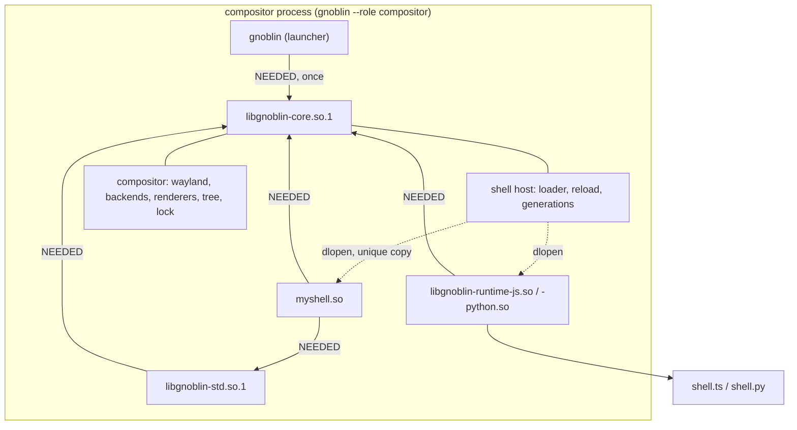

# Modular framework: core, std and shells

Status: design, lane Architect, branch `rust-compositor` (PR #339, draft). Written against `origin/rust-compositor` at
`17e44ef17`. The proof spike behind the linking, panic, reload and upgrade claims is recorded in
`design/modular-framework-spike.md`; every claim marked "spike" cites a command and output there. Claims marked
`[INFERENCE]` were read from code or knowledge and not run.

The owner's specification (condensed in `local://modular-brief.md` and the lane brief) is the authority. This file turns it
into crate names, an ABI, a loader, a discovery rule, a reload protocol, a migration order and a lane breakdown. Section 2
is the one decision list; the owner may overrule any row.

## 1. What changes, in one page

Today one executable `gnoblin` holds every role, the shell is a separate process (`--role runtime`, QuickJS) that talks to the
compositor over the owner socket, and the desktop policy (fallback window manager, built-in fades, portal dialogs, bell,
magnifier) is compiled into the compositor.

After this work:

- `libgnoblin-core.so.1` holds the compositor machinery, the shell host (loader, hot reload, supervision) and a small C ABI.
  `gnoblin` becomes a thin launcher that links it dynamically and also keeps the guardian and services roles.
- A shell is a module the shell host loads: a `.so` (any language that can export one symbol), or a `.py`, `.js`, `.mjs`,
  `.ts`, `.mts` file run by a language runtime library (`libgnoblin-runtime-python.so`, `libgnoblin-runtime-js.so`) that is
  itself a native module on the same ABI.
- The shell runs on its own thread inside the compositor process by default. `[shell] isolate = true` (or `--isolate`) runs the
  same host in a guardian-supervised child over today's owner socket.
- The ABI is addressed by schema names (classes, properties, methods, signals), not one C function per schema member. A new
  schema member needs no ABI change and no new symbol.
- `libgnoblin-std.so.1` (optional) holds the policy and the OOP desktop API: the fallback window manager, the default
  providers, then Client, Collection, Workspace, layouts, bindings, animation and styling. It links core and nothing links it
  back.
- Rust shells depend on the SDK crates `gnoblin-core` and `gnoblin-std`. They contain extern declarations and safe wrappers,
  never a copy of the implementation.

The wire contract does not change: the shell edits the node tree, claims chords and reads events. What changes is where the
transport ends (in-process queue instead of a socket) and who owns policy (std instead of core).

## 2. Decisions

One list. "Brief" is `local://modular-brief.md`. A row marked CHANGED differs from the brief. A row marked **Resolved** records a
choice the main agent made on the owner's behalf; the owner may still overrule it.

| #   | Decision                                                                                                                                                                                                                                                                            | Trade-off and what the owner can overrule                                                                                                                                                                                                                                                                                                                                                                                                                                                                                                                                                                                                                                                                      |
| --- | ----------------------------------------------------------------------------------------------------------------------------------------------------------------------------------------------------------------------------------------------------------------------------------- | -------------------------------------------------------------------------------------------------------------------------------------------------------------------------------------------------------------------------------------------------------------------------------------------------------------------------------------------------------------------------------------------------------------------------------------------------------------------------------------------------------------------------------------------------------------------------------------------------------------------------------------------------------------------------------------------------------------- |
| D1  | In-process shell on its own thread is the default; `isolate` runs the same host out of process.                                                                                                                                                                                     | Matches the spec (one core copy, no IPC latency). A native shell segfault ends the session. `isolate = true` restores today's containment. Overrule: make `isolate` the default (costs one frame of latency and a second core mapping in the child). **Resolved:** yes, in-process is the default (owner decision recorded by Main; the owner may still overrule).                                                                                                                                                                                                                                                                                                                                             |
| D2  | The core exports five direct symbols and one versioned function table (`gnoblin_get_api`). Everything else is reached through the table.                                                                                                                                            | A table gives additive growth, soft feature probing by `size`, and one place to generate. A direct symbol per verb gives ELF symbol versioning for free but a shell built against 1.1 then fails to load on 1.0 instead of degrading. Spike (6) shows both outcomes.                                                                                                                                                                                                                                                                                                                                                                                                                                           |
| D3  | The ABI is schema-addressed: classes, properties, methods and signals are interned by name at run time (`catalog_*`).                                                                                                                                                               | New schema members need no ABI change; per-member C functions would grow the table with every schema edit. Cost: a name lookup at start-up (cached by the SDK) and untyped values at the boundary; the SDKs and `gnoblin.d.ts` generate the typed layer. The catalog lists every namespace including the owner-only `tree`: it is metadata, not authority. The in-process shell host is the owner by construction, a module's operations are still decided by the owner socket's peer check and the observer rules, and `gnoblin-schema/tests/owner_only_tree.rs` lists `gnoblin-core-impl/build.rs` as an owner path while keeping every client-side crate, portal and service on the catalog without `tree`. |
| D4  | The tree mirror and the per-tick transaction builder live in core (one implementation). Language libraries query them through `node_get`/`node_children` and write through `write_*`.                                                                                               | One implementation for every language and no per-language mirror drift. Cost: the JS runtime's own mirror (`gnoblin-tree-client` inside `gnoblin-js`) is replaced by ABI calls in Phase 6, which is the largest single rewrite in the plan.                                                                                                                                                                                                                                                                                                                                                                                                                                                                    |
| D5  | CHANGED. SDK crate naming: `gnoblin-core` and `gnoblin-std` are the SDK crates (extern declarations and safe wrappers). The implementation crates are `gnoblin-core-impl` and `gnoblin-std-impl` (cdylib).                                                                          | The spec makes shells depend on `gnoblin-core = "1"`. The brief named the SDK `gnoblin-sdk`. Cost: "core" names two things; docs say "the core library" (`libgnoblin-core`) and "the core SDK crate". Section 4.2.                                                                                                                                                                                                                                                                                                                                                                                                                                                                                             |
| D6  | SONAMEs and installed file names use hyphens: `libgnoblin-core.so.1`, `libgnoblin-std.so.1`, set by the linker `-soname` argument and by dist renaming. Runtime modules are installed as `libgnoblin-runtime-js.so` and `libgnoblin-runtime-python.so` under `$libdir/gnoblin/`.    | Cargo derives artifact names from `[lib] name`, which cannot contain a hyphen, so the build emits `libgnoblin_core_impl.so` and `libgnoblin_std_impl.so` (build-internal underscore names); the spec names the installed files with hyphens and dist renames to match. **Resolved:** hyphens, as the spec says. Overrule: one-line change of the soname argument and the dist rename.                                                                                                                                                                                                                                                                                                                          |
| D7  | CHANGED. The lock card stays in core. The brief moved it to std.                                                                                                                                                                                                                    | A locked session with a dead or absent shell and no card is a black screen with no way back. It is the compositor's own recovery path and about 14 KB. Overrule: move it to std behind a provider and accept that a core-only shell must supply a lock screen. **Resolved:** the lock card stays in core.                                                                                                                                                                                                                                                                                                                                                                                                      |
| D8  | CHANGED. `gnoblin-js` stays a client-side crate. It is not linked into core and `client-side-isolation` does not change for it. It becomes `libgnoblin-runtime-js.so`, a module that speaks only the ABI.                                                                           | The scout report said `gnoblin-js` must leave `CLIENT_SIDE`. It need not: the runtime library is dlopened, never linked into the compositor. The deps graph keeps its strongest rule.                                                                                                                                                                                                                                                                                                                                                                                                                                                                                                                          |
| D9  | CHANGED. Renderers (`gnoblin-render-gles`, `-software`, `-vulkan`) and display backends stay inside `libgnoblin-core.so`, selected at run time. The spec's `libgnoblin-renderer-*.so` is not built in this plan.                                                                    | A renderer behind a C vtable puts an indirection on the hottest path and needs a stable GPU-object ABI that nobody asked for. Spec section 4 says not every module must be unloadable. Overrule: a later lane can split a renderer behind the existing traits. **Resolved:** renderers stay in core.                                                                                                                                                                                                                                                                                                                                                                                                           |
| D10 | CHANGED. Tree classes `camera`, `tween`, `effect`, `view`, `canvas` stay in core. They are the compositor's retained scene, not std's Camera2D/3D and timelines, which are objects built on them.                                                                                   | Removing them breaks the schema and the renderer. A shell that never creates one is a shell "with no scene graph"; example 8 proves it. Overrule is not realistic.                                                                                                                                                                                                                                                                                                                                                                                                                                                                                                                                             |
| D11 | The compositor-owned fade-in, fade-out and placement tween become a `MotionPolicy` setting. Core's default is none (instant). Std's installer sets today's 200 ms values.                                                                                                           | A core-only shell gets honest instant windows. The default desktop keeps its look because the packaged default shell links std. Overrule: keep the 200 ms default in core.                                                                                                                                                                                                                                                                                                                                                                                                                                                                                                                                     |
| D12 | The Python runtime is PyO3 against the system libpython, inside `libgnoblin-runtime-python.so`, one build per distro Python. RustPython and hand-written C-API code are rejected. Section 10.1.                                                                                     | Widest compatibility (C extensions, pip). Cost: a package per Python minor. Subinterpreters are not used for reload (PyO3 support is partial); reload purges user modules and re-runs the entry in a fresh namespace.                                                                                                                                                                                                                                                                                                                                                                                                                                                                                          |
| D13 | Import specifiers: `gnoblin-core` is the host bridge, `gnoblin-std` (and `gnoblin-std/<path>`) is the stock OOP library, installed as data files. The old `gnoblin` and `gnoblin/<path>` specifiers are removed.                                                                    | 0.2.0 is unreleased, so a clean cutover is cheap; an alias would be a shim. Cost: every doc example and the starter change in one commit. Overrule: keep `gnoblin` as an alias for `gnoblin-std`. **Resolved:** clean cutover to the `gnoblin-core` and `gnoblin-std` specifiers, no alias.                                                                                                                                                                                                                                                                                                                                                                                                                    |
| D14 | CHANGED. The conventional user shell name is `shell.<ext>`, so `init.ts`/`init.js` are renamed `shell.ts`/`shell.js` and `GNOBLIN_CONFIG` becomes `GNOBLIN_SHELL`. `config.toml` is new and holds only `[shell]`.                                                                   | The spec names `shell.so/py/js/ts` and `GNOBLIN_SHELL`. Today `init.ts` is both the shell and the configuration document source; config.toml does not exist in the Rust tree. Cost: docs, `gnoblinctl config init`, 16 test references. Overrule: accept both names. **Resolved (Main, built in lane Discovery): clean cutover to `shell.*` and `GNOBLIN_SHELL`, no alias; the owner may overrule.**                                                                                                                                                                                                                                                                                                           |
| D15 | Ambiguity is an error that lists the candidates; inside one tier a shell named `default` wins, otherwise exactly one candidate must exist.                                                                                                                                          | Spec allows "a deterministic documented rule". An error is easier to explain than an ordering. Cost: a user with `shell.so` and `shell.ts` sees an error once and fixes it. **Built in lane Discovery (`gnoblin-shell-discovery`): the rule applies per directory (each `XDG_DATA_DIRS` entry decides on its own), two forms of one name (`foo.so` and `foo.py`) are an ambiguity even for `default`, and a candidate whose launcher target is missing still counts as a candidate.**                                                                                                                                                                                                                          |
| D16 | Native hot reload copies the `.so` to a unique path, `dlopen`s it, and never `dlclose`s a retired generation. Core links with `-z nodelete`.                                                                                                                                        | Unloading code that a callback, a thread or a TLS destructor may still reach is the known crash source. Cost: one idle mapped copy per reload, bounded at 32 (then a reload is refused: restart), logged and shown; opt-in unload is proven, off. Section 17.                                                                                                                                                                                                                                                                                                                                                                                                                                                  |
| D17 | A retired generation's ABI calls return `E_RETIRED` and do nothing. Registrations are owned by a generation context and removed with it.                                                                                                                                            | Makes "no stale call into freed state" a property of the core instead of a convention shells must follow. Spike (5) proves it with a canary.                                                                                                                                                                                                                                                                                                                                                                                                                                                                                                                                                                   |
| D18 | The ABI major is 1 from the first commit, but the ABI is explicitly unstable until 0.2.0 ships. After that, minors are additive only and `abi.lock` in the ABI crate enforces it in CI.                                                                                             | The SONAME says `.1` per the spec, while the product is `0.2.0-alpha.0`. Overrule: SONAME `.0` until release. **Resolved:** SONAME `.1` now.                                                                                                                                                                                                                                                                                                                                                                                                                                                                                                                                                                   |
| D19 | The four SDK crates are structured to be published: `gnoblin-core-abi`, `gnoblin-core`, `gnoblin-macros`, `gnoblin-std`. SDK semver major equals the ABI major; a newer SDK on an older core degrades per function. They keep `publish = false` until the owner approves a release. | Cargo's `gnoblin-core = "1"` then always means "ABI 1, any minor". Cost: four crates leave the "never uploaded" rule in the workspace manifest. Overrule: keep them unpublished and vendor them (worse for authors). **Resolved:** keep `publish = false` for now; publishing a crate is an external action that needs the owner's approval, so the crates are laid out to be publishable and nothing is uploaded.                                                                                                                                                                                                                                                                                             |
| D20 | The custom shader pass (core gap G8) reverses owner decision O7 ("no user shader pass"). It is scheduled as the last step of Phase 7 (M7.9) and flagged to the owner.                                                                                                               | Needed for "control of rendering"; a WGSL effect kind is the narrow way. Overrule: leave it out; shells then render only through canvas, view and the three effects. **Resolved:** scheduled last, after every other Phase 7 step, so the owner can still veto it before any shader code lands.                                                                                                                                                                                                                                                                                                                                                                                                                |
| D21 | XR stays the out-of-process `extensions/gnoblin-xr` program (J7's first sentence stands; its "no `.so`" clause is reversed for everything else).                                                                                                                                    | An OpenXR runtime loads client code into the calling process and `xrWaitFrame` blocks (`design/xr-extension.md:105-107`). Overrule: an XR std library behind the ABI is possible later and is not planned here.                                                                                                                                                                                                                                                                                                                                                                                                                                                                                                |

**D7, proven end to end.** The JS library is two packages: the stock lock screen lives in `gnoblin-std`, so a shell that imports
only `gnoblin-core` draws none. The card in core is what keeps such a session from being a black screen with no way back, and
`crates/gnoblin/tests/js_lock_core_only.rs` proves it against the real compositor (the lock taken through the tree, keys on
the seat path of a real keyboard, the PAM test double). With a shell whose entry imports only `gnoblin-core` and holds the tree (it
places a window, which the tree shows), and with no shell at all: no lock screen is drawn, the card takes the password, an
empty and a wrong one never unlock, the right one does, a window that had the keyboard hears none of it and hears keys again
after the unlock. Everything the compositor told a core-only shell, and the tree after every key, holds neither the password
nor its bytes. What a core-only shell must know about the lock is nothing: it does not engage, beat or authenticate, and the
card appears. It took no change to the product. A stock shell whose screen throws, hangs or crashes is `js_lock_failures.rs`,
which still passes after the split. Release build, 20 runs, from the cover proven to the password accepted: a core-only shell
1.137 to 1.180 s (1 s of grace plus the half second the page allows), no shell 0.079 to 0.117 s; the page says what a core-only shell must know (`docs/session-lock.md`, "A shell on gnoblin-core only"), which is nothing. The takeover tests of the stock screen (`js_lock_boundary.rs`, `js_lock_bound.rs`) had stayed on
a shell with an empty `shell.ts`, which the split left without a lock screen; they now import `gnoblin-std`.

### 2.1 Reversals recorded

These earlier decisions said the opposite of what this plan does. Each gets a retraction note in its own file in the first
commit of Phase 1 (migration step M0.3), pointing here.

| Earlier decision                                                                                                                                      | What it said                                                                                                              | What replaces it                                                                                                                                                                                                                                      |
| ----------------------------------------------------------------------------------------------------------------------------------------------------- | ------------------------------------------------------------------------------------------------------------------------- | ----------------------------------------------------------------------------------------------------------------------------------------------------------------------------------------------------------------------------------------------------- |
| `design/rust-compositor.md` D6 (`:1902-1923`, "Native plugins: WASM modules"), tier-5 table row (`:75-78`)                                            | Third-party native code is WebAssembly, "not native libraries".                                                           | Shells are native `.so` modules or interpreted scripts on a stable C ABI. WebAssembly stays a non-goal (spec section 11). `gnoblin-wasm` is already deleted.                                                                                          |
| `design/rust-compositor.md` D22 option C (`:2898`, "In-process native plugins ... Rejected") and open decision 4 (`:3106`, "never for third parties") | A fault ends the session and Rust has no stable ABI.                                                                      | Both objections are answered: the ABI is C with a catch at every boundary (section 5.7), and isolation is opt-in (D1). D22 as a whole was already retracted (survey 16.3); this closes the one row still read as policy.                              |
| `design/rust-compositor.md` process table (`:164-188`)                                                                                                | "`--role compositor` ... runs no scripts"; "`--role runtime`" is the JavaScript role; "The roles stay in one executable". | The compositor process runs the shell host and so may run scripts and native shell code. `--role runtime` becomes `--role shell` (the isolated host). Roles stay in one executable; that executable now links a shared core.                          |
| `design/monolithic-compositor.md` acceptance (`:46`, "A fresh session install contains one compositor executable")                                    | One executable, nothing else of ours.                                                                                     | One executable `gnoblin` plus `libgnoblin-core.so.1` (required), `libgnoblin-std.so.1` and the runtime modules (optional). Still one compositor executable and no `gnoblin-mutter`. The file is legacy Mutter text; the note is added, not rewritten. |
| `design/js-runtime.md` J7 (`:61-63`) and `design/js-spec-native.md:341` ("there is no `.so`")                                                         | XR is an out-of-process program; "not a `.so` loaded into any process".                                                   | Only the XR sentence stands (D21). A `.so` shell is now a first-class shell.                                                                                                                                                                          |
| `design/js-runtime.md` J6 (`:55-59`), lock-screen trust note (`:79-80`)                                                                               | Layouts and bindings run "in the JS process"; the shell is the user's own process.                                        | A script shell runs on the shell thread inside the compositor by default. The lock-screen trust note changes: the lock card (D7) and the lease logic still protect a locked session from a hung shell; a crashed in-process shell ends the session.   |
| `docs/typescript-shell.md:114-115`                                                                                                                    | "The TypeScript shell is the only shell" and "the copy built into the binary".                                            | TypeScript is one of four languages; the stock library is installed data (D13).                                                                                                                                                                       |

### 2.2 Files that assume the old model

From `agent://ScoutPackaging` section 3, checked against the tree. Each is changed or deliberately kept by the migration step named.

| File or doc                                                                                                                                                                                                          | Assumes                                                                         | Step                                          |
| -------------------------------------------------------------------------------------------------------------------------------------------------------------------------------------------------------------------- | ------------------------------------------------------------------------------- | --------------------------------------------- |
| `crates/gnoblin/src/main.rs:9-17,34-42`, `src/role.rs:3-6,29,47-51`                                                                                                                                                  | four roles, one flag                                                            | M4.3                                          |
| `crates/gnoblin/tests/roles.rs:49,70,98-116`                                                                                                                                                                         | the role list, the three flags, `--role compositor`                             | M4.3                                          |
| `crates/gnoblin/tests/{guardian,js_guardian,js_lock*,js_runtime_role,js_shell,backend_selection}.rs`                                                                                                                 | `CARGO_BIN_EXE_gnoblin`, `--role runtime`, `GNOBLIN_CONFIG` (16 uses in crates) | M3.6, M4.3                                    |
| `crates/gnoblin/Cargo.toml:26-33`, `xtask/src/deps.rs:146-164,758-775` (`BINARY_ROOTS`, `binary-roots`)                                                                                                              | binary names compositor, session, js, services                                  | M2.7                                          |
| `xtask/src/deps.rs:34-69` (`FOUNDATION`, `ENGINE`), `:121-126` (`CLIENT_SIDE`)                                                                                                                                       | every crate is in a named set; new crates are unconstrained                     | M0.2                                          |
| `crates/gnoblin-session/src/supervisor.rs:566-570`, `plan.rs:161-175`                                                                                                                                                | runtime role is a `--role runtime` child                                        | M4.4                                          |
| `crates/gnoblin-js/src/host_api.rs:252-259`                                                                                                                                                                          | version sidecar found through `current_exe()`                                   | M6.2                                          |
| `crates/gnoblin-js/src/{stock.rs:3,18, build.rs:15-59}`                                                                                                                                                              | stock library embedded in the binary                                            | M6.3                                          |
| `crates/gnoblin-js/src/bytecode.rs:36-40,117-146`                                                                                                                                                                    | cache key from the lockfile versions of the linked engine                       | M6.4                                          |
| `crates/gnoblin-js/src/watch.rs`                                                                                                                                                                                     | extension filter `.ts/.mts/.js/.mjs`                                            | M5.5                                          |
| `crates/gnoblin-config/src/locate.rs`                                                                                                                                                                                | `GNOBLIN_CONFIG`, `init.ts`, `init.js`                                          | M4.2                                          |
| `Cargo.toml:3-8,119-126,232-237`, `CONTRIBUTING.md:111-115`                                                                                                                                                          | `unsafe_code = forbid`, comments on who links rquickjs                          | M2.1                                          |
| `justfile:100-103`, `xtask/src/dist.rs:81-150`, tests `:704-741`, `xtask/src/main.rs:21-38`                                                                                                                          | plain file copies of executables; no libs, headers, `.pc`, symlinks             | M2.9                                          |
| `xtask/src/native_libs.rs`, `scripts/ci-install-system-libraries.sh`, `.github/workflows/rust.yml`                                                                                                                   | `-sys` classification, jobs                                                     | M2.9, M7                                      |
| `design/dist-status.md:26-39`                                                                                                                                                                                        | install table (already stale against `dist.rs`)                                 | M2.9                                          |
| `design/rust-compositor.md:164-188, 1785, 1802, 1902-1930, 2898, 3105-3106`; `design/monolithic-compositor.md`; `design/js-runtime.md:55-63,79-80`; `design/js-spec-native.md:341`; `design/xr-extension.md:105-107` | the reversed decisions of section 2.1                                           | M0.3                                          |
| `docs/typescript-shell.md:114-115`, `docs/bring-your-own-shell.md`, `docs/build-a-desktop.md`, `docs/config/configure/config-files.md`, `docs/guides/files_and_load_order.md`                                        | one shell, `init.ts`, `GNOBLIN_CONFIG`                                          | M8.5                                          |
| `design/docs-parity/allow.toml`, `xtask/src/docs_parity.rs:21-26`                                                                                                                                                    | docs parity reads the TypeScript surface only                                   | M8.5                                          |
| `scripts/build-packages.sh`, `pkgsmith/*`, `nix/`, `design/{distribution,release-packaging}.md`                                                                                                                      | legacy Mutter build; none builds Rust                                           | untouched: Rust packaging is new (section 11) |
| `xtask/layout-allow.toml`, `xtask/dupes-allow.toml`                                                                                                                                                                  | per-crate waivers keyed by `crate::Type`; moves stale them                      | M1.x, as each type moves                      |

## 3. Layers



Three layers, the dependency arrow always pointing down: shells -> std -> core. A core-only shell links core alone and never maps std
(spike (3): `readelf -d` shows NEEDED `libgnoblin-core.so.1` only among ours). Language runtime libraries are ordinary modules on
the same ABI: they are not linked into core and not special to the loader beyond file-extension dispatch.

## 4. Crates

### 4.1 Graph

New crates in bold. Existing crates keep their directory and name; only the classification column changes where stated. `impl`
crates are the only place `unsafe` and `#[unsafe(no_mangle)]` live outside the existing FFI shims.

| Crate                                                                                                                                                                                                                               | Kind                               | Depends on (workspace crates)                                                                                                                             | Role                                                                                                                                                                                                                                                                                                                  |
| ----------------------------------------------------------------------------------------------------------------------------------------------------------------------------------------------------------------------------------- | ---------------------------------- | --------------------------------------------------------------------------------------------------------------------------------------------------------- | --------------------------------------------------------------------------------------------------------------------------------------------------------------------------------------------------------------------------------------------------------------------------------------------------------------------- |
| **`gnoblin-core-abi`**                                                                                                                                                                                                              | rlib, SDK tier, publishable        | none (`gnoblin-schema` as a build-dependency only)                                                                                                        | `#[repr(C)]` types, error codes, the function-table struct, version constants, `exports.txt`, `abi.lock`, generated schema constants and the C header.                                                                                                                                                                |
| **`gnoblin-macros`**                                                                                                                                                                                                                | proc-macro, SDK tier, publishable  | none                                                                                                                                                      | `#[gnoblin::main]`, `#[gnoblin::on(...)]`. Emits the `gnoshell_entry_v1` descriptor and the panic-catching trampolines.                                                                                                                                                                                               |
| **`gnoblin-core`**                                                                                                                                                                                                                  | rlib, SDK tier, publishable        | `gnoblin-core-abi`, `gnoblin-macros`                                                                                                                      | Safe Rust API for shell authors. `extern "C"` declarations, `build.rs` link stub, `Gnoblin`, `Node`, `Window`, events. Never names the implementation.                                                                                                                                                                |
| **`gnoblin-std`**                                                                                                                                                                                                                   | rlib, SDK tier, publishable        | `gnoblin-core`, `gnoblin-core-abi`                                                                                                                        | Safe Rust API over `libgnoblin-std.so.1`: `prelude`, `Workspace`, `Layout`, `Binding`, `Camera`. Same link-stub technique.                                                                                                                                                                                            |
| **`gnoblin-shell-discovery`**                                                                                                                                                                                                       | rlib, foundation                   | none                                                                                                                                                      | Pure: XDG paths, `config.toml [shell]`, launcher files, tiers, ambiguity, error text, `--list-shells` rows. No I/O beyond reading files it is handed.                                                                                                                                                                 |
| **`gnoblin-shell-host`**                                                                                                                                                                                                            | rlib, client side                  | `gnoblin-core-abi`, `gnoblin-log` (as built: the tree, model and proto crates stay with the language runtimes)                                            | Language-neutral host: generation contexts, registration tables, dispatch loop, the native loader with its bounded retire list, stage/commit/abandon and swap, strikes, spawn ownership, watcher. Generic over the event type. Section 17.                                                                            |
| **`gnoblin-wm-api`**                                                                                                                                                                                                                | rlib, foundation                   | `gnoblin-types`                                                                                                                                           | The window-manager provider trait, `WmEffect`, `WmOptions`/`FocusMode`/`DragConstraint` (moved from `gnoblin-wayland/src/policy.rs`).                                                                                                                                                                                 |
| **`gnoblin-std-wm`**                                                                                                                                                                                                                | rlib, std                          | `gnoblin-wm-api`, `gnoblin-types`                                                                                                                         | The fallback window manager (`fallback.rs`), cascade placement. Pure. The default provider.                                                                                                                                                                                                                           |
| **`gnoblin-core-impl`**                                                                                                                                                                                                             | cdylib + rlib, impl                | `gnoblin-compositor`, `gnoblin-shell-host`, `gnoblin-core-abi`, `gnoblin-shell-discovery`, `gnoblin-log`                                                  | `libgnoblin-core.so.1`. Implements every ABI function, `gnoblin_main`, the in-process `TreeLink`, provider adapters. Owns the SONAME and the link flags (`-z nodelete`, `-z defs`).                                                                                                                                   |
| **`gnoblin-std-impl`**                                                                                                                                                                                                              | cdylib + rlib, impl                | `gnoblin-core` (SDK), `gnoblin-std-wm`, `gnoblin-wm-api`, `gnoblin-animation`, `gnoblin-a11y`, `gnoblin-core-abi`                                         | `libgnoblin-std.so.1`. Std's own C table (`gnoblin_std_get_api`), registers the default providers into core through the ABI, then Workspace/layouts (Phase 7).                                                                                                                                                        |
| **`gnoblin-runtime-js`**                                                                                                                                                                                                            | cdylib, impl                       | `gnoblin-core` (SDK), `gnoblin-js`                                                                                                                        | `libgnoblin-runtime-js.so`. Exports `gnoruntime_entry_v1`; QuickJS and oxc are linked here, no longer in `gnoblin` or `gnoblinctl` check paths.                                                                                                                                                                       |
| **`gnoblin-runtime-python`**                                                                                                                                                                                                        | cdylib, impl                       | `gnoblin-core` (SDK), `gnoblin-std` (SDK, optional feature)                                                                                               | `libgnoblin-runtime-python.so`. PyO3; provides the built-in module `gnoblin._core` and `gnoblin._std`.                                                                                                                                                                                                                |
| **`examples/*`**                                                                                                                                                                                                                    | cdylib members                     | SDK crates                                                                                                                                                | The 18 required examples (section 12). Workspace members so `cargo build --workspace` builds them.                                                                                                                                                                                                                    |
| `gnoblin-compositor`                                                                                                                                                                                                                | rlib, engine root (unchanged name) | unchanged, minus std policy crates after M1                                                                                                               | Composition root. Gains `inproc_shell` (the in-process `TreeLink`). No longer linked by the `gnoblin` binary.                                                                                                                                                                                                         |
| `gnoblin` (bin)                                                                                                                                                                                                                     | bin, launcher                      | `gnoblin-session`, `gnoblin-services`, `gnoblin-compat-host`, `gnoblin-shell-discovery`, `gnoblin-log`                                                    | Guardian and services roles; dynamic link to core for `compositor` and `shell` roles. No `gnoblin-compositor`, no `gnoblin-js`.                                                                                                                                                                                       |
| `gnoblin-js`                                                                                                                                                                                                                        | rlib, client side (unchanged)      | unchanged in Phase 2; `gnoblin-shell-host` shares its reload code from M2.6; ABI client from M6.2                                                         | The JS engine: QuickJS, oxc, loader, stock library. Linked only into `gnoblin-runtime-js` and `gnoblinctl check/types`.                                                                                                                                                                                               |
| `gnoblin-wayland`, `-render`, `-backend*`, `-input*`, `-xwayland`, `-pipewire-export`, `-lock*`, `-output`, `-capture`, `-cursor`, `-secret`, `-log`, `-model`, `-proto`, `-schema`, `-types`, `-config`, `-client`, `-tree-client` | unchanged                          | unchanged                                                                                                                                                 | Core machinery, statically inside `libgnoblin-core.so`.                                                                                                                                                                                                                                                               |
| `gnoblin-animation`, `gnoblin-a11y`, `gnoblin-paint`, `gnoblin-portal*`                                                                                                                                                             | unchanged                          | unchanged                                                                                                                                                 | Classified std (a11y, portal UI) or core (animation easing under the scene tweens, paint under canvases). `gnoblin-portal-ui` becomes std-impl's slot provider in M1.9.                                                                                                                                               |

Removed edges: `gnoblin` -> `gnoblin-compositor`, `gnoblin` -> `gnoblin-js`, `gnoblin-compositor` -> any std-policy crate (after M2.10).

### 4.2 The `gnoblin-core` naming problem

Requirements that collide: shells write `gnoblin-core = "1"` in `Cargo.toml` (SDK); the artifact must be `libgnoblin-core.so.1`
(core library); one Cargo workspace cannot hold two packages named `gnoblin-core`.

Solution, in three parts:

1. **Package names.** The SDK crate is `gnoblin-core` (lib name `gnoblin_core`, rlib). The implementation crate is
   `gnoblin-core-impl` (lib name `gnoblin_core_impl`, `crate-type = ["cdylib", "rlib"]`). Same pair for std: `gnoblin-std` and
   `gnoblin-std-impl`.
2. **Artifact name is independent of the crate name.** The SONAME is a link argument (`-Wl,-soname,libgnoblin-core.so.1` from
   `gnoblin-core-impl/build.rs`). Cargo emits `libgnoblin_core_impl.so`; dist installs it as `libgnoblin-core.so.1.<minor>.<patch>`
   with the SONAME symlinks. There is precedent for an install-time rename: `pam_gnoblin_keyring.so` in `xtask/src/dist.rs`.
   Giving the implementation the lib name `gnoblin_core` would collide with the SDK in `cargo doc` output and in `--extern` names for
   any crate that sees both; the rename avoids it.
3. **The link-time name `-lgnoblin-core` resolves to a stub, not to the implementation.** Section 4.3.

Rust users never see `-impl`: they write `use gnoblin_core as gnoblin;` (the std prelude re-exports that alias, so
`#[gnoblin::main]` works) and `gnoblin-core = "1"`.

### 4.3 Cargo build order, and why it is not a problem

Problem: the `gnoblin` launcher and every SDK crate must link `-lgnoblin-core`, but Cargo has no artifact dependency on a cdylib
(`-Z bindeps` is unstable), and a build script runs before the dependency it would link is built.

Mechanism: **link against a generated stub that carries the SONAME.** Each linker (launcher `build.rs`, SDK `build.rs`) writes a tiny
C file defining the exported symbols listed in `gnoblin-core-abi/exports.txt`, runs `cc -shared -Wl,-soname,libgnoblin-core.so.1`
into `OUT_DIR`, and passes `-L OUT_DIR -lgnoblin-core`. The result records `NEEDED libgnoblin-core.so.1` and nothing else of
ours; at run time the dynamic loader resolves that name to the real installed core. No build ordering exists, so `cargo build -p
myshell` works on a machine that has no core built, and a shell author with an installed `-dev` package can set
`GNOBLIN_CORE_LIB_DIR` (or rely on pkg-config) to link the real library instead.

Costs, measured in the spike (results table, rows 2 and 3, and the "order" output): one extra `cc` run per linking crate (18 ms for a
three-symbol stub); a dependency on a C compiler, present wherever Rust links because rustc drives the link through `cc` (the spike's
linker was `rust-lld` behind it); and one invariant to test: the stub's symbol list must equal the real export list, which `xtask dist-check`
does by comparing `nm -D` of the real core with `exports.txt`. Running the launcher in the build tree needs the real core named
`libgnoblin-core.so.1` next to it (cargo emits `libgnoblin_core_impl.so`), so `cargo xtask stage` (and `just run`) builds
`-p gnoblin-core-impl -p gnoblin` and copies or symlinks it under the SONAME; the launcher's `build.rs` sets `-rpath $ORIGIN`. `cargo build -p gnoblin`
alone succeeds (0.5 s in the spike) and does not build the cdylib; the launcher then fails with the loader's own message,
`libgnoblin-core.so.1: cannot open shared object file`, which names the file. `cargo build --workspace` builds both.

Rejected alternatives:

- **A normal dependency edge from the launcher on the `cdylib`+`rlib` crate.** Measured: cargo then builds the cdylib too, but into
  `target/debug/deps/libgnoblin_core_impl.so` (not uplifted, not named by the SONAME), and compiles the implementation as an rlib for the
  dependent as well. In the real tree that is the whole compositor compiled as an rlib nobody links. It also needs an `impl` edge that
  `core-through-abi` forbids. It does not remove the need for the stub, because the link still needs a file called `libgnoblin-core.so`.
- A nested `cargo build` from `build.rs`: a second target directory, lock contention, doubled compile time.
- `dlopen` from the launcher with no NEEDED: fails the spec's "NEEDED once" check and hides a missing core until run time.

### 4.4 xtask dependency rule changes (`xtask/src/deps.rs`)

All edits land in M0.2 (new sets and rules, no crates yet, so nothing fails) and are completed in M2.7.

| Rule or set                            | Change                                                                                                                                                                                                                                                                                 |
| -------------------------------------- | -------------------------------------------------------------------------------------------------------------------------------------------------------------------------------------------------------------------------------------------------------------------------------------- |
| `FOUNDATION`                           | add `gnoblin-core-abi`, `gnoblin-wm-api`, `gnoblin-shell-discovery`.                                                                                                                                                                                                                   |
| new `SDK` set                          | `gnoblin-core-abi`, `gnoblin-macros`, `gnoblin-core`, `gnoblin-std`.                                                                                                                                                                                                                   |
| new `sdk-isolation`                    | an SDK crate names only SDK crates among workspace crates (build-dependency on `gnoblin-schema` allowed for `gnoblin-core-abi`). Guarantees a shell never compiles compositor code or a foundation crate into itself.                                                                  |
| new `IMPL` set, `impl-sealed`          | `gnoblin-core-impl`, `gnoblin-std-impl`, `gnoblin-runtime-js`, `gnoblin-runtime-python`: no crate may depend on an impl crate except as a dev-dependency (tests) and except `gnoblin-core-impl` -> its own lower crates.                                                               |
| new `impl-unsafe`                      | only impl crates, `gnoblin-core`, `gnoblin-macros`, and the existing FFI crates may omit `[lints] workspace = true`; each must restate the clippy table with `unsafe_code = "deny"` (the pattern at `Cargo.toml:119-124`).                                                             |
| `ENGINE`                               | unchanged; `gnoblin-wm-api` is foundation, so `engine-isolation` still bans engine-to-engine edges and `gnoblin-wayland` -> `gnoblin-wm-api` is a foundation edge.                                                                                                                     |
| `CLIENT_SIDE`                          | add `gnoblin-shell-host`. `gnoblin-js` stays (D8). New edge `gnoblin-compositor` -> `gnoblin-shell-host` is allowed (clients are hosted by the compositor, not the reverse).                                                                                                           |
| `binary-roots` / `BINARY_ROOTS`        | `gnoblin-session`, `gnoblin-services`, `gnoblin-shell-discovery`; remove `gnoblin-compositor`, `gnoblin-js`. New rule `core-through-abi`: the `gnoblin` binary may reach the compositor only through the stub link; no `gnoblin-core-impl` edge exists either.                         |
| new `std-below-core`                   | no foundation, engine, client-side or SDK(core) crate depends on `gnoblin-std*`, `gnoblin-wm-api` excepted (it is core-side by design). `gnoblin-std-wm` depends on `gnoblin-wm-api` and `gnoblin-types` only.                                                                         |
| `cursor-isolation`, portal rules       | unchanged. `PORTAL_ALLOWED` gets `gnoblin-std-impl` in M1.9 (the portal dialog UI crate is std's).                                                                                                                                                                                     |
| `log-features`                         | a cdylib counts as a binary for the sinks: `gnoblin-core-impl` may enable `init` (it installs the log for the compositor process). Add `IMPL` to the exemption.                                                                                                                        |
| new `profile-unwind` (not a deps rule) | `xtask` fails if any `[profile.*]` sets `panic = "abort"`; the SDK `build.rs` fails the shell build when `CARGO_CFG_PANIC=abort`.                                                                                                                                                      |
| `layout`, `dupes`                      | `xtask/layout-allow.toml` gets the stub `build.rs` paths if they name `src/`; ABI structs that mirror `Rect`/`Point` must reuse `gnoblin-types` or carry a `dupes-allow.toml` row (`gnoblin_core_abi::Rect`: one waiver, justified by `repr(C)`). Moved types (M1) restate their rows. |
| `native-libs`                          | add `pyo3`/`pyo3-ffi` (Python runtime) as `NATIVE` with `libpython3-dev` in `scripts/ci-install-system-libraries.sh`; QuickJS stays classified.                                                                                                                                        |
| new `abi-lock` check                   | `cargo xtask abi-check`: `crates/gnoblin-core-abi/abi.lock` (sorted exports, table field names/offsets, struct sizes, error codes) must be a prefix of the regenerated manifest. Additive diffs update the lock in the same commit; removals fail.                                     |
| new `dist-check`                       | section 11.                                                                                                                                                                                                                                                                            |

## 5. The C ABI

### 5.1 Shape

Two sides, both in `gnoblin-core-abi`:

- **Direct exports of `libgnoblin-core.so.1`**, listed in `exports.txt`. Nothing else is visible: rustc's own export script for a cdylib
  already ends in `local: *`, so `nm -D --defined-only` shows these and no `__rust_*`, no `rust_eh_*`. The core does **not** add a version script
  of its own: the spike (1) shows `rust-lld` rejecting the second script with `attempt to reassign symbol ... to version 'GNOBLIN_1'` and leaving the
  symbols unversioned anyway. `xtask dist-check` enforces "exactly `exports.txt`" instead.

    | Symbol                                                                     | Purpose                                                                                                                                                                                         |
    | -------------------------------------------------------------------------- | ----------------------------------------------------------------------------------------------------------------------------------------------------------------------------------------------- |
    | `gnoblin_abi_version(u32 *major, u32 *minor, u32 *patch)`                  | What the installed core is. Never fails.                                                                                                                                                        |
    | `gnoblin_get_api(u32 want_major, u32 built_minor, const GnoblinApi **out)` | Returns the function table. Refuses a different major with `E_ABI` and a last-error text naming both. A newer `built_minor` than the core's still succeeds; `size` tells which functions exist. |
    | `gnoblin_last_error(char *buf, size_t cap)`                                | Thread-local text of the last failure on this thread; returns the full length. Usable when `gnoblin_get_api` itself failed.                                                                     |
    | `gnoblin_main(int argc, char **argv)`                                      | Launcher entry (`--role compositor` and `--role shell`). Runs discovery, loads the shell, drives the loop, returns the exit code.                                                               |
    | `gnoblin_catalog_hash(void)`                                               | 64-bit hash of the schema catalog this core was built with. Cheap compatibility probe for generated SDK constants.                                                                              |

- **`GnoblinApi`**, a `#[repr(C)]` struct of function pointers whose first four fields are `size`, `major`, `minor`, `reserved`.
  Fields are appended, never moved, retyped or removed within a major. A caller checks a field with
  `offset_of(field) + size_of(field) <= api.size`. A newer core hands an older SDK a longer table, and an older core hands a newer
  SDK a shorter one; spike (6) runs both directions.

Why a table rather than one exported symbol per function (D2): the generator, the Python and JS runtimes, and the C header all
walk one struct; a function added in 1.3 is invisible to a shell built against 1.2 instead of changing its load behaviour; and
the exported-symbol surface that `nm` checks stays five lines long.

### 5.2 Handles, identity and ownership

| Thing                           | Representation                                                                                                   | Lifetime and validity                                                                                                                                           |
| ------------------------------- | ---------------------------------------------------------------------------------------------------------------- | --------------------------------------------------------------------------------------------------------------------------------------------------------------- |
| Generation context `GnoblinCtx` | `u64`, generation-tagged (`index:40, generation:24`).                                                            | Made by the loader, passed to the shell's `init`. Every table function takes it first. After the generation retires every call returns `E_RETIRED` (D17).       |
| Node                            | `u64` tree `NodeId`, the schema's id (zero is nil, never reused in one shell instance, `tree_mirror.rs:NodeId`). | Valid until the node is destroyed; a destroyed id returns `E_NO_SUCH_NODE`, never another node. Survives generation swaps (nodes belong to the shell instance). |
| Registration `GnoblinReg`       | `u64`, generation-tagged.                                                                                        | Owned by the context that made it. Removed by `remove(reg)` or with the context. A removed handle returns `E_STALE`.                                            |
| Class, property, method, signal | `u32` ids from `catalog_*`.                                                                                      | Valid for the life of the process; resolved by name, so an id is only meaningful against the core that issued it. The SDK resolves names once per `Gnoblin`.    |
| Pending call `GnoblinPending`   | `u64`.                                                                                                           | Resolved once through its callback; cancelled with its context.                                                                                                 |
| Process `GnoblinProc`           | `u64`.                                                                                                           | Owned by the generation that spawned it unless adopted (identical argv and options) by the next one, as `host_process` does today.                              |

Ownership rules, in force for every function:

1. No Rust type crosses the boundary: no `String`, `Vec`, `Box<dyn _>`, `Result`, `Option<Box<_>>`. Strings are `(ptr, len)` UTF-8,
   not NUL-terminated.
2. **Inputs are borrowed for the call.** Core copies what it keeps. The shell may free its argument the moment the call returns.
3. **Outputs are transient or owned, and the signature says which.** A `const T *` or `GnoblinStr` returned by a query is valid until the
   next ABI call on the same thread (it points into a per-thread arena). A `GnoblinBuf` is owned by the caller and freed by
   `buf_free`. Callback arguments are transient: valid until the callback returns.
4. **Each side frees what it allocated.** The workspace sets no `#[global_allocator]`, but the shell and the core are separate
   cdylibs with separate libstd copies; core never frees shell memory and the shell never frees core memory. The shell's `user`
   pointer and its `drop_user` callback are the one pairing: the core calls `drop_user(user)` exactly once, when the registration
   ends, on the shell thread, while the generation's code is still mapped (D16 guarantees it).
5. Values use one tagged struct, `GnoblinValue { u32 size; u32 kind; ... }`, one kind per `value_kind` of the schema (bool, int, uint,
   double, text, node, list, texts, effects, bytes) plus `secret`. The schema has no unions, so `kind` selects the fields
   (`messages.toml:299`). The `effects` list is an array of the `effect` record type, generated from the schema.
6. Structs passed in start with `u32 size` set by the caller; the core reads only that many bytes and defaults the rest. Structs
   passed out start with a `size` the core fills. This is the rule that makes a field addition source- and binary-compatible.

### 5.3 Errors

Every table function returns `i32`: zero is success, negative is an error code. Functions that return a handle return zero for
failure. The text is in `last_error`, per thread, UTF-8, and is never overwritten by a successful call.

| Code | Name             | Meaning                                                                                                            |
| ---- | ---------------- | ------------------------------------------------------------------------------------------------------------------ |
| 0    | `OK`             |                                                                                                                    |
| -1   | `ERR`            | Failure; see last error.                                                                                           |
| -2   | `PANIC`          | A panic was caught at this boundary (either side). The core logged it with the generation, function and message.   |
| -3   | `UNSUPPORTED`    | The function or catalog member is not in this core (older minor, or member removed from the schema).               |
| -4   | `ABI`            | Major mismatch or malformed `size`.                                                                                |
| -5   | `LOAD`           | A module failed to load or initialise (loader errors).                                                             |
| -6   | `STALE`          | A handle that was removed or whose generation has ended.                                                           |
| -7   | `RETIRED`        | The calling generation has been retired; the call did nothing.                                                     |
| -8   | `NO_SUCH_NODE`   | Node id not in the mirror (destroyed or never existed).                                                            |
| -9   | `NO_SUCH_MEMBER` | Class, property, method or signal not in the catalog, or not a member of that class.                               |
| -10  | `TYPE`           | A value of the wrong `kind` for the member.                                                                        |
| -11  | `REFUSED`        | The compositor refused it (the schema's refusal codes: `shell-already-attached`, stale serial, locked, not owner). |
| -12  | `THREAD`         | A shell-thread-only function was called from another thread.                                                       |
| -13  | `BUSY`           | A single-holder resource is taken (second tree attach, second claim of one chord).                                 |
| -14  | `TIMEOUT`        | A deadline passed (boot wait, init budget).                                                                        |

The refusal strings the compositor already produces (`wire::code`) are carried verbatim in the last-error text after a `REFUSED`.

### 5.4 Threads

Three kinds of thread meet at the ABI:

| Thread            | What runs there                                                                                                    | Rule                                                                                                                                                |
| ----------------- | ------------------------------------------------------------------------------------------------------------------ | --------------------------------------------------------------------------------------------------------------------------------------------------- |
| Compositor thread | Smithay, calloop, the frame, the scene. Applies queued transactions at frame start (4 ms budget, `tree_frame.rs`). | **Never runs shell code.** A hung or slow shell cannot stall a frame; the lock-card lease (`LOCK_UI_LEASE_MS` 2 s) lapses and the card takes over.  |
| Shell thread      | Every shell callback, `init`, `shutdown`, timers, the dispatch loop. One per shell instance.                       | The shell sees a single-threaded world. All table functions except those marked ANY are shell-thread only; elsewhere they return `E_THREAD`.        |
| Other threads     | Threads the shell starts, the watcher, services.                                                                   | May call only `log`, `post`, `wake_fd`, `last_error`, `buf_free`. To act on the shell's world, `post(ctx, fn, user)` a closure to the shell thread. |

Callback delivery model: the compositor publishes each frame's `TreeBatch` and events into the shell's mailbox (a lock-free queue
plus an eventfd) from the compositor thread; the shell thread drains it in `dispatch`. Delivery order is arrival order, one
batch per frame is applied to the mirror before any callback of that batch runs, and callbacks of one event run in registration order.
Callbacks run to completion on the shell thread; there is no re-entrancy into `dispatch`. `remove` and `remove_owner` called
from inside a callback defer the `drop_user` call until that callback returns (spike core does this). Transactions are queued from
the shell thread with `TreeQueue::submit`, which is `Send + Clone` and wakes the frame loop (`tree_frame.rs:507-557`), exactly as the
IPC dispatcher uses it today.

A shell that owns its own event loop (tokio, GLib) sets `foreign_loop` in its entry descriptor, receives `wake_fd`, and calls
`dispatch(ctx, 0)` when it is readable. Default shells never see the loop.

Budgets: `init` has a 5 s wall deadline (`BOOT_WAIT`, today's constant). Native code cannot be interrupted, so a callback that runs
longer than 2 s is logged once with the registration and generation, counted as a strike against the generation (the existing
`JsSupervisor` policy: three strikes in 30 s latch `Degraded` and the last good generation is kept after a reload), and visible in
`gnoblinctl shell status`. Script runtimes keep their own interrupt budgets inside the runtime module.

### 5.5 Callback registration and removal by generation

Every registering function takes `ctx`; the core records the owner in the registration. There is no owner argument to get wrong.

- `on_signal`, `on_change`, `on_node_created`, `on_node_destroyed`, `timer_add`, `on_shutdown`, `claim_*` (seat claims),
  `subscribe`, `provider_register` and `spawn` all create registrations owned by the context.
- **Staged registrations are inactive.** During a reload, registrations made by the new generation's `init` are recorded but receive
  nothing until commit; abandon discards them without a call.
- At retire the core runs the context's `on_shutdown` hooks, removes every registration (calling each `drop_user`), releases its seat
  claims, cancels its pending calls and timers, then marks the context retired. Spike (5): after retire, 5 events delivered; the old
  generation's call counter stays at its pre-retire value and its drop counter equals its registration count.
- An event already dequeued for a registration that has since been removed is not delivered (removed-before-call check in the dispatch loop).

### 5.6 Secret text

`GnoblinValue` kind `secret` and the `secret`-flagged schema members carry `{ptr, len}`. On the way in, the core copies the bytes into a
`SecretText` (`gnoblin-secret`, zeroed on drop, `Debug` redacted) and the SDK zeroes its own buffer after the call (`Secret::new`
takes ownership of a `Vec<u8>` or `&mut [u8]`). On the way out, the compositor sends a secret only to the shell holding the member's
claim and only as a `secret` value; a callback that receives one must copy it out before returning (it is transient and zeroed by
the core after the callback). Log lines, `last_error` and trace output never contain the bytes of any value whose member the schema
marks `secret`; they print `<redacted N bytes>`. The wire's `FLAG_SENSITIVE` bit is the same schema-derived table
(`envelope.rs`).

### 5.7 Panics and exceptions

`panic = "unwind"` is required for core and shells (D1 consequence: the JS strike policy depends on unwinding through host frames,
`supervisor.rs:1-6`). Rust 1.81 and later abort when a panic leaves an `extern "C"` function, so containment is built in layers:

1. **Every core export and table function** body runs inside `catch_unwind` (`guard()` in the spike). A panic becomes `E_PANIC`, a
   `last_error` text and a log line from the core's logger. Spike (4): `selftest_panic` returns `-2` and
   `panic in core export selftest_panic: selftest panic inside the core export` appears on stderr.
2. **Every callback the shell hands the core** is a trampoline generated by the SDK (`gnoblin-macros`, or `tramp<F>` in the spike).
   It wraps the user closure in `catch_unwind` _inside the shell's own libstd_, reports the message through `report_panic(ctx, ...)` so the
   core's logger records it with the generation, and returns `E_PANIC`. A panic never unwinds across two libstd copies. Spike (4):
   `PANIC in shell generation N: boom from the shell callback`, then the core line `callback of registration R panicked; contained`,
   and the next event is still delivered.
3. The core also wraps each callback call in `catch_unwind`, so a callback declared `extern "C-unwind"` by a non-SDK shell still cannot take
   the dispatch loop down.
4. **Other languages.** The Python and JS runtimes convert an exception into a logged error plus `E_PANIC` at their own boundary
   (the existing `call_budgeted` and error remapping in `gnoblin-js`). A C shell must not longjmp or unwind through the table.
5. The panic hook (`gnoblin-log/init.rs:130`) is process-global and lives in the core. A shell's libstd has its own hook slot, which the
   SDK points at `report_panic`, so a panic outside a trampoline (a shell thread) is also logged by the core.
6. A segfault, abort or stack overflow in native shell code is not containable in process. It ends the compositor, and with a session lock
   engaged the session ends (fail closed: the guardian's `EndsSession` policy for the compositor). `isolate` exists for this.

### 5.8 Versioning and compatibility policy

| Change                                         | Allowed in a minor?           | How                                                                                                                                             |
| ---------------------------------------------- | ----------------------------- | ----------------------------------------------------------------------------------------------------------------------------------------------- |
| New table field (function)                     | yes                           | Appended; `size` grows; the SDK probes with `offset_of`.                                                                                        |
| New schema class or member                     | yes                           | No ABI change. Appears in the catalog; old SDKs ignore it. `catalog_hash` differs.                                                              |
| New error code, new `kind` value, new flag bit | yes                           | Callers must treat unknown codes as `ERR` and unknown kinds as `UNSUPPORTED`.                                                                   |
| New exported symbol                            | yes, rarely                   | Appended to `exports.txt` and `abi.lock`; a shell that references it will not load on an older core (clear `ld.so` text). Prefer a table field. |
| Reorder, resize, retype, or remove a field     | no (major)                    | A removed function keeps its slot as a stub returning `E_UNSUPPORTED` until the next major.                                                     |
| Change the meaning of an existing call         | no (major)                    |                                                                                                                                                 |
| Schema member removed                          | no (schema's own deprecation) | `E_NO_SUCH_MEMBER` at run time; the schema's version rule applies (`version.rs`: caret rule).                                                   |

SDK crates: semver major equals the ABI major. An SDK built against 1.3 that finds a 1.1 core runs; functions added in 1.2 and 1.3 return
`E_UNSUPPORTED` through safe wrappers that return `Result` (`Err(Unsupported)`). The SDK checks `gnoblin_abi_version` at `init` and, on a
major mismatch, the shell fails to load with `incompatible ABI: this shell was built for gnoblin ABI 1.x; the installed core is 2.0`.
`abi.lock` (D18, M2.1) is the CI-enforced contract; a golden shell `.so` built from the first ABI commit is kept under
`tests/modular/golden/` (small, regenerated only by an owner, hash in the file) and run against every later core (example 12).

### 5.9 Function families

Names are table fields. `T` = thread (`S` shell thread, `A` any). Return `i32` unless stated. The full signatures are generated into
`include/gnoblin/core.h`; this table fixes the surface.

| Family      | Function                                                                                        | T   | Notes                                                                                                                                                                                         |
| ----------- | ----------------------------------------------------------------------------------------------- | --- | --------------------------------------------------------------------------------------------------------------------------------------------------------------------------------------------- |
| Lifecycle   | `ctx_info(ctx, GnoblinCtxInfo *)`                                                               | S   | Generation number, module path, language, reload count, state dir, whether `isolate`.                                                                                                         |
|             | `log(ctx, level, msg, len)`                                                                     | A   | Goes to `gnoblin-log` with the generation as the target. The only ABI function for output.                                                                                                    |
|             | `report_panic(ctx, msg, len)`                                                                   | A   | Used by trampolines.                                                                                                                                                                          |
|             | `on_shutdown(ctx, cb, user, drop)` -> reg                                                       | S   | Runs at retire and at exit, before registrations are removed.                                                                                                                                 |
|             | `request_reload(ctx)`, `request_exit(ctx, code)`                                                | A   | Posted to the host.                                                                                                                                                                           |
| Memory      | `buf_free(GnoblinBuf *)`, `value_free(GnoblinValue *)`                                          | A   | For owned outputs only.                                                                                                                                                                       |
| Catalog     | `catalog_class(ctx, name, len)` -> class id                                                     | S   | Interns a class name.                                                                                                                                                                         |
|             | `catalog_member(ctx, class, kind, name, len, GnoblinMember *)`                                  | S   | Property, method or signal; fills id, `value_kind`, flags (`animated`, `readonly`, `secret`), argument kinds.                                                                                 |
|             | `catalog_each(ctx, class, kind, cb, user)`                                                      | S   | Enumerates members; used by the runtimes to build their objects.                                                                                                                              |
| Tree read   | `tree_attach(ctx, mode)`                                                                        | S   | `holder` or `observer`; `E_BUSY` if another holder (`shell-already-attached`). Blocks up to the boot wait for the snapshot.                                                                   |
|             | `node_exists`, `node_class`, `node_parent`, `node_children(GnoblinNodes *)`                     | S   | Mirror reads.                                                                                                                                                                                 |
|             | `node_get(ctx, node, prop, GnoblinValue *)`                                                     | S   | Reads through the per-tick overlay, so a write in this tick is visible (as `TxBuilder` does).                                                                                                 |
| Tree write  | `write_create(ctx, class, GnoblinNode *)`, `write_destroy`, `write_insert(parent, node, index)` | S   | Implicit per-tick transaction, committed when the dispatch cycle ends; one in flight; stale retries up to 3 (`JsShell` rule).                                                                 |
|             | `write_set(ctx, node, prop, const GnoblinValue *, seconds)`                                     | S   | `seconds > 0` on an `animated` property starts the compositor tween.                                                                                                                          |
|             | `write_call(ctx, node, method, args, n, cb, user, drop)` -> pending                             | S   | Methods: `window.focus/close`, `screen.apply`, `seat.claim`, ... Answer arrives through `cb`.                                                                                                 |
|             | `flush(ctx, cb, user, drop)` -> pending                                                         | S   | Commit now; `cb` gets the serial or the refusal.                                                                                                                                              |
| Events      | `on_signal(ctx, node_or_0, class, signal, cb, user, drop)` -> reg                               | S   | `node = 0` means any node of the class. Covers `chord`, `gesture`, `pointer_chord`, `event` (window requests), `destroyed`, `lock.requested`.                                                 |
|             | `on_change(ctx, node_or_0, class, prop, cb, user, drop)` -> reg                                 | S   | Property observation from the change batches.                                                                                                                                                 |
|             | `on_node_created(ctx, class, cb, user, drop)` -> reg                                            | S   | Windows appearing (`client_created`).                                                                                                                                                         |
|             | `remove(reg)`, `remove_owner` is internal                                                       | S   | `drop_user` is deferred while the callback runs.                                                                                                                                              |
| Verbs       | `call(ctx, ns, object, member, args, n, cb, user, drop)` -> pending                             | S   | `gnoblin` namespace: `session.logout/power`, `config.commit/current/reload`, `idle.hold`, slot claims and answers. Names resolved from the schema like tree members.                          |
|             | `subscribe(ctx, ns, object, signal, cb, user, drop)` -> reg                                     | S   | `session.reload_requested`, `lock_state_changed`, `request` signals.                                                                                                                          |
| Loop        | `dispatch(ctx, timeout_ms)`, `wake_fd(ctx)`                                                     | S/A | Foreign-loop mode only.                                                                                                                                                                       |
|             | `post(ctx, fn, user)`                                                                           | A   | Run `fn(user)` on the shell thread.                                                                                                                                                           |
|             | `timer_add(ctx, ms, repeat, cb, user, drop)` -> reg                                             | S   |                                                                                                                                                                                               |
| Processes   | `spawn(ctx, argv, n, GnoblinSpawn *, on_exit, user, drop)` -> proc                              | S   | Ownership per generation, adoption on identical argv, process group (`host_process` semantics).                                                                                               |
|             | `proc_kill(proc, signal)`                                                                       | S   |                                                                                                                                                                                               |
| State       | `state_put(ctx, key, bytes, len, version)`, `state_get(ctx, key, GnoblinBuf *, u32 *version)`   | S   | Retained across reloads of this shell instance, dropped at restart; 16 MiB cap.                                                                                                               |
| Providers   | `provider_register(ctx, kind, const void *vtable, user)` -> reg                                 | S   | Kinds: `WM` (core gap G2), `SLOT_UI` (portal dialogs). A provider is owned by the generation or, for std's defaults, by the std context. Vtables are C structs defined in `gnoblin-core-abi`. |
| Policy      | `setting_set(ctx, key, GnoblinValue *)`, `setting_get`                                          | S   | Compositor policy knobs that are not tree members (`window.motion`, see G3).                                                                                                                  |
| Diagnostics | `stats(ctx, GnoblinStats *)`                                                                    | A   | Callbacks, strikes, retired generations, stale calls rejected.                                                                                                                                |

About 40 functions. Seat input grabs, cursor control, frame policy and layer geometry (gaps G4 to G7) add no function: they are schema members
(`seat.grab`, `seat.cursor`, `window.frame_policy`, ...) reached by `write_call`/`write_set`.

### 5.10 Shell entry descriptor and module kinds

A native shell exports one symbol, `gnoshell_entry_v1`, returning a pointer to a static `ShellEntry` (spike): `abi_major`,
`abi_minor_built`, `init(api, ctx)`, `shutdown(ctx)`, optional `stats`, a label and flags (`foreign_loop`). The prefix is `gnoshell_`,
not `gnoblin_`, so "the core's symbols are the only `gnoblin_*` in the process" is a checkable invariant. The SDK's `build.rs` passes a
version script that exports only that symbol (a shell has no rustc-script conflict only because the SDK passes the one script; the spike's shell crates do exactly this), so `nm -D --defined-only myshell.so` shows one line.

A language runtime exports `gnoruntime_entry_v1` returning a `RuntimeEntry` with `abi_major`, `name`, the extensions it handles, and
`start(api, ctx, script_path)` / `shutdown(ctx)`. A runtime is loaded with the same unique-copy `dlopen` path and sits between the loader
and the script: the generation's context belongs to the runtime module, and the runtime creates a fresh interpreter generation inside
it (section 8.2).

## 6. Module loader and language dispatch

Lives in `gnoblin-shell-host` (logic) and `gnoblin-core-impl` (the `dlopen`/`dlsym` shims, the only `unsafe`).

Detection takes the resolved file and decides by content first and extension second. Nothing reads a shebang.

| Step | Test                                                                   | Result                                                                                                                                                                                                             |
| ---- | ---------------------------------------------------------------------- | ------------------------------------------------------------------------------------------------------------------------------------------------------------------------------------------------------------------ |
| 1    | `language = "..."` in the launcher file or `[shell]`                   | wins; one of `native`, `python`, `js`, `ts`.                                                                                                                                                                       |
| 2    | the first four bytes are `\x7fELF`                                     | native (covers `libx.so`, `libx.so.1`, `target/debug/libmyshell.so`).                                                                                                                                              |
| 3    | extension `.so`                                                        | native (an unreadable file is a `LOAD` error, not a language error).                                                                                                                                               |
| 4    | `.py` -> python; `.js`, `.mjs` -> js; `.ts`, `.mts` -> ts (js runtime) | runtime `libgnoblin-runtime-<lang>.so`.                                                                                                                                                                            |
| 5    | any other extension `.X`                                               | look for `libgnoblin-runtime-X.so` in the runtime directories; if present it is the runtime (adding Lua needs no change to gnoblin). Otherwise the error lists the known extensions and the `language =` override. |

Runtime directories, in order: `$GNOBLIN_RUNTIME_DIR`, `<core libdir>/gnoblin/` (found with `dladdr` on a core symbol, so a relocated prefix
works). There is no other search and no registry.

Native load, step by step (this is what the spike runs):

1. Copy the module to `$XDG_RUNTIME_DIR/gnoblin/<pid>/gen-<n>-<name>` (mode 0700 directory; `/tmp` fallback with `O_EXCL`).
2. `dlopen(copy, RTLD_NOW | RTLD_LOCAL)`. The copy is unlinked immediately; the mapping keeps the inode. `RTLD_LOCAL` keeps a shell's symbols out
   of the global scope, so two generations never interpose. Core, being a NEEDED of the launcher, is already global.
3. `dlsym("gnoshell_entry_v1")`; absent -> `LOAD` error "not a gnoblin shell".
4. Check `abi_major == core major`. A descriptor built against a newer minor than the core is accepted: the shell probes the table's `size`.
5. Call `init(api, ctx)` under `catch_unwind` with the 5 s deadline. A non-zero return, a panic or a timeout is a load failure; whatever `init`
   registered is removed with its context.
6. A failed or retired module is never `dlclose`d (D16), and the number kept is bounded (section 17). A module that wants unloading may export `gnoshell_unload_safe`; `try_unload` honours it only when the policy allows (default off).

Same-path `dlopen` returns the same handle and shares statics (spike (5): "same path twice: handles equal = true"), which is why a reload
must copy.

## 7. Discovery

Implemented once in `gnoblin-shell-discovery`, used by the launcher (so errors appear before a compositor starts), by core
(`--list-shells`, reload), and by `gnoblinctl shell list`.

### 7.1 Command line

```text
gnoblin [--shell NAME] [--watch] [--isolate] [--list-shells] [PATH]
```

`PATH` is always a path (relative to the working directory, so `./myshell.so` and `myshell.py` both work). `--shell NAME` is always a
name. The two together are a usage error. `--watch` with no `PATH` watches whichever shell discovery selects. `--role` stays for the
guardian's children and is hidden from `--help`'s shell section. A bare word with no `/` that is not an existing file is an error that
says `did you mean --shell NAME?`.

### 7.2 Tiers

First tier that yields exactly one shell wins; a tier that yields several is an ambiguity error (7.4); a tier that yields none is skipped.

| Tier | Source                                                                                                                         | Name or path resolution                                                                                                                                                                             |
| ---- | ------------------------------------------------------------------------------------------------------------------------------ | --------------------------------------------------------------------------------------------------------------------------------------------------------------------------------------------------- |
| 1    | CLI `PATH`, or `--shell NAME`                                                                                                  | `PATH` as given. `NAME` resolved in tiers 5, 6 and 7 (the packaged default is the shell named `default`). A name found nowhere is an error; discovery does not fall through on an explicit request. |
| 2    | `GNOBLIN_SHELL`                                                                                                                | Contains `/` -> a path (relative to the working directory). Otherwise a name, as `--shell`. Set but empty -> ignored. Set and unresolvable -> error, no fall through.                               |
| 3    | `$XDG_CONFIG_HOME/gnoblin/config.toml`, `[shell] default = "name"` or `[shell] path = "..."`                                   | `default` is a name (tiers 5, 6 and 7). `path` is absolute, `~/...`, or relative to the directory holding `config.toml`. Both keys set -> error. Unresolvable -> error.                             |
| 4    | `$XDG_CONFIG_HOME/gnoblin/shell.so`, `shell.py`, `shell.js`, `shell.mjs`, `shell.ts`, `shell.mts`                              | The files that exist. `shell.so` and `shell.ts` together are an ambiguity.                                                                                                                          |
| 5    | `$XDG_DATA_HOME/gnoblin/shells/` (default `~/.local/share`)                                                                    | Entries of 7.3. Several distinct names -> the one named `default` wins; else ambiguity.                                                                                                             |
| 6    | each `$XDG_DATA_DIRS` entry in order (default `/usr/local/share:/usr/share`), `/gnoblin/shells/`                               | Each directory is its own sub-tier; the first with any entry decides, by the tier-5 rule. This is XDG precedence: an earlier directory shadows a later one.                                         |
| 7    | the packaged default: `<prefix>/share/gnoblin/default-shell/shell.<ext>`, with `<prefix>` taken from the executable's location | Not looked up through `XDG_DATA_DIRS`, so a relocated or `/opt` prefix still finds it. It is what `gnoblin` runs on a fresh install.                                                                |

`$XDG_CONFIG_HOME`, `$XDG_DATA_HOME` and the entries of `$XDG_DATA_DIRS` follow the rule that was in `locate.rs`: a relative value is invalid and
ignored; the defaults are `$HOME/.config`, `$HOME/.local/share` and `/usr/local/share:/usr/share`. `config.toml` has one table, `[shell]`, with keys
`default`, `path`, `language` and `isolate`; unknown keys are a warning, not an error. `isolate` is the only key read when the shell came from a
higher tier, and a `config.toml` that cannot be parsed is then a warning; it is an error only when the lookup reaches tier 3. `[shell] language`
overrides detection for the shell that tier 3 selects. A path that is a directory holding `shell.<ext>`, or a `name.toml` launcher, is accepted
wherever a path is (tiers 1 to 3), and a file that starts with the ELF magic is native whatever it is called.

### 7.3 Installed shell entries

In a `shells/` directory a shell is one of: a module file (`name.so`, `name.py`, `name.js`, `name.mjs`, `name.ts`, `name.mts`), a directory
`name/` containing `shell.<ext>` (for multi-file Python or TypeScript shells), a symlink to either, or a **launcher file** `name.toml`:

```toml
# /usr/share/gnoblin/shells/tiler.toml: a lightweight reference, not a manifest. Every key is optional but one path key.
module = "tiler/libtiler.so"      # relative to <core libdir>/gnoblin/shells/ (arch-correct, multiarch-safe)
# path = "/opt/tiler/shell.py"    # alternative: absolute, or relative to this file
# language = "native"             # only to override detection
description = "A tiling shell"
```

The name is the file stem (the link's own name for a symlink, the directory name for a directory). Two entries with one name in one directory (`foo.so`
and `foo.py`, or `foo.toml` and `foo.ts`) are an ambiguity inside that directory. The same name in an earlier tier shadows a later one;
`--list-shells` prints the shadowed copy marked `shadowed`. A relative `path` in a launcher is relative to the directory of the launcher file itself
with symlinks resolved, so a link to a launcher in a source tree keeps working; `module` needs the library directory, which the launcher supplies
(`Environment::module_dir`, found with `dladdr`) because discovery cannot. A launcher whose target is missing is still a candidate, with the
reason attached: it takes part in the ambiguity rule, and choosing it is an error that names the target.

### 7.4 `--list-shells`, errors

`gnoblin --list-shells` prints one row per entry in all tiers, in precedence order, exit 0, and marks the one that would run:

```text
NAME      TIER  LANGUAGE  DEFAULT  LOCATION
tiler     5     native    yes      /home/kieran/.local/share/gnoblin/shells/tiler.toml -> .../libtiler.so
lines     6     python             /usr/share/gnoblin/shells/lines.py
default   7     ts                 /usr/share/gnoblin/default-shell/shell.ts   (packaged)
```

Failure text is one block, exit 1, and the compositor never starts (the guardian sees the exit and reports it; no blank screen):

```text
gnoblin: no shell found.

Looked in this order:
  1. command line            not given
  2. GNOBLIN_SHELL           not set
  3. /home/k/.config/gnoblin/config.toml   missing
  4. /home/k/.config/gnoblin/shell.{so,py,js,mjs,ts,mts}   none present
  5. /home/k/.local/share/gnoblin/shells/  empty
  6. /usr/local/share/gnoblin/shells/  missing;  /usr/share/gnoblin/shells/  empty
  7. /usr/share/gnoblin/default-shell/shell.*   not installed

Run a shell directly:     gnoblin ./myshell.so
Pick an installed shell:  gnoblin --shell NAME    (gnoblin --list-shells)
Set a default:            [shell] default = "NAME"  in /home/k/.config/gnoblin/config.toml
```

An ambiguity prints `several shells are equally preferred:` and the candidate list (name, where it is, `-> target` for a launcher or a
directory, and the language), then, for an ambiguity found by the tiers, the same "Looked in this order" block (the ambiguous tier says `N shells`,
later tiers `not reached`), then the same three remedies; an ambiguity in an explicit request has no such block. A named shell that does not
exist prints `no shell named "x"`, the nearest installed name when one is within two edits, the installed shells with where they are, and
the directories it looked in. A bare word with no `/` that is not a file prints `Did you mean --shell word?`. The texts are pinned word for word
by `crates/gnoblin-shell-discovery/tests/errors.rs`; the launcher prints `gnoblin: ` before the `Display` of `DiscoveryError`. A
shell that loads but fails (`init` error, ABI
mismatch, missing library) prints the loader's text: for a missing library, the `dlopen` message verbatim plus `readelf -d` NEEDED
hint; for an ABI mismatch, both versions; for a script exception, the remapped `file:line:column`.

Argumentless `gnoblin` and `gnoblin ./x` run the identical code path from the point where the tiers have produced a module (spec 5.4): the
only difference is which tier answered.

## 8. Hot reload

### 8.1 Native modules

Trigger: `--watch` (inotify on the module file and, for a launcher file, its target; 100 ms quiet debounce, the existing `ConfigWatcher`
constants) or `session.reload_requested` or `gnoblinctl shell reload`. The reload runs on the shell thread between dispatches.

1. Stage: unique copy, `dlopen`, entry check, `begin_stage` (the existing rollback mark: pending writes, claims, spawns, canvases are
   recorded so they can be dropped).
2. `init(ctx_new)` under the 5 s budget. Registrations are staged (inactive).
3. Failure at step 1 or 2: `abandon_stage`, remove the new context's registrations, keep the old generation untouched, log
   `reload of /x/libmyshell.so failed, still running generation 3: <reason>`. The failed library stays mapped (retire list); the next change retries.
   Nothing a failed `init` already did outside the ABI (spawned a process, wrote a file) is undone, and the log says so (spec 6.4).
4. Commit: run the old context's `on_shutdown` hooks; release the old claims and send the new claims behind the releases in one transaction
   (the "release first, claim behind" order of `shell/mod.rs:337-401`); activate the new context's registrations; adopt spawns with identical
   argv; `reconcile(previous)`.
5. Retire the old context: remove its registrations (each `drop_user` runs), mark it `RETIRED` so any call from its code returns `E_RETIRED`,
   push its library handle on the retire list. **No `dlclose`**, and a reload past the retire limit is refused before anything is copied (section 17). The core itself is `-z nodelete`.
6. Log `generation 4 active (3 retired, 0 stale calls rejected)`.

Spike (5) exercised steps 1, 2, 4, 5 and the failure branch with a canary: old generation's `calls` = 1 before retire and 1 after retire plus 5 further
events (0 stale calls); its `drops == registrations` (1 == 1); `/proc/self/maps` shows two shell copies and one core. Spike also shows `dlopen` of the same path twice
returns one handle.

State carried across: **compositor-owned** state (Wayland connections, surfaces, buffers, outputs, devices, windows and their nodes) is
untouched because it never lived in the shell. **Shell-instance** state survives: the tree mirror, the node-id space, canvases and UI nodes
the shell made (nodes are owned by the instance, not the generation, as today's `HostState` does), the retained `state_*` store, the dialog
slot claim. **Generation** state dies: callbacks, timers, claims, pending calls, script heaps. A generation re-finds its nodes by `name`
through `write_create(class)` with a `name` property, which adopts an existing node of that class and name instead of creating a second;
nodes of the previous generation that the new one did not adopt by the end of `init` and that are flagged `ephemeral` are destroyed.
std objects (Workspace, scenes, cameras) survive when std keeps them in its context, which belongs to the std library, not the generation
(std is loaded once and never reloaded).

Threads a shell starts keep running old code, which is safe because the library is never unmapped; their ABI calls return `E_RETIRED`. The
SDK's `Shell::spawn_thread` joins them in `on_shutdown`.

### 8.2 Scripts

Python, JavaScript and TypeScript use the same stage/commit/abandon protocol, with a fresh runtime generation as the reload unit:

| Language   | Unit of reload                                                                                                                                                                                                             | Watch set                                                                                                 | Notes                                                                                                                                        |
| ---------- | -------------------------------------------------------------------------------------------------------------------------------------------------------------------------------------------------------------------------- | --------------------------------------------------------------------------------------------------------- | -------------------------------------------------------------------------------------------------------------------------------------------- |
| JavaScript | A new QuickJS `Runtime` and `Context` (what `generation/mod.rs` does today).                                                                                                                                               | Every file the loader read (`JsLoadState.files`), plus the stock library directory.                       | Import confinement under the shell's directory stays.                                                                                        |
| TypeScript | The same, with oxc stripping on load; the bytecode cache key is the content SHA plus the runtime module's version.                                                                                                         | As JavaScript; extensions `.ts` `.mts` `.js` `.mjs`.                                                      | A syntax or type-strip error is a failed stage.                                                                                              |
| Python     | The same interpreter; user modules (those whose `__file__` is under the shell's directory) are removed from `sys.modules`, a new `__main__`-like namespace is made, the entry re-run. Callbacks are removed by generation. | The entry file and every `sys.modules[*].__file__` under the shell directory, recomputed after each load. | Sub-interpreters are not used (D12). State held by C extensions is not reset; `gnoblin --isolate --watch` restarts the host process instead. |

The watcher's extension filter (`watch.rs`) is widened to `.py` and `.so`/launcher `.toml` in M5.5.

### 8.3 What is not hot-reloaded

The core library, a renderer or backend, and the ABI major (spec 6.5). A package update of `libgnoblin-core.so.1` takes effect at the next
start of `gnoblin`, with the shell unchanged (example 12).

### 8.4 Tooling

`gnoblinctl shell watch [DIR]` is optional: it runs `cargo build` on source change under `DIR` (the `notify` crate is already a dependency) and
the compositor's own `--watch` then reloads the new artifact. A failed build leaves the artifact untouched, so the running shell stays. The
compositor never runs cargo.

## 9. Core and std

### 9.1 The rule

Core holds mechanism and a minimal safe default. Anything that decides what the desktop _looks like or does by convention_ is std. A
test for each item: can a complete tiling shell (example 8) be written without it? If yes and the compositor still works, it is std.

### 9.2 Core gaps, prioritised

From `agent://ScoutCore`, re-checked against the tree. "Where" is the file the change lives in. G-numbers are used by the lanes.

| Pri | Gap                                                                                                                         | Where it lives                                                                                                                                                                                                                                                                                                                                                                                  | Needed by                                 |
| --- | --------------------------------------------------------------------------------------------------------------------------- | ----------------------------------------------------------------------------------------------------------------------------------------------------------------------------------------------------------------------------------------------------------------------------------------------------------------------------------------------------------------------------------------------- | ----------------------------------------- |
| P0  | G1 Loadable shell ABI and host                                                                                              | new `gnoblin-core-abi`, `gnoblin-shell-host`, `gnoblin-core-impl`; in-process link in `gnoblin-compositor/src/ipc/tree_host.rs` neighbour `inproc_shell.rs`                                                                                                                                                                                                                                     | everything                                |
| P0  | G2 Window-manager provider replaces `Scene::shell_places()` (17 call sites)                                                 | `gnoblin-render/src/scene.rs:487-545` (the flag is renamed `holder_attached` and kept as scene state), `gnoblin-backend/src/render/compose.rs:1127-1438,1344-1360,2149,2249,2651`, `compose/lock_ui.rs:122`, `gnoblin-wayland/src/{state.rs, window_request.rs, interactive.rs, lock_card.rs, xwayland.rs, protocols/zxdg_decoration_v1.rs}`, `gnoblin-compositor/src/ipc/tree_host.rs:154,197` | examples 1, 8; no-provider behaviour      |
| P0  | G3 Compositor-owned animation becomes a setting (`window.motion`: `map_fade_ms`, `unmap_fade_ms`, `retarget_ms`, default 0) | `gnoblin-backend/src/render/compose.rs:1532,1546,1626,3121-3133`, `compose/motion.rs:8,46,364`                                                                                                                                                                                                                                                                                                  | a shell with its own animation            |
| P1  | G4 Shell input grabs: `seat.grab(scope)` / `seat.ungrab`, and pointer-button claims                                         | expose `gnoblin-input/src/router.rs:303-312` (`begin_grab`/`end_grab`); `gnoblin-wayland/src/state.rs:3169` (`grab_local`); schema `seat.toml`; `keyboard.rs:752`, `pointer_chord.rs`                                                                                                                                                                                                           | example 6, interactive move/resize in std |
| P1  | G5 Per-surface frame and presentation policy: `window.frame_policy` (`auto`/`hold`/`rate`), a presentation-timestamp event  | `gnoblin-wayland/src/state.rs:2691-2725` (frame callbacks), the `wp_presentation_time` handler; schema `window.toml`/`surface.toml`                                                                                                                                                                                                                                                             | a shell that suspends hidden windows      |
| P1  | G6 Geometry overrides for layer surfaces and popups                                                                         | `gnoblin-wayland/src/protocols/zwlr_layer_shell_v1.rs`, `popup.rs`, `compose.rs set_window_surfaces`; schema `surface.toml`                                                                                                                                                                                                                                                                     | example 8 (own panels)                    |
| P1  | G7 Cursor control: `seat.cursor` (image, hotspot, hide)                                                                     | `gnoblin-cursor`, `compose.rs:813 set_cursor`, schema `seat.toml`                                                                                                                                                                                                                                                                                                                               | a shell that draws its own pointer        |
| P2  | G8 Custom shader pass: an effect kind carrying WGSL                                                                         | `gnoblin-render/src/effect.rs:6-7`, `transaction.rs:214-216`, `gnoblin-render-frame/src/shader/mod.rs:13-16`, GLES/Vulkan program modules. Reverses owner decision O7 (D20). Scheduled as M7.9, last in Phase 7, and flagged to the owner (D20).                                                                                                                                                | "control of rendering"                    |
| P2  | G9 Per-output scanout or render-target request on `Backend`                                                                 | `gnoblin-backend/src/lib.rs`                                                                                                                                                                                                                                                                                                                                                                    | later                                     |
| P2  | G10 Built-in UI out of core: portal dialogs, bell, magnifier wiring                                                         | section 9.3. The lock card stays (D7).                                                                                                                                                                                                                                                                                                                                                          | example 17                                |
| P2  | G11 Workspace remnants: the `seat.workspaces` published list and `WmOptions` publication                                    | `gnoblin-wayland/src/state.rs:449-450,2402-2432`, `compose.rs:374-384,2045-2070`. The `workspace` tree class is already gone from the schema (`17e44ef17`); these two are config pass-through, left in place until std has its own configuration.                                                                                                                                               | cleanup after Phase 7                     |
| P2  | G12 Shell watchdog and metrics (callback duration, strikes, queue depth)                                                    | `gnoblin-shell-host`, `gnoblinctl shell status`                                                                                                                                                                                                                                                                                                                                                 | operability                               |

G2 is the one that changes behaviour. Today `shell_places()` is one boolean set when a shell attaches (`tree_host.rs:155`) and cleared on detach
(`:197`). Every decision site picks between "the shell decides" and "the Rust fallback decides". After G2 there are exactly two deciders and one
rule:

```text
decider(window) = Shell      if unlocked && a holder is attached && the window has a node     (unchanged: window_request.rs:367)
                = Provider   otherwise
Provider        = the registered WM provider, or NullWm when none is registered
```

`NullWm` (in `gnoblin-wm-api`) is the minimal core behaviour: a new window is placed at the origin of the first output at its natural size, keeps
the order it arrived in, and the compositor does not change keyboard focus on click. It refuses nothing and drops no request. It is what a
core-only session without a holder does, and the only thing core tests need.

Landed in M1.1 to M1.3. `State::decider(window)` is the rule above and is the one place a window-scoped decision asks it. The scene flag is
`holder_attached`; a question about the holder alone, with no window to decide for (the lock card's lease, a control request the shell owns,
dropping a provider's effects while a shell is attached, the pointer pick), reads `holder_attached` directly and keeps the condition it had, so
the default desktop does not change. `NullWm` also keeps the record of windows and outputs the compositor reads for every provider, and it
refuses only a window that is already open or one past `MAX_WINDOWS`. A session reaches it by starting with `Config::window_manager = None`; the
default is still the stock provider until M1.5 moves it.

### 9.3 What moves out of core

The move list, exact. Sizes are from `wc -c` on `17e44ef17`.

| From                                                                                                                                                                                                                                                                          | Moves to                                                                                                                          | What stays in core                                                                                                                                                                                                                                                    | Step     |
| ----------------------------------------------------------------------------------------------------------------------------------------------------------------------------------------------------------------------------------------------------------------------------- | --------------------------------------------------------------------------------------------------------------------------------- | --------------------------------------------------------------------------------------------------------------------------------------------------------------------------------------------------------------------------------------------------------------------- | -------- |
| `gnoblin-wayland/src/policy.rs` (3.8 KB: `WmOptions`, `FocusMode`, `DragConstraint`, `NewWindowFocus`)                                                                                                                                                                        | `gnoblin-wm-api` (shared types; both core and std use them)                                                                       | the options are still read from the configuration document and published on the seat node (G11)                                                                                                                                                                       | M1.1     |
| `gnoblin-wayland/src/fallback.rs` (54.6 KB, 1424 lines: window records, cascade, focus rotation, maximise/fullscreen/minimise, output re-fit, 256-window cap)                                                                                                                 | `gnoblin-std-wm` (implements the `WindowManager` trait); `gnoblin-types/src/cascade.rs` goes with it (its only user)              | the trait, the `NullWm`, the `decider` rule, the effect applier (`apply_decided`, `state.rs:1667`)                                                                                                                                                                    | M1.5     |
| `gnoblin-wayland/src/state.rs` glue: `toplevel_created` focus-on-map (`:2232-2236`), `activate_at` raise-on-click (`:3196-3217`), `window_closed` refocus (`:1689`)                                                                                                           | provider callbacks (`open`, `activate`, `close` return `WmEffect`s)                                                               | the Smithay plumbing that turns an effect into a configure, a node write or a focus change                                                                                                                                                                            | M1.3     |
| `gnoblin-compositor/src/window_management.rs` (config -> `WmOptions`)                                                                                                                                                                                                         | `std_providers/wm.rs`, later `gnoblin-std-impl`                                                                                   | nothing: it only feeds the provider                                                                                                                                                                                                                                   | M1.6     |
| `gnoblin-compositor/src/accessibility.rs`, `bell.rs` (config -> colour filter, magnifier zoom, visual bell)                                                                                                                                                                   | `std_providers/{a11y,bell}.rs`, later `gnoblin-std-impl`                                                                          | the frame mechanisms: `gnoblin-render-frame` zoom and filter passes, the node effect that flashes; `setting_set` keys they are driven through (`a11y.filter`, `a11y.zoom`, `bell.flash`)                                                                              | M1.6     |
| `gnoblin-backend/src/render/compose/motion.rs` policy: `MOTION_MS = 200`, window retarget rules, visual-bell flash (`:7-14`)                                                                                                                                                  | `MotionPolicy` setting (G3); std's installer sets 200                                                                             | the tween driver and the fade primitives                                                                                                                                                                                                                              | M1.4     |
| `gnoblin-compositor/src/portal/{ui.rs, style.rs}` and the `gnoblin-portal-ui`/`-core`/`-consent`/`-filechooser`/`-appchooser` UI crates (egui)                                                                                                                                | std's `SLOT_UI` provider (`gnoblin-std-impl`)                                                                                     | `portal/{negotiate,outcome,queue,validate}.rs` (request queue, reply validation: the security-relevant half), the slot mechanism (`gnoblin-model/src/slot.rs`, O6). With no UI provider and no slot-claiming shell a consent request is refused `no-ui`, fail closed. | M1.7     |
| `gnoblin-a11y`, `gnoblin-animation`                                                                                                                                                                                                                                           | classification only: a11y is std; animation easing stays core (it sits below the scene tweens, `render/Cargo.toml:19`)            | -                                                                                                                                                                                                                                                                     | M0.2     |
| `gnoblin-wayland/src/interactive.rs` (20 KB: Smithay move/resize grab machinery)                                                                                                                                                                                              | stays; its start gating becomes provider-driven (G2) and its grabs become the shell-callable `seat.grab`/`window.begin_move` (G4) | the grabs                                                                                                                                                                                                                                                             | M1.3, G4 |
| **Not moved:** `lock_card.rs`, `ipc/lock_card.rs`, `compose/lock_ui.rs` (D7); `modal.rs`; `popup.rs`; `output_policy.rs`, `output_config.rs`, `output_control.rs`; `access.rs`; `observation.rs`; `pointer_chord.rs`; `tree_frame.rs`; `window_request.rs`; all `protocols/*` | -                                                                                                                                 | -                                                                                                                                                                                                                                                                     | -        |

The UI-heavy crates (`gnoblin-portal-*`) are only renamed in classification: they are std by `PORTAL_ALLOWED` today and `gnoblin-std-impl`
joins that allow list (M1.7). `gnoblin-paint` stays core (canvases are painted by the compositor).

### 9.4 The provider mechanism

Replaces `shell_places()` (the boolean) and the hard-wired `Fallback` field.

- `gnoblin-wm-api` defines `trait WindowManager` with the methods `Fallback` has today (`open`, `close`, `activate`, `raise`, `lower`,
  `set_maximised`, `set_fullscreen`, `set_minimised`, `move_resize`, `place`, `set_rect`, `move_to_output`, `output_added`, `output_removed`,
  `output_moved`, `reserve`, `may_take_focus`, `window`, `windows`, `work_area`), the argument and effect types, and `NullWm`.
- `State` holds one `Box<dyn WindowManager>` (replacing the `fallback` field). A new `State::decider(window)` implements the rule of 9.2 and is
  the only place a decision site asks "who decides".
- Registration across the library boundary uses a C vtable, not a Rust trait object (Rust has no stable ABI): `provider_register(ctx, WM,
&GnoblinWmVtable, user)` with `repr(C)` event and effect structs. Core wraps the vtable as a `WindowManager` (`ForeignWm`); std wraps its
  `gnoblin-std-wm::Fallback` as a vtable. Each provider call is per window event (not per frame), so the marshalling cost is irrelevant.
- **Who registers.** `libgnoblin-std.so.1` registers its defaults (WM provider, `SLOT_UI` provider, the `window.motion` default, the a11y and bell
  wiring) when `gnoblin_std_init` runs. That is one call, once per process, made by the std SDK the first time a shell (or the Python and JS runtimes, on `import gnoblin.std` or `gnoblin-std`) uses std; there is no ELF constructor: the packaged default shell links std, so a stock
  session registers them; a core-only shell never loads std, so none are registered and `NullWm` applies (example 17). std's context is
  separate from any generation, so these registrations survive shell reloads (spec 6.3).
- **Provider conflicts.** At most one `WM` provider is live. A second `provider_register` of the same kind from another module returns
  `E_BUSY`; a shell that wants its own WM first calls `provider_unregister`, or simply holds the tree (the Shell decider outranks any provider).
- **Between Phase 1 and Phase 2** the same code is compiled in behind the cargo feature `std-providers` of `gnoblin-compositor` (default on) so
  the compositor keeps working before the ABI exists. The feature is deleted in M2.11 when std-impl takes over registration. The xtask
  `std-below-core` rule allows that one edge for exactly that period.

Failure containment for providers: a provider call is wrapped in `catch_unwind` on the compositor thread (it is std code, in-process); a panic or
a vtable returning an invalid effect swaps in `NullWm` for the rest of the session and logs once. The compositor thread never waits on a
shell, but a WM provider _is_ called on it, which is why providers are library code with a bounded cost and not shell callbacks.

## 10. Language runtimes

A runtime module is a native module that exports `gnoruntime_entry_v1` and is itself written on the SDK. Nothing about it is special to core.

### 10.1 Python

Evaluated for the system where a Python shell must run `from gnoblin import gnoblin` and use installed libraries, with hot reload.

| Option                                                                            | For                                                                                                                                                                                                                                                                                                                                       | Against                                                                                                                                                                                                                                     |
| --------------------------------------------------------------------------------- | ----------------------------------------------------------------------------------------------------------------------------------------------------------------------------------------------------------------------------------------------------------------------------------------------------------------------------------------- | ------------------------------------------------------------------------------------------------------------------------------------------------------------------------------------------------------------------------------------------- |
| **PyO3 against the system libpython, in `libgnoblin-runtime-python.so`** (chosen) | Ordinary CPython: C extensions, pip packages, the real stdlib, asyncio. Safe Rust API for the glue; the module `gnoblin._core` is a `#[pymodule]` registered with `PyImport_AppendInittab` before `Py_Initialize`. The library is dlopened only when a `.py` shell is selected, so compositors that never run Python never map libpython. | NEEDED `libpython3.N.so.1.0`: one package build per distro Python minor (as `vim` or `gdb` do). PyO3 supports sub-interpreters only partially, so reload does not use them (D12). Build needs the Python development files (`python3-dev`). |
| RustPython                                                                        | Pure Rust, no libpython, one artifact for every distro, easy sandboxing.                                                                                                                                                                                                                                                                  | Incomplete stdlib, no C extensions (no numpy, no most pip wheels), slower, a large binary (tens of MB), and a language-version drift problem. "Ordinary Python scripts and modules" is the spec's wording; this does not meet it.           |
| CPython C-API by hand                                                             | Same compatibility as PyO3, no dependency on the PyO3 crate.                                                                                                                                                                                                                                                                              | The same libpython coupling with manual reference counting and error handling in `unsafe`, for a code size PyO3 already provides. No benefit.                                                                                               |
| PyO3 `abi3`                                                                       | One build for Python >= 3.x for extension modules.                                                                                                                                                                                                                                                                                        | `abi3` helps an _extension_ loaded by Python; an _embedding_ host still links one concrete libpython. It does not remove the per-distro build, so it is not used for the runtime (it is fine for any future pip-installed helper).          |

Box facts (spike (7)): the Agent37 template is Debian 12 with Python 3.11.2, the development files (`/usr/include/python3.11`, `libpython3.11.so`, `python-3.11-embed.pc`), `cc` and `pkg-config`, so a PyO3 build works there without installing anything. `cbindgen` is absent, which is one more reason the C header is written by `gnoblin-core-abi/build.rs` and not by cbindgen.

Shape of the Python surface:

- Built-in module `gnoblin._core`: the table, node handles, `on`/`bind`/`spawn`, values converted to Python types by the schema `kind`.
- Pure-Python package `gnoblin` installed under `<datadir>/gnoblin/python/`, added to `sys.path` of the embedded interpreter only (not the
  user's system Python): `from gnoblin import gnoblin` is the singleton over `_core`; decorators (`@gnoblin.on_client_created`,
  `@gnoblin.bind("Super+Return")`) are thin wrappers over `on` and `claim`, written once in Python over the one ABI.
- `gnoblin.std` imports `gnoblin._std`, a built-in module over `libgnoblin-std.so.1`'s own table (`gnoblin_std_get_api`). When std is not
  installed the import raises `ImportError: gnoblin-std is not installed (looked for libgnoblin-std.so.1 in ...)`: example 17. A Python
  `Layout` or `Binding` subclass registers a vtable whose callbacks call the Python method (callbacks from std through the ABI, with the GIL
  taken in the trampoline).
- Exceptions: a callback's exception is logged with traceback by the runtime and returns `E_PANIC` to core; the strike counts toward the
  generation. The interpreter's own `sys.excepthook` is routed to the same log.
- Threads: the GIL is released while the shell thread waits in `dispatch`. Python threads that call `gnoblin` APIs go through `post`.

### 10.2 JavaScript and TypeScript

`gnoblin-js` (the engine, unchanged name) keeps QuickJS-ng (`rquickjs-sys`, compiled from C source by `cc`) and the oxc crates. They move out of
the `gnoblin` binary into `libgnoblin-runtime-js.so`. `gnoblinctl` keeps linking `gnoblin-js` for `check` and `types`.

- **Specifier mapping.** The resolver (`gnoblin-js/src/loader.rs`) keeps its three kinds and changes the bare ones:

    | Specifier                           | Resolves to                                                                                                                                                                                                                                                                                                                                |
    | ----------------------------------- | ------------------------------------------------------------------------------------------------------------------------------------------------------------------------------------------------------------------------------------------------------------------------------------------------------------------------------------------ |
    | `gnoblin-core`                      | A synthetic module: the host bridge (`__gnoblinHost`'s object, now backed by the ABI table through the runtime's SDK handle) and the core types. Always available.                                                                                                                                                                         |
    | `gnoblin-std`, `gnoblin-std/<path>` | The stock OOP library: today's `data/js/gnoblin/**` (52 modules), installed as data to `<datadir>/gnoblin/js/gnoblin-std/`. Located through `$GNOBLIN_STD_JS_DIR`, then `$XDG_DATA_HOME`, then `$XDG_DATA_DIRS`, then `<prefix>/share/gnoblin/js/`. A missing library is an import error: `gnoblin-std is not installed (looked in: ...)`. |
    | `./x`, `../x`, `x.ts`, `x.js`       | Files under the shell's directory; normalised, canonicalised, and refused if they leave the root (today's confinement). `./x.js` falls back to `./x.ts`.                                                                                                                                                                                   |
    | absolute path                       | only the entry the host passes.                                                                                                                                                                                                                                                                                                            |
    | anything else                       | error naming the specifier, the importing file and the two valid bare names.                                                                                                                                                                                                                                                               |

    `gnoblin` and `gnoblin/<path>` stop resolving (D13). `data/js/gnoblin/index.ts` becomes `gnoblin-std`'s index; `data/js/gnoblin/host/**` becomes the
    bridge behind `gnoblin-core`. The build-script embedding (`build.rs:15-59`, `stock.rs`) is deleted; the starter becomes the packaged default shell
    `share/gnoblin/default-shell/shell.ts`.

- **TypeScript.** `ts.rs` (oxc) strips types on first load with a source map, so errors point at `.ts` lines. The bytecode cache
  (`bytecode.rs`) is keyed by the SHA-256 of the stripped input, the runtime module's version string and the QuickJS/oxc versions baked into the
  runtime library at build time (replacing the lockfile-derived constant that assumed the binary linked the engine). Location:
  `$XDG_CACHE_HOME/gnoblin/js/`. The user compiles nothing. Imported `.ts` modules go through the same path.
- **Declarations.** `gnoblin-js-types` already generates `gnoblin.d.ts` from the schema; it is split into `gnoblin-core.d.ts` (schema, host bridge)
  and `gnoblin-std.d.ts` (from the stock sources). Both install to `<datadir>/gnoblin/types/`, and `gnoblinctl types init` writes a
  `tsconfig.json` whose `paths` map the two specifiers there. Editors work; nothing in startup type-checks.
- **Bindings.** The `__gnoblinHost` natives (`bindings/host/*`, `props.rs`) call the runtime's SDK handle (`node_get`, `write_*`, `on_signal`, `call`,
  `spawn`, `timer_add`) instead of `HostState`'s own mirror (D4). `host_process` spawn ownership and the strike policy move to `gnoblin-shell-host`
  (M2.6), which this runtime shares with every other language.
- **Isolated mode.** The same runtime module loads in the `--role shell` child; there the shell host's link is the socket `TreeLink` and
  nothing in the module changes.

## 11. Distribution and install layout

`xtask dist install` today copies plain files and records a sha256 per file in `share/gnoblin/install-manifest` (`dist.rs:28-31`). It learns four
things: a `libdir` (default `lib`; a distro passes `lib64` or a multiarch triplet), symlinks as an install kind (the manifest records the link
target), a rename between build name and install name (the `pam_gnoblin_keyring.so` precedent), and generated files (`.pc`, header).

| Installed path (prefix `/usr`)                                                                                                                                        | Source                                                                        | Package role                                    |
| --------------------------------------------------------------------------------------------------------------------------------------------------------------------- | ----------------------------------------------------------------------------- | ----------------------------------------------- |
| `bin/gnoblin`, `bin/gnoblinctl`                                                                                                                                       | build dir                                                                     | runtime                                         |
| `lib/<libdir>/libgnoblin-core.so.1.<minor>.<patch>`                                                                                                                   | `libgnoblin_core_impl.so` from `gnoblin-core-impl`, renamed                   | runtime (`gnoblin-core`)                        |
| `lib/<libdir>/libgnoblin-core.so.1` -> the file above (the SONAME link)                                                                                               | symlink                                                                       | runtime                                         |
| `lib/<libdir>/libgnoblin-core.so` -> `libgnoblin-core.so.1` (the linker name)                                                                                         | symlink                                                                       | development                                     |
| `lib/<libdir>/libgnoblin-std.so.1.<minor>.<patch>`, `.so.1`, `.so`                                                                                                    | `gnoblin-std-impl`, same scheme                                               | runtime (`gnoblin-std`, optional) / development |
| `lib/<libdir>/gnoblin/libgnoblin-runtime-js.so`                                                                                                                       | `gnoblin-runtime-js`, renamed                                                 | runtime (optional)                              |
| `lib/<libdir>/gnoblin/libgnoblin-runtime-python.so`                                                                                                                   | `gnoblin-runtime-python`, renamed                                             | runtime (optional, depends on python3)          |
| `lib/<libdir>/gnoblin/shells/`                                                                                                                                        | modules that launcher files reference                                         | a shell's own package                           |
| `include/gnoblin/core.h`, `core_schema.h`, `std.h`                                                                                                                    | generated by `gnoblin-core-abi/build.rs` from `abi.lock` types and the schema | development                                     |
| `lib/pkgconfig/gnoblin-core.pc`, `gnoblin-std.pc`                                                                                                                     | generated by dist                                                             | development                                     |
| `share/gnoblin/shells/*.toml`                                                                                                                                         | launcher files (7.3)                                                          | per shell package                               |
| `share/gnoblin/default-shell/shell.ts`                                                                                                                                | today's `data/js/starter/init.ts`, renamed                                    | runtime                                         |
| `share/gnoblin/js/gnoblin-std/**`                                                                                                                                     | `data/js/gnoblin/**`                                                          | runtime (std JS)                                |
| `share/gnoblin/python/gnoblin/**`                                                                                                                                     | `data/python/gnoblin/**` (new)                                                | runtime (python)                                |
| `share/gnoblin/types/**`                                                                                                                                              | generated declarations                                                        | development                                     |
| existing items (`libexec/xdg-desktop-portal-gnoblin`, `lib/security/pam_gnoblin_keyring.so`, `lib/pam.d`, `lib/systemd/user`, `share/wayland-sessions`, portal files) | unchanged                                                                     | unchanged                                       |

`gnoblin-core.pc` carries `Name`, `Version: <abi minor>.<patch>`, `Libs: -L${libdir} -lgnoblin-core`, `Cflags: -I${includedir}`, and
`Requires.private` for nothing (the SDK needs no C library). A prefix that is not on the loader's search path gets an `$ORIGIN/../<libdir>` RPATH on
`bin/gnoblin` (set by the launcher `build.rs` with `-Wl,-rpath,$ORIGIN/../lib`), so `cargo xtask dist install --prefix ~/gnoblin` runs without
`LD_LIBRARY_PATH`. A distro prefix needs no RPATH (`/usr/lib` is searched).

**`xtask dist-check`** (also `just dist-check`; the checks of `agent://ScoutPackaging` section 2, with the mechanisms the spike proved):

| Check                                                                                                              | Command it wraps                                |
| ------------------------------------------------------------------------------------------------------------------ | ----------------------------------------------- |
| core has `SONAME libgnoblin-core.so.1`, flag `NODELETE`                                                            | `readelf -d`                                    |
| core's defined dynamic symbols equal `exports.txt`; no `__rust_*`, no `rust_eh_personality`                        | `nm -D --defined-only`                          |
| `bin/gnoblin` has `NEEDED libgnoblin-core.so.1` exactly once and no `libgnoblin-std`                               | `readelf -d`                                    |
| a core-only shell has NEEDED core and no std; defines no `gnoblin_*`, only `gnoshell_entry_v1`                     | `readelf -d`, `nm -D --defined-only`            |
| a std shell has NEEDED std and core; std has NEEDED core                                                           | `readelf -d`                                    |
| `ldd` on the installed tree reports no `not found`                                                                 | `ldd`                                           |
| minimum glibc symbol version                                                                                       | `objdump -T` (the `build-packages.sh:128` line) |
| run `gnoblin` with a test shell and count `libgnoblin-core` mappings in `/proc/<pid>/maps`: exactly 1              | the runtime half; a test, not a static check    |
| `.pc` files parse, and `pkg-config --libs gnoblin-core` links a trivial C program that calls `gnoblin_abi_version` | `pkg-config`, `cc`                              |

The tools are not assumed: spike (7) records which exist on the Agent37 template. Where one is missing the check uses the `object` crate inside
xtask (pure Rust ELF reading) instead of shelling out; the run-time half has no such dependency.

## 12. The 18 required examples

Sources live in `examples/<NN>-<name>/` as workspace members (Rust) or plain files. Tests live in `crates/gnoblin/tests/modular/<NN>_<name>.rs`
(one cargo test target, `modular`), using the existing `crates/gnoblin/tests/support/` session harness: real binary, headless backend, a
`wayland-client` test client, the log reader. Each test builds nothing; `cargo build --workspace` has already produced the example artifacts.

| #   | Example                                                     | Language      | Test directory and what it asserts                                                                                                                                                                 | Phase |
| --- | ----------------------------------------------------------- | ------------- | -------------------------------------------------------------------------------------------------------------------------------------------------------------------------------------------------- | ----- |
| 1   | Minimal Rust shell, core only                               | Rust          | `modular/01_core_only`: windows are placed by the shell; `readelf -d` NEEDED is core only; `nm -D` defines only `gnoshell_entry_v1`; `/proc/PID/maps` one core, no std.                            | 3     |
| 2   | Rust shell using `gnoblin_std::prelude`                     | Rust          | `modular/02_rust_std`: Workspace and a layout arrange two clients; NEEDED std then core.                                                                                                           | 7     |
| 3   | Python shell using std abstractions                         | Python        | `modular/03_python_std`: `from gnoblin.std import Workspace`; clients arranged; `libpython` mapped, std mapped.                                                                                    | 7     |
| 4   | JavaScript ES-module shell                                  | JS            | `modular/04_js_esm`: `import { gnoblin } from "gnoblin-core"; import { Workspace } from "gnoblin-std"` plus a relative import.                                                                     | 6     |
| 5   | TypeScript shell with types and imports/exports             | TS            | `modular/05_ts_types`: three files, types erased, a source-mapped runtime error points at the `.ts` line; `gnoblinctl check` passes on the shell with the installed declarations.                  | 6     |
| 6   | Custom Rust tiling layout                                   | Rust          | `modular/06_rust_layout`: a `Layout` implementation arranges N clients as asserted rectangles after clients open and close.                                                                        | 7     |
| 7   | Custom input binding entirely in a scripting language       | TS and Python | `modular/07_script_binding`: a chord claimed in the script runs a script closure that moves a window; no Rust or C code of the example.                                                            | 6     |
| 8   | Shell with no workspaces and no scene graph                 | Rust          | `modular/08_no_workspace_scene`: a tiler of raw `window` nodes, no non-window node created (asserted from the tree), no std mapped.                                                                | 3     |
| 9   | Native shell dynamically linked to installed libraries      | Rust          | `modular/09_dynamic_link`: a shell linking std and core from the installed prefix; `ldd` clean; one core mapping while std and the shell are both loaded.                                          | 7     |
| 10  | Rust hot reload without disconnecting Wayland clients       | Rust          | `modular/10_rust_reload`: a client's connection and surface survive two reloads; the new behaviour is observed; the old generation's canary stays flat; `drops == registrations`.                  | 5     |
| 11  | Python and TypeScript hot reload                            | Py, TS        | `modular/11_script_reload`: edit the file and an imported module; behaviour changes; no duplicate listener (a counter); a stale module cache would fail it.                                        | 6     |
| 12  | Library upgrade without recompiling an ABI-compatible shell | Rust          | `modular/12_abi_upgrade`: golden shell `.so` (built from the first ABI) runs against a core rebuilt with ABI minor +1 (a function added); and the reverse for degradation (spike (6)).             | 8     |
| 13  | Argumentless `gnoblin` discovers a user shell               | any           | `modular/13_discover_user`: `shell.so` under a test `XDG_CONFIG_HOME`; `gnoblin` runs it; the log names tier 4.                                                                                    | 4     |
| 14  | Select a system-installed shell by name                     | any           | `modular/14_by_name`: a launcher file in a test `XDG_DATA_DIRS`; `gnoblin --shell NAME`; `--list-shells` row asserted.                                                                             | 4     |
| 15  | Several shells discovered                                   | any           | `modular/15_several`: two equal candidates -> exit 1 with the exact candidate list; with `default` present it wins; a `config.toml` default overrides; tier order golden.                          | 4     |
| 16  | Clear failure when no shell exists                          | -             | `modular/16_none`: empty XDG dirs and no packaged default -> exit 1, the exact error text of 7.4, no compositor started, no blank screen.                                                          | 4     |
| 17  | Correct operation without gnoblin-std installed             | Rust, Py, JS  | `modular/17_no_std`: a prefix with no `libgnoblin-std.so.1`: the core-only shell runs; a Python or JS shell that imports std gets the exact error text; no provider registered, `NullWm` in force. | 7     |
| 18  | Recovery from a failed reload                               | Rust          | `modular/18_failed_reload`: a replacement whose `init` errors, one that panics, one truncated file: the old generation keeps serving; log names the reason; a later good reload works.             | 5     |

Lifetime and compatibility tests beyond the 18 (`crates/gnoblin-core-impl/tests/` and `crates/gnoblin-shell-host/tests/`): stale-callback canary
across a reload; `drop_user` exactly once; a call from a retired generation returns `E_RETIRED` and changes nothing; `E_THREAD` from a wrong
thread; panic in a callback contained and the next event delivered; one core mapping with a shell, a std shell and a runtime module loaded;
`gnoblin_get_api(2, ...)` refused with both versions in the text; a shell built against a newer minor degrading per function.

## 13. Migration order

Every step is one small commit (a few files). After every step: the workspace builds, `cargo xtask deps/layout/dupes/logging` pass, and the compositor
works (the existing session tests in `crates/gnoblin/tests/` and `crates/gnoblin-compositor/tests/` are the regression). Gates run on boxes, never
here. "Behaviour" lists the one thing the step makes true.

### Phase 0: preparation

| Step | Change                                                                                                                                                                             | Behaviour                                          |
| ---- | ---------------------------------------------------------------------------------------------------------------------------------------------------------------------------------- | -------------------------------------------------- |
| M0.1 | Root `Cargo.toml`: state `panic = "unwind"` for `profile.dev` and `profile.release` with the reason; `xtask` rejects `panic = "abort"`.                                            | The unwinding assumption is checked, not implicit. |
| M0.2 | `xtask/src/deps.rs`: sets and rules of 4.4 (`SDK`, `IMPL`, `sdk-isolation`, `impl-sealed`, `impl-unsafe`, `std-below-core`, classification of `gnoblin-a11y`), with no crates yet. | Rules exist and pass on the current tree.          |
| M0.3 | Retraction notes in the files of 2.1 and the `rust-compositor.md` process table; this design file is final.                                                                        | The record matches the plan.                       |

### Phase 1: core without std (compositor works throughout)

| Step | Change                                                                                                                                                                                                                                                | Behaviour                                                                                          |
| ---- | ----------------------------------------------------------------------------------------------------------------------------------------------------------------------------------------------------------------------------------------------------- | -------------------------------------------------------------------------------------------------- |
| M1.1 | New crate `gnoblin-wm-api`; move `policy.rs` types and the fallback's argument and effect types (`Open`, `Standing`, `FallbackEffect` -> `WmEffect`, `FallbackRefusal`, `Window`). `gnoblin-wayland` depends on it. `dupes-allow.toml` rows restated. | No behaviour change.                                                                               |
| M1.2 | `trait WindowManager` in `gnoblin-wm-api`; `Fallback` implements it; `State.fallback` becomes `Box<dyn WindowManager>`.                                                                                                                               | No behaviour change.                                                                               |
| M1.3 | `State::decider()`, replacing the 17 `shell_places()` call sites (list in G2); `Scene::shell_places` renamed `holder_attached`; `NullWm` added; interactive/activate/focus-on-map calls go through the provider.                                      | Core test: a provider-less session places a window at the origin; with a holder the shell decides. |
| M1.4 | `MotionPolicy` setting in `compose.rs`/`motion.rs`, still defaulting to today's 200 ms; internal `setting_set`.                                                                                                                                       | No behaviour change; a test sets 0 and gets instant windows.                                       |
| M1.5 | New crate `gnoblin-std-wm`; `fallback.rs` and `cascade.rs` move into it; `gnoblin-compositor` gains feature `std-providers` (default on) that registers `Fallback`.                                                                                   | Same behaviour with the feature on.                                                                |
| M1.6 | `window_management.rs`, `accessibility.rs`, `bell.rs` move into `gnoblin-compositor/src/std_providers/` behind the feature, driven through `setting_set` keys.                                                                                        | Same behaviour with the feature on.                                                                |
| M1.7 | Portal dialog UI behind a `UiProvider` trait; `ui.rs` and `style.rs` move into `std_providers/portal_ui.rs`; no provider means refuse `no-ui`.                                                                                                        | Same behaviour with the feature on.                                                                |
| M1.8 | CI job `core-only`: `cargo test -p gnoblin-compositor -p gnoblin-wayland --no-default-features`.                                                                                                                                                      | **Phase 1 acceptance:** core builds and its tests pass with no std code compiled.                  |
| M1.9 | Gaps G4, G5, G6, G7, each its own commit with schema + golden catalog + tests (`seat.grab`/`ungrab`, `window.frame_policy`, layer/popup overrides, `seat.cursor`). G8 is M7.9.                                                                        | New schema members; no existing behaviour changes.                                                 |

### Phase 2: dynamic libraries and ABI

| Step  | Change                                                                                                                                                                                                                      | Behaviour                                                                      |
| ----- | --------------------------------------------------------------------------------------------------------------------------------------------------------------------------------------------------------------------------- | ------------------------------------------------------------------------------ |
| M2.1  | `gnoblin-core-abi`: types, errors, table struct (lifecycle, memory, catalog), `exports.txt`, `abi.lock`, header generation; `xtask abi-check`; the unsafe-opt-out comment in `Cargo.toml` updated.                          | Nothing links it yet.                                                          |
| M2.2  | `gnoblin-macros` and the `gnoblin-core` SDK skeleton (stub `build.rs`, `panic` check, `Gnoblin::log`, registration wrappers).                                                                                               | Compiles; unused.                                                              |
| M2.3  | `gnoblin-core-impl`: cdylib with SONAME, nodelete, exports and the table (productised spike core: registry, queue, `guard`), plus test-shell fixtures and the spike scenarios as integration tests.                         | `libgnoblin-core.so.1` builds; tests (4), (5) of the spike pass in CI.         |
| M2.4  | `gnoblin-shell-host`: contexts, registration tables, dispatch loop, loader with unique copy and retire list; canary tests.                                                                                                  | Library only.                                                                  |
| M2.5  | `gnoblin` links core through the stub (`build.rs`, `-rpath $ORIGIN`); `xtask stage`; `dist-check` v0 (NEEDED once). The binary still runs the old roles.                                                                    | **NEEDED once** is checked in CI; behaviour unchanged.                         |
| M2.6  | Move the strike policy, `watch.rs`, `host_process` and the stage/commit protocol out of `gnoblin-js` into `gnoblin-shell-host`; `gnoblin-js` consumes them.                                                                 | JS tests (`gnoblin-js/tests`, `crates/gnoblin/tests/js_*`) are the regression. |
| M2.7  | Complete the deps rules (4.4): `binary-roots`, `CLIENT_SIDE`, `log-features`. `gnoblin-js` stays in `BINARY_ROOTS` until M6.6.                                                                                              | Rules match the tree.                                                          |
| M2.8  | `gnoblin-compositor/src/inproc_shell.rs`: shell thread, `TreeQueue` link, `TreeHooks.publish` mailbox + eventfd; tested without the binary.                                                                                 | Unused by the binary.                                                          |
| M2.9  | `xtask dist`: libdir, symlinks, rename, header, `.pc`; `dist-check` completed; install-manifest records links.                                                                                                              | `dist install` produces the table of section 11.                               |
| M2.10 | The flip: `gnoblin-core-impl` depends on `gnoblin-compositor` and `gnoblin-shell-host`; `gnoblin_main` serves `--role compositor`; the binary drops `gnoblin-compositor`. The JS runtime role is still the old socket role. | Same session; the compositor now runs inside `libgnoblin-core.so.1`.           |
| M2.11 | `gnoblin-std-impl` skeleton; provider registration through `provider_register` and the C vtables; the `std-providers` feature and its module are deleted from `gnoblin-compositor`.                                         | Default desktop unchanged; `std-below-core` rule tightened.                    |

### Phase 3: Rust shells

| Step | Change                                                                                                                                                  | Behaviour                                  |
| ---- | ------------------------------------------------------------------------------------------------------------------------------------------------------- | ------------------------------------------ |
| M3.1 | ABI families tree read/write, events, verbs, timers, spawn, state implemented in `gnoblin-core-impl` over `gnoblin-shell-host` and the in-process link. | Native shell can attach and edit the tree. |
| M3.2 | SDK safe API: `Gnoblin`, `Node`, `Window`, events, `bind`, `spawn`; `#[gnoblin::main]`.                                                                 | -                                          |
| M3.3 | `gnoblin ./x.so` (explicit path only): the compositor role loads the shell in process.                                                                  | A native shell runs.                       |
| M3.4 | Examples 1 and 8 and their tests, including the single-core-mapping check.                                                                              | Phase 3 acceptance (examples 1, 8).        |
| M3.5 | Lock and failure tests for an in-process shell: hung callback (lease lapses, card takes over), callback panic, retired-generation call.                 | Lock safety proven.                        |
| M3.6 | Guardian integration: the compositor reports `config accepted`/`ready` to the guardian on behalf of an in-process shell; restart plan for `isolate`.    | Session reports unchanged.                 |

### Phase 4: startup and discovery

| Step | Change                                                                                                                                                            | Behaviour                         |
| ---- | ----------------------------------------------------------------------------------------------------------------------------------------------------------------- | --------------------------------- |
| M4.1 | `gnoblin-shell-discovery` with tests for every tier, XDG handling, `config.toml`, launcher files, ambiguity, error text, `--list-shells` rows. (May start at M0.) | Pure library.                     |
| M4.2 | `locate.rs` and every user of it: `GNOBLIN_CONFIG` -> `GNOBLIN_SHELL`, `init.ts` -> `shell.ts`; docs, `gnoblinctl config init`, the 16 test references, scripts.  | Clean cutover.                    |
| M4.3 | Launcher CLI: `--shell`, `--watch`, `--isolate`, `--list-shells`, positional `PATH`; `--role runtime` -> `--role shell`; `tests/roles.rs` rewritten.              | New flags documented in `--help`. |
| M4.4 | Guardian resolves the shell before spawning the compositor and passes it down; isolated mode spawns `--role shell` with the socket link.                          | Examples 13-16.                   |
| M4.5 | Packaged default shell and its install path (7.2 tier 7); `--list-shells` golden tests.                                                                           | Fresh install runs a shell.       |

### Phase 5: hot reload

| Step | Change                                                                                                            | Behaviour                            |
| ---- | ----------------------------------------------------------------------------------------------------------------- | ------------------------------------ |
| M5.1 | Native reload protocol in `gnoblin-shell-host` (8.1): stage, commit, abandon, retire list, `E_RETIRED`, counters. | Reload by `gnoblinctl shell reload`. |
| M5.2 | `--watch` for native modules; example 10.                                                                         | -                                    |
| M5.3 | Failed-reload recovery; example 18.                                                                               | -                                    |
| M5.4 | Retained state, adopt-by-name, `ephemeral` nodes.                                                                 | -                                    |
| M5.5 | Watcher filter widened (`.py`, `.so`, launcher `.toml`); `gnoblinctl shell watch`.                                | -                                    |

### Phase 6: Python, JavaScript, TypeScript

| Step | Change                                                                                                                               | Behaviour                                                  |
| ---- | ------------------------------------------------------------------------------------------------------------------------------------ | ---------------------------------------------------------- |
| M6.1 | Runtime dispatch in the loader (`gnoruntime_entry_v1`, extension to library), with a minimal test runtime.                           | -                                                          |
| M6.2 | `gnoblin-runtime-js`: `gnoblin-js` behind the SDK; `__gnoblinHost` natives over the table; fix `host_api.rs` version sidecar lookup. | JS shell runs in process; old socket role still available. |
| M6.3 | `gnoblin-core`/`gnoblin-std` specifiers; stock library installed as data; starter becomes the packaged default.                      | Examples 4, 5.                                             |
| M6.4 | Bytecode cache key and location for the runtime module.                                                                              | -                                                          |
| M6.5 | `gnoblin-runtime-python`: embedding, `gnoblin._core`, the pure-Python package, generation reload.                                    | Python shell on core only.                                 |
| M6.6 | Delete the old `--role runtime` path and `JsRoleRunner` socket runner; `gnoblin-js` leaves `BINARY_ROOTS`. Examples 7, 11.           | One shell host for every language.                         |

### Phase 7: optional subsystems

`gnoblin-std-impl` grows behind its own C table; each step is independent after M7.1.

| Step | Change                                                                                                  |
| ---- | ------------------------------------------------------------------------------------------------------- |
| M7.1 | `gnoblin_std_get_api`, the std SDK crate, `prelude`, the std-side `abi.lock`.                           |
| M7.2 | Client, Collection, typed listeners, emitters.                                                          |
| M7.3 | Workspace objects, output and workspace policies.                                                       |
| M7.4 | Floating and tiling layouts; the custom `Layout` trait over a C vtable (example 6).                     |
| M7.5 | Binding classes (move, resize, swap), gesture triggers; script bindings through callbacks (example 7).  |
| M7.6 | Animation timelines, styling, borders and shadows, backdrop effects, Camera2D/3D, 2D to 3D transitions. |
| M7.7 | Python bindings of std (`gnoblin._std`); example 3.                                                     |
| M7.8 | Optional: converge the TypeScript std onto the native one (D-E of the brief; not blocking).             |
| M7.9 | The custom shader pass (G8, D20): an effect kind carrying WGSL. Scheduled last; flagged to the owner.   |

### Phase 8: examples, validation, docs

| Step | Change                                                                                                                                                                                                                    |
| ---- | ------------------------------------------------------------------------------------------------------------------------------------------------------------------------------------------------------------------------- |
| M8.1 | `examples/*` crates and scripts.                                                                                                                                                                                          |
| M8.2 | The 18 tests of section 12 (those not already added), run on Agent37 boxes.                                                                                                                                               |
| M8.3 | ABI golden shell and upgrade test; `abi-check` in CI.                                                                                                                                                                     |
| M8.4 | CI jobs: `core-only`, `dist-check`, `modular` tests; `native-libs` and the system-library script for Python.                                                                                                              |
| M8.5 | Docs: `bring-your-own-shell.md`, `build-a-desktop.md`, `typescript-shell.md`, `config-files.md`, `files_and_load_order.md`, new `rust-shell.md` and `python-shell.md`; docs-parity gates for the new surfaces; CHANGELOG. |
| M8.6 | Retire this design's "plan" status; list what shipped.                                                                                                                                                                    |

## 14. Lane breakdown

Each lane is sized for one worker, owns the files named, and has an acceptance test that passes on a box. "After" is a hard dependency; lanes with no
dependency between them may run in parallel. Merge conflicts between parallel lanes are limited to the shared files named in "Shared".

| Lane           | Phase | Steps                                                                                                           | Owns (files)                                                                                                                                                         | Relies on                              | Acceptance                                                                                                                               | After                                                                                                             |
| -------------- | ----- | --------------------------------------------------------------------------------------------------------------- | -------------------------------------------------------------------------------------------------------------------------------------------------------------------- | -------------------------------------- | ---------------------------------------------------------------------------------------------------------------------------------------- | ----------------------------------------------------------------------------------------------------------------- |
| **Prep**       | 0     | M0.1-M0.3                                                                                                       | `Cargo.toml`, `xtask/src/deps.rs`, the retraction notes                                                                                                              | this doc                               | `xtask deps` passes; notes present                                                                                                       | -                                                                                                                 |
| **WmProvider** | 1     | M1.1-M1.3                                                                                                       | `crates/gnoblin-wm-api/**`, `gnoblin-wayland/src/{policy,window_request,state,interactive,xwayland}.rs`, `gnoblin-render/src/scene.rs`, `compose.rs`, `tree_host.rs` | -                                      | existing tests green; new `NullWm` core test                                                                                             | Prep                                                                                                              |
| **StdMove**    | 1     | M1.4-M1.8                                                                                                       | `crates/gnoblin-std-wm/**`, `gnoblin-compositor/src/std_providers/**`, `portal/*`, `compose/motion.rs`                                                               | WmProvider                             | `core-only` CI job green; default session unchanged                                                                                      | WmProvider (strictly)                                                                                             |
| **CoreGaps**   | 1     | M1.9 (G4-G7, four sub-lanes G4, G5, G6, G7)                                                                     | per gap: `gnoblin-input/src/router.rs` + `seat.toml`; `state.rs:2691` + `window.toml`; layer/popup files + `surface.toml`; `gnoblin-cursor` + `seat.toml`            | WmProvider (for `state.rs` merge)      | each: schema golden updated, a test through a fake shell sets the member and observes the effect                                         | WmProvider; parallel to StdMove; the four are parallel (shared: `crates/gnoblin-schema/tests/golden/catalog.txt`) |
| **AbiCrates**  | 2     | M2.1, M2.2, M2.3                                                                                                | `crates/gnoblin-core-abi/**`, `gnoblin-macros/**`, `gnoblin-core/**`, `gnoblin-core-impl/**` (without the compositor edge), `xtask/src/abi_check.rs`                 | spike record                           | `libgnoblin-core.so.1` SONAME/exports checked; spike scenarios 3-6 pass as tests; `abi-check` green                                      | Prep; **parallel to Phase 1**                                                                                     |
| **ShellHost**  | 2     | M2.4, M2.6                                                                                                      | `crates/gnoblin-shell-host/**`; the moved parts of `gnoblin-js/src/{supervisor,watch,host_process,shell,reload}`                                                     | AbiCrates                              | canary and lifetime tests; JS regression suite green                                                                                     | AbiCrates                                                                                                         |
| **InProc**     | 2     | M2.8                                                                                                            | `gnoblin-compositor/src/inproc_shell.rs` and its tests                                                                                                               | ShellHost (trait), WmProvider (rename) | an in-process fake shell holds the tree against the real compositor; hung shell does not block a frame                                   | ShellHost, WmProvider                                                                                             |
| **Dist**       | 2     | M2.5, M2.9                                                                                                      | `xtask/src/dist.rs`, `xtask/src/dist_check.rs`, `crates/gnoblin/build.rs`, `justfile`                                                                                | AbiCrates                              | `dist install` tree matches section 11; `dist-check` green on a box                                                                      | AbiCrates; parallel to ShellHost                                                                                  |
| **Flip**       | 2     | M2.7, M2.10, M2.11                                                                                              | `crates/gnoblin/**`, `gnoblin-core-impl` compositor edge, `gnoblin-std-impl` skeleton, `xtask/src/deps.rs`                                                           | InProc, StdMove, Dist                  | the full existing session suite passes with the compositor inside `libgnoblin-core.so.1`; one core mapping; `std-providers` feature gone | InProc, StdMove, Dist (strictly sequential)                                                                       |
| **RustSdk**    | 3     | M3.1-M3.6                                                                                                       | `gnoblin-core-impl` ABI families, `gnoblin-core` safe API, `gnoblin-macros`, `examples/01`, `examples/08`, `tests/modular/{01,08}`                                   | Flip                                   | examples 1 and 8 pass; lock safety tests pass                                                                                            | Flip                                                                                                              |
| **Discovery**  | 4     | M4.1, M4.2                                                                                                      | `crates/gnoblin-shell-discovery/**`, `gnoblin-config/src/locate.rs`, docs and scripts naming `GNOBLIN_CONFIG`/`init.ts`                                              | -                                      | tier, XDG, ambiguity and error-text tests (pure)                                                                                         | **none: starts at once, parallel to everything** (M4.2 after Prep)                                                |
| **Startup**    | 4     | M4.3-M4.5                                                                                                       | `crates/gnoblin/src/**`, `gnoblin-session/**`, `crates/gnoblin/tests/roles.rs`, packaged default shell                                                               | Discovery, Flip, RustSdk (for M4.4)    | examples 13-16                                                                                                                           | Discovery, RustSdk                                                                                                |
| **Reload**     | 5     | M5.1-M5.4                                                                                                       | `gnoblin-shell-host/src/reload*`, `gnoblin-core-impl`                                                                                                                | RustSdk, ShellHost                     | examples 10, 18; stale-call tests                                                                                                        | RustSdk                                                                                                           |
| **JsRuntime**  | 6     | M6.1-M6.4, M6.6                                                                                                 | `crates/gnoblin-runtime-js/**`, `gnoblin-js/src/{bindings,loader,stock,bytecode,host_api}`, `data/js/**` moves                                                       | Reload, Startup                        | examples 4, 5, 7(ts), 11(ts), 17(js)                                                                                                     | Reload                                                                                                            |
| **PyRuntime**  | 6     | M6.5                                                                                                            | `crates/gnoblin-runtime-python/**`, `data/python/**`                                                                                                                 | Reload (and M6.1 runtime dispatch)     | a Python core-only shell runs and reloads; example 11(py)                                                                                | Reload; **parallel to JsRuntime** (shared: runtime dispatch in M6.1, owned by JsRuntime)                          |
| **StdNative**  | 7     | M7.1-M7.6 (sub-lanes: M7.2+M7.3 Client/Workspace; M7.4 layouts; M7.5 bindings; M7.6 animation/style), then M7.9 | `crates/gnoblin-std-impl/**`, `gnoblin-std/**`                                                                                                                       | RustSdk, CoreGaps (G4 for bindings)    | examples 2, 6, 9; each sub-lane has its own object tests                                                                                 | RustSdk; M7.1 first, then the sub-lanes in parallel                                                               |
| **StdPython**  | 7     | M7.7                                                                                                            | `gnoblin-runtime-python` std module, `data/python/gnoblin/std.py`                                                                                                    | PyRuntime, StdNative M7.2-M7.4         | examples 3, 17(py)                                                                                                                       | PyRuntime, StdNative                                                                                              |
| **Validation** | 8     | M8.1-M8.6                                                                                                       | `examples/**`, `crates/gnoblin/tests/modular/**`, `tests/modular/golden/**`, docs, CI workflow                                                                       | everything above                       | the 18 examples and the lifetime tests green on boxes; docs gate; `abi-check`                                                            | strictly last; M8.3 (golden ABI) may start after RustSdk                                                          |

Critical path: Prep -> WmProvider -> StdMove -> Flip -> RustSdk -> Reload -> JsRuntime -> Validation. Parallel from the first day: AbiCrates,
Discovery, and (after WmProvider) CoreGaps.

Four workers can run at once after Prep: WmProvider, AbiCrates, Discovery, and Dist's M2.9 half that does not need the core (the xtask
learns symlinks and `.pc` generation on fixture files). Fewer than that run later, because Flip is a join.

## 15. Risks and questions for the owner

Risks, most severe first:

1. **JS runtime port (D4, M6.2).** Moving `HostState`'s mirror and builder onto ABI calls is the largest rewrite and the one most likely to
   expose behavioural drift in 52 stock modules. Mitigation: `gnoblin-js`'s own test suite and `crates/gnoblin/tests/js_*` run against the
   in-process path; the old socket role stays until M6.6.
2. **In-process crash domain (D1).** A segfault in native shell code ends the session. Mitigation: `isolate`, panic containment, and the recommendation in
   docs that `--isolate` is for shells under development.
3. **Native std surface area (Phase 7).** Workspace, layouts, bindings, animation and styling are a rewrite of `data/js/gnoblin/**` into Rust behind a
   C table with vtables for user layouts and bindings. Example 6 needs the custom `Layout` vtable; its shape is the least settled part of this document.
4. **ELF and Rust cdylib specifics.** Version script together with Rust's own export list, `-z defs`, `nodelete`, TLS in retired libraries: spike (1), (3),
   (5) answer the first three; TLS destructors after retire are safe only because nothing is `dlclose`d (D16).
5. **Cargo `cc` dependency for the link stub.** Present wherever Rust links. If an environment links with `rust-lld` and no `cc`, the stub step fails with a
   message naming `GNOBLIN_CORE_LIB_DIR`.

Questions for the owner, each a row of section 2 that is a real choice. Main resolved these on the owner's behalf; the owner may still overrule any of them:

- **D1** in-process by default: yes.
- **D6** hyphenated SONAME and installed file names, `libgnoblin-core.so.1` and `libgnoblin-std.so.1`; the underscore artifact names stay build-internal.
- **D7** the lock card stays in core.
- **D9** renderers stay in core.
- **D13/D14** clean cutover to the `gnoblin-core` / `gnoblin-std` specifiers and from `init.*` / `GNOBLIN_CONFIG` to `shell.*` / `GNOBLIN_SHELL`, with no aliases.
- **D18** SONAME `.1` now.
- **D19** the SDK crates keep `publish = false`; publishing is an external action that needs the owner's approval.
- **D20** the shader pass is scheduled last in Phase 7 (M7.9) and still flagged to the owner: it reverses O7.

## 16. Implementation notes, M2.1 to M2.3

What the first ABI lane built, where it differs from the text above, and why. Resolved decisions D1, D6, D7, D9, D13, D14, D18, D19 and D20 are as Main set them: in-process default, hyphen SONAME `libgnoblin-core.so.1`, lock card and renderers in core, clean cutover of specifiers and of `init.*`, SONAME `.1` now, `publish = false` for now, and the shader pass last.

| Topic                                   | As built                                                                                                                                                                                                                                                      | Reason                                                                                                                                        |
| --------------------------------------- | ------------------------------------------------------------------------------------------------------------------------------------------------------------------------------------------------------------------------------------------------------------- | --------------------------------------------------------------------------------------------------------------------------------------------- |
| Header generation                       | `cargo xtask abi-header` renders `include/gnoblin/core.h` from `gnoblin_core_abi::reflect`, the layouts and signatures rustc computed from the same macros that declare the types. No `cbindgen`, and no source parsing.                                      | One declaration produces the Rust type, the `abi.lock` entry and the C text, so they cannot disagree. The tests compile the header with `cc`. |
| `abi.lock`                              | One entry per line, each with the ABI version that introduced it; a `released` line freezes everything up to a version. Before the release a change only makes the lock stale; after it a change is breaking. A struct that starts with `size: u32` may grow. | D18: the ABI is unstable until 0.2.0.                                                                                                         |
| Exports                                 | Four: `gnoblin_abi_version`, `gnoblin_get_api`, `gnoblin_last_error`, `gnoblin_catalog_hash`. `gnoblin_main` is added by the Flip lane.                                                                                                                       | The compositor edge does not exist yet.                                                                                                       |
| Table                                   | Added `set_last_error` (a shell's `init` explains a failure), and `post` takes a `drop_user` so queued work is freed when its generation retires first. A registering function that returns zero has not adopted `user`.                                      | The loader must show the reason an `init` failed, and `post` must not leak.                                                                   |
| Error codes from handle-returning calls | The last-error text starts with the symbolic code name and a colon (`E_RETIRED: ...`).                                                                                                                                                                        | These functions return a handle, so they carry no code.                                                                                       |
| Shell exports                           | No version script. rustc already exports only `#[no_mangle]` items, and a dependency's build script cannot pass link arguments to a shell. The one `#[no_mangle]` is the entry symbol, emitted by the macro.                                                  | Section 5.10 assumed the SDK could pass a script.                                                                                             |
| `panic = "abort"`                       | Refused by `#[cfg(panic = "abort")] compile_error!` in `gnoblin-core`.                                                                                                                                                                                        | `CARGO_CFG_PANIC` in a build script does not reflect the profile.                                                                             |
| Ids                                     | A context or registration handle is a 24-bit tag over a 40-bit index that is never reused; a handle of the wrong kind or a forged value is rejected as stale.                                                                                                 | Section 5.2.                                                                                                                                  |
| Staged contexts                         | A generation is staged, active or retired. Registrations of a staged generation receive nothing; `abandon` drops them without a call.                                                                                                                         | Section 5.5 and 8.1, built ahead of the Reload lane so the swap tests exist.                                                                  |
| Owned buffers                           | `buf_free` and `value_free` free only addresses the core lent, recorded in a ledger.                                                                                                                                                                          | A forged pointer must not reach the allocator.                                                                                                |
| Test driver                             | The `test-driver` feature of `gnoblin-core-impl` adds one export, `gnoblin_test_main`, and the scenario tests run it through a fixture launcher that links the stub. `dist-check` rejects that export in a shipped core.                                      | A cdylib cannot be driven from Rust tests without a process that links it.                                                                    |
| `dist-check`                            | Reads ELF files with its own reader (cross-checked against `readelf` and `nm` in tests) instead of shelling out.                                                                                                                                              | A machine that links Rust need not have binutils.                                                                                             |
| `dist install`                          | `--libdir`, symlinks as a manifest kind (`symlink:<target>`), the versioned core file with its SONAME and linker links, generated `core.h` and `gnoblin-core.pc`. All are installed only when the core library was built.                                     | Section 11. The launcher and `xtask stage` are the Dist lane's.                                                                               |

## 17. Implementation notes, M2.4 and M2.6

What the ShellHost lane built, where it differs from the text above, and why.

- **One loader, one registry.** `gnoblin-shell-host` holds the generation contexts, the registrations each one owns, the event queue
  and the dispatch loop (`generation.rs`, a `GenerationHost<E>` generic over the published event), and the native loader (`native.rs`, a
  `NativeLoader<E>`). `gnoblin-core-impl` keeps only what is specific to the C ABI: handle encoding, the function table, the
  conversion of an `extern "C"` callback and its `drop_user` into a boxed callback and release, the catalog and the buffers it
  lends. It instantiates one `GenerationHost<SignalDelivery>` and one `NativeLoader` in statics. `guard.rs` (panic containment, the
  last-error text) and `handle.rs` moved with them, because the loader needs both. The design text put the `dlopen` shims in the impl
  crate; the loader is language-neutral enough, and the only `unsafe` in the crate is its `native` module, so the whole loader
  moved and the ABI crate dependency came with it.
- **Dependencies as built.** `gnoblin-shell-host` depends on `gnoblin-core-abi`, `gnoblin-log`, `notify`, `rustix`, `serde` and `thiserror`. The
  tree client, model, proto, secret and config crates of the design table stay with the language runtimes that use them (the
  tree mirror is replaced by ABI calls in Phase 6, not by this crate). It is classified client side (`CLIENT_SIDE`): it may not
  link the compositor or an engine crate, and the compositor side may link it.
- **Retention is bounded and visible (D16).** A retired native generation stays mapped, so the host keeps a list of the libraries it
  cannot unmap (`retire.rs`). Each retirement, abandonment and failed load is logged with the running count and the mapped size; `RetainedStats`
  (`count`, `mapped_bytes`, `max_retained`, `unloaded`, with a `Display` line) is what `gnoblinctl shell status` shows once the
  in-process shell edge exists (the Reload lane wires it; the function is `host::retained_stats`). The size is the size of the
  library files, an upper bound of the address space they hold: clean file pages, shared with nothing.
    - **The limit.** After `max_retained` libraries (default 32) the next load is refused before the copy is made, with
      `32 retired shell libraries are still mapped (the limit is 32). Retired native code is never unloaded, so restart gnoblin
to reload the shell again`. The running generation is untouched and keeps serving. A limit of 0 is raised to 1. Making it a
      setting (`config.toml [shell] max_retained`) belongs with the discovery lane's `config.toml`; the loader takes a
      `RetirePolicy` today.
    - **The trade-off.** 32 reloads is hours of editing at a save a minute, and a few MB each: a `.so` shell is a development
      artefact, and a session that reloads thousands of times is a session worth restarting. The alternative, unloading, is the
      crash this design exists to avoid, so the choice is between a bounded leak and a possible fault; the bounded leak was
      chosen. Failed loads count too: a library that failed `init` is as mapped as one that ran.
    - **`try_unload` (default off).** `NativeModule::try_unload` unmaps a retired generation, once the policy sets
      `allow_unload` and only when all of these hold: the generation has retired, it holds no registration and no queued
      post (so no callback can reach its code), and the module exports `gnoshell_unload_safe` and it answers yes (it runs no
      thread and holds no TLS destructor of its own: only the shell can know). The module is consumed, because its entry
      descriptor lives in the library; a refusal hands it back with the reason (`NotAllowed`, `NotRetired`, `StillHeld`,
      `NotProven`). A library whose thread-local destructors the C library has registered stays mapped regardless: `dlclose`
      is a request, and the scenario test shows what a fixture shell does.
- **Moved out of `gnoblin-js`.** The strike policy (`supervisor.rs`: `Clock`, `SystemClock`, `ManualClock`, `StrikePolicy`, `GenerationFault`,
  `Health`, `FaultAction`, `StrikeSupervisor`), the watcher (`watch.rs`: `ConfigWatcher` takes a caller-supplied relevance test
  and a `with_extensions` helper, so `.py`, `.so` and `.toml` can be watched later), spawn ownership and adoption
  (`process/`: `Processes`, `ProcessExit`, `StreamMode` with `begin_stage`, `restage`, `end_stage`), and the reload and swap protocol (`stage.rs`). The Js
  prefixes are gone with the language: callers import the host's names. `gnoblin-js` keeps what is QuickJS: `JsStager` (stage a
  generation through `JsHost`, say where a `JsError` is) and `JsReloader` over the host's `Reloader`, and `ShellSwap`, which says
  what each step of a swap does to the JavaScript shell.
- **The protocol.** `Reloader<S: Stager, F, C>` is stage, commit and recovery; a failed stage or a rejected commit leaves the
  running generation as it was, and the supervisor decides between restaging and giving up. `RollbackSlot<M>` holds the mark a
  stage must roll back to. `swap<H: SwapHost>` runs the steps in the one order that is correct: snapshot, start the new programs,
  take the staged claims, end the old generation, release the old claims and send the new ones behind the releases in one
  transaction, install, take over, finish. A step that fails in the generation's own code is a diagnostic; a dead link stops the swap.
- **Canaries.** `crates/gnoblin-shell-host/tests/canary.rs` (stale callback after retire, `drop_user` exactly once on every path, a
  failed `init` keeping the old generation, an abandoned stage leaving no registration and running no hook, a contained panic,
  thread affinity, the mailbox bound), the unit tests of `stage.rs` and `retire.rs`, and in `gnoblin-core-impl`'s scenarios the
  retention limit and `try_unload` against real libraries.
