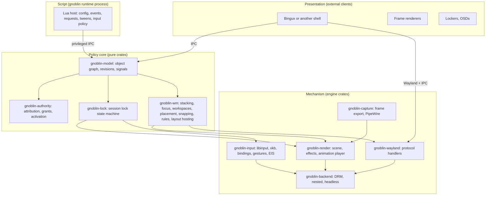
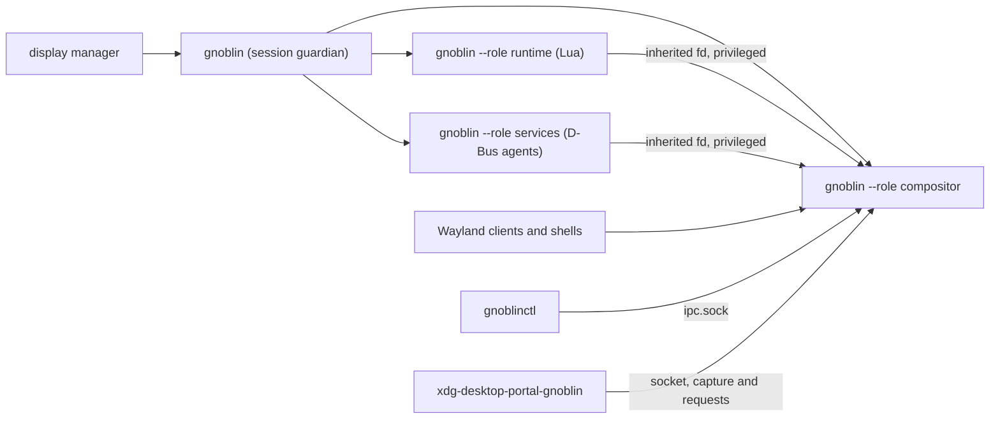
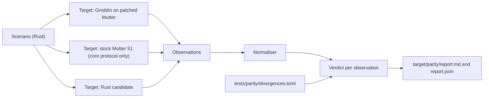
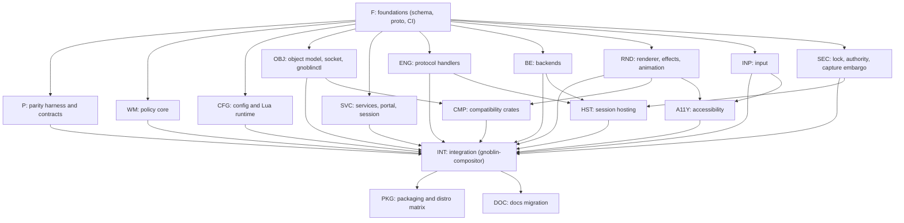

# Gnoblin compositor rewrite: Rust and Smithay

**Status:** decided and partly built. The workspace, the object schema, the IPC
envelope, the parity runner and the pure policy crates are on
`origin/rust-compositor`, and the engine runs one slice.

Items marked [INFERENCE] were not verified against source or a running system.
Every decision in "Decisions to confirm" records what was decided and when.

The landed commits and their test counts are in
[rust-compositor-progress.md](rust-compositor-progress.md). The questions that
the build raised and the plan does not answer are collected in "Known gaps and
plan ambiguities". Progress is also tracked on the Doop canvas
<https://doop.drewett.dev/c/gQeAehTEmA>, rendered from
`~/dev/gnoblin-compositor-doop/progress.json`.

## Summary

- Replace Mutter with a Gnoblin-owned floating compositor written in Rust on
  Smithay. Fold the compositor, the script runtime, the control API, the session
  services and the portal backend into one Cargo workspace in this repository.
- Do it one seam at a time. At every step, change only one side of a contract
  and keep the other side as the known-good reference. The reference is Gnoblin
  on patched Mutter (and stock Mutter for plain protocol behaviour).
- Treat parity as data. One harness runs the same scenarios against the Mutter
  reference and the Rust candidate, normalises the observations and compares
  them. Every deliberate difference goes into a divergence ledger.
- Make the object model the one language of the system. One schema drives the
  compositor's object store, the socket protocol, the Lua bindings,
  `gnoblinctl`, `gnoblin.d.lua` and the API reference.
- Keep crash and trust boundaries in processes: the compositor runs no Lua and
  no D-Bus agents. Lua and the agents are restartable privileged clients.
- Freeze new Mutter patch series now. New behaviour that needs a Mutter patch
  goes to the Rust compositor instead.

## Why

| Problem                                     | Evidence (2026-11-04)                                                                                                                                                                     |
| ------------------------------------------- | ----------------------------------------------------------------------------------------------------------------------------------------------------------------------------------------- |
| Mutter is a heavy target                    | `subprojects/mutter`: 573,570 lines of C and headers in 1,613 files. Gnoblin uses a small part of it.                                                                                     |
| The patch series keeps growing              | `patches/`: 249 patch files, 29,612 lines. `99-typed-window-api` alone is 119 patches and 15,971 lines.                                                                                   |
| Growth is recent and fast                   | Patch files added per month (`git log --diff-filter=A`): Jun 3, Jul 18, Aug 2, Sep 99, Oct 94. Renumbering inflates these counts.                                                         |
| Gnoblin's own code is wrapped around Mutter | `src/` holds about 70,000 lines of C, C++ and Lua overlay code. Most of `src/control` uses `MetaDisplay`, `MetaWindow` and Clutter types directly.                                        |
| Older distributions are blocked             | `design/debian12-ubuntu2204-private-runtime.md`: Mutter 51 needs GTK >= 4.14, `gcr-4`, `girepository-2.0`, `libei`, `libdisplay-info` and Glycin 2. Debian 12 and Ubuntu 22.04 lack them. |
| Compat patches exist only for Mutter floors | `74-fedora43-compat` (PipeWire), `82-wayland-compat` (wayland-server 1.25), `99/0059` (libinput 1.30), portal `09-compatibility`, `libgxdp/0001` (GTK 4.20).                              |
| No CI job boots a graphical session         | `.github/workflows/verify.yml` checks builds and installed files only. Session behaviour is verified locally in nested and QEMU runs.                                                     |

A Smithay compositor does not need GTK, GLib, GObject introspection, Clutter or
Cogl. Smithay 0.7.0 uses a pure Rust Wayland server unless `use_system_lib` is
enabled (`smithay-0.7.0/Cargo.toml`), so the `wayland-server` floor in
`82-wayland-compat` stops being a Gnoblin problem.

## What Gnoblin is after the rewrite

Gnoblin is the compositor and session runtime that shell developers build on.
Think of it as the Wayfire or Xfce of this generation: a small, stable,
conservative core that does the heavy lifting, and many ways to change it.

Gnoblin owns the hard parts: rendering, input, outputs, window management,
security boundaries, session lifecycle and the standard Wayland and portal
surfaces. Shells such as Bingux own presentation and compose their desktop out
of Gnoblin's primitives.

Hackability comes in tiers. Each tier has a clear owner and a clear failure
boundary:

| Tier | Mechanism                                              | Runs where                     | Example                                               |
| ---- | ------------------------------------------------------ | ------------------------------ | ----------------------------------------------------- |
| 1    | Declarative configuration in Lua                       | Runtime process, validated     | Settings, window rules, bindings, animations          |
| 2    | Lua scripting on the object model                      | Runtime process, restartable   | Event handlers, requests, tweens, input policy        |
| 3    | User fragment shaders with a declared uniform schema   | Compositor GPU pass, validated | Per-window tint or effect                             |
| 4    | External clients through Wayland protocols and the IPC | Separate processes             | Bars, docks, lockers, frame renderers, OSDs           |
| 5    | WASM modules with a host API generated from the schema | Compositor, sandboxed (D6)     | Placement strategies, input policy, effect parameters |

Tier 5 is sandboxed WebAssembly, not native libraries (D6). Tiers 1 to 4 already
exist today in some form; the rewrite makes them consistent.

## Core abstractions

These ideas shape the plan, the code and the tests. When a choice is unclear, go
back to these.

1. **Change one side of a seam at a time.** A seam is a contract with two sides:
   Wayland protocols, the control socket, D-Bus names, script semantics, pixels
   on screen. Keep one side fixed while the other changes, so every difference
   has a single cause.
2. **Mechanism, policy, script, presentation.** Four layers with one dependency
   direction. The engine (Smithay glue) provides mechanism. The Gnoblin core
   decides policy (stacking, focus, placement, lock). The runtime scripts policy
   through the object model. Shells present. A layer never reaches down past its
   neighbour.
3. **Everything a shell touches is an object.** Each object has an identity, a
   lifetime, typed properties, methods that return an `Operation`, and signals.
   Objects that end say so. This is the direction already set in the `lua-api/*`
   branches (`design/lua-api-goal.md` and `design/shell-api-redesign.md` on
   `docs/lua-api-overhaul-design`).
4. **Contracts are data.** The schema, the contract inventory, the parity ledger
   and the distro matrix are files in the tree, checked by CI. If it is not
   written down, it does not exist.
5. **Functional core, imperative shell.** Window management, focus, session lock
   and authority are pure state machines with no Smithay types. Smithay handlers
   translate protocol traffic into events for the core and apply the commands it
   returns. The pure core is tested exhaustively and compared with Mutter
   traces.
6. **Attribution is not authority.** The compositor proves who started a window
   or process. Policy decides what that party may do. Applications can never
   forge attribution by choosing an app ID or title.
7. **Frames go out as streams, input comes in as events.** One frame export path
   serves screenshots, screen casts and thumbnails. One input injection path
   (EIS) serves remote desktop and the test harness.
8. **Two implementations are equal when their observations are equal.** Same
   stimulus, same observations after declared normalisation. Anything else is
   either a bug or a recorded, intentional divergence.

## Architecture

### Layers



### Process model



| Process                      | Owns                                                                                                                                      | Restart behaviour                                                                                                        |
| ---------------------------- | ----------------------------------------------------------------------------------------------------------------------------------------- | ------------------------------------------------------------------------------------------------------------------------ |
| `gnoblin` (guardian)         | Session start and end, systemd targets, environment, child supervision, logs, recovery state                                              | Lives for the login. Never runs scripts or renders.                                                                      |
| `gnoblin --role compositor`  | Wayland, rendering, input, outputs, the policy core, the object store, the IPC socket, compositor-side D-Bus surfaces                     | A crash ends the session, so this process runs no scripts or D-Bus agents.                                               |
| `gnoblin --role runtime`     | Lua configuration, event handlers, requests, timers, tweens, input policy decisions                                                       | Restartable. The compositor keeps the last accepted configuration.                                                       |
| `gnoblin --role services`    | polkit agent, GeoClue agent, passphrase prompts (`prompt.secret`), PipeWire privacy monitor, `org.freedesktop.ScreenSaver`, idle, inhibit | Restartable. Requests fail closed while it is down.                                                                      |
| `xdg-desktop-portal-gnoblin` | Portal interfaces (optional relay, D19); IPC client of the compositor; no policy, no UI                                                   | D-Bus activated by `xdg-desktop-portal`, not by services; optional package; removal falls through to `gtk`, `kde` (D19). |
| `gnoblinctl`                 | Command line client                                                                                                                       | Short-lived.                                                                                                             |

This keeps today's proven guardian and supervisor model
(`design/lean-runtime.md`, `design/startup-recovery.md`) and moves the D-Bus
agents out of the compositor process. `gnoblin-idle` folds into the services
role. The roles stay in one executable, as `design/monolithic-compositor.md`
requires; `gnoblinctl` and the portal stay separate binaries.

### One IPC

Today there are two wires with overlapping meaning: the private runtime protocol
(20 packet types, GVariant, major 2 minor 6) and the native control socket
(JSON, API 1.93). There are 19 snapshot pushers that send whole GVariant
snapshots to the Lua worker.

Adding one native method touched about eight registries
(`design/shell-api-redesign.md`). `src/control/gnoblin-api-operations.h` now
drives gates, dispatch and packing from one table, but the Lua stubs, docs and
tests are still separate.

The rewrite has one IPC:

- The schema (`gnoblin-schema`) declares every object type, property, method,
  signal and error code, and the Gnoblin version that added each one.
- The compositor keeps the live object graph (`gnoblin-model`). It publishes
  property diffs and signals with revisions, not whole snapshots.
- Shells, `gnoblinctl`, the portal, the services role and the script runtime all
  speak the same IPC. The runtime and services connect over an inherited file
  descriptor that carries extra capabilities: trusted input contexts, input
  policy decisions, request handling and configuration commits.
- Generated from the schema: the Rust client crate, the Lua bindings,
  `gnoblin.d.lua`, `gnoblinctl` subcommands and completion, the API reference in
  `docs/shell-api/`, the WIT package, and a compatibility report that fails CI
  when a released member changes shape.
- The wire is binary: length-prefixed frames on
  `$XDG_RUNTIME_DIR/gnoblin/ipc.sock`, found through `GNOBLIN_IPC_SOCKET`, with
  file descriptors passed alongside (`SCM_RIGHTS`). Messages are Protocol
  Buffers generated from the schema (D16). The first frame is a fixed-layout
  handshake, so a version mismatch is always reportable. The candidate speaks
  only IPC 0.2.0 (D3).
- JSON stays at the edges for people and scripts: `gnoblinctl --json` prints
  JSON, and `gnoblinctl ipc dump` decodes live traffic for debugging.

The request layer is schema, not a side channel: `request` is an object with the
methods `claim`, `answer` and `decline` and the signals `offered` and
`finished`.

`decline` is its own member because "the provider refused" and "the provider
answered with nothing" are different outcomes, and only `answer` carries a
value.

`answer`'s value field is marked `secret`. A frame's member is the schema's
qualified member path, `<object>.<member>` — `request.answer`, or
`example.ext.answer` for an extension — so the generated sensitive table
names it, and the envelope constructors flag and redact the frame without
knowing which members are secret.

### IPC extensions

Gnoblin has one generic extension mechanism. An extension is a namespace of
members that a privileged connection provides on the IPC. Extensions are out of
tree: each ships its own schema file and provider, and the host configuration
loads it into Gnoblin. The stock tree contains no extension, and no extension
is built into the compositor. Gnoblin's docs use `example.ext` as the neutral
name. Bingux ships its greeter control as an extension from its own repository;
this plan has no other coupling to it. An IPC namespace is one power among
several that an extension package can declare; D22 defines the general case
(manifest, grants, isolation tiers and supervision).

**One ABI.** Every extension speaks the same envelope (namespace, member, request id, flags, opaque payload) through one stock `extension` surface: `provide`, `call`, `event`, `provider-gone`, and the granted list in the handshake Grants frame. Stock crates hold no per-extension generated code, enums or modules. An extension's payload schema is read by its own generated code outside the stock tree, and by the Lua host's dynamic classes at load time (D21).

**Loading.** The host configuration lists each extension in
`gnoblin.configure.extensions`. Each entry has:

- `namespace`: the namespace, such as `example.ext`. It must be unique and
  must not be a core namespace.
- `schema`: the path to the schema file, shipped by the extension's package.
- `provider`: the privileged connection role allowed to provide the namespace.
- `grants`: the restricted socket identities granted the namespace.

There is no run-time registration of arbitrary names. A provider can only
provide namespaces listed in the host configuration. At load, the compositor
parses the schema, checks that its namespace matches the entry, that its
members do not collide with core members, and that its version is a full
`MAJOR.MINOR.PATCH`. A failing load refuses that extension only. The compositor
starts without it, logs the error, and calls to its namespace fail with
`not-supported`.

- **Access:** a connection sees an extension only if its handshake's Grants
  frame lists it (see Versioning). Grants are per connection.
- **Authority:** an extension carries requests, not powers. A provider gets the
  capabilities of its connection, and no more. Extension providers hold no PAM,
  logind or session privileges. Those stay with the host's own manager.
- **Provider disconnect:** calls fail with `provider-gone` until it connects
  again.
- **Payloads:** the compositor reads the envelope (namespace, member, request
  ID, flags) and forwards the payload bytes without decoding them. The generated
  code sets a `sensitive` flag on any message with a field marked `secret`.
  Logs, the parity recorder and `gnoblinctl ipc dump` drop the payload of every
  `sensitive` frame, so none of them needs the extension schema to keep a
  secret out. Gnoblin handles no other secret of an extension.
- **Lua:** `require("<namespace>")` resolves an extension namespace that is
  loaded and granted to the host's connection. `require` loads only these and
  host-registered loaders such as layouts.
- **Versioning:** an extension carries the full version of the project that
  ships it, with the same `since` and handshake rules as Gnoblin.

Clients need generated code to speak the binary IPC (D16). A client of an
extension uses that extension's generated code. Which code a Bingux client uses
depends on when Bingux moves to bingux-ui:

- **Bingux on bingux-ui (Rust) by cutover:** clients use `gnoblin-client` and
  the generated Rust code of each extension they use. No QML client is built.
- **Bingux still on Quickshell at cutover:** Bingux needs a generated
  `Gnoblin.Ipc` QML module, because its shell writes JSON lines to the socket
  from QML today (`shell/bingux/WorkspaceState.qml` in Bingux). The module is
  dropped when the move to bingux-ui finishes.

D3 needs Bingux on IPC 0.2.0 by the phase 3 gate, so the move to bingux-ui
either lands before that gate or the QML module is built as a bridge.

### Versioning

Gnoblin has one version number, in full `MAJOR.MINOR.PATCH` form. The IPC
version is exactly the Gnoblin version, with all three parts, and so is every
surface generated from the schema. Nothing shortens it: Gnoblin 0.2.0 serves IPC
0.2.0, and Gnoblin 0.2.3 serves IPC 0.2.3. The rewrite ships as 0.2.0.

- **Source:** `src/gnoblin-version.json`, which `prepare-release.sh` writes and
  the source bundle and `gnoblin --version` read.
    - `xtask` copies it into the Cargo workspace version, the schema,
      `gnoblin.d.lua`, the WIT package (`gnoblin:ipc@0.2.0`) and the API
      reference, so no crate, file or protocol keeps its own number.
    - The copy step is not written yet; the workspace version is `0.2.0-alpha.0`
      by hand.
- **Members:** each schema member records `since`, the full Gnoblin version that
  added it. Clients compare `since` with the compositor's version before they
  use a member.
- **Handshake:** both sides send their full versions. The compositor accepts a
  client built against version A when its own version B is at least A and
  SemVer-compatible with it, using Cargo's caret rule: the leftmost non-zero
  part matches. Otherwise it refuses with an error that names both versions.
  After the fixed accept frame, the compositor sends a mandatory Grants frame
  before any other frame: a u32 big-endian length, a u16 entry count, then per
  entry the namespace (u8 length, then UTF-8) and its major, minor and patch
  versions as u32s. It lists each extension the connection is granted, with that
  extension's version, and is empty when none are granted. The socket name carries
  no version.
- **Grants failures:** each is a named error on both encode and decode. More
  than 64 entries; a namespace that is empty, longer than 128 bytes, not UTF-8,
  or contains a space or control character; a duplicate namespace; a body that
  ends inside an entry or before its count; bytes after the last entry; a body
  over the length cap. A refused accept sends no Grants frame.
- **Breaking changes:** a release that removes or reshapes a released member
  bumps the leftmost non-zero part (0.2.4 to 0.3.0, or 1.4.2 to 2.0.0). The
  compatibility report in CI enforces this.
- **Releases:** 0.1.x continues from the C tree under the patch freeze (D9).
  Candidate builds are `0.2.0-alpha.N`. The cutover release is 0.2.0.
- **Legacy IPC:** the control API (1.93), the runtime packet protocol (2.6) and
  `compositor-v1.sock`, served by Gnoblin 0.1.x on the Mutter session. They keep
  their own numbers until they go away with that session.

Two kinds of interface keep their own versions, because outside tools read them:

- Gnoblin-owned Wayland protocols follow Wayland's rules: `_vN` in the interface
  name for a break, and the interface `version` for additions.
- Compat crates serve upstream D-Bus names as they are. Each support matrix
  records the upstream version it was tested against.

### Hosting sessions

Decided in D4: bsm becomes a Gnoblin. One compositor binary serves both levels:

- **Host:** Gnoblin on the real screen and seat, with a kiosk configuration
  written in Lua like any other config: its layout, lock and session objects,
  and the greeter UI as an ordinary Wayland client. bsm's manager (session state
  machine, PAM through `bsm-helper`, logind, session launch) is a privileged
  client of the host, like the script runtime. Its greeter control reaches the
  host only as an out-of-tree extension that host configuration loads (D21).
  bsm stays a Bingux project that ships this configuration, the manager and the
  extension.
- **Session:** each signed-in user's Gnoblin runs on the nested backend as a
  Wayland client of the host. That user's apps and Bingux are its clients.

Gnoblin provides three general primitives for this:

1. **A production nested backend.** Each output is a surface on the parent. Size
   and scale come from the parent's configure and preferred-scale events. Input
   comes from the parent's seat, including relative pointer, pointer
   constraints, tablets and text input. Frames go to the parent as dmabufs. The
   same backend replaces the winit development window.
2. **`gnoblin_session_host_v1`.** A Wayland protocol on the brokered per-session
   connection: ready, protect request and its acknowledgement by a rendered
   frame, lock request, logout and power requests, output hints. It replaces the
   `bsm-host` bridge, `org.gnoblin.Hosted1` and bsm's own `bsm_session_host_v1`.
3. **Protection covers.** `gnoblin-lock` generalises from covering every surface
   to covering any client. bsm's invariants (one input owner, protect before
   reveal, opaque cover on failure, a greeter crash unlocks nothing) become
   compositor-enforced rules, not manager policy.

This removes headless Mutter, the `bsm-host` bridge, virtual monitors, the
ScreenCast, RemoteDesktop and DisplayConfig calls for hosting, `Hosted1`, and
bsm's separate DRM, input and rendering code.

Open points: cross-user render-node and dmabuf access between the host (the
`bsm` account) and a session (the user) [INFERENCE: render nodes are
world-accessible on most distributions]; and whether a nested session hands its
clients' buffers to the host as subsurfaces to skip a second composite, a later
optimisation.

### Main data paths

| Path          | Stages                                                                                                                                                                                          |
| ------------- | ----------------------------------------------------------------------------------------------------------------------------------------------------------------------------------------------- |
| Input         | Backend device event -> libinput config -> lock gate (`gnoblin-lock`) -> grabs and bindings -> optional script policy decision with deadline -> seat delivery -> idle and activity tracking     |
| Frame         | Client commit -> `gnoblin-wm` commands -> scene graph (window transforms, effects, animation player) -> damage -> render per output -> present -> frame export taps (capture)                   |
| Configuration | Script evaluates -> typed `ConfigDocument` -> compositor validates again -> transactional apply or reject -> result and `config.reloaded` signal -> last-good store                             |
| Request       | Application or system asks (polkit, keyring, GeoClue, portal access, lock) -> `Request` object offered -> one owner claims -> answer or end -> one `finished` outcome -> fail closed on timeout |
| Activation    | Client action -> attribution (launch, activation token, input serial) -> authority check -> focus or `activation-denied` signal                                                                 |

The compositor validates every configuration document itself and never trusts
the runtime. Embedded defaults are a typed Rust value, so the compositor can
start and recover without any script.

### Safety model

| Concern              | Rule                                                                                                                                                                                                     |
| -------------------- | -------------------------------------------------------------------------------------------------------------------------------------------------------------------------------------------------------- |
| Memory safety        | `#![forbid(unsafe_code)]` in every crate except named FFI modules. Each `unsafe` block has a `SAFETY:` comment. CI lists every crate that contains `unsafe`.                                             |
| Compositor crashes   | No `unwrap` or `expect` in compositor crates (Clippy `unwrap_used` and `expect_used` denied). A protocol error disconnects the client, never the compositor.                                             |
| Script faults        | Lua runs in another process with instruction and memory limits. On a missed deadline the runtime restarts; the compositor keeps its accepted state.                                                      |
| Lock                 | Fail closed: opaque cover; input goes only to lock surfaces; no capture or clipboard. A locker crash keeps the cover.                                                                                    |
| Focus stealing       | Activation needs a valid token or a trusted context. A process ID or app ID alone never grants focus.                                                                                                    |
| Privileged protocols | Access is decided per client, not only per global. Sandboxed clients (`wp_security_context_v1`) do not see screencopy, data-control, layer-shell or foreign-toplevel management unless policy allows it. |
| Untrusted input      | The wire codec, configuration parser and protocol handlers are fuzzed (`cargo fuzz`) before they ship.                                                                                                   |
| Secrets              | Prompt answers never enter logs, events for other clients, crash reports or the parity recorder.                                                                                                         |

## Project structure

The Rust workspace lives at the repository root, beside the current C tree,
until cutover. At cutover the C tree, `subprojects/mutter`, `subprojects/imgui`,
`subprojects/xdg-desktop-portal-gnome`, `patches/` and the CMake superbuild are
deleted in one reviewed change.

```text
gnoblin/
  Cargo.toml                  workspace, shared lints and dependency versions
  rust-toolchain.toml         pinned development toolchain
  justfile                    canonical task runner (build, check, parity, docs, package)
  crates/
    gnoblin/                  the executable: role dispatch (guardian, compositor, runtime, services); no extension role (D21)
    gnoblin-schema/           object types, properties, methods, signals, errors, `since` versions
    gnoblin-types/            shared primitives: geometry, scale, transform, identity, tick, version, error code
    gnoblin-proto/            wire codec, handshake, capabilities, versioning; client and server traits
    gnoblin-client/           Rust client library (gnoblinctl, runtime, services, portal, tests, Bingux)
    gnoblin-model/            live object graph, revisions, property diffs, subscriptions
    gnoblin-config/           configuration document, validation, merge, salvage, last-good store, extension manifest parse and hash check (D22) (no Lua)
    gnoblin-config-codegen/   the config schema's generator, shared by gnoblin-config's build.rs and xtask
    gnoblin-wm/               pure window management policy and the layout module (no Smithay types)
    gnoblin-lock/             pure session lock and protection cover state machine
    gnoblin-authority/        pure attribution, activation and capability grant rules (D22)
    gnoblin-wayland/          Smithay protocol handlers, one module per protocol; dynamic globals from provider XML at run time (D22)
    gnoblin-render/           scene graph, effects, user shaders, animation and tween player, damage
    gnoblin-input/            libinput settings, xkb, chords, gestures, input policy routing, IME, EIS server
    gnoblin-backend/          backends: drm (udev, libseat, gbm), nested (Wayland client), headless
    gnoblin-output/           output layout, transactional configuration, gamma, power, EDID and vendor names
    gnoblin-capture/          frame export: screencopy, image copy capture, PipeWire streams, thumbnails
    gnoblin-log/              logging facade: the macros every crate logs through, the component mapping and `Role`; depends on `tracing` alone (D23)
    gnoblin-log-console/      console formatter, redaction and colour (D23)
    gnoblin-log-store/        SQLite sink: writer thread, retention (D23)
    gnoblin-log-init/         installs the sinks for one process: `init`, options, panic hook (D23)
    gnoblin-xwayland/         Xwayland startup and window management
    gnoblin-a11y/             accessibility logic: keyboard monitor, sticky/slow/bounce/mouse keys, magnifier and colour-filter state
    compat/                   one crate per compatibility path; none depends on another (see "Compatibility crates")
      gnoblin-compat-core/                shared adapter frame: support matrix, mode gate, sandbox refusal, D-Bus helpers
      gnoblin-compat-mutter-screencast/   org.gnome.Mutter.ScreenCast
      gnoblin-compat-mutter-remotedesktop/  org.gnome.Mutter.RemoteDesktop
      gnoblin-compat-mutter-inputcapture/  org.gnome.Mutter.InputCapture
      gnoblin-compat-mutter-clipboard/    org.gnome.Mutter.Clipboard
      gnoblin-compat-mutter-displayconfig/  org.gnome.Mutter.DisplayConfig
      gnoblin-compat-mutter-idlemonitor/  org.gnome.Mutter.IdleMonitor
      gnoblin-compat-mutter-inputmapping/  org.gnome.Mutter.InputMapping (later)
      gnoblin-compat-mutter-servicechannel/  org.gnome.Mutter.ServiceChannel (later)
      gnoblin-compat-mutter-x11-interop/  mutter_x11_interop Wayland redirect (later)
      gnoblin-compat-gnome-shell-introspect/  org.gnome.Shell.Introspect
      gnoblin-compat-gnome-shell-screenshot/  org.gnome.Shell.Screenshot
      gnoblin-compat-gnome-session-manager/  org.gnome.SessionManager
      gnoblin-compat-gnome-keyring-prompter/  org.gnome.keyring.SystemPrompter and PrivatePrompter, for gcr callers
      gnoblin-compat-gtk-shell1/          gtk_shell1 Wayland redirect (compositor side)
      gnoblin-compat-gtk-dconf-settings/  dconf layer for GTK (D15)
      gnoblin-compat-qt-portal-settings/  QT_QPA_PLATFORMTHEME for Qt (D15)
      gnoblin-compat-x11-xsettings/       XSETTINGS for X11 apps on the XWM connection (D15)
    gnoblin-compositor/       composition root: event loop, wiring, the only crate that knows every subsystem; `portal` module: provider negotiation, request queue, reply validation, outcomes (D19)
    gnoblin-lua/              Lua host: config, loader, generated bindings, operations, timers, tweens; the `layout` module (Lua layout host, D17, in progress); extension Lua modules (D22); uses gnoblin-lua-sandbox
    gnoblin-lua-sandbox/      mlua VM construction, instruction hook and memory limits, stdlib subset; a separate crate until the layout host lands, then folds into gnoblin-lua
    gnoblin-wasm/             WASM module host (wasmtime): WIT host API from the schema, capabilities, deadlines (D6); WASM extension tier (D22)
    gnoblin-session/          guardian: supervision, systemd and logind, environment, autostart, logs, recovery
    gnoblin-services/         services role: serves the agents and links the GeoClue agent (`location_agent`); polkit, prompter, PipeWire privacy, inhibit, idle
    gnoblin-service-core/     the services role's shared machinery: slot registry, request state machine, the connection agents offer through
    gnoblin-service-testkit/  private message bus for one test (dev-dependency only)
    gnoblin-service-polkit/   polkit authentication agent (D-Bus client of the system bus)
    gnoblin-service-screensaver/  org.freedesktop.ScreenSaver agent and its inhibits
    gnoblin-service-location/ GeoClue agent and location policy
    gnoblin-diag/             recovery and console overlay (see D5); `portal` module: built-in portal dialog models, pure and egui-free (D19)
    gnoblinctl/               command line client (binary)
    xdg-desktop-portal-gnoblin/  portal backend (binary)
    gnoblin-testkit/          in-process fixture, test clients, input injection, observation recorder
    gnoblin-parity/           scenario runner, targets (Mutter reference, Rust candidate), normaliser, reports
    xtask/                    code generation: d.lua, API docs, schema dump, compatibility report
  protocols/                  Gnoblin-owned Wayland XML (window frame, session host) with version history
  data/                       session entries, systemd units, portal config, default configuration
  tests/
    parity/                   scenarios, contract inventory, divergence ledger, reference recordings
    e2e/                      QEMU and nested end-to-end runs that use only public clients
    corpus/                   Lua configuration corpus for differential and fuzz runs
  docs/  design/  packaging/  versions/
```

The tree is the target layout. `crates/` and `xtask/` exist today; `protocols/`,
`data/` and the non-parity parts of `tests/` arrive with the phases that need
them.

Three kinds of file are generated at build time and gitignored, so a clean
checkout builds with plain `cargo build`:

- the namespace `.proto` documents and the sensitive table, from the object
  schema into `crates/gnoblin-proto`'s `OUT_DIR`;
- the configuration document, its enums, the alias table, the validators and the
  catalogue, from `crates/gnoblin-config/schema/config.toml`;
- `gnoblinctl`'s command tree and the Lua bindings, each into `OUT_DIR`.

Nothing generated is committed, so a stale copy cannot disagree with the schema
that produced it. `cargo xtask gen-proto` and `cargo xtask gen-config` write
readable copies under `target/` for review. `proto/envelope.proto` is the one
hand-written `.proto`, because the envelope is not a schema member.

### Dependency rules

`cargo xtask deps` enforces these over `cargo metadata`, one named rule per
edge, so a violation names the edge and the rule:

- **Foundation crates** are `gnoblin-types`, `gnoblin-schema`, `gnoblin-proto`,
  `gnoblin-wm`,
  `gnoblin-lock`, `gnoblin-authority` and `gnoblin-output`. None depends on
  Smithay, `wayland-*`, a GPU renderer, `zbus` or `mlua`.
- `gnoblin-types` is the root of the graph, and the only home of a value two
  crates pass to each other: geometry, scale, transform, identity, tick,
  revision, version and error code.
- **Engine crates** are `gnoblin-backend`, `gnoblin-input`, `gnoblin-render`,
  `gnoblin-wayland`, `gnoblin-capture` and `gnoblin-xwayland`.
- `gnoblin-output` sits in the foundation set although the mechanism layer
  performs the mode sets: an output arrives as a descriptor and a configuration
  becomes a layout of rectangles, so the crate is pure policy.
- `gnoblin-render` is the one engine crate every other engine crate may name
  (rule `HUB_SCENE`). A frame _is_ the scene's paint order and damage, so a
  frame description that could not name the scene would duplicate the graph or
  drop its damage.
- The hub edge is one-directional: `gnoblin-render` depends on `gnoblin-types`
  alone, so it cannot pull Smithay or policy in behind a caller, and no
  foundation crate may name it.
- Only `gnoblin-compositor` depends on every engine crate. Apart from
  `gnoblin-render`, engine crates do not depend on each other, except through
  traits in `gnoblin-backend` and types in `gnoblin-model`.
- `gnoblin-lua` depends on `gnoblin-client`, not on compositor crates. The
  runtime is a client. Its `layout` module is the one exception: it may name
  `gnoblin-wm`, `gnoblin-types` and `gnoblin-lua-sandbox` (see the layout edges
  rule below), so a Lua layout runs in the host process and nowhere else.
- `gnoblin-services`, every `gnoblin-compat-*` D-Bus crate and
  `xdg-desktop-portal-gnoblin` depend on `gnoblin-client` and `zbus`, not on
  compositor crates.
- `gnoblin-diag::portal` (dialog models) depends on `gnoblin-types` and `gnoblin-schema` only. The egui drawing code elsewhere in `gnoblin-diag` draws them.
- `gnoblin-compositor::portal` (negotiation, queue, validation, outcomes) depends on `gnoblin-diag::portal` (payload and result types only), `gnoblin-types` and `gnoblin-schema`. Only `gnoblin-compositor` may depend on `gnoblin-diag`. Nothing depends on `xdg-desktop-portal-gnoblin`.
  `xdg-desktop-portal-gnoblin` depends on neither: it speaks `portal-call` over
  the privileged IPC.
- A compat crate depends only on `gnoblin-compat-core`, `gnoblin-client` and its
  own transport:
    - `zbus` for D-Bus names;
    - the `gnoblin-wayland` extension trait for the Wayland redirects
      (`gnoblin-compat-gtk-shell1`, `gnoblin-compat-mutter-x11-interop`);
    - the `gnoblin-xwayland` extension trait for `gnoblin-compat-x11-xsettings`.
- No compat crate depends on another, and nothing outside `compat/` depends on a
  compat crate except the binary that links it.
- `gnoblin-a11y` holds pure state machines and the keyboard-monitor logic. It
  does not depend on Smithay, so `gnoblin-input` and `gnoblin-render` call it
  and its tests run without a session.
- `gnoblin-testkit` and `gnoblin-parity` are development dependencies only.
- `gnoblin-wm` depends on `gnoblin-types` alone and holds the layout value types, the placement validator, the floating fallback and the `LayoutEngine` contract (`gnoblin_wm::layout`). It names no Lua or WASM crate. `gnoblin-lua-sandbox` depends on `mlua` alone. The Lua layout host is the `layout` module of `gnoblin-lua`, which may name `gnoblin-wm`, `gnoblin-types` and `gnoblin-lua-sandbox`. `gnoblin-wasm` may name `gnoblin-wm` (`layout` module only) for WASM layouts (D22). Only `gnoblin-compositor` registers a layout engine with `gnoblin-wm`.

These rules are what makes concurrent work safe: a lane can change a crate
without breaking another lane, provided the shared types do not change.

#### One name per concept

`gnoblin-types` is a foundation crate so that two crates cannot both declare a
`Rect`, a `Tick` or a `ClientId` and disagree about what they mean. Before
adding a type, search for the shape and reuse it.

`cargo xtask dupes --deny` reports a struct or enum that two crates declare with
the same name or the same shape. A genuine homonym — two meanings that share a
word, such as a backend `Output` and the window manager's — is waived in
`xtask/dupes-allow.toml` with a reason. The check is local and not part of
`just ci`, because a lane mid-migration must be able to read the report with
`--warn`.

## From the current tree to the new crates

| Current area                                                             | Size today                   | New home                                        | Strategy                                                                                                     |
| ------------------------------------------------------------------------ | ---------------------------- | ----------------------------------------------- | ------------------------------------------------------------------------------------------------------------ |
| `src/cli`                                                                | 8,466 lines                  | `gnoblinctl`, `gnoblin-client`                  | Port in phase 1 against Mutter; the socket is the seam                                                       |
| `src/idle.c`                                                             | 690 lines                    | `gnoblin-services`                              | Port in phase 1; use `ext-idle-notify-v1` instead of `org.gnome.Mutter.IdleMonitor`                          |
| `src/config` (core)                                                      | part of 14,891 lines         | `gnoblin-config`                                | Port; prove with a differential corpus against the C config core                                             |
| `src/config/lua`                                                         | part of 14,891 lines         | `gnoblin-lua`                                   | Redesign on the object model; keep limits, loader and recovery semantics                                     |
| `src/session`                                                            | 5,241 lines                  | `gnoblin-session`                               | Port the guardian; drop the packet zoo in favour of the IPC                                                  |
| `src/control` and `src/control/windows`                                  | 18,599 lines                 | `gnoblin-model`, `gnoblin-proto`, `gnoblin-wm`  | Redesign; split policy (pure) from publication (model)                                                       |
| `patches/mutter/99-typed-window-api`                                     | 119 patches, 15,971 lines    | `gnoblin-wm`, `gnoblin-render`, `gnoblin-input` | Re-derive behaviour from the contract inventory, not by replaying patches                                    |
| `patches/mutter/30-layer-shell`, `40-gnoblin-protocols`, `src/protocols` | 8,117 lines of overlay       | `gnoblin-wayland`                               | Use Smithay handlers where they exist; write the rest                                                        |
| `src/compositor/plugin`, `src/compositor/effects`                        | 5,576 lines (C and C++)      | `gnoblin-render`, `gnoblin-diag`                | Redesign; Cogl snippets become GLES shader passes; the plugin vfunc contract becomes animation tracks        |
| `src/input`, `68-gnoblin-input`, `70-config-preferences`                 | 3,086 lines and 22 patches   | `gnoblin-input`                                 | Redesign on libinput and xkbcommon; keep every configuration key                                             |
| Session lock series 70 to 79 and `src/protocols/session-lock`            | 10 patches and 862 lines     | `gnoblin-lock`, `gnoblin-wayland`               | Redesign as a pure state machine; keep every rule in `src/protocols/session-lock/README.md`                  |
| Capture series 65, 66, 74                                                | 5 patches                    | `gnoblin-capture`                               | Redesign as one frame export path                                                                            |
| `src/agents`                                                             | 2,971 lines                  | `gnoblin-services`                              | Port to `zbus`; move out of the compositor process                                                           |
| `src/portal` and `patches/xdg-desktop-portal-gnome`                      | 1,758 lines and 14 patches   | `xdg-desktop-portal-gnoblin`                    | Rewrite as a Rust backend; drop the patched GNOME backend                                                    |
| `src/cursor` (Hyprcursor)                                                | 164 lines and 2 patches      | `gnoblin-render`                                | Load Xcursor and Hyprcursor themes in Rust (Hyprcursor via SVG rendering) [INFERENCE: check format coverage] |
| ImGui console, debug and recovery panels                                 | C++ plus `subprojects/imgui` | `gnoblin-diag`                                  | Redesign (D5)                                                                                                |
| Window frames (`61-window-frames`, `src/protocols/window-frame`)         | 8 patches and 2,064 lines    | `gnoblin-render`, `gnoblin-wayland`             | Keep `gnoblin_window_frame_manager_v1` wire-compatible; Bingux builds against it                             |
| Crash and lifetime fixes (50, 59, 79, 80, 81)                            | about 8 patches              | none                                            | Drop. Rust ownership and Smithay's resource model remove the cause; parity scenarios prove it                |
| Distro compat series (74, 82, 99/0059, portal 09, libgxdp)               | 6 patches                    | none                                            | Drop with the GNOME library floors                                                                           |
| Build: CMake superbuild, meson subprojects, `scripts/manage-patches.py`  | -                            | Cargo and `just`                                | Delete at cutover                                                                                            |

### Wayland protocol coverage

Smithay 0.7.0, the last crates.io release, ships handlers for these protocols
(checked in the local Cargo registry, `src/wayland/`). This is a release
snapshot: phase 0 re-checks coverage against the exact git revision the
workspace pins (D7).

- **Shells and windows:** xdg-shell, wlr-layer-shell, xdg-decoration, KDE server
  decoration, xdg-activation, xdg-foreign, xdg-toplevel-icon, xdg-toplevel-tag,
  xdg-system-bell.
- **Session and security:** ext-session-lock, ext-idle-notify, idle-inhibit,
  security-context, ext-foreign-toplevel-list.
- **Clipboard:** data device, primary selection, wlr and ext data-control.
- **Input:** text-input, input-method, virtual-keyboard, tablet, pointer
  constraints, relative pointer, pointer gestures, cursor-shape,
  keyboard-shortcuts-inhibit.
- **Buffers and timing:** linux-dmabuf, drm-syncobj, drm-lease, fifo,
  commit-timing, presentation-time, single-pixel-buffer, alpha-modifier,
  viewporter, fractional-scale, content-type.
- **X11:** xwayland-shell, xwayland keyboard grab.

Gnoblin writes these itself:

| Protocol                              | Why                                                                                  |
| ------------------------------------- | ------------------------------------------------------------------------------------ |
| `zwlr_foreign_toplevel_manager_v1` v3 | Shells use it today; not in Smithay                                                  |
| `zwlr_screencopy_manager_v1` v3       | Shells and tools use it today                                                        |
| `ext_image_copy_capture_v1`           | On Smithay master, not in 0.7.0 (prior-art survey); take it with the pinned revision |
| `zwlr_gamma_control_manager_v1`       | Night light clients                                                                  |
| `zwlr_output_power_manager_v1`        | Idle display power                                                                   |
| `zwlr_output_manager_v1`              | Deferred in `TODO.md` today; the new output crate makes transactional apply natural  |
| `ext_background_effect_manager_v1`    | Upstream in Mutter 51; Gnoblin's blur depends on it                                  |
| `gnoblin_window_frame_manager_v1`     | Gnoblin-owned; wire-compatible port                                                  |
| `gnoblin_session_host_v1`             | Gnoblin-owned, new; lets a host Gnoblin run nested sessions (D4)                     |

## Parity and testing

The testing policy is end-to-end first. Every run writes a repeatable artifact.
Isolated tests (pure crates, codecs) start only after their failure modes are
written down.

### The parity harness



- **Targets.** A target is a way to start a headless session with a fixed
  virtual output layout and to stop it. Gnoblin on Mutter and stock Mutter run
  with Mutter's headless backend and virtual monitors. The candidate runs with
  `gnoblin-backend` headless. Each target runs in its own `dbus-run-session` and
  runtime directory.
- **Stimuli.** Test clients from `gnoblin-testkit` (toplevels with size limits,
  popups, layer surfaces, lockers, clipboard owners, text-input clients). Input
  goes in through EIS on every target: Mutter exposes it through
  `org.gnome.Mutter.RemoteDesktop.ConnectToEIS`; the candidate serves EIS
  itself. One injection path means one source of truth for input.
- **Observations.**
    - Protocol traces recorded by the test clients as structured events
      (configure sizes and states, enter and leave, focus, keymaps, frame
      callback order).
    - Control socket state: `windows.list`, `layers.list`, `monitors.list`,
      focus history, and event streams.
    - Pixel probes through screencopy: semantic checks such as "this rectangle
      is opaque cover colour" or "window B is above window A at this point".
      Whole image comparison is used only between candidate builds, never across
      renderers.
    - Performance: idle RSS, start to `Ready`, layer commit latency,
      presentation timestamps.
- **Normalisation.** Object IDs are remapped by creation order; serials and
  absolute timestamps are removed; event order is compared only where the
  contract defines order.
- **Verdicts.** `parity`, `candidate-fails`, `reference-fails`, or `divergent`
  (allowed only with a ledger entry that gives the reason and an issue link).
  The ledger makes every deliberate difference from Mutter visible on disk.

### What feeds the harness

| Source                                                                                           | Use                                                                                                                                    |
| ------------------------------------------------------------------------------------------------ | -------------------------------------------------------------------------------------------------------------------------------------- |
| Contract inventory (phase 0)                                                                     | Samples for every socket method and event (API 1.93), the `gnoblin.d.lua` API, configuration keys, and reference `wayland-info` output |
| Existing Wayland test clients in `tests/*-client.c`                                              | Ported into `gnoblin-testkit` scenarios; the C versions remain usable against both targets                                             |
| Python contract tests (`control-contract`, `session-lock-*`, `focus-policy-contract` and others) | Run against the Mutter reference on the legacy IPC; a test-side mapping compares them with IPC 0.2.0 observations from the candidate   |
| `tests/qemu-e2e/run-*.sh` that use only public clients                                           | Run against both prefixes in the QEMU guest (`scripts/qemu-e2e sync-prefix`)                                                           |
| Lua corpus (`tests/configs`, docs examples, default config, Bingux configs, fuzzed configs)      | Differential check of `gnoblin-config` against the C config core                                                                       |
| wlcs                                                                                             | Protocol conformance for the candidate only, as a separate test binary (GPL-2.0)                                                       |

### Test layers

| Layer              | Runs                                                                                            | Proves                                                      |
| ------------------ | ----------------------------------------------------------------------------------------------- | ----------------------------------------------------------- |
| Pure core          | Property and model tests on `gnoblin-wm`, `gnoblin-lock`, `gnoblin-authority`, codec and config | Invariants across random event sequences                    |
| In-process fixture | Compositor with headless backend and the test renderer in one process                           | Protocol behaviour, fast, debuggable                        |
| Parity             | Headless targets side by side, in CI                                                            | Behaviour matches the reference or is a recorded divergence |
| Nested session     | Candidate in a window on the developer desktop                                                  | Real shells and applications                                |
| QEMU guest         | Full session from a display manager                                                             | Login, lock, output hotplug, real input stack               |
| Real hardware      | Kieran's machines                                                                               | DRM, multi-GPU, VRR, tablets, laptops                       |

The parity layer is the first time CI boots a compositor session. It runs on
every pull request that touches `crates/`.

## Phases

Lanes start work as soon as their inputs exist. Phases are integration gates:
the candidate is not called "phase N" until every gate item passes and the
parity report shows it.

A phase 0 item is marked done only when the code is on `origin/rust-compositor`
with a test that would fail without it. The per-crate ledger is
[rust-compositor-progress.md](rust-compositor-progress.md).

### Phase 0: groundwork

Landed:

- The Cargo workspace, the pinned toolchain, shared lints, the `just` recipes
  and the `rust.yml` job that runs `just ci`: format, build, Clippy, tests,
  `cargo xtask deps` and `cargo deny`.
- `gnoblin-schema` with its parse and catalog rules and its first slice, and
  `gnoblin-proto` with the framed envelope, the fixed-layout handshake, the
  caret version rule and build-time `.proto` generation.
- `tests/parity/contracts/`, read out of the C sources by
  `scripts/contract-inventory.py` with a `--check` mode that fails on a stale
  file.
- The parity runner, its normaliser, its report, three scenarios and the test
  kit. The Mutter targets are named and refused with the lane that brings them,
  so no scenario passes on a stand-in.
- Failure-mode lists, each entry naming its test, in the crate docs of
  `gnoblin-wm`, `gnoblin-lock`, `gnoblin-authority`, `gnoblin-a11y`,
  `gnoblin-session`, `gnoblin-config`, `gnoblin-model` and `gnoblin-render`.
- `gnoblin-types`, and the first engine slice: a headless backend with the
  software renderer and `gnoblin-wayland` serving a real `wayland-client`.

Open:

- The two Mutter reference targets and the EIS input path, so a scenario can run
  against the reference and the performance baseline can be recorded.
- An MSRV job, which waits for the dependency floors the probe produces.
- The Mutter patch freeze announced in `CONTRIBUTING.md`; D9 is decided but the
  announcement is not written.
- The native dependency probe on every target image.
- The `lua-api/*` phases landed or their design frozen.

Gate, unmet: the parity runner runs in CI against both Mutter targets and stores
a report.

### Phase 1: outside-in ports that ship on Mutter

Replace C programs whose seam is already a public contract. Users get Rust code
early, and the C tree shrinks before the engine exists.

- `gnoblinctl` in Rust over `gnoblin-client`. Gate:
  `tests/gnoblinctl-cli.test.py` and recorded CLI output match the C binary for
  every command.
- `gnoblin-config` with a differential corpus against the C config core: the
  same files give the same accepted document, warnings and errors.
- Idle in the services role, using `ext-idle-notify-v1` as a Wayland client.
  Gate: idle and inhibit QEMU runs pass on Mutter.
- `xdg-desktop-portal-gnoblin` in Rust for the compositor-bound interfaces
  (Screenshot, ScreenCast, RemoteDesktop, InputCapture, GlobalShortcuts,
  Clipboard, Settings, Inhibit). Its capture backend uses
  `org.gnome.Mutter.ScreenCast`, `RemoteDesktop` and `InputCapture` here and the
  IPC on the candidate. FileChooser and Email route to `gtk`. Gate: portal QEMU
  runs pass on Mutter, and the patched GNOME backend is no longer built.
- Delete each C program in the same change that replaces it.

### Phase 2: walking skeleton

The thinnest end-to-end compositor, integrated early so every lane plugs into
something real.

Started on `origin/rust-compositor`: the headless backend, the Pixman software
renderer with screenshot readback, xdg-shell toplevels and tracked popups,
floating placement out of `gnoblin-wm`, click-to-focus, keyboard and pointer,
`wl_shm`, damage and the per-iteration frame loop.

Open: the nested backend, GLES, dmabuf, presentation time, popup grabs,
interactive move and resize, EIS input, and the `gnoblin-compositor` root that
wires the roles together.

- Headless and nested backends, GLES and Pixman renderers, xdg-shell toplevels
  and popups, floating placement, click-to-focus, keyboard and pointer, `wl_shm`
  and dmabuf, damage, frame callbacks, presentation time.
- `gnoblin-wm` driving the engine through events and commands.
- EIS input in the candidate.
- Gate: wlcs core subset passes; parity scenarios for single and multiple
  toplevels, popups and focus pass or have ledger entries.

### Phase 3: a shell can run

- Layer shell, both foreign-toplevel protocols, xdg-activation, decorations,
  data device and data-control, text-input and input-method, pointer
  constraints, idle protocols, cursor shape, fractional scale.
- IPC 0.2.0 in the compositor; `gnoblinctl` on it.
- Bingux ported to IPC 0.2.0 in lockstep (D3). Bingux keeps its legacy IPC
  client for the Mutter session until cutover.
- Runtime role with `gnoblin-lua`: configuration load, reload, salvage and
  recovery; bindings; window rules; autostart; `Request`; process spawn; timers.
- Gate: Bingux top bar, dock, launcher and settings run in a nested candidate
  session; layer, readiness and lock-request scenarios match the reference.

### Phase 4: feature parity

These run as parallel lanes and merge as each reaches its gate.

- Visuals: shadows, rounded corners, opacity, tint, blur with background effect
  that follows window opacity, user shaders, native frames and the frame protocol, open,
  close, minimise and workspace animations, runtime tweens and window visual
  transforms.
- Outputs: DRM and KMS through udev and libseat, hotplug, multi-monitor,
  transactional output configuration with rollback, gamma, output power, VRR,
  multi-GPU.
- Input: every libinput key from `68-gnoblin-input` and `70-config-preferences`,
  tablets and pads, gestures and the touchpad router, xkb layouts and IBus,
  orientation lock.
- Accessibility (lane A11Y): Orca key grabs through the keyboard monitor,
  sticky, slow, bounce and mouse keys, magnifier, colour filters, reduced motion
  honoured by animations, and an accessible recovery overlay.
- Session lock, capture embargo and lock privacy.
- Xwayland (D2) with the XWayland settings Gnoblin exposes today.
- Frame export: screencopy, image copy capture, PipeWire streams, thumbnails,
  portal ScreenCast and RemoteDesktop.
- Session hosting (D4): production nested backend, `gnoblin_session_host_v1` and
  protection covers. bsm's manager runs against a host Gnoblin, and bsm's
  security scenarios (`security-scenarios-results.md` in Bingux) pass on it.
- Services role: polkit, GeoClue, prompter, PipeWire privacy, ScreenSaver,
  inhibit, logind, as providers in the slot model.
- Compatibility adapters with the defaults chosen in D13, each proved by its
  real consumer against both targets.
- Recovery and console (D5).
- Gate: every parity scenario is `parity` or `divergent`; no `candidate-fails`
  remain in the cutover set.

### Phase 5: dogfood

- Kieran runs the candidate as the daily session with the Mutter session kept
  installed for recovery.
- QEMU end-to-end matrix runs against both prefixes on every supported
  distribution image.
- Soak runs compare memory, latency and frame pacing with the Mutter baseline
  captured in phase 0.
- Gate: two weeks of daily use without a session-ending crash; performance equal
  to or better than the reference on every recorded metric, or a ledger entry
  that accepts the difference.
- Gate: every rule in `src/protocols/session-lock/README.md` (keyboard, pointer,
  touch, IME, Xwayland, clipboard, drag and drop, capture of every output,
  locker restart, output hotplug while locked) has a passing real-session test
  on the candidate. No cutover starts before this.

### Phase 6: cutover and removal

- The Rust compositor becomes `gnoblin`. Packages switch to Cargo builds with
  vendored sources.
- Bingux and bsm drop their legacy IPC clients; Mutter's legacy IPC socket
  leaves with Mutter.
- One change deletes `subprojects/mutter`, `subprojects/imgui`,
  `subprojects/xdg-desktop-portal-gnome`, `patches/`, the C tree and the CMake
  superbuild. `docs/` is updated in the same change.
- Gate: release packages install, log in, lock, unlock, log out and uninstall on
  every supported target (`packaging/targets.json` gates).

### Phase 7: after cutover

- Validate older runtime targets end to end (Debian 12, Ubuntu 22.04), now that
  the GNOME library floors are gone, and widen the matrix where D11 allows.
- Candidates that wait for evidence of need: Vulkan renderer, colour management
  and HDR, `ext-workspace-v1`.

## Workstreams

The work is split into lanes that agents can run at the same time. Each lane
owns its crates. The integration lane owns `gnoblin-compositor` and is the only
lane that edits it.



| Lane | Owns                                                                          | Needs first                                | Starts in |
| ---- | ----------------------------------------------------------------------------- | ------------------------------------------ | --------- |
| F    | workspace, `gnoblin-schema`, `gnoblin-proto`, CI, `xtask`                     | nothing                                    | 0         |
| P    | `gnoblin-testkit`, `gnoblin-parity`, `tests/parity`                           | F workspace                                | 0         |
| OBJ  | `gnoblin-model`, `gnoblin-client`, `gnoblinctl`                               | F schema and proto                         | 1         |
| CFG  | `gnoblin-config`, `gnoblin-lua`                                               | F schema                                   | 1         |
| SVC  | `gnoblin-session`, `gnoblin-services`, portal relay                           | OBJ client                                 | 1         |
| WM   | `gnoblin-wm`                                                                  | F schema                                   | 1         |
| SEC  | `gnoblin-lock`, `gnoblin-authority`                                           | failure-mode lists                         | 1         |
| ENG  | `gnoblin-wayland`, `gnoblin-xwayland`                                         | F workspace                                | 2         |
| BE   | `gnoblin-backend`, `gnoblin-output`                                           | F workspace                                | 2         |
| RND  | `gnoblin-render`, `gnoblin-capture`, `gnoblin-diag`                           | F workspace                                | 2         |
| INP  | `gnoblin-input`                                                               | F workspace                                | 2         |
| INT  | `gnoblin-compositor`, `crates/gnoblin`                                        | skeleton pieces from WM, ENG, BE, RND, INP | 2         |
| PKG  | `packaging/`, release workflow                                                | INT binary                                 | 4         |
| DOC  | `docs/`                                                                       | OBJ generated reference                    | 3         |
| HST  | nested backend acceptance, `gnoblin_session_host_v1`, bsm manager integration | BE nested backend, SEC covers, ENG         | 4         |
| CMP  | `compat/` crates, one per path, and their support matrices                    | OBJ IPC, RND frame export                  | 3         |
| A11Y | `gnoblin-a11y`, keyboard monitor, overlay accessibility, Orca scenarios       | INP, RND                                   | 3         |

Rules for running lanes in parallel:

- Each lane works in its own worktree and branch. One lane, one set of crates.
- Shared types (`gnoblin-schema`, `gnoblin-model` traits, `gnoblin-backend`
  traits) change only through a short design note in the pull request and an F
  lane review. Lanes that need a change message the F lane; they do not edit the
  shared crate themselves.
- INT merges lane work into the skeleton at least once per lane milestone and
  runs the full parity suite before each merge to `main`.
- A lane is done when its component card's "done when" items pass in the parity
  report, not when its crate compiles.
- Build, lint and test runs happen once per lane change set, not in the middle
  of a parallel batch.

Validation is local, because no CI job boots a graphical session and the pinned
dependency is a git revision:

- A lane gets its own worktree from `origin/rust-compositor` and its own
  `CARGO_TARGET_DIR`, so parallel `cargo` runs do not fight over one lock.
- A lane runs `cargo fmt --check`, `cargo clippy --all-targets -D warnings`,
  `cargo test` and `cargo xtask deps` for the crates it owns.
- A lane lands at most two commits. The Beads pre-commit hook spends GitHub API
  quota, so a lane checks `gh api rate_limit` before committing and waits for
  the reset rather than retrying.
- Pushes are serialised through one `flock` queue, and a lane rebases on
  `origin/rust-compositor` before it pushes. Upstream wins a conflict in a file
  the lane does not own.
- Nothing is skipped or force-pushed to get a commit through. A hook that fails
  is a defect to fix in the same change.

## Component cards

Each card is a brief for one lane. "Failure modes first" lists the start of the
failure-mode list that must be complete before isolated tests or code.

### Policy core: `gnoblin-wm`

- **Owns:** floating placement, stacking, focus model and history, workspaces
  with stable IDs, maximise, fullscreen, minimise, snapping and edge resistance,
  interactive move and resize, window rules application, work area from
  exclusive zones.
- **Replaces:** `35-window-management`, `52-focus-transfer`,
  `55-drag-shortcuts`, `84` to `92` native window and workspace series, much of
  `99-typed-window-api`, `src/control/windows`.
- **Interface:** `Wm::handle(event) -> Vec<Command>`; no Smithay types.
- **Failure modes first:** focus lands on a closed window; a window is placed
  off every output after hotplug; minimised windows keep focus; stacking
  violates the layer order; a fullscreen window covers the lock; a rule loops.
- **Parity:** placement, stacking and focus traces against the Mutter reference;
  deliberate placement differences go into the ledger.
- **Done when:** model tests cover the failure modes; parity scenarios for
  focus, stacking, workspaces, snapping and rules pass.

### Layout engines: `gnoblin-wm::layout`, the Lua layout host, `gnoblin-lua-sandbox`

- **Owns:** `gnoblin-wm::layout` holds the pure value types (`Placement`, `Transform3`, `Camera`, `Request`, `Reply`, `LayoutEffect`, `ReplyError`, `LayoutFailure`), the placement validator, the floating fallback and the `LayoutEngine` contract. The Lua layout host is the `layout` module of `gnoblin-lua` (in progress): the worker thread, generation bookkeeping, the abandon-and-replace backstop and module loader. `gnoblin-lua-sandbox` holds the mlua VM construction and limits, shared with `gnoblin-lua`; it folds into `gnoblin-lua` once the host lands. The standard layouts are Lua files under `gnoblin.layouts.*`, not Rust.
- **Replaces:** nothing. Tiling, scrolling and 3D layouts are new features.
- **Depends on:** `gnoblin-wm` on `gnoblin-types` alone; `gnoblin-lua` (`layout` module) on `gnoblin-wm`, `gnoblin-types` and `gnoblin-lua-sandbox`; `gnoblin-lua-sandbox` on `mlua` alone. `gnoblin-wm` hosts one layout engine per workspace.
- **Interface:** `arrange(ctx) -> Result<Reply, LayoutFailure>` and `on_request(ctx, req) -> Result<Reply, LayoutFailure>`, where a `Reply` is `Handled` or `Declined`. Full contract in D17.
- **Failure modes first:** zero, one and oversized windows; area smaller than gaps; removal of the focused or only window; rapid add and remove; output resize mid-layout; non-deterministic output; a transient added to a full workspace; a spinning layout; a wedged worker (a native call that never returns); a late or stale reply; a reply with a bad count, id or transform. D17 lists the full set.
- **Parity:** none. This is a new feature, not a divergence, so it has no ledger entry. Floating keeps its parity scenarios in `gnoblin-wm`.
- **Done when:** host tests name every failure mode; `cargo xtask deps` accepts the new edges; a Gnoblin-only scenario arranges a workspace that mixes floating, tiled and 3D windows.

### Session lock: `gnoblin-lock`

- **Owns:** states unlocked, locking, locked, unlocking; cover rules; input,
  capture, clipboard and drag embargo; locker crash handling; per-client
  protection covers for nested sessions (D4).
- **Replaces:** series 70 to 79, `src/protocols/session-lock`.
- **Failure modes first:** start from every rule in
  `src/protocols/session-lock/README.md` and add output hotplug while locked,
  runtime restart while locked, reload that disables the protocol while locked,
  capture requested during locking, input method popup while locked.
- **Done when:** model tests show no reachable state where a non-lock surface
  gets input or is captured while not unlocked; QEMU lock runs with swaylock and
  the Qt frame-callback locker pass on both targets.

### Authority: `gnoblin-authority`

- **Owns:** launch attribution (session leader and activation token, not app
  ID), activation tokens, trusted input contexts, scoped grants.
- **Replaces:** `FocusContext`, `MenuContext`, `WindowDrag`, `SnapContext`,
  `TextTarget` rules in `src/config/lua/gnoblin-lua-contexts.c` and
  `src/control/gnoblin-control-focus.c`.
- **Failure modes first:** a token is reused; a context outlives its gesture; a
  child process inherits authority it should not; a client claims another's app
  ID to get focus.
- **Extension grants (D22):** the pure grant check and its never-grantable list
  live here. A capability is granted only when host configuration lists it for
  that extension. Lock embargo, session-lock bypass, authority and launch
  attribution forging, and secret-marked frames are never grantable.

### Object model and IPC: `gnoblin-model`, `gnoblin-proto`, `gnoblin-client`, `gnoblinctl`

- **Owns:** the object graph, revisions, property diffs, signals, `Operation`
  handling, error codes, the handshake (with the Grants frame), the single
  extension envelope and stock `extension` surface, IPC 0.2.0, client library and CLI.
- **Replaces:** `src/control` publication and dispatch, the runtime packet
  protocol, `src/cli`.
- **Done when:** the generated reference, `gnoblin.d.lua` and CLI come from the
  schema; the test-side mapping shows IPC 0.2.0 covers every recorded legacy IPC
  contract sample; Bingux runs on IPC 0.2.0.
- **Extension ABI:** `gnoblin-proto` owns the generic envelope (namespace, member, request id, flags, opaque payload). `gnoblin-model` and `gnoblin-client` own the stock `extension` surface. No stock crate holds per-extension generated code (D21).

### Configuration and Lua: `gnoblin-config`, `gnoblin-lua`

- **Owns:** the typed configuration document, validation, merge, salvage,
  last-good store; the Lua host with instruction and memory limits (the VM
  construction comes from `gnoblin-lua-sandbox`), the
  `require` loader (host-registered loaders and granted extension namespaces),
  spawn, tweens compiled to native descriptions, input policy handlers with
  deadlines.
- **Replaces:** `src/config`, `src/config/lua`,
  `src/session/gnoblin-runtime-worker.c`.
- **Extension classes:** `gnoblin-lua` builds the Lua classes for a loaded extension at load time from its schema file. It holds no compiled-in extension names (D21).
- **Layout host (D17, in progress):** the `layout` module of this crate, not a separate crate. It owns the worker thread, generations and the abandon-and-replace backstop for Lua layouts, and implements the `gnoblin_wm::layout::LayoutEngine` trait.
- **Depends on:** `gnoblin-lua-sandbox` (VM construction and limits; it folds into this crate once the layout host lands), `gnoblin-wm` (`layout` module only), `gnoblin-types`, `gnoblin-schema`. The layout module is the only part allowed to name `gnoblin-wm`; see the dependency rules.
- **Failure modes first:** a handler loops; a reload races a pending operation;
  salvage removes a key that changes lock or protocol policy; a saved last-good
  document is from an older schema; a callback throws.
- **Done when:** the corpus gives identical accepted documents to the C core,
  apart from ledger entries for intended API changes; reload and recovery QEMU
  runs pass.

### Protocol handlers: `gnoblin-wayland`

- **Owns:** one module per protocol, per-client access policy, protocol gating
  from configuration. A `dynamic` module creates globals from protocol
  descriptors that an extension package declares, at run time (D22). It is
  Proposed and prototype-gated. It does not use the in-binary `Extension` trait,
  which is the compat-adapter seam only.
- **Replaces:** `src/protocols/*`, `30-layer-shell`, `30-screencopy`,
  `40-gnoblin-protocols`, `59-frame-callback-queue`, `80-xdg-resource-lifetime`,
  `81-pointer-constraints`.
- **Done when:** wlcs passes for every protocol it covers; protocol scenarios
  match the reference; `wayland-info` lists the same globals, apart from ledger
  entries.

### Backends and outputs: `gnoblin-backend`, `gnoblin-output`

- **Owns:** the backend trait (outputs, render targets, input source, session
  switching), DRM through udev and libseat with GBM, nested as a Wayland client
  (production and development), headless with virtual outputs for tests; output
  layout, transactional apply and rollback, gamma, power, vendor names from
  EDID.
- **Replaces:** Mutter's native and headless backends, `81-vendor-lookup`,
  `86-native-monitor-move`, gamma and output power overlays, headless Mutter and
  the `bsm-host` bridge in bsm's hosted mode.
- **Failure modes first:** a mode set fails half way; a VT switch during a
  frame; a GPU is removed; the parent compositor of a nested session disappears.

### Renderer: `gnoblin-render`, `gnoblin-capture`, `gnoblin-diag`

- **Owns:** the scene graph with window visual transforms (opacity, scale,
  rotation, offset), effects as GLES passes, user shaders with a uniform schema,
  the animation and tween player, cursor providers (D20), frame export taps, the recovery
  overlay, and the egui fallback UI for portal requests (D19).
- **Layouts are 3D-first; the renderer draws 2D today.** Every layout placement is a full 3D transform, and 2D is the special case `z = 0` with an orthographic camera. The renderer's ability to draw depth, a perspective camera and 3D hit testing is a separate decision, D18. Until D18 lands, the renderer refuses any non-2D transform or perspective camera with the named `unsupported-3d` error. That refusal is a temporary renderer state, not a layout restriction.
- **Damage:** the rule for 3D damage is written in D18.
- Nothing in the IPC, the schema or the damage model assumes a flat plane.
- **Session owner:** capture and remote-desktop sessions are compositor objects.
  `gnoblin-capture` owns their PipeWire streams and `gnoblin-input` owns their
  EIS contexts. The portal and the `gnoblin-compat-mutter-screencast` and
  `gnoblin-compat-mutter-remotedesktop` crates are clients: they open and close
  sessions through the IPC. A session ends when the client that opened it
  disconnects, so a crashed adapter cannot leave a stream running.
- **Replaces:** `src/compositor/effects`, `src/compositor/plugin`,
  `51-blur-cache`, `53`, `56`, `60`, `62`, `63`, `64`, `65`, `66`, `77`,
  `43-hyprcursor` (replaced by the D20 provider chain), the ImGui overlay.
- **Note:** the Mutter plugin's rule that every animation hook must end in a
  `*_completed` call becomes: every animation track ends, even when its target
  closes, and reports `finished`.
- **Parity:** semantic pixel probes only across renderers; full images only
  across candidate builds.

### Input: `gnoblin-input`

- **Owns:** libinput device settings, xkb keymaps and layouts, IBus bridge,
  chord grammar for bindings, gestures and the touchpad router, input policy
  routing to the runtime with deadlines, the EIS server, idle activity.
- **Replaces:** `src/input`, `68-gnoblin-input`, `70-config-preferences` input
  parts, `75`, `78`, `85`, `25-wayland-keyboard`, `82-wayland-keymap`.
- **Failure modes first:** a key release is lost after a grab ends; a consumed
  press leaks its release; a device is removed mid-gesture; the runtime misses a
  decision deadline; layouts change while a key is held.

### Services and portal: `gnoblin-session`, `gnoblin-services`, `xdg-desktop-portal-gnoblin`

- **Owns:** the guardian, autostart, logind and systemd integration, the
  built-in providers (see "Optional components and compatibility"), ScreenSaver
  and idle names, inhibit. Portal negotiation is in the compositor, not here (D19).
- **Extension providers (D22):** supervises out-of-process extension providers:
  start, restart policy, restricted socket and process-group kill on overrun.
  The failure modes are in D22. Tests use a fake provider binary.
- **Portal relay:** `xdg-desktop-portal-gnoblin` is an optional package that
  serves the `org.freedesktop.impl.portal.*` names and speaks `portal-call` to
  the compositor. Nothing depends on it. Removing it makes `xdg-desktop-portal` fall
  through to `gtk`, then `kde`, with no config change (D19, "Removability").
- **UI:** the relay has no UI dependency. The built-in egui UI is in the
  compositor: `gnoblin-diag::portal` holds the dialog models and `gnoblin-compositor::portal` the negotiation (D19).
- **Replaces:** `src/session`, `src/agents`, `src/idle.c`, `src/portal`,
  `subprojects/xdg-desktop-portal-gnome` and its patches.
- **Keeps:** `org.freedesktop.ScreenSaver`, `org.gnome.ScreenSaver` forwarding,
  `org.gnoblin.SessionIdle`, `org.freedesktop.impl.portal.desktop.gnoblin`,
  agent names. A nested session asks its host for logout and power through
  `gnoblin_session_host_v1` and never calls logind itself.

### `gnoblin-diag::portal`: built-in portal UI models

- **Owns:** the typed `portal-ui` payload and result model for each interface
  (FileChooser, AppChooser, Print, Account and the rest), the dialog state and
  the dialog events the egui UI renders and fills. No negotiation, no provider
  logic, no queue, no outcome rules, no drawing and no D-Bus.
- **Replaces:** nothing; new in 0.2.0 (D19).
- **Depends on:** `gnoblin-types` and `gnoblin-schema` only.
- **Drawn by:** `gnoblin-diag`, with egui in the compositor process.

### `gnoblin-compositor::portal`: portal negotiation

- **Owns:** per-request provider negotiation (`negotiate.rs`), the built-in UI
  request queue (first in first out, eight waiting, `queue.rs`), provider reply
  validation (`validate.rs`), and the single outcome returned per call
  (`outcome.rs`). Consent state and its timeout, FileChooser path and filter
  logic, AppChooser filtering and Print printer and page checks are dialog rules
  and stay with the dialogs. No drawing and no D-Bus.
- **Replaces:** the negotiation half of the original portal UI crate (D19).
- **Depends on:** `gnoblin-diag::portal` (payload and result types), `gnoblin-types`
  and `gnoblin-schema`.
- **Used by:** the compositor's `portal-call` handler. Nothing depends on
  `xdg-desktop-portal-gnoblin`.
- **Why core and not the portal process:** D19 keeps the relay thin and
  removable (see "Removability"). Negotiation needs the config, the built-in UI
  queue and the process supervisor, which all live in core. Moving it into the
  relay would make removing the relay lose the fallback behaviour and force the
  relay to link the UI state.

### Compatibility crates: `compat/`

A crate is named `gnoblin-compat-<vendor>-<interface>`, so the name says whose
interface it adapts. The vendor is one of mutter, gnome-shell, gnome-session,
gnome-keyring, gtk, qt or x11. For example, gnoblin-compat-mutter-screencast
adapts org.gnome.Mutter.ScreenCast, and gnoblin-compat-x11-xsettings serves
XSETTINGS. The directory name equals the crate name.

- **Layout:** one crate per compatibility path (the tree under "Project
  structure"), all built on `gnoblin-compat-core`. A path is one GNOME, Mutter
  or toolkit-specific name or protocol, so its mess stays in one crate and can
  be removed alone.
- **Not compat:** standard protocols in the redirect table, such as
  `xdg_session_management`, are native features in `gnoblin-wayland`, not compat
  crates.
- **Core:** `gnoblin-compat-core` holds what every adapter shares: the support
  matrix type, the mode gate (`gnoblin.configure.compat`), sandbox refusal,
  lock-embargo checks and D-Bus helpers. It has no adapter logic.
- **Linking:** each crate is a Cargo feature of the binary that hosts it. D-Bus
  crates run in the services role; the Wayland redirect crates plug into
  `gnoblin-wayland` through an extension trait. A distribution can leave any
  path out at build time; a user can turn any path off at run time.
- **Failure modes first:** an adapter call skips the lock embargo; a capture
  stream outlives its session; a caller depends on an unsupported method and
  fails silently; two adapters disagree about output names; one adapter's
  dependency leaks into another crate.
- **Done when:** each enabled crate runs its real consumer against both targets,
  its support matrix matches the parity result, and `cargo xtask deps` shows no
  edges between compat crates.

### Accessibility: `gnoblin-a11y`

Accessibility is its own lane, not a side effect of input and rendering.

| Area                     | What Gnoblin provides                                                                      | Where                                     |
| ------------------------ | ------------------------------------------------------------------------------------------ | ----------------------------------------- |
| Screen reader keys       | `org.freedesktop.a11y.KeyboardMonitor` for Orca: key watches and grabs                     | compositor, logic in `gnoblin-a11y`       |
| Keyboard accessibility   | Sticky, slow, bounce and mouse keys; repeat settings                                       | `gnoblin-a11y` logic, `gnoblin-input`     |
| Magnifier                | Full-screen and lens zoom that follows focus, caret and pointer                            | `gnoblin-a11y` state, `gnoblin-render`    |
| Colour filters           | Invert, greyscale, colour-blindness filters, high-contrast cursor                          | `gnoblin-render` passes                   |
| Motion and contrast      | Animations honour reduced motion; contrast and reduced motion published to apps (D15)      | `gnoblin-render`, settings publish        |
| Visual bell              | Screen or window flash for `xdg_system_bell`                                               | `gnoblin-render`                          |
| Accessible recovery UI   | The egui overlay (D5) exposes an AT-SPI tree through AccessKit [INFERENCE: check on Linux] | `gnoblin-diag`                            |
| Window and focus mapping | Focus changes on the IPC; `gtk_shell1` links windows to AT-SPI objects                     | object model, `gnoblin-compat-gtk-shell1` |

- **Not Gnoblin's job:** the on-screen keyboard and shell UI accessibility
  belong to the shell; app accessibility trees belong to the apps.
- **Why the keyboard monitor stays in the compositor:** key grabs must decide
  before the focused client sees the key, so a process hop would add latency to
  every key press. It is the one D-Bus name the compositor serves itself.
- **Watch:** Wayland-native accessibility work (GNOME's Newton project and
  AccessKit) may replace parts of AT-SPI [INFERENCE: check status at phase 4].
- **Failure modes first:** a grab outlives Orca; sticky keys leave a modifier
  latched across a session lock; the magnifier shows lock-screen content on
  another output; a native animation ignores reduced motion.
- **Done when:** Orca reads and controls a session through its key bindings,
  each keyboard accessibility mode passes its input scenarios, and Orca can read
  the recovery overlay.

### Xwayland: `gnoblin-xwayland`

- **Owns:** Xwayland process, X11 window management for a floating desktop, the
  `xwayland` configuration keys, and an extension trait that lets
  `gnoblin-compat-x11-xsettings` use the XWM's X connection.
- **Depends on:** D2.

## Rethinking current approaches

| Today                                                                         | After                                                                          | Why                                                                |
| ----------------------------------------------------------------------------- | ------------------------------------------------------------------------------ | ------------------------------------------------------------------ |
| New features land as Mutter patches                                           | Patch freeze; features land in the Rust compositor                             | Stops the growth that motivates the rewrite                        |
| Several registries per native method, partly merged into one operations table | One schema; everything else generated                                          | Removes a whole class of drift bugs                                |
| Runtime packet protocol plus control socket                                   | One IPC; the runtime is a privileged client                                    | One vocabulary for Lua, shells and tools                           |
| 19 snapshot pushers sending whole snapshots                                   | Property diffs with revisions                                                  | Less copying, simpler consumers                                    |
| D-Bus agents inside the compositor process                                    | Services role, restartable                                                     | A D-Bus bug cannot end the session                                 |
| Protocols gated on or off globally                                            | Per-client access policy, with the global switch as the default                | Sandboxed applications should not see privileged protocols         |
| Screenshot, screen cast and thumbnails are separate paths                     | One frame export path                                                          | One implementation to secure and test                              |
| bsm hosts headless Mutter through three Mutter D-Bus APIs and a bridge        | bsm is a host Gnoblin; sessions are nested Wayland clients (D4)                | One compositor; no virtual monitors, streams or open D-Bus capture |
| Input injection differs per test                                              | EIS everywhere                                                                 | Same input path for tests and remote desktop                       |
| Window effects are Clutter actor effects                                      | Visual transforms are scene properties; tweens run natively                    | Supports the Godot-style tween direction without actor workarounds |
| Embedded defaults are Lua                                                     | Embedded defaults are a typed value                                            | The compositor can start and recover with no Lua                   |
| CMake superbuild drives meson and patch application                           | Cargo workspace with `just`                                                    | One build system; no patch tooling                                 |
| No graphical session in CI                                                    | Headless parity runs in CI                                                     | Session behaviour is checked on every pull request                 |
| ImGui and C++ inside the compositor                                           | `gnoblin-diag` (D5)                                                            | No C++ toolchain; no Cogl                                          |
| GSettings overrides feed Mutter preferences                                   | Configuration is the only source; a settings bridge publishes it to apps (D15) | One configuration source                                           |

### Smaller decisions to undo

A survey of the current tree found these. The evidence column names where to
look, with paths under `src/`. Rows marked [INFERENCE] come from the survey and
were not re-checked. The rewrite fixes each one by building the thing once, not
by porting the workaround.

| Today                                                                                                    | Evidence                                                                                                          | After                                                                                     |
| -------------------------------------------------------------------------------------------------------- | ----------------------------------------------------------------------------------------------------------------- | ----------------------------------------------------------------------------------------- |
| Config file search written four times; `gnoblinctl` still loads `gnoblin.toml` and `gnoblin.conf`        | `cli/gnoblinctl-args.c:301-302`; other copies [INFERENCE]                                                         | One `locate()` in `gnoblin-config`, one precedence order, `init.lua` only                 |
| About a dozen `GNOBLIN_*` variables with no scheme; two names for the version file                       | `cli/gnoblinctl-cli.c`, `config/lua/gnoblin-lua-install.c`                                                        | One table of documented variables; internal and test knobs are flags or test injection    |
| `"normal"` and `"unlock-screen"` aliases handled in three files                                          | `config/gnoblin-config-windows.c:294`, `config/lua/gnoblin-lua-input.c:29`, `input/gnoblin-touchpad-router.c:106` | Enums parse once at the schema boundary; aliases live in one table removed at a break     |
| Lua operations return an integer `request_id` and a handle; completion goes out under two event names    | `config/lua/gnoblin-lua-operations.c:394`, `control/gnoblin-control-dispatch.c:129`                               | One operation handle and one completion event                                             |
| Lua accepts `targetType` and `target_type`; `gnoblin.on`, `gnoblin.snapshot`, `launches["end"]` aliases  | `design/lua-api.md` [INFERENCE: line numbers not re-checked]                                                      | One generated name per member; no aliases in IPC 0.2.0                                    |
| The screenshot path waits for capture by sleeping in a loop                                              | `portal/backend/gnoblin-screenshot-capture.c:299`                                                                 | Completion is an event                                                                    |
| The API minor is a header literal, read by a regex in the build script                                   | `control/gnoblin-native-control.h:16`, `scripts/build-identity.py` [INFERENCE: regex not re-checked]              | One version source (see "Versioning")                                                     |
| Fixed 16 ms, 50 ms, 100 ms and 1 s timers in input policy, launches, rules, IBus retry, recovery markers | [INFERENCE]                                                                                                       | Frame clock for frame work, event sources elsewhere; a timer only where time is the input |
| Input policy silently bypassed until the next reload after a failure                                     | `control/gnoblin-control-input-routing.c` [INFERENCE]                                                             | A reported state on the session object, visible in `gnoblinctl` and the overlay           |
| Three retry schedules in the frame renderer client                                                       | `protocols/window-frame/meta-gnoblin-frame-renderer.c` [INFERENCE]                                                | One backoff policy in `gnoblin-session`, or none where the cause is start-up ordering     |
| Unsupervised start reads legacy config; supervised start reads current config                            | `control/gnoblin-native-control.c` [INFERENCE]                                                                    | One start path; running without the guardian is a mode of it                              |

Two items need a closer look before they are planned: whether declarative
command shortcuts and Mutter action groups still bind keys beside Lua input
policy (`design/lua-input-policy.md`), and whether idle should come from one
source instead of both ScreenSaver and the Mutter idle monitor.

## Optional components and compatibility

Three kinds of software sit outside the compositor core. Each has its own rule:

- **Providers** fill a session slot, such as the polkit agent or the locker.
  Gnoblin ships a default; a shell can take the slot over.
- **Portal backends** answer `xdg-desktop-portal` requests. Gnoblin owns the
  interfaces that need the compositor and routes the rest.
- **Compatibility adapters** serve GNOME and Mutter names as thin redirects to
  Gnoblin's own systems, so existing tools keep working.

### Providers and slots

Every optional capability is a named slot with one contract. The services role
holds the default provider for most slots. `portal.ui` is the exception: its default is the built-in UI in the compositor, and the portal relay is not a slot provider. A shell claims a slot through the IPC, using the
same `Request` claim as the script API. When no provider claims a request, it
fails closed with an error that names the slot.

A provider only presents the choice and returns a typed answer. It never holds
trusted caller identity or permission authority: the portal backend and the
compositor keep those, validate every answer against its request, and cancel the
request when the caller goes away.

| Slot             | Contract                                   | Default provider                                          | Taken over by        |
| ---------------- | ------------------------------------------ | --------------------------------------------------------- | -------------------- |
| `auth.polkit`    | polkit agent, answered as a `Request`      | services role                                             | shell                |
| `prompt.secret`  | passphrase or confirm `Request`            | none; prompts fail closed                                 | shell                |
| `location.agent` | `org.freedesktop.GeoClue2.Agent`           | services role                                             | shell                |
| `lock.locker`    | `ext-session-lock-v1` client, lock request | none; lock fails closed                                   | shell or locker      |
| `idle.policy`    | idle watches, ScreenSaver names            | services role                                             | shell or config      |
| `portal.ui`      | UI step for portal requests (handler, D19) | egui fallback if unset; else a claimant; else fail closed | shell or built in    |
| `notifications`  | `org.freedesktop.Notifications`            | none                                                      | shell                |
| `a11y.keyboard`  | `org.freedesktop.a11y.KeyboardMonitor`     | compositor, built in                                      | none; always Gnoblin |

The session object lists each slot with its provider and state, so a shell,
`gnoblinctl` and the recovery overlay can show what is missing. This replaces
today's separate switches (`auth.polkit_agent`, `prompts.enabled`,
`location.enabled`) with one model.

Gnoblin runs its own keyring service (D27), which holds the Secret store. The Secret portal serves per-app secrets from that store and holds none itself. The
`prompt.secret` slot only shows a passphrase or confirm prompt and returns the
answer. Programs reach it through an adapter:

| Caller                                   | How it reaches `prompt.secret`                               | Without the adapter                  |
| ---------------------------------------- | ------------------------------------------------------------ | ------------------------------------ |
| gnome-keyring, `pinentry-gnome3` (gcr)   | `gnoblin-compat-gnome-keyring-prompter` serves the gcr names | GNOME's `gcr-prompter`, if installed |
| KeePassXC, KWallet, oo7 (Secret Service) | none; they draw their own unlock prompt                      | unchanged                            |
| GPG with `pinentry-qt`, `-gtk`, `-tty`   | none; pinentry draws its own prompt                          | unchanged                            |

The gcr adapter speaks the prompter's D-Bus interface through `zbus`, so Gnoblin
no longer links `gcr-4` [INFERENCE: check that the interface is stable enough to
serve without libgcr]. A distribution that ships no gcr callers leaves the crate
out.

### Portals

The portal backend has one job per interface: the behaviour belongs to the portal
crate, the compositor IPC, or a system service. The UI step is separate. Every
interface and its contract is in D19, table "Interfaces and their contracts".

- **Compositor-bound:** ScreenCast, Screenshot (and its colour pick), RemoteDesktop,
  InputCapture, GlobalShortcuts, Clipboard, Settings, Inhibit, Wallpaper, Background.
  The compositor provides the capability.
- **Portal-served:** FileChooser, AppChooser, Print, Account, Email, Notification,
  Lockdown, DynamicLauncher. The portal crate provides the behaviour through system
  services (CUPS, `mailto:`, the notification owner, passwd).
- **Keyring-served:** Secret, by Gnoblin's keyring service (D27).
- **Not served:** OpenURI and Trash. These stay on `gtk;*`.

`gnoblin.configure.portal_routing` keeps the per-interface routing. Each routed
interface lists `gnoblin` first, then `gtk;*` as the fallback where Gnoblin does not
implement it. `gnoblin.configure.portals.<Interface>` is the UI handler, not routing
(D19).

The portal's capture and input backend is a trait with two implementations. In
phase 1 it uses `org.gnome.Mutter.ScreenCast`, `RemoteDesktop` and
`InputCapture` on the real Mutter. On the candidate it uses the IPC. The parity
harness runs the same portal requests through both.

The relay is D-Bus activated by `xdg-desktop-portal` through its `.portal` and D-Bus service files, which ship in its own package (D19). The services role does not start it. The relay connects to the compositor IPC like any client and reconnects when the compositor restarts. It holds no privileged connection. Capture and input injection stay in the compositor, and the portal reaches them only through `portal-call` after a `portal.ui` answer grants consent. Every stream it opens is tied to that request.

### Compatibility adapters

An adapter serves a GNOME or Mutter name and translates each call into a Gnoblin
object-protocol operation. Rules:

1. **No policy of its own.** Calls go through the normal path, so the lock
   embargo, attribution and privacy indicators apply. An adapter cannot do
   anything its caller could not do through the IPC. Sessionful APIs such as
   ScreenCast keep only wire state: handle maps and session lifetimes that end
   with the caller.
2. **Declared fidelity.** Each adapter checks in a support matrix: every method,
   property and signal is faithful, partial or rejected. A rejected call returns
   a D-Bus error; it never fails silently.
3. **Proved by the real consumer.** The parity harness runs the consumer (for
   example `xdg-desktop-portal-gnome`) against Mutter and against the candidate.
   The adapter is the only side that changes.
4. **Out of the compositor.** D-Bus adapters run in the services role as
   clients. Wayland redirects (`gtk_shell1`) live in `gnoblin-wayland`.
5. **Optional per name.** `gnoblin.configure.compat` enables or disables each
   adapter; a disabled adapter does not own its bus name.
6. **Not a shim.** A shim keeps an old internal API for Gnoblin's own callers
   and has a removal date. An adapter is a supported interface for third-party
   software and stays.

#### Capture and input adapters

Mutter's capture and input names accept any same-user caller today
(`docs/bsm/gnoblin-hosted.md` in Bingux). Gnoblin does not keep that as the
default. Checking bus names or sandbox status cannot authorise a native caller,
because any same-user process can own a name or run unsandboxed.

The ScreenCast, RemoteDesktop, InputCapture, Clipboard and Shell Screenshot
adapters have one setting, `gnoblin.configure.compat.capture`:

- `portal` (default): the adapters do not own their bus names. Capture and input
  injection happen only through the Gnoblin portal, after consent.
- `unmediated`: the adapters own the Mutter names on the session bus and accept
  any unsandboxed same-user caller, as Mutter does. A user can set it to run
  gnome-remote-desktop or the stock GNOME portal, and the documentation states
  the cost.
- `off`: no capture or input adapters.

Nested sessions under bsm do not use these adapters at all (D4), so no hosting
path needs `unmediated`.

In every mode, capture stops during lock, every stream shows in the privacy
state, and callers inside a sandbox (Flatpak, `wp_security_context_v1`) are
refused.

#### Redirect map

Consumers marked [INFERENCE] are not checked against their source. Phase 0
records the real consumers with `busctl monitor` and `WAYLAND_DEBUG` in a
reference session.

| Mutter or GNOME surface                | Known consumers                                   | Redirect to                                         | Proposal                |
| -------------------------------------- | ------------------------------------------------- | --------------------------------------------------- | ----------------------- |
| `org.gnome.Mutter.ScreenCast`          | portal-gnome, Gnoblin screenshot backend          | frame export streams                                | adapter, `capture` mode |
| `org.gnome.Mutter.RemoteDesktop`       | portal-gnome                                      | EIS server with a scoped input grant                | adapter, `capture` mode |
| `org.gnome.Mutter.InputCapture`        | portal-gnome (Input Leap, Deskflow)               | pointer barriers plus EIS                           | adapter, `capture` mode |
| `org.gnome.Mutter.DisplayConfig`       | portal-gnome, GNOME Settings [INFERENCE]          | output objects, transactional apply                 | reads on; apply off     |
| `org.gnome.Mutter.IdleMonitor`         | `src/idle.c`, gsd-power [INFERENCE]               | idle watches                                        | adapter, on             |
| `org.gnome.Mutter.Clipboard`           | portal-gnome clipboard                            | selection objects                                   | adapter, `capture` mode |
| `org.gnome.Mutter.InputMapping`        | gsd-wacom [INFERENCE]                             | tablet output mapping config                        | adapter, later          |
| `org.gnome.Mutter.ServiceChannel`      | [INFERENCE] GNOME portal and Shell helpers        | privileged client connection from the services role | adapter, later          |
| `org.gnome.Mutter.ColorManager`        | Night Light via gsd-color [INFERENCE]             | not redirected; Night Light moves to Gnoblin (D15)  | dropped                 |
| `org.gnome.Shell.Introspect`           | portal-gnome window picker                        | window list and thumbnails                          | adapter, on             |
| `org.gnome.Shell.Screenshot`           | portal-gnome screenshots                          | one-frame capture                                   | adapter, `capture` mode |
| `org.gnome.SessionManager`             | portal-gnome, GTK inhibit [INFERENCE]             | session inhibit and logout                          | inhibit on; logout off  |
| `org.freedesktop.a11y.KeyboardMonitor` | Orca [INFERENCE]                                  | input grabs and key watches                         | native, `gnoblin-a11y`  |
| `gtk_shell1` (Wayland)                 | GTK 3 and 4                                       | activation, titlebar actions, modal, launch, bell   | redirect, on            |
| `mutter_x11_interop` (Wayland)         | portal-gnome dialogs over X11 windows [INFERENCE] | generic parent relation                             | redirect, later         |
| `xdg_session_management` (Wayland)     | GTK window restore [INFERENCE]                    | window placement store                              | later, on demand        |

The `gtk_shell1` redirect matters most for daily use. With it, GTK apps that
draw their own titlebars can hand titlebar clicks to the compositor
(`titlebar_gesture`), so Gnoblin's titlebar action settings apply to them.
Whether Mutter's current handling already does this is [INFERENCE] and a phase 0
check.

niri is precedent for a tested subset on Smithay. Its `src/dbus/` serves
Mutter's ScreenCast, DisplayConfig and ServiceChannel, GNOME Shell's Introspect
and Screenshot, and the a11y KeyboardMonitor, and its portal config routes to
`gnome;gtk;`. Phase 0 compares the exact methods each Gnoblin portal path calls
with that subset.

### What Gnoblin will not do, and what that breaks

| Mutter behaviour dropped                                 | What breaks                                                   | Mitigation                                   |
| -------------------------------------------------------- | ------------------------------------------------------------- | -------------------------------------------- |
| libmutter as a library and the `MetaPlugin` ABI          | GNOME Shell and its extensions; already unsupported           | none; shells are clients                     |
| Running as an X11 window manager or X11 session          | an X11 Gnoblin session [INFERENCE: not supported today]       | Xwayland only                                |
| GSettings as the source of compositor behaviour          | GNOME Settings Multitasking and Keyboard panels, GNOME Tweaks | one-way settings publish, optional (D15)     |
| Clutter and Cogl scene and effects                       | nothing outside Gnoblin                                       | `gnoblin-render`                             |
| Devkit viewer, `org.gnome.Mutter.Devkit`, `DebugControl` | today's nested devkit tests                                   | nested and headless backends, parity harness |
| Startup-notification focus heuristics                    | apps that only send `DESKTOP_STARTUP_ID` may not get focus    | `xdg-activation` and `gtk_shell1` redirect   |
| `org.gnome.Mutter.X11` and `experimental-features`       | nothing Gnoblin uses [INFERENCE]                              | none                                         |

Breaks with a decided path:

- **Night Light** in Bingux uses `org.gnome.settings-daemon.plugins.color`.
  Under D15 the services role owns Night Light, and Bingux's toggle moves to
  Gnoblin's IPC.
- **gnome-remote-desktop and the stock GNOME portal** need the capture adapters,
  so they work only with `compat.capture = "unmediated"`, and only as far as
  those adapters are faithful [INFERENCE].
- **GNOME Settings Displays** needs most of `DisplayConfig`. The adapter starts
  with reads and simple applies; anything else is rejected and listed.

## Distribution and toolchain

- **Native dependencies of the candidate** [INFERENCE: confirm with the phase 0
  dependency probe]: libinput, libudev, libseat, libdrm, GBM and EGL with GLES
  from Mesa, libxkbcommon, Pixman, PipeWire (capture), Xwayland at run time. Lua
  is vendored through `mlua`. D-Bus is `zbus` (pure Rust). EIS is `reis` (pure
  Rust) [INFERENCE: check crate maturity]. No GTK, GLib, GObject introspection,
  `gcr`, Glycin or `libei`.
- **Toolchain floor:** the MSRV comes from the exact pinned revisions, not from
  a release number. The cached `smithay-0.7.0` declares `rust-version` 1.80.1;
  Smithay master declares 1.87 and `mlua` 0.12 declares 1.88 (prior-art survey).
  Distro `rustc` is older than 1.88 on Debian 12 (1.63), Debian 13 stable
  (1.85), Ubuntu 22.04 and 24.04 (1.75) and openSUSE Leap 15.6 (1.77).
- **Toolchain delivery is a named platform decision (D11).** Proposal:
    - Declare the MSRV as the highest floor of the pinned dependencies and test
      it in CI.
    - Build release packages in CI containers with a pinned upstream toolchain
      and vendored crates for every target.
    - Offer distribution-native source builds only where the distribution
      `rustc` is new enough (Fedora, Arch, openSUSE Tumbleweed and Leap 16,
      NixOS, Ubuntu 26.04). Package claims for other targets never rely on
      distro `rustc`.
- **Smithay:** pinned in `[workspace.dependencies]` to git revision
  `65aa86fa5236e41775c313408102a5d5c2d1e2ca`, as niri and Pinnacle do. Bump it
  on a schedule, and only with a full parity run (D7).
- **Advisories:** `deny.toml` sets `unmaintained = "workspace"`, so a direct
  dependency that stops being maintained fails the check while a transitive
  informational advisory does not. Smithay's Pixman renderer pulls in `paste`
  (RUSTSEC-2024-0436), which no choice of ours can change.
- **Target set:** the minimum is the four newest major releases of each family,
  taken literally. A release past its vendor's end of life stays in the list as
  a build and test target unless Kieran drops it. The list lives in
  `packaging/targets.json` and is confirmed in D11.
- **What the rewrite does and does not fix.** It removes the GNOME library
  floors and the Mutter compat patches. It does not remove per-target work:
  graphics drivers, libinput, libseat, PipeWire and kernel DRM features still
  differ by release. Phase 0 runs a dependency-floor audit on every target
  image, and each target still has to pass the `packaging/targets.json` gates
  (package build, install, login, removal). Until then, older-distribution
  support is a goal, not a result.

## Bingux and other shells

Contracts the candidate keeps, from the shell surface inventory:

- The `$XDG_RUNTIME_DIR/gnoblin` directory ownership check.
- `layers.list` record shape and the rule that "mapped" reflects the
  compositor's map, not the client's claim. bsm readiness depends on it today;
  under D4 it moves to `gnoblin_session_host_v1`.
- Events `gnoblin.session.lock-requested` and `gnoblin.osd.requested`, and the
  rule that a lock request fails when no client subscribes.
- `gnoblinctl` commands and their `--json` shapes that Bingux parses.
- `gnoblin_window_frame_manager_v1`, which `bingux-frame` builds against.
- The meaning of bsm's readiness and action signals, carried by
  `gnoblin_session_host_v1` instead of `org.gnoblin.Hosted1`.
- `init.lua`, `GNOBLIN_CONFIG`, `gnoblin.load` with globs.

Contracts that change, with a migration path in Bingux before cutover:

- The legacy IPC to IPC 0.2.0 (object model), in lockstep with no translator
  (D3). The duplicate namespaces (`monitor`/`monitors`, `layer`/`layers`,
  `launch`/`launches`, `events.mutter`) do not survive into IPC 0.2.0.
- `compositor-v1.sock` and `GNOBLIN_COMPOSITOR_SOCKET` become `ipc.sock` and
  `GNOBLIN_IPC_SOCKET`. The `api` handshake becomes the version handshake in
  "Versioning".
- Hosted mode is replaced by nested sessions (D4): `gnoblin --hosted`,
  `org.gnoblin.Hosted1`, `bsm-host` and bsm's own compositor go away.
- `$XDG_RUNTIME_DIR/gnoblin/config-fallback` becomes a documented runtime status
  property instead of an undocumented file.
- `org.gnoblin.Shell.GlobalShortcutsProvider` is owned by Bingux inside a
  Gnoblin name space. Decide whether Gnoblin reserves `org.gnoblin.Shell.*` for
  shells or Bingux moves to its own name.

## Risks

| Risk                                                                       | Mitigation                                                                                                                                          |
| -------------------------------------------------------------------------- | --------------------------------------------------------------------------------------------------------------------------------------------------- |
| Scope: Mutter does more than the inventory shows                           | The contract inventory and `wayland-info` from the reference define the cutover set; anything outside it is listed and decided, not discovered late |
| Two codebases during the move                                              | Patch freeze; phase 1 deletes C as it ports; one cutover change removes the rest                                                                    |
| Smithay churn on a git pin                                                 | Scheduled bumps with a parity run; one lane owns the bump                                                                                           |
| Xwayland fidelity for a floating desktop                                   | Dedicated scenarios with X11 clients that position themselves; D2                                                                                   |
| Security regressions in lock, focus and capture                            | Pure state machines, failure-mode lists first, model tests, stricter review lane                                                                    |
| Performance regressions                                                    | Phase 0 baseline; performance verdicts in the parity report; phase 5 gate                                                                           |
| Accessibility, colour management and HDR                                   | Listed as known gaps in `design/gnome-parity.md` terms; not cutover blockers unless Kieran decides otherwise                                        |
| Parallel lanes drift                                                       | Owned crates, F lane review of shared types, single integration owner                                                                               |
| Licence of ported overlay code that derives from Mutter (GPL-2.0-or-later) | Port behaviour from contracts and tests, not by translating Mutter-derived files; decide the workspace licence first (D8)                           |
| wlcs is GPL-2.0                                                            | Keep it in a separate test binary that is not shipped                                                                                               |

## Decisions to confirm

*All sixteen decisions were made by Kieran on 2026-11-04. D17 was settled on
2026-11-05 and revised the same day on Kieran's direction: layouts are Lua, they
own window geometry through messages, and placements are 3D. The renderer's
3D pass is D18, and until it lands the renderer refuses non-2D transforms.
Kieran has not yet confirmed the revision.
Each section below records the choice, its consequences, and the options considered.

| ID  | Question                     | Decision                                                                                                                                                                                                                        |
| --- | ---------------------------- | ------------------------------------------------------------------------------------------------------------------------------------------------------------------------------------------------------------------------------- |
| D1  | Where scripts run            | **Decided:** separate process                                                                                                                                                                                                   |
| D2  | Xwayland                     | **Decided:** Smithay XWM in-tree                                                                                                                                                                                                |
| D3  | Control API transition       | **Decided:** IPC 0.2.0 only, lockstep                                                                                                                                                                                           |
| D4  | How bsm hosts sessions       | **Decided** (amended by D21): bsm becomes a Gnoblin; greeter control is an out-of-tree extension                                                                                                                                |
| D5  | Recovery and console UI      | **Decided:** egui overlay in the compositor                                                                                                                                                                                     |
| D6  | Native plugins               | **Decided:** WASM modules                                                                                                                                                                                                       |
| D7  | Smithay tracking             | **Decided:** pinned git revision                                                                                                                                                                                                |
| D8  | Licence of the workspace     | **Decided:** GPL-2.0-or-later (kept)                                                                                                                                                                                            |
| D9  | Mutter patch freeze          | **Decided:** now, fixes excepted                                                                                                                                                                                                |
| D10 | Lua version                  | **Decided:** Lua 5.5, vendored (kept)                                                                                                                                                                                           |
| D11 | Distribution target set      | **Decided:** full list, classified                                                                                                                                                                                              |
| D12 | Renderer                     | **Decided:** GLES now, Vulkan later                                                                                                                                                                                             |
| D13 | Adapter default set          | **Decided:** reads on; writes off; capture via portal only                                                                                                                                                                      |
| D14 | Portal UI without a shell    | **Superseded in part by D19:** fail closed stays for security-sensitive consent only; no longer the rule for pickers                                                                                                            |
| D19 | Portal fallback UI           | **Decided 2026-11-05:** every portal interface served; egui fallback when no handler is set                                                                                                                                     |
| D15 | Night Light and app settings | **Decided:** services role; per-toolkit publish, on by default                                                                                                                                                                  |
| D16 | IPC wire format              | **Decided:** binary, Protocol Buffers                                                                                                                                                                                           |
| D17 | Layout engines               | **Decided:** layouts are sandboxed Lua modules in the compositor VM; messages, 3D placements, Rust fallback; `floating` (the default) is native Rust with no Lua engine, and equals the shipped module                          |
| D18 | Renderer 3D pass             | **Proposed:** depth, perspective camera and 3D hit testing in 0.2.0 on GLES 3.1; `unsupported-3d` until then                                                                                                                    |
| D19 | Portal fallback UI           | **Decided 2026-11-05:** gnoblin is the preferred portal backend; egui fallback UI when no handler is configured; consent stays compositor-drawn                                                                                 |
| D20 | Cursor providers             | **Decided 2026-11-05:** ordered provider chain in `gnoblin-render` (Hyprcursor, kde-gnome-svg, Xcursor), built-in arrow last; Mutter pluggability per NEWS !5104                                                                |
| D21 | bsm greeter is out-of-tree   | **Decided 2026-11-05:** stock tree has no bsm or greeter code; the extension mechanism is generic and host-loaded; D4 amended                                                                                                   |
| D22 | General extension system     | **Decided 2026-11-05:** packages with `extension.toml`; powers granted per extension by host configuration (least privilege); out-of-process, WASM and Lua tiers; native in-process plugins rejected for 0.2.0; D21 generalised |
| D23 | Logging                      | **Decided 2026-11-06:** every crate logs through the `gnoblin-log` macros; `gnoblin-log-init` installs a console and a SQLite sink, and only a binary may name it                                                               |
| D24 | Blur and opacity             | **Decided 2026-11-06:** blur fades with its window's opacity; no blur-fade protocol. A node's effects stack in order inside its opacity group.                                                                                  |
| D25 | Layout kinds                 | **Decided 2026-11-06:** a layout declares `kind` and `extent`; the kind decides window placement, and window floating is removed.                                                                                               |
| D26 | Stackable surface effects    | **Proposed 2026-11-06:** effects form an ordered stack of blur, shadow and shader passes, added and removed one at a time.                                                                                                      |
| D27 | Keyring                      | **Decided 2026-11-06:** own keyring service with an encrypted SQLCipher store; key source open (`design/keyring.md`)                                                                                                            |

### D1: where scripts run

**Decided 2026-11-04: separate process.** The phase 0 measurements below still
run, to set the latency budget for input policy decisions.

- **Separate process:** crash and hang isolation; matches today's guardian model
  and Pinnacle. Costs one hop per call and per input decision.
- **Thread in the compositor:** lower latency and direct object access. A fault
  in the C script engine ends the session, and a hung script can only be stopped
  by the interrupt handler.
- **Compositor main loop:** simplest. A slow handler drops frames.

Evidence to collect in phase 0: the round-trip time of an input policy decision
and of an operation on the current Lua worker, and how often a worker restart
happens in the QEMU soak runs. Tweens and lifecycle animations run natively in
every option, so per-frame cost does not cross the process boundary.

### D2: Xwayland

**Decided 2026-11-04: Smithay XWM in-tree.**

- **Smithay XWM in-tree:** full X11 window management. Client-chosen positions
  work, which matters for a floating desktop. More code to own; cosmic-comp does
  this.
- **xwayland-satellite:** less code, used by niri. X11 windows become xdg
  toplevels, so X11 positioning and some grab semantics are lost.

### D3: control API transition

**Decided 2026-11-04: IPC 0.2.0 only, in lockstep.** No translator ships.
Consequences:

- Bingux carries both clients until cutover: the legacy IPC for the Mutter
  session, IPC 0.2 for the candidate. The duplication lives in Bingux, not
  Gnoblin.
- A Bingux regression on IPC 0.2.0 blocks the phase 3 gate.
- The parity harness maps legacy IPC observations to IPC 0.2.0 in test code
  only.

- **IPC 0.2.0 plus a legacy IPC translator until Bingux moves:** no flag day.
  This is a deliberate, time-bounded exception to the no-shims rule. It is
  removed when Bingux and bsm pass their bridge tests on IPC 0.2.0 only, and no
  later than the phase 6 cutover change.
- **Keep the legacy IPC forever:** no Bingux work. Keeps the duplicate
  namespaces and loose record shapes.
- **IPC 0.2.0 only, at cutover:** no translator. Bingux must move in lockstep.

### D4: how bsm hosts sessions

**Decided 2026-11-04: bsm becomes a Gnoblin.** See "Hosting sessions".

**Amended 2026-11-05 by D21:** the host runs a Lua kiosk configuration and the greeter UI as an ordinary client. bsm's manager keeps PAM, logind and session launch. bsm's greeter control is an out-of-tree extension loaded by host configuration, not a Gnoblin feature.

- **bsm becomes a Gnoblin (chosen):** one compositor to maintain; Gnoblin gains
  a nested backend, a session-host protocol and protection covers.
- **Keep bsm's compositor, nest Gnoblin in it:** smaller bsm change now; two
  compositors stay maintained in parallel.
- **Headless Gnoblin with streams:** reproduces the Mutter design; needed only
  if the host could not be a Wayland compositor.

The Mutter-API options (adapters on a private socket, or the session bus) were
dropped: they existed only because Mutter cannot run as a Wayland client.

### D5: recovery and console UI

**Extended by D19 (2026-11-05):** egui also serves portal fallback UI (FileChooser, AppChooser, Print, Account, ColorPicker, consent dialogs) when no `gnoblin.configure.portals` handler is set. Same overlay; no second UI toolkit.

**Decided 2026-11-04: egui overlay in the compositor.** `gnoblin-diag` replaces
the ImGui recovery, console and debug panels. The console still evaluates Lua in
the runtime process, never in the compositor. It also supplies the egui fallback UI
for portal requests when no handler is configured (D19); it never supplies portal behaviour.

- **egui overlay in the compositor:** works when no shell runs; pure Rust. UI
  code runs inside the compositor.
- **Separate Wayland client:** a UI fault cannot end the session. Recovery then
  depends on a client starting.
- **Recovery overlay only; the console moves to `gnoblinctl lua`:** smallest.
  Loses the in-session console.

### D6: native plugins

**Decided 2026-11-04: WASM modules.** Consequences:

- Modules run in `wasmtime` inside the compositor, with fuel or epoch deadlines
  and a memory cap per module [INFERENCE: confirm the wasmtime limits API at the
  pinned version].
- The host API is generated from `gnoblin-schema` as a WIT interface, so modules
  see the same objects as Lua and shells. A module gets only the capabilities
  its manifest declares and the user grants.
- A module that traps or misses its deadline is unloaded; the compositor keeps
  running with the module's last accepted state removed.
- Modules do not get the per-frame render path at first (proposed). Effects stay
  native; a module may set declared effect parameters.
- Isolation holds only if the host API is the module's only reach: no WASI file
  system, network or process access unless a capability grants it. Fuel and
  epochs do not bound time spent inside host calls, so every host call is
  asynchronous or has its own deadline.
- Proposed timing: after the object model is stable (phase 4 or later). Lane CFG
  owns the host API; the crate `gnoblin-wasm` holds the runtime. D22 makes WASM
  one isolation tier of the general extension system; its host API is the
  extension host API.

- **Compiled-in modules only, at first:** safe and reviewed. No out-of-tree
  native code.
- **`abi_stable` dynamic libraries:** Wayfire-style power. A plugin fault ends
  the session, and Rust has no stable ABI.
- **WASM modules:** isolated, with a stable interface. Runtime cost, and a host
  API to design and keep.

### D7: Smithay tracking

**Decided 2026-11-04: pinned git revision,** bumped on a schedule with a full
parity run. Lane F owns the bump.

- **Pinned git revision:** current protocols such as image copy capture.
  Upgrades bring churn.
- **crates.io releases:** stable. 0.7.0 is from 2025-06-24 and lacks protocols
  Gnoblin needs.

The pin is `65aa86fa5236e41775c313408102a5d5c2d1e2ca` (2026-11-04,
"input/tablet: Send the old focus its frame before proximity_in"). It reports
version 0.7.0 and `rust-version` 1.87, so the toolchain pin builds it. The
workspace entry waits for a release that carries `ext-image-copy-capture-v1`
rather than taking 0.7.0.

Every member inherits the entry with `default-features = false`, so the DRM,
libinput, X11, winit and Xwayland backends stay out of the dependency graph
until a crate asks for them.

`renderer_pixman` sits in the workspace entry rather than a member, because the
software path is the reference renderer and it turns `#[cfg]`s on in Smithay's
own modules: that switch must look the same for the whole workspace.

### D8: licence of the workspace

**Decided 2026-11-04: keep GPL-2.0-or-later** for the whole workspace, as in
`COPYING` today. `cargo deny` checks that every dependency is compatible.

- **GPL-2.0-or-later (chosen):** today's terms; ported Gnoblin and
  Mutter-derived logic carries over without relicensing. Files from upstream
  keep their own notices.
- **GPL-3.0-or-later:** what niri, Pinnacle and cosmic-comp use.
- **MIT or Apache-2.0:** what Smithay uses; the widest reuse.

The choice affects contributions, reuse of Smithay examples, and the rule for
porting overlay code that derives from Mutter (GPL-2.0-or-later).

### D9: Mutter patch freeze

**Decided 2026-11-04: freeze now.** Bug, security and distro-compat fixes are
still allowed; new behaviour goes to the Rust compositor.

- **From now:** stops the growth at once. Bingux features that need compositor
  changes wait for the candidate.
- **From phase 3:** fewer blocked features. More patches to re-derive later.

### D10: Lua version

**Decided 2026-11-04: keep Lua 5.5, vendored.** JavaScript on QuickJS-NG was
considered and dropped.

- **Lua 5.5, vendored:** matches the static Lua 5.5.1 build in `pkgsmith.yaml`.
- **Lua 5.4:** older and more widely used.
- **Luau:** real sandbox and interrupts in `mlua`. Breaks existing
  configurations.

### D11: distribution target set

**Decided 2026-11-04: the full list, classified as in the table below.**
End-of-life releases are build and test targets only. Phase 0 confirms each
end-of-life date marked [INFERENCE].

The minimum is the four newest major releases per family. Each release is either
a runtime target (packages and session support) or build and test only (past
vendor end of life). End-of-life status is from endoflife.date where the
prior-art survey fetched it; the rest is [INFERENCE] and needs a check in
phase 0.

| Family        | Four newest releases                | Proposed class                                                          |
| ------------- | ----------------------------------- | ----------------------------------------------------------------------- |
| Fedora        | 42, 43, 44, 45                      | 42 build and test only (EOL 2026-05-27); 43 to 45 runtime               |
| Ubuntu LTS    | 20.04, 22.04, 24.04, 26.04          | 20.04 build and test only [INFERENCE]; 22.04 to 26.04 runtime           |
| Debian        | 10, 11, 12, 13                      | 10 and 11 build and test only [INFERENCE]; 12 and 13 runtime            |
| openSUSE Leap | 15.5, 15.6, 16.0 (plus Tumbleweed)  | 15.5 build and test only [INFERENCE]; 15.6, 16.0 and Tumbleweed runtime |
| EL            | 7, 8, 9, 10                         | 7 build and test only [INFERENCE]; 8 to 10 runtime                      |
| NixOS         | 25.05, 25.11, 26.05 (plus unstable) | 25.05 and 25.11 build and test only (EOL); 26.05 and unstable runtime   |
| Arch          | rolling                             | runtime                                                                 |

Options:

- **Classify as above:** meets the four-release minimum literally; EOL rows cost
  CI time and old-toolchain work.
- **Drop EOL rows:** less CI work; falls below the stated minimum for Fedora,
  Debian, Leap, EL and NixOS.

### D12: renderer

**Decided 2026-11-04: GLES now, Vulkan later.**

- Ship on Smithay's GLES renderer, with Pixman for software rendering.
- Write every effect and user shader once, in one shader language, and compile
  it per backend with `naga`. The language is chosen in phase 0.
- Add a Vulkan backend when Smithay's renderer lands (PR #2165, an early draft
  on 2026-11-04). Effects then move without a rewrite.
- GLES 3.1 has compute shaders, so blur can move to a compute pass before Vulkan
  if measurements justify it.
- HDR and colour management need Gnoblin's own colour pipeline on either API;
  Smithay's colour management PR #982 is still a draft.

Options considered: Vulkan first with a GLES fallback (most modern; co-owns an
early upstream renderer), an own wgpu renderer (dmabuf, sync and scanout need
unsafe `wgpu-hal` escape hatches), and GLES only (simplest; limits HDR and
effects).

Depth is the renderer's job, and D18 decides it. This section records only the
GPU and first-user notes that D18 relies on.

- **GPU:** a depth buffer exists on GLES 3.1 and Vulkan. See D18.
- **First user:** the layout engine (D17), which places windows in 3D space.
- **Damage:** see D18.

### D13: adapter default set

**Decided 2026-11-04: `portal` mode.** Read methods (display state, window list,
idle, inhibit) are on. Methods that change state, such as `DisplayConfig` apply
and `SessionManager` logout, return an error until enabled in
`gnoblin.configure.compat`. Capture and input happen only through the Gnoblin
portal after consent.

The modes are defined under "Capture and input adapters". The choice is the
default:

- **`portal`, other adapters on (proposed):** safer than Mutter.
  gnome-remote-desktop and the stock GNOME portal need an explicit opt-in.
- **`unmediated`, everything on:** GNOME tools work out of the box, without
  consent, as under Mutter.
- **Everything off:** smallest surface; GNOME tools fail until enabled.

Capture adapters ship only after these parity scenarios pass:

- In `portal` mode, an unsandboxed same-user client cannot open a capture or
  input session on the session bus.
- Consent grants one stream tied to its request; the stream ends with it.
- A nested session's clients cannot reach the host's privileged globals.
- Capture stops during lock, and sandboxed callers are refused.

### D14: portal UI when no shell claims it

**Superseded in part by D19 (2026-11-05).** Kieran's direction replaces fail-closed
for pickers and dialogs: an unset handler falls back to the egui UI in the compositor.
Consent for capture and input is the one place the fallback is a deliberate decision;
see D19, "Consent in the fallback".

- **Fail closed:** no screen sharing or remote desktop without a shell that
  claims `portal.ui`. Simplest and safest.
- **Compositor-drawn consent:** the recovery overlay (D5) draws a minimal picker
  and consent dialog. Works without a shell and cannot be spoofed by an app;
  adds UI code to the compositor.
- **Separate fallback client:** a small Wayland client claims `portal.ui`. Keeps
  UI out of the compositor; needs a toolkit and a process to start.

### D15: Night Light and the GSettings bridge

**Decided 2026-11-04:**

- **Night Light:** the services role owns schedule and colour temperature, set
  in Gnoblin configuration and applied through the IPC. No GNOME colour daemon
  and no `ColorManager` redirect.
- **Settings for apps:** a one-way publish from Gnoblin configuration, on by
  default, with one switch per target in `gnoblin.configure.compat`:
    - `portal`: the portal Settings interface (colour scheme, accent, contrast,
      reduced motion). The shared base for GTK4, Qt 6.5 and later, Chromium,
      Electron and Firefox [INFERENCE: check each toolkit's keys].
    - `gtk`: a Gnoblin dconf layer for fonts, icon theme, cursor and button
      layout.
    - `qt`: the session sets `QT_QPA_PLATFORMTHEME=xdgdesktopportal`, so Qt
      reads what it can from the portal. No Qt config files are written.
    - `xsettings`: XSETTINGS for X11 apps, served by
      `gnoblin-compat-x11-xsettings` on the in-tree XWM's connection (D2).
      Turning a target off leaves those apps on their own settings. Writes from
      GNOME Settings are never read back.

- **Night Light owner:** the services role sets colour temperature on outputs
  through the IPC, or an external `wlr-gamma-control` client (gammastep,
  wlsunset) does it, or a `ColorManager` adapter keeps gsd-color working.
- **GSettings bridge direction:** one-way publishes configuration values (button
  layout, colour scheme, fonts) into the portal Settings interface and a Gnoblin
  dconf layer for unsandboxed apps. Two-way also maps writes from GNOME Settings
  into runtime overrides, so its panels work, at the cost of a second writer.

### D16: IPC wire format

**Decided 2026-11-04: binary Protocol Buffers.**

- **Frames:** length-prefixed; file descriptors travel with `SCM_RIGHTS`.
- **Code generation:** `gnoblin-proto`'s `build.rs` renders the `.proto` text
  from `gnoblin-schema` and compiles it in `OUT_DIR` with the pure-Rust `protox`
  front end, so a build needs no `protoc` binary. `cargo xtask gen-proto` runs
  the same renderer for reading; nothing generated is checked in.
- **Evolution:** field numbers are assigned once and never reused, which fits
  the additive `since` rule.
- **RPC:** Gnoblin owns a small envelope for request, reply, event and error
  frames.
- **JSON:** only in `gnoblinctl` output and debug dumps.

Options considered:

- **Wayland-style wire, generated:** object ID, opcode, length and typed
  arguments, as `wayland-scanner` does. Smallest and closest to the object model
  and to what the team already debugs. Gnoblin owns the codec, the generator for
  each client language and the dump tool. Changes can only append opcodes.
- **Cap'n Proto:** `.capnp` generated from the schema. Its capability RPC
  matches Gnoblin's capability model, and reads are zero-copy. It adds a second
  schema language to the build, and the Rust RPC crate is less mature than the
  codec [INFERENCE: check `capnp-rpc` and fd passing].
- **Protocol Buffers:** `.proto` generated from the schema, with `prost`. Every
  language has bindings, and field numbers give additive evolution. Gnoblin
  still owns the RPC layer, and the wire is not self-describing.
- **CBOR with integer keys:** self-describing, so a dump needs no schema, and it
  maps one to one onto today's JSON shapes. Type checks happen after decoding.
  Messages may be larger and slower to decode than the schema-driven options
  [INFERENCE: measure with recorded Gnoblin traffic before deciding].
- **postcard or bincode:** the least code in Rust. Not suitable here: other
  languages cannot speak it, and positional fields break the `since` rule.

### D17: layout engines

**Revised 2026-11-05: a layout is a Lua module. It is the window-geometry authority for its workspace, it receives messages, and every placement is 3D. Layouts run in a sandboxed Lua VM inside the compositor, on a worker thread that the compositor never waits on past the frame deadline. Rust keeps the pure value types, validation, the floating fallback and the host. The earlier Rust built-in engines are superseded (see Options).**

Each workspace has one active layout. The layout owns the geometry of the tiled
windows. Every request that would change a window's geometry reaches the layout
as a message, and the layout answers HANDLED or DECLINED. Floating is the layout
that declines every request, so the wm's existing floating logic applies
unchanged. The name `floating` (the default, and the value of an unset workspace
or output layout) is not loaded as a module and creates no Lua engine. The wm
runs `FloatingEngine`, a native Rust layout in `gnoblin-compositor::layout` that
gives the same reply as the shipped `gnoblin.layouts.floating` module: no
placements, a `float` effect for every tiled window, and a declined geometry
request. A test (`native_floating_matches_the_shipped_floating_module`) runs both
and compares their replies. The default path therefore never touches the Lua
sandbox. `gnoblin.layouts.floating` (`src/data/lua/gnoblin/layouts/floating.lua`)
stays shipped with the same behaviour, for users who register it or compose it
explicitly.

Options considered:

- **Tiling and scrolling inside `gnoblin-wm`:** one crate and no trait. The
  policy core grows past its scope, each new engine edits the core, and users
  cannot add engines.
- **Built-in engines in Rust, Lua through a runtime adapter (superseded):**
  testable without a session, and one call returns every rectangle. But the
  standard set is compiled code that users cannot copy or edit, and a user
  layout runs in the runtime process, so every arrange crosses the D1 process
  boundary on the hot path.
- **Engines as Lua scripts that drive IPC:** no core code. Each arrange becomes
  several round trips, windows can move between calls, and arrangement is not
  atomic.
- **Lua layouts in a sandboxed VM inside the compositor, on a worker thread,
  with a fallback (chosen):** a layout is a value that any module can build,
  compose and ship. The standard set is ordinary Lua files that users copy and
  edit. A reply is a complete placement set, so arrangement is atomic. The
  compositor never waits past the frame deadline, so a failing layout cannot
  stop a workspace. Costs: a Lua VM is now part of the compositor process, which
  is a new dependency and a new sandbox surface. A crash in the vendored Lua C
  code ends the compositor, where a runtime-process VM would end only the
  runtime. Layouts give up the crash isolation that D1 chose for scripts. Config
  and scripts stay in the runtime role.
- **Lua VM in a separate layout process:** keeps crash isolation, but each
  request crosses IPC on the hot path, and the reply can arrive after the frame.
  That is non-atomic again, and it needs a supervisor. This is also the only safe
  hard-termination path, and it is rejected for 0.2.0 (see "Stuck worker").
- **Lua-only engines in the runtime role:** one language for every engine. Each
  arrange pays a round trip, and no workspace tiles while the runtime is down.

**Scope.** The layout contract is 3D-first (D17). Making the renderer draw it is
D18, which is new scope and not a divergence from Mutter.

**The layout value.** A layout is either:

- a function `arrange(ctx)`, the stateless shorthand; or
- a table `{ arrange = fn, on_request = fn, command = { name = fn, ... },
options = schema }` for a stateful or message-driven layout.

Layouts live in modules, and registration names the module:
`gnoblin.layout.register("name", "my.layout")`. The value is a module name, not
a closure. A closure cannot cross from the runtime role into the compositor, so
the runtime sends the module name and the hash of its source, and the compositor
VM loads that module through its own sandboxed `require`. A layout defined
inline in the config file is not supported. Move it into a module.

**Authority and messages.** `gnoblin-wm` forwards every geometry-affecting
request to the layout before it applies its own default:

| Message        | Raised by                                              | Carries                | DECLINED means                                |
| -------------- | ------------------------------------------------------ | ---------------------- | --------------------------------------------- |
| `place`        | a window maps, or joins the workspace                  | window, focus hint     | the arrange pass places it                    |
| `remove`       | a window unmaps, is destroyed, or leaves the workspace | window                 | the arrange pass closes the gap               |
| `set_position` | client, IPC or Lua                                     | window, x, y           | wm default: floating logic                    |
| `set_size`     | client, IPC or Lua                                     | window, w, h           | wm default: floating logic                    |
| `move`         | interactive drag drop                                  | window, drop point     | wm default: float at the drop point           |
| `resize`       | interactive resize                                     | window, edge, delta    | wm default: floating logic                    |
| `state`        | maximise, fullscreen, snap or float requests           | window, from, proposed | wm default: state machine as written          |
| `focus`        | directional focus commands                             | direction              | wm default: nearest by placement rect         |
| `output`       | output resize, adoption or removal                     | new work area          | wm default: arrange against the new work area |
| `command`      | `workspace:layout_command`, `layout.command`           | command name, params   | refused: `refused`                            |

- **Handler shape.** `on_request(ctx, req)` returns nil to decline, or a HANDLED
  reply `{ placements = {...}, camera = ..., effects = {...} }`. `arrange(ctx)`
  is the batch pass and returns the same reply shape for the whole tiled set.
  Rust mirrors this as `Reply::Handled` and `Reply::Declined`. `Layout::arrange`
  and `Layout::on_request` return a `Result`, so a failure is distinct from a
  decline.
- **Atomicity.** A HANDLED reply is a complete placement set for the workspace,
  never a patch. It is validated as a whole and applied as a whole. Replies in
  one event batch are committed together, the last one winning, so no
  intermediate set is ever shown.
- **Ordering.** Within one event batch the wm sends requests in arrival order.
  Each HANDLED reply becomes the base snapshot for the next request. When the
  batch changes membership, area or params and no request handled it, `arrange`
  runs once for the batch.
- **The layout never writes `WindowState`.** It returns geometry and effects.
  The `float` effect asks the wm to float a window, and the wm applies it through
  its own state machine after the commit. Only `gnoblin-wm` changes flags.
- **Worker and deadline.** Requests and arrange run on one worker thread that
  owns the VM. The event and render threads wait for a batch's reply for at most
  the frame deadline. A reply that misses it is discarded, and that request gets
  its DECLINED default. Starting value: 4 ms [INFERENCE: set by measurement in
  phase 0].
- **Generations.** Each batch carries a generation number. A reply applies only
  if its generation is still current for its workspace. A stale or late reply is
  dropped without effect.

**The arrange snapshot.** `ctx` is read-only except `ctx.state`:

- `ctx.area`: the work area of the output, before gaps.
- `ctx.output`: `{ id, name, scale }`.
- `ctx.windows`: the tiled windows in stacking order. Each has `id`, `app_id`,
  `title`, `size_hints` (min and max width and height), and `state`, which is
  `"tiled"` for every member of the set.
- `ctx.focus`: the focused window id, or nil.
- `ctx.params`: inner and outer gaps, border width, and the layout's options,
  merged from the schema and the user's values. Gaps clamp to zero when the area
  is smaller than them.
- `ctx.state`: the layout's own table, kept per workspace in the VM. It is the
  only writable part of `ctx`. The host resets it when the module hash changes.

The layout has no clock. The host enforces the deadline from outside the VM.

**Placements are 3D.** A placement is `{ window, x, y, w, h, z, rotation, scale,
transform, visible, opacity, decorated }`. The rectangle form (`x, y, w, h`) is
shorthand for a flat placement at `z = 0` with no rotation or scale, which is
the 2D special case. `transform` is optional and is either:

- `{ pos = {x, y, z}, rot = {rx, ry, rz}, scale = {sx, sy, sz} }`, with the
  rotation in degrees about each axis; or
- `{ matrix = {16 numbers} }`, a 4x4 matrix in column-major order.

`camera` is optional on a reply. It is `"orthographic"` (the default, which
makes the 2D case exact), or `{ perspective = { fov = deg, near = n, far = f,
pose = transform } }`. Layouts may return any valid transform, and a layout may
set the workspace camera. Until D18 lands, the renderer refuses non-2D placements
and perspective cameras with `unsupported-3d`. That is a temporary renderer
state, not a layout restriction, and a layout may still be written against the
full contract.

Validation of a reply, all or nothing:

- one placement per tiled window, by id, with no duplicate and no unknown id.
  `visible = false` hides a window, and it still needs its placement. A nil
  reply is HANDLED only for an empty set; otherwise it is DECLINED;
- every number finite, sizes non-negative, and every transform invertible, so a
  scale of zero or a singular matrix is refused;
- a perspective camera has `0 < near < far` and `0 < fov < 180`;
- coordinates within a bound of 2^20 device pixels, so no value overflows the
  renderer.

Hit testing and input use the inverse of each placement's transform. A pointer
ray is taken through the camera and intersected with each placed window in its
local space, and the nearest hit wins. A 3D arrangement is therefore clickable.

**The Rust side.** `gnoblin-wm::layout` is a pure module with no Lua and no
clock. It holds the value types (`Placement`, `Transform3`, `Camera`,
`Request`, `Reply`, `Handled`, `LayoutEffect`, `ReplyError`, `LayoutFailure`),
the validator (`settle`), and the floating fallback. The fallback
declines every request and returns no placements, so each window keeps its own
rectangle.

```rust
pub trait LayoutEngine {
    fn submit(&mut self, job: Job, generation: Generation) -> Ticket;
    fn collect(&mut self, generation: Generation, deadline: Instant) -> Outcome;
}
```

The Lua layout host is the `layout` module of `gnoblin-lua`. It implements `LayoutEngine` for a Lua layout. It owns the worker thread, the generation bookkeeping, and the abandon-and-replace backstop, and it runs every run on that worker, never on the frame thread. It depends on `gnoblin-wm` (`layout` module), `gnoblin-types` and `gnoblin-lua-sandbox`. `gnoblin-lua-sandbox` owns the mlua VM construction and limits; it is a separate crate only until the host lands, then it folds into `gnoblin-lua` so one crate holds every Lua limit. `gnoblin-wm` holds a `Slot`, wrapping a `Box<dyn LayoutEngine>`, per workspace, and never names the Lua crates.

**Composition rules.**

- **Tiled set:** a window is tiled when it is not floating, minimised,
  fullscreen, maximised or snapped. Any other window leaves the layout. When its
  flag clears, it returns to its previous slot if that slot still exists, and
  otherwise a `place` request puts it using the focus hint.
- **State precedence:** `floating` is a preference the user or a rule sets. It
  never overrides the other flags and none of them clears it.
    - Effective state, strongest first: `minimised` (hidden, out of every
      layout), `fullscreen`, `maximised`, `snapped`, `floating`, tiled.
    - Entering `maximised`, `fullscreen` or `snapped` keeps `floating` as it
      was. Leaving it returns the window to the next weaker state: a window
      that was tiled returns to its tiled slot, and a window that was floating
      returns to its floating rect.
    - Snapping or maximising a tiled window is allowed. It leaves the tiled set
      until it is restored, and the layout arranges the rest.
    - Setting `floating` on a window saves its tiled slot. Clearing it returns
      the window to that slot if it still exists.
    - The `state` request carries the proposed state. The layout answers for it,
      and the wm commits the flag only together with the reply.
    - A workspace belongs to one output, and its layout instance moves with it.
- **Transients:** dialogs and modals always float over their parent and never
  enter the tiled set. They do not reach the layout as `place`.
- **Ownership:** `gnoblin-wm` owns one layout instance per workspace. The
  instance lives with the workspace, so switching workspaces keeps each layout's
  state.
- **Drag:** a `move` request on a tiled window reaches the layout, which may swap
  or reinsert it. A drop outside the work area floats the window at the drop
  point, through the DECLINED default.
- **Resize:** a `resize` request on a tiled window changes the layout's ratio, not
  the window's size.
- **Focus moves:** a `focus` request picks the nearest window by placement rect,
  not by stacking order. Floating windows count with their own rects, and a
  transformed placement is measured by its projected bounds.
- **Output removal:** the taking output adopts each workspace with its layout
  instance and its trees intact. Trees are never merged. Adopted workspaces are
  arranged against the new work area.
- **Output resize:** an `output` request arranges again with the new work area on
  the next event. No partial arrange is applied.
- **Rules:** `layout` switches the workspace to that layout when the window maps
  there. `float` sets the initial floating state. `column-width` sets the initial
  scrolling column width. Rules apply once, on map, so no rule can reclassify a
  window on every arrange.

**Animation.** A reply gives target placements only. The tween player in
`gnoblin-render` animates from the last drawn placement to the new target, and
the scrolling view offset animates the same way. Reduced motion makes both
instant. The layout never sees frames.

**Runtime and sandbox.** Layout code runs under these limits. A Lua instruction
hook cannot pre-empt a C call that is already blocked. The cooperative guard is
the instruction hook with a wall deadline check inside it, and the stdlib subset
removes the long blocking C calls so the hook always gets control. The backstop
for a worker that still does not return is abandon-and-replace (see "Stuck worker").

- **Stdlib subset.** The VM loads only `math` without `random`; `table` without
  `sort`, because a comparator is user code the hook must count; `string` limited
  to `len`, `sub`, `byte`, `char` and `format`, where `format` rejects a width or
  precision above 99; and `select`, `type`, `tostring`, `tonumber`, `next`,
  `pairs`, `ipairs`, `error` and `assert`.
  Removed: `string.find`, `match`, `gmatch`, `gsub` and `rep`, which can run
  unbounded inside C; `pcall` and `xpcall`, which could catch the abort; `coroutine`;
  `utf8`; `load`, `loadfile` and `dofile`; `os`; `io`; `debug`; `collectgarbage`;
  and the `package` loaders. `require` resolves only layout modules, from the
  shipped and user module paths. Bytecode is never loaded.
- **Determinism.** Output never follows `pairs` order. The reply follows the input
  order of `ctx.windows`. `math.random` does not exist, so output depends only on
  the snapshot and `ctx.state`.
- **Instruction hook.** A count hook checks the batch's abort flag and deadline
  every fixed number of instructions, and raises an error that cannot be caught,
  because `pcall` is removed. Starting value: [INFERENCE: set by phase 0].
- **Memory.** Each VM has a memory limit. Starting value: 16 MiB [INFERENCE: set by
  phase 0]. Exceeding it is a `memory` failure.
- **Blocking calls.** The remaining C functions, `table.concat` and `string.format`,
  are linear in their output and bounded by the memory limit.
- **Stuck worker (abandon and replace).** The caller never blocks on the VM. It
  waits for a batch's reply for at most the frame deadline. A worker that still
  has not returned past the hard limit, 100 ms [INFERENCE], is abandoned. Rust
  cannot safely terminate a thread blocked in C, so nothing is killed. The
  abandoned worker's results are discarded by generation. A fresh worker is spawned
  with a VM rebuilt from the last good module set, and each layout's last good
  `ctx.state` is restored. The wedged thread is counted as leaked and ends only if
  its C call returns. After three leaked workers in one session, Lua layouts are
  disabled for that session, every workspace stays on the built-in floating
  fallback, and `layout-failed` reports `vm-wedged`.
- **Hard termination (rejected for 0.2.0).** The only safe way to stop a wedged
  layout is process isolation: the layout VM runs in a child process, as the
  runtime role does. That costs one IPC round trip on every arrange and request,
  on the hot path, and it reopens the supervisor question in D1. It is not built
  in 0.2.0.
- **Safety of the fallback.** The compositor never waits on the VM past the frame
  deadline. A wedged layout delays nothing after that deadline, and it cannot stop
  input or frames.

**Failure fallback.** On a failed batch, whether deadline, error, memory, refused
reply, wedged worker or VM down:

- Each window keeps the last good placement for its id, if that id is still in
  the set. A window with no last good placement keeps its own rectangle, which is
  the floating default.
- The wm emits `layout-failed` with the reason, and reports it to diag.
- Consecutive failures are counted per workspace. Three in a row switch the
  workspace to floating. The layout is not tried again until `workspace:set_layout`
  is called or a reload changes its module hash. A successful batch resets the
  count.
- A failed request gets its DECLINED default, so the window still moves through
  the wm's own logic.

**Standard library.** Shipped as Lua modules under `gnoblin.layouts.*`, installed
as files under the shipped module path. A user copies one into the config
directory, gives it a new name, and edits it. A user module with the same name
shadows the shipped file. Layouts are not special-cased.

- `floating`: declines every request and returns no placements. The wm runs the native `FloatingEngine` for this name, so the module is not loaded; the module stays shipped for explicit use, with the same reply.
- `kiosk`: one window fills the output, with `decorated = false`, and the others
  are `visible = false`. Decoration is a render hint, not a `WindowState` flag.
- `monocle`: every window fills the area, the focused one on top, and the others
  are `visible = false`.
- `master-stack`, `dwindle` (Hyprland), `grid`: tiled arrangements with their
  options.
- `scrolling` (niri): columns in a row, with rectangles that may lie outside the
  area and are clipped by the renderer. `ctx.state` holds the columns and the
  view offset. The view offset animates in the tween player.
- `carousel` (3D example): windows on a ring in 3D space with a perspective
  camera. It is a worked example of `transform` and `camera`.

**Composition.** Layouts are values, so these combinators are ordinary functions:

- `layout.stack{ base, overlay }`: runs both on the same windows. For each
  window, a placement from `overlay` replaces the one from `base`.
- `layout.with_gaps(l)`: shrinks the area by the outer gap before it calls `l`,
  and passes the placements through.
- `layout.per_output{ [name] = l, default = l2 }`: picks a layout by output name.

**Selection and configuration.** Configuration is the `layout` section, read from the last accepted document (`gnoblin.configure.layout`):

- `default`: the layout of a workspace with no override. Default `floating`.
- `workspaces`: a list of `{ workspace, layout }`, keyed by the decimal workspace id. These win over `outputs` and `default`.
- `outputs`: a list of `{ output, layout }`, keyed by connector id. **Not applied yet:** the wayland factory receives only a `WorkspaceId`, so the override is logged at startup and otherwise ignored. Closing this gap means passing the output with the workspace to the factory. It is a known gap, not a design change.
- `module-dirs`: extra directories searched for layout modules, before the installed ones. The first directory with the module wins, so a file here shadows the shipped module. The schema's description says "after the shipped ones"; that is wrong and is listed for fixing with the schema.

The Lua surface `workspace:set_layout(name)`, `output:set_layout(name)` and the rule key `layout` select a layout at run time. A workspace with no layout uses its output's layout, and an output with none uses `floating`.

**IPC and schema additions (all since 0.2.0).**

- `workspace.layout`: a string, one of the shipped names or a registered name.
  Settable. When unset, the workspace uses its output's layout.
- `output.layout`: the default for the output's workspaces that set no layout.
  Settable.
- `workspace` operation `layout.command`: takes a command name and parameters and
  returns the effect. Errors: `refused` (this layout does not know the command)
  and `unknown-layout`.
- `workspace` signal `layout-changed`.
- `workspace` signal `layout-failed`: `{ workspace, layout, reason, consecutive }`,
  where `reason` is one of `deadline`, `memory`, `error`, `refused-reply`,
  `vm-wedged`, `vm-down` or `missing-module`.
- `window.floating`: a boolean, settable.
- `window.column`: read-only, `{ index, position }` on a scrolling workspace,
  otherwise null.
- Rule keys: `layout`, `float`, `column-width`.
- Internal runtime-to-compositor path: `layout.register` carries the module name
  and source hash. It is refused with `missing-module` or `invalid-layout`.

**Lua surface.**

- `gnoblin.layout.register(name, module)`: `module` is a module name, as above. A
  name may not shadow a shipped layout, so the call is refused at registration.
  Re-registering on reload replaces the layout.
- `require("gnoblin.layouts.<name>")`: the shipped modules, for copying and
  composing.
- `layout.stack`, `layout.with_gaps` and `layout.per_output`, as above.
- `workspace:set_layout(name)`, `workspace:layout()`,
  `workspace:layout_command(name, params)` and `window:set_floating(bool)`.
- `gnoblin.events.on("layout-failed", fn)`: failures reach the runtime as events,
  so config can react to them.

**Failure modes.** This list must be complete before any code:

- Zero windows, one window, and a window larger than the area.
- Area smaller than the gaps: gaps clamp to zero, so no rect is negative.
- Removal of the focused window, and removal of the only window.
- Rapid add and remove in one event batch: one arrange, not one per change.
- Output resize mid-layout: applied on the next event, never partially.
- Non-deterministic output: placements never follow `pairs` order, and
  `math.random` does not exist in the VM.
- A transient added to a full workspace floats and is never tiled.
- A drop outside the work area floats. A drop on a fullscreen window does nothing.
- A flag clears after its slot was removed: a `place` request restores the window.
- A rule that loops: rules apply on map only.
- An output removed while its workspace is the only one: the workspace is adopted
  and no window is lost.
- A spinning layout, such as `while true do end` in `arrange`: the instruction
  hook raises a `deadline` failure, the batch falls back, and the worker is
  reused. The test asserts the fallback and that the next frame is not delayed
  past the deadline.
- A wedged worker: a worker that never returns, such as one blocked in a native
  call the stdlib subset does not cover. The test build injects a test-only hook
  that makes the worker block forever. It must produce `vm-wedged` for the batch,
  an abandoned worker counted as leaked, and a fresh worker with a VM rebuilt from
  the last good `ctx.state`, with a late reply from the abandoned worker discarded
  by generation and no input or frame delayed past the deadline. A fourth leak in
  the session disables layouts and the test asserts the floating fallback.
- A Lua deadline miss, error or memory overrun: the fallback above, with the
  reason in `layout-failed`.
- A Lua reply with the wrong count, a duplicate or unknown id, a non-finite value,
  a non-invertible transform, or a bad camera: the whole reply is rejected as
  `refused-reply`.
- A stale or late reply: dropped by generation, with no effect.
- A transform that puts a window outside the output: allowed, and the renderer
  clips it. A transform that yields a NaN is refused.
- A VM that is down: Lua workspaces fall back to floating with `vm-down`, and the
  VM is rebuilt from the last good module set.
- An unknown or unregistered layout name: the workspace falls back to floating
  and keeps its windows.
- A configured layout module that cannot be loaded at startup (missing, syntax error, load failure): a warning names the layout and the reason, and every workspace that asks for it floats. The session keeps running.
- A configured `outputs` override: accepted and logged at startup, then ignored, because the factory receives only a workspace id. The output's workspaces use `default`. Known gap, listed for closing.
- A reload removes a name that workspaces still use: those workspaces fall back to
  floating, with a notice.
- A reload that changes a module's hash: the layout is reloaded and its `ctx.state`
  is reset.
- A registration that collides with a shipped name: refused at registration.
- Reduced motion during a running tween: the next arrange snaps to the target.

**Parity.** Floating is the default. It is the native `FloatingEngine`, which declines every request and returns no placements, so the parity
harness keeps its placement, stacking and focus scenarios against the Mutter
reference, unchanged. Tiling, scrolling, 3D and Lua layouts have no Mutter
equivalent. They are a new feature, not a divergence, so they do not go in
`tests/parity/divergences.toml`. Their tests are host tests in the `gnoblin-lua`
layout module for the failure modes above, and table-driven tests of each
shipped module through the host, checking no overlap, containment in the area
where the module promises it, determinism, zero and one window, and add and
remove, plus a deadline, memory and bad-return test per host. Expected outputs
live under `tests/layout/`. The parity report does not score them.

### D18: renderer 3D pass

**Proposed 2026-11-05. The layout contract (D17) is 3D-first, so every placement is a full 3D transform. This decision is whether `gnoblin-render` draws it.**

The user's intent is that 3D should just work. So the target is the 0.2.0 renderer, and the decision is how.

Options considered:

- **GLES 3.1 depth pass in 0.2.0 (proposed):** a depth buffer, a perspective camera, and inverse-transform hit testing on GLES 3.1. Cost: new GPU work with no prototype yet; the renderer's damage rule must change. Benefit: 3D layouts work on the 0.2.0 target without waiting for Vulkan.
- **Defer the depth pass to Vulkan:** the renderer stays 2D on GLES until the Vulkan backend exists. Cost: 3D layouts do not draw until a later release, and the user's intent slips. Benefit: no new GLES depth code.
- **Keep refusing non-2D transforms:** the renderer never draws 3D, and 3D is a layout-side expression only. Cost: contradicts the user's intent; a 3D layout is unusable. Benefit: smallest renderer.

Until D18's implementation lands, the renderer refuses any transform that is not 2D, and any perspective camera, with the named `unsupported-3d` error. This is a temporary renderer state, and it is recorded here so the refusal is not read as a layout restriction.

- **Damage:** under an orthographic camera, damage stays per node. Under a perspective camera it is the full output until a tighter rule is measured.
- **Hit testing:** a pointer ray is taken through the camera and intersected with each placed window in its local space; the nearest hit wins. A 3D arrangement is therefore clickable.
- **Validation:** non-finite or singular transforms are refused at the layout boundary, before the renderer sees them.
- **Verification:** screenshot parity of 2D scenes before and after the depth pass; property tests that a point inside a placed window's projected quad hits it and a point outside does not, under a random transform; a host test that a perspective camera refuses in the damage path until the tighter rule exists.
- **Ledger:** new 0.2.0 scope, recorded in the ledger, not a divergence from Mutter.

### D19: portal coverage, provider negotiation and built-in portal UI

**Decided 2026-11-05, on Kieran's direction, and amended the same day.** A deliberate deviation from the plan: Gnoblin serves every `org.freedesktop.impl.portal.*` interface a desktop needs, not only the ones `portals.conf` routes today. Gnoblin core negotiates a UI provider per interface and per request. When no provider handles the request, the built-in portal UI (egui in the compositor) serves it. D14's fail-closed rule for pickers and dialogs is replaced. Fail-closed remains only where a safety rule below demands it.

#### Layers

- **`xdg-desktop-portal-gnoblin` (relay, optional):** owns the D-Bus names and the per-request `Request` and `Session` object paths, validates the call shape, forwards each call as one typed IPC message (`portal-call`) to the compositor's `portal` module, and returns the reply. It has no policy and no UI, and holds no state beyond open calls. It connects to the compositor IPC like any client, and it is activated by `xdg-desktop-portal`, not by the services role.
- **Negotiation (`gnoblin-compositor::portal`):** resolves the provider for the interface, runs it under a deadline, validates its reply, applies the fallback, and returns one outcome to the relay. It starts process providers itself (rules below) and calls the built-in UI in-process. It depends on `gnoblin-diag::portal` for types only.
- **Built-in UI (compositor):** the `portal` module of `gnoblin-diag` holds the per-interface payload and result types and the dialog state. The `portal` module of `gnoblin-compositor` holds the queue, reply validation and outcome rules. `gnoblin-diag` draws the dialogs with egui in the compositor process. A `portal.ui` claimant is reached over its IPC claim.
- **Core without the relay:** negotiation, the built-in UI and the config live in core and keep working when the relay is absent. They have no portal caller then, and nothing else changes (see "Removability").

#### Handler rule

`gnoblin.configure.portals.<Interface>` names the provider for one interface. It takes one of three forms:

- `"builtin"`: the built-in egui UI serves every request for this interface.
- A string naming a shell that claims the `portal.ui` slot (the D14 path): the request goes over the existing claim.
- A table `{ command = { "/path/to/binary", "fixed-arg", ... }, timeout = 120 }`: a process provider (protocol below). `command` is a list of strings, never a shell line.

Unset means the provider is chosen per request: a `portal.ui` claimant if one exists, else `"builtin"`.

#### Negotiation per request

1. Assign a gnoblin `request_id` (unique per boot, from `gnoblin-compositor::portal`). It is carried to the provider in every message and to the built-in UI. Late replies are matched on it.
2. Resolve the provider for `(interface, request)`: the configured one, or the default when unset.
3. Call it with the typed request and the deadline. A provider returns exactly one terminal outcome, `handled(result)`, `cancelled`, `declined` or `error`, and its reply is validated against the safety rules.
4. Fall back to `"builtin"` only in these cases:
    - the provider returns `declined` (it confirms it did not act);
    - the provider is absent, or failed to start before dispatch (spawn error, connect refused, claim missing);
    - the provider times out, and the interface is `idempotent: yes` in the contract table (pickers, consent).

    Any other failure is terminal. For `idempotent: no` interfaces, a provider that accepted the request and then crashed, hung or timed out returns `error` (or `cancelled`) to the caller. The built-in UI is never invoked for it, because the provider may already have acted.

5. **Requester gone is terminal.** If the D-Bus caller vanishes, the relay disconnects, or the `Request` is closed, the request is cancelled. No fallback runs and no dialog opens. Any open prompt and input grab are torn down, a `portal-cancel` goes to any provider that has the request, and late replies are dropped.
6. Return the outcome: `handled { result }`, `cancelled { reason }` or `error { code }`. The relay maps it to the portal response code (handled `0`, cancelled `1`, error `2`) and answers the D-Bus call.

The built-in UI is never reached for a request whose requester has left, and it never auto-accepts.

#### Interfaces and their contracts

Every interface is served by Gnoblin. Each routes `gnoblin;gtk;kde;*` in `portals.conf` (see "Removability"). Versions are the `xdg-desktop-portal` interface versions [INFERENCE: check the installed `xdg-desktop-portal` headers at implementation].

| Interface               | D-Bus contract (version)                               | Behaviour provider                                                    | UI step                              | idempotent |
| ----------------------- | ------------------------------------------------------ | --------------------------------------------------------------------- | ------------------------------------ | ---------- |
| ScreenCast              | `org.freedesktop.impl.portal.ScreenCast` (5)           | compositor capture sessions over IPC (`gnoblin-capture`)              | yes: consent and source pick         | no         |
| Screenshot              | `org.freedesktop.impl.portal.Screenshot` (2)           | compositor capture over IPC                                           | yes: consent                         | yes        |
| Screenshot, `PickColor` | method of `org.freedesktop.impl.portal.Screenshot` (2) | compositor reads one pixel of the composed frame                      | yes: pick overlay                    | yes        |
| RemoteDesktop           | `org.freedesktop.impl.portal.RemoteDesktop` (2)        | compositor input sessions (EIS) over IPC                              | yes: consent and devices             | no         |
| InputCapture            | `org.freedesktop.impl.portal.InputCapture` (1)         | compositor input barriers over IPC                                    | yes: consent                         | no         |
| GlobalShortcuts         | `org.freedesktop.impl.portal.GlobalShortcuts` (1)      | compositor binding over IPC                                           | no                                   | no         |
| Clipboard               | `org.freedesktop.impl.portal.Clipboard` (1)            | compositor selection over IPC                                         | no                                   | no         |
| Settings                | `org.freedesktop.impl.portal.Settings` (2)             | compositor settings object (D15)                                      | no                                   | yes        |
| Inhibit                 | `org.freedesktop.impl.portal.Inhibit` (3)              | compositor inhibit and idle policy over IPC                           | no                                   | no         |
| FileChooser             | `org.freedesktop.impl.portal.FileChooser` (4)          | services: file access and document-portal export                      | yes: open, save, folder              | yes        |
| AppChooser              | `org.freedesktop.impl.portal.AppChooser` (1)           | services: `.desktop` entries and `mimeapps.list`                      | yes: list                            | no         |
| Print                   | `org.freedesktop.impl.portal.Print` (1)                | services: CUPS through `lp`, or print-to-PDF file                     | yes: printer and copies              | no         |
| Account                 | `org.freedesktop.impl.portal.Account` (1)              | services: passwd GECOS and `~/.face`                                  | yes: confirm                         | no         |
| Email                   | `org.freedesktop.impl.portal.Email` (2)                | services: `xdg-open mailto:` with the composed URI                    | no                                   | no         |
| Notification            | `org.freedesktop.impl.portal.Notification` (1)         | services forwards to the owner of `org.freedesktop.Notifications`     | no                                   | no         |
| Wallpaper               | `org.freedesktop.impl.portal.Wallpaper` (1)            | compositor background object over IPC                                 | yes: confirm                         | no         |
| Lockdown                | `org.freedesktop.impl.portal.Lockdown` (1)             | services reads `gnoblin.configure.lockdown`                           | no                                   | yes        |
| DynamicLauncher         | `org.freedesktop.impl.portal.DynamicLauncher` (1)      | services writes a `.desktop` file under `$XDG_DATA_HOME/applications` | yes: confirm                         | no         |
| Background              | `org.freedesktop.impl.portal.Background` (1)           | services records a session-only grant                                 | yes: confirm                         | no         |
| Secret                  | `org.freedesktop.impl.portal.Secret` (1)               | services: keyring store of the keyring service (D27)                  | yes: confirm first retrieval per app | no         |
| OpenURI, Trash          | `org.freedesktop.impl.portal.OpenURI`, `Trash`         | services: `xdg-open`; Trash via `gio trash`                           | no                                   | no         |

`idempotent: yes` means a repeated or abandoned request has no effect at the provider, so a timeout may fall back. `no` means the provider may act; an ambiguous outcome is terminal. For consent rows, `yes` covers the consent step only: session creation after consent is compositor work the provider has not started.

The "UI step" column is the built-in UI. A provider may replace it (handler rule).

#### What each built-in UI step does and does not do

| Interface                               | The built-in UI does                                                                                                                  | It does not                                                                      |
| --------------------------------------- | ------------------------------------------------------------------------------------------------------------------------------------- | -------------------------------------------------------------------------------- |
| FileChooser                             | open, save, folder; filters; single or multiple select; path bar; directory list; current folder; overwrite confirm                   | thumbnails, search, bookmarks, hidden-file toggle, drag and drop, rename, delete |
| AppChooser                              | list with a filter; "remember choice" (services writes `mimeapps.list`)                                                               | add or edit applications; browse for an executable                               |
| Print                                   | printer from `lpstat`, or print-to-PDF file; copies; page range. Without CUPS only print-to-PDF is offered, and the dialog says so    | paper size, duplex, preview, driver or printer settings                          |
| Account                                 | confirm sharing name and avatar                                                                                                       | edit name or avatar; choose an online account                                    |
| Email                                   | nothing: the composed `mailto:` goes to the default handler                                                                           | compose UI, attachments, address book                                            |
| Notification                            | nothing: the owner of `org.freedesktop.Notifications` draws the toast. With no owner the request fails with `error { not-supported }` | draw toasts; Gnoblin owns no notification daemon                                 |
| Wallpaper                               | confirm "set wallpaper to this file?", then set the compositor background                                                             | picker, slideshow, per-output wallpapers                                         |
| Lockdown                                | nothing: values come from `gnoblin.configure.lockdown`                                                                                | edit values                                                                      |
| Background                              | confirm "let this app run in the background?"; the grant lasts for the session                                                        | autostart: `EnableAutostart` returns an error and writes no file                 |
| DynamicLauncher                         | confirm installing the launcher; services writes the `.desktop` file                                                                  | icon editing                                                                     |
| ScreenCast, RemoteDesktop, InputCapture | consent, then a source or device choice; each request is a fresh consent                                                              | persistent per-app permission; "remember" for capture or input                   |
| Screenshot                              | consent; full screen or an interactive region                                                                                         | annotate, save dialog, delay                                                     |
| PickColor                               | full-screen pick overlay: a click picks the pixel's colour; Escape cancels. Same consent rules as Screenshot                          | magnifier, palette, pick history                                                 |
| Secret                                  | confirm "let this app read its secret?" on first retrieval per app. The secret comes from the keyring store (D27)                     | none: the keyring store is Gnoblin's own (D27)                                   |

Settings, Clipboard, GlobalShortcuts and Inhibit have no UI step. OpenURI and Trash need no dialog.

#### Safety rules for the built-in UI and every consent

These apply to the built-in UI and to any provider reply that grants capture, input or secret access. A provider cannot waive them.

- **Unspoofable and above everything:** the dialog is drawn in the compositor's top layer. While it is open, pointer and keyboard go only to it, through a compositor grab. No client receives those events, so a client cannot draw over it or press its buttons.
- **Identity from the compositor:** the requester's app id and name come from the compositor's own attribution of the caller (the client binding that services resolves from the caller's PID, which the relay gets from the bus). They never come from the request body, and the app's own title text is never shown as identity.
- **Deny is the default:** Deny has focus. Escape and Enter on Deny deny. Allow is never focused by default.
- **One gesture to allow:** Allow needs one deliberate pointer press and release on Allow, or Enter on a focused Allow. Key repeat does not count. Allow ignores input for 500 ms after the dialog appears (proposed), so a click already in progress cannot accept it.
- **No remember for capture, input or secrets.** AppChooser's "remember" is the only remember, and it is the user's explicit choice.
- **Lock embargo:** refused while the session is locked. If the lock engages with a dialog open, the dialog closes with `error { locked }`.
- **Rate and queue caps:** at most 5 UI requests per app id per minute (proposed); at most eight queued in total and two per app id (proposed). Over the cap, `error { busy }`.
- **A failing built-in UI cancels, never auto-accepts:** if the UI fails (panic, render failure, lost renderer), the request is cancelled with `cancelled { reason: ui-failed }`. A panic in a frame is caught and that frame is dropped. A panic that escapes ends the session, as any compositor panic does (D5).
- **Replies are validated, never trusted:** a provider reply (process stdout or shell claim) is decoded and checked against the typed schema for the interface. Unknown fields, wrong types and out-of-range values fail validation. A failed validation is a provider error that falls back to the built-in UI.
- **A reply cannot grant more than the request asked:** `multiple = false` allows one source; `interactive = false` forbids a region; `device_types` and `capabilities` must be a subset of those requested; `desktop_file_id` must be one of the offered choices; Print `copies` and `pages` stay within the requested bounds; ScreenCast `cursor_mode` must be one the request allowed. A reply that exceeds the request fails validation.
- **Provider commands never take request-controlled arguments:** `command` is built from config only. The request reaches the process as typed data on stdin. No request field is used in argv, in an environment variable, in a file name or in a shell.

#### Provider process protocol

A process provider (`command = {...}`) is started by `gnoblin-compositor::portal` for one request:

- **argv:** exactly the configured `command` list. No shell. Fixed working directory (`$HOME`). Fixed environment (`PATH`, `HOME`, the session's `XDG_*`, and `GNOBLIN_PORTAL_INTERFACE` set to the interface name). No request data goes in argv or environment.
- **stdin:** one length-prefixed Protocol Buffers `portal-ui` request (`gnoblin-schema`, D16), carrying `request_id`, then EOF.
- **stdout:** exactly one length-prefixed `portal-provider-reply` whose `request_id` matches, then exit 0. Stdout is capped at 1 MiB; beyond that the reply is an error.
- **stderr:** captured to the journal; never parsed.
- **outcome:** the reply is one of `handled { result }`, `cancelled`, `declined` (the provider confirms it did not act) or `error { code }`. A non-zero exit, a malformed reply or a validation failure is `error`.
- **deadline:** `timeout` seconds (default 120). At the deadline the process gets SIGTERM, then SIGKILL after 2 s. The timeout is handled by the negotiation rule for the interface's `idempotent` flag.
- **requester gone:** the process is sent SIGTERM and then killed, and a late stdout is dropped. No fallback runs.

#### Secret: store decision (decided, D27)

Secret needs a store. Gnoblin has no keyring dependency and stores no secrets today. The options were weighed as follows:

| Option                                   | What it is                                                                                                                              | Trade-off                                                                                             |
| ---------------------------------------- | --------------------------------------------------------------------------------------------------------------------------------------- | ----------------------------------------------------------------------------------------------------- |
| A. Delegate to `org.freedesktop.secrets` | Gnoblin asks a running Secret Service (gnome-keyring, or KWallet's bridge) for the master secret. Gnoblin adds only the consent dialog. | Not chosen. No new crypto in Gnoblin, but Gnoblin then owns no store and needs a provider on the bus. |
| B. Own encrypted store (chosen, D27)     | A SQLCipher database under `$XDG_DATA_HOME/gnoblin/`, served by the keyring service.                                                    | Chosen by Kieran 2026-11-06. The key source is an open problem (`design/keyring.md`).                 |
| C. Stay on the next backend              | Gnoblin serves no Secret. `gtk`, then `kde`, answer.                                                                                    | Not chosen. Nothing new to build, but Gnoblin does not serve this portal.                             |

Decided 2026-11-06 by Kieran (D27): option B, a SQLCipher store owned by Gnoblin's keyring service. Option A is not chosen, so Gnoblin takes no secret from another provider. Coexistence with a provider that already owns `org.freedesktop.secrets` is in `design/keyring.md`.

#### Schema additions (`gnoblin-schema`)

All messages are Protocol Buffers (D16), versioned with the IPC schema (D3).

- **`portal-call`** (relay to compositor): `request_id` (opaque, chosen by the relay), `interface`, `method`, `options` (typed per interface; the relay validates the D-Bus shape), `caller_pid` (from the bus credentials, never from the body). Reply: `portal-call-reply`.
- **`portal-cancel`** (relay to compositor): `request_id`. Sent when the D-Bus caller disconnects or closes the `Request` object.
- **`portal-call-reply`**: `request_id` and one outcome: `handled { result }`; `cancelled { reason }`, `reason` one of `user`, `timeout`, `ui-failed`, `requester-gone`; or `error { code, message }`, `code` one of `no-ui`, `locked`, `busy`, `provider-failed`, `not-supported`, `unknown-app`, `unavailable`. A `declined` provider outcome is never sent to the caller; it triggers the built-in fallback.
- **`portal-ui`** (negotiation to the built-in UI or a `portal.ui` claimant): `request_id`, `interface`, `method`, `app_id` (set by the compositor from attribution), `deadline_ms`, and `payload`, a typed union with one variant per interface: FileChooser `{mode, title, multiple, directories, filters, current_filter, current_folder, current_name, choices}`; AppChooser `{content_type, last_choice, filter_text}`; Print `{title, printers, copies, pages}`; Account `{reason, name, avatar_uri}`; Wallpaper `{uri, options}`; Background `{reason, autostart_requested}`; DynamicLauncher `{name, icon, desktop_file_id}`; ScreenCast `{source_types, cursor_mode, multiple}`; RemoteDesktop `{device_types}`; InputCapture `{capabilities}`; Screenshot `{interactive}`; PickColor `{}`; Secret `{app_id, purpose}`. Reply: `portal-ui-response`, the same outcome shape as `portal-call-reply`, with `result` typed per interface.
- **`portal-provider-reply`** (process stdout, and the shell claim): the `portal-ui-response` shape, validated by the safety rules above.
- **Reply validator:** `gnoblin-schema` provides `validate_reply(request, reply)`. It is pure and used by `gnoblin-compositor::portal`, so the rules are checked in one place.
- **Extensions:** `gnoblin-schema` holds the core schema and the generic extension loader only: namespace, member table, and the load-time validation rules. It has no per-extension types. An extension's schema file is read at load (D21).

#### Failure modes

| Event                                                                                         | Result                                                                                                                                                                                                                      |
| --------------------------------------------------------------------------------------------- | --------------------------------------------------------------------------------------------------------------------------------------------------------------------------------------------------------------------------- |
| Relay not activated or not installed                                                          | No portal calls reach the compositor; `xdg-desktop-portal` uses the next backend in `portals.conf`. The compositor keeps serving its own IPC clients such as `gnoblinctl`. Core keeps working (removability)                |
| Relay up, compositor IPC down (restart or crash)                                              | The relay has no compositor connection: each call returns `error { unavailable }`, portal code `2`. No fallback runs inside the relay. The relay reconnects with backoff and serves calls again once the compositor is back |
| Requester gone (D-Bus caller vanished, relay disconnect, `Request` Close, or `portal-cancel`) | Terminal. No fallback, no dialog. Any open prompt and input grab are torn down, a `portal-cancel` goes to the provider, the request is cancelled, and late replies are dropped                                              |
| User cancels (Cancel or Escape)                                                               | `cancelled { user }`, portal code `1`                                                                                                                                                                                       |
| Timeout, provider, `idempotent: yes`                                                          | Provider killed, then fall back to built-in. Built-in: `cancelled { timeout }`, portal code `1`; for consent this is a denial                                                                                               |
| Timeout, provider, `idempotent: no`                                                           | Provider killed; `error { provider-failed }`, portal code `2`. No built-in fallback, because the provider may already have acted                                                                                            |
| Provider absent, or failed to start before dispatch                                           | Fall back to built-in                                                                                                                                                                                                       |
| Provider returns `declined`                                                                   | Fall back to built-in (the provider confirmed no action)                                                                                                                                                                    |
| Provider returns `error`, an invalid reply, or crashes after accepting                        | `error { provider-failed }`, portal code `2`; no built-in fallback, for any `idempotent` value                                                                                                                              |
| Double reply, or reply after fallback started, or reply for a closed request                  | The first terminal outcome wins. Later replies are dropped and logged to the journal, with the `request_id`                                                                                                                 |
| Built-in UI fails                                                                             | `cancelled { ui-failed }`, portal code `1`; never accepts                                                                                                                                                                   |
| Lock engaged, or UI requested while locked                                                    | Refused: `error { locked }`, portal code `2`; an open dialog closes                                                                                                                                                         |
| Second request while one is open                                                              | Queued (first in first out, eight total, two per app id); shown when the first closes. Queue full: `error { busy }`                                                                                                         |
| Headless or no GPU renderer                                                                   | Built-in unavailable: `error { no-ui }`, unless a provider handles the request. Consent is refused, with the missing renderer named                                                                                         |
| Named shell provider not connected                                                            | Absent provider: fall back to built-in                                                                                                                                                                                      |
| Services role down                                                                            | Requests for services-hosted providers fail with `error { not-supported }` until services returns (services is restartable, D4); compositor-hosted requests are unaffected                                                  |
| Keyring service not running                                                                   | `error { unavailable }`. No fallback to another provider, because its store holds other secrets (D27)                                                                                                                       |
| Keyring store locked (no key source unlocked yet)                                             | `error { locked }`; `Unlock` returns a prompt (D27)                                                                                                                                                                         |
| Another provider owns `org.freedesktop.secrets`                                               | Gnoblin's service does not take the name. The Secret portal still serves from Gnoblin's own store (D27)                                                                                                                     |
| Unknown `app_id` (no compositor attribution)                                                  | `error { unknown-app }`; no dialog                                                                                                                                                                                          |
| Relay binary removed                                                                          | `xdg-desktop-portal` uses the next backend in `portals.conf` (`gtk`, then `kde`). Verified as in "Removability"                                                                                                             |

Keyboard: Tab moves focus in order; Enter activates the focused default (Deny for consent); Escape cancels (`cancelled { user }`). The egui tree is exposed through AccessKit, as D5 requires. Motion: transitions are skipped when the Settings reduced-motion value is set (D15). Theme: the built-in UI draws only the accent colour and font size from `gnoblin.configure.portal_ui`.

#### Removability

`xdg-desktop-portal-gnoblin` is optional. The rules:

1. **No hard dependency on the relay:** gnoblin core, the compositor, the session and every other component have no `Requires` on the portal binary. Packaging uses `Recommends` or `Suggests`. xtask dependency rule: nothing depends on the portal crate.
2. **Core keeps working without it:** negotiation, the built-in UI and the config live in core. With the relay absent they have no portal caller and nothing else changes.
3. **Automatic fallthrough:** `portals.conf` ships each interface as `gnoblin;gtk;kde;*` (an ordered list). When the relay is removed, `xdg-desktop-portal` moves to `gtk`, then `kde`, with no config change. The `.portal` file's `UseIn` and `Interfaces` list the interfaces the relay serves, so they stay accurate.
4. **No stale activation:** the `.portal` file and the D-Bus service file ship in the same package as the binary and are removed with it. Core sets no env var that makes `xdg-desktop-portal` wait on a missing backend.
5. **Verification step:** in a test session, uninstall the relay (or move its binary and `.portal` file aside), restart `xdg-desktop-portal`, and confirm a FileChooser request is served by the next backend in `portals.conf` (`gtk` or `kde`). Then reinstall and confirm `gnoblin` serves it again. Not yet run.
6. **Outcome verification (not yet run):** with a test provider, check each failure-table row: `declined` falls back; `error` on an `idempotent: no` interface never reaches the built-in UI; a timeout on a consent interface falls back; a requester disconnect during a provider call kills the provider and opens no dialog; a double reply yields one outcome and a journal entry.

#### Config surface

```lua
gnoblin.configure.portals.FileChooser = "builtin"                                  -- built-in UI
gnoblin.configure.portals.Print = { command = { "/usr/lib/gnoblin/print-pick" }, timeout = 120 }
gnoblin.configure.portal_routing = { FileChooser = { "gnoblin", "gtk", "kde" } }   -- routing, not handler
gnoblin.configure.portal_ui = { accent = "#3584e4", font_size = 14 }
```

Routing is `gnoblin.configure.portal_routing`, a separate table (see Conflicts). `portals.<Interface>` is the provider, never routing.

#### Crate placement and dependency rules

- `xdg-desktop-portal-gnoblin` (relay): depends on `gnoblin-client`, `gnoblin-schema` and `zbus`. Names no compositor, UI or services crate. Optional; nothing depends on it.
- `gnoblin-compositor::portal` (negotiation, queue, validation, outcomes): depends on `gnoblin-diag::portal` (payload and result types only), `gnoblin-types` and `gnoblin-schema`. Nothing depends on `xdg-desktop-portal-gnoblin`.
- `gnoblin-diag::portal` (dialog models): depends on `gnoblin-types` and `gnoblin-schema` only. Only `gnoblin-compositor` may depend on `gnoblin-diag`.
- `gnoblin-diag` (compositor side): draws the dialogs with egui.

#### Parity and ledger

Mutter's portal setup delegates the toolkit-bound interfaces to `xdg-desktop-portal-gtk`. Gnoblin serving them is a deliberate extension. Each interface Gnoblin serves that the reference delegates gets an entry in `tests/parity/divergences.toml`, reason "D19: deliberate extension", with an issue link. The GTK dialogs are not reproduced. New 0.2.0 scope is recorded in the ledger, with two open items: the key source for the keyring store (D27), and the removability verification.

#### Conflicts with the plan

- **Phase 1 gate** (the line "FileChooser and Email route to `gtk`"): superseded by D19; those routes become `gnoblin;gtk;kde;*`. Not edited here.
- **Config keys:** `gnoblin.configure.portals.<Interface>` is the provider. Routing is `gnoblin.configure.portal_routing`. Kieran needs to confirm.
- **Secret:** served by Gnoblin's own keyring service, with a SQLCipher store (D27). The key source is open.
- **Relay optionality:** the plan's `xdg-desktop-portal-gnoblin` is a required package; D19 makes it optional. Packaging changes follow.
- **`portals.conf`:** not edited by this decision. The implementation lane changes the routes and adds Background.

### D20: cursor providers

**Decided 2026-11-05: cursors come from an ordered chain of pure providers in `gnoblin-render`: Hyprcursor, the KDE/GNOME SVG layout and Xcursor. A built-in arrow is the last resort. This replaces the single Hyprcursor path.**

Sourced context. The primary source is Mutter's NEWS file (https://github.com/GNOME/mutter/blob/main/NEWS), read directly on 2026-11-05 by Main. NEWS proves only these three things:

- Mutter 51.beta: cursor implementations are pluggable, "Allow external cursor implementations" (Carlos, !5104). This is the provider model this decision uses.
- Mutter 51.rc: SVG cursors go through the hardware cursor plane, "Fix using hardware cursor for SVG cursors" (Michel, !5217).
- Mutter 51.1: a cursor implementation can fall back to Xcursor, "Allow cursor implementations to fall back to Xcursor" (Alessandro, !5352).

NEWS says nothing else about SVG or scalable themes, and does not say which theme formats Mutter loads. Hyprcursor is not in Mutter upstream per this evidence.

Reported by theme authors, unverified against Mutter's cursor-loader source: the `cursors_scalable/<name>/metadata.json` layout, the lookup roots `~/.local/share/icons` and `/usr/share/icons`, the GNOME 51 rule that SVG is used only for what the shell draws, and the Adwaita fallback for themes without SVG. Sources: phinger-cursors v2.2 release notes (https://newreleases.io/project/github/phisch/phinger-cursors/release/v2.2) and Bibata_Cursor issue #188 (https://github.com/ful1e5/Bibata_Cursor/issues/188, comment by kjozsa).

- cursor-shape-v1 version 2 adds `dnd_ask` and `all_resize`. Reported by theme authors as expected by GNOME 51; not verified.
- **Implementation-time check (blocking for the `kde-gnome-svg` provider):** read Mutter's cursor loader source (`src/backends/meta-cursor-*.c` and the theme loading code) and record the `metadata.json` schema, the search roots and the SVG-only-for-shell rule with file and line citations, before writing that provider. Until then, every claim about those is `[INFERENCE]`.
- Not claimed: that stock Mutter reads Hyprcursor.

- **Trait:** `gnoblin-render` defines `CursorProvider::lookup(theme, shape, size, scale, files) -> Lookup`. `files` is a loader over a fixed list of theme directories, passed in, so tests use an in-memory loader. The result is `Found(CursorImages)`, `Miss` (no such theme or shape) or `Failed(reason)` (a corrupt or oversized file). No provider touches the filesystem directly.
- **Images:** `CursorImages { hotspot, frames }`. Each frame is a premultiplied ARGB8888 bitmap at the physical size, with `delay_ms`. A static shape has one frame. The hotspot is clamped into the image. A zero-size image is `Failed`.
- **Chain:** `gnoblin.configure.cursor.providers` gives the order. Default: `hyprcursor`, `kde-gnome-svg`, `xcursor`. The first `Found` wins. `Miss` and `Failed` pass to the next provider, and `Failed` is logged with the file and reason. After the last provider, a built-in arrow answers, so the pointer is never invisible. The arrow is a 24-pixel RGBA bitmap compiled into the binary.
- **Providers in 0.2.0:**
    - `xcursor`: parses Xcursor files. Inheritance follows `index.theme` `Inherits`, with a depth limit of 8 and cycle detection. Search path: `XCURSOR_PATH`, then `~/.local/share/icons`, `~/.icons`, `/usr/share/icons`, `/usr/share/pixmaps`. Size rule: the smallest nominal size at or above the physical size, else the largest, resampled to the physical size.
    - `hyprcursor`: reads compiled Hyprcursor themes and rasterises the vector at the exact physical size. [INFERENCE: check the layout against hyprcursor's documentation before implementing.]
    - `kde-gnome-svg`: reads `cursors_scalable/<name>/metadata.json` and the SVGs, follows the CSS-name symlinks, and searches the two GNOME 51 roots above. Rasterises at the exact physical size.
    - Rasteriser: `resvg`/`usvg`, pure Rust. librsvg is rejected: it is C with GLib and Cairo, which breaks the pure-Rust build and the `gnoblin-render` dependency rules. Cost: resvg can be slower than librsvg on large SVGs; the caps below bound it.
    - `svg-dir` (plain SVG themes without metadata) is reserved in the enum and not built in 0.2.0.
- **Not in 0.2.0:** Lua user providers (a Lua call in the cursor load path breaks the pure trait and the sandbox limits) and external-command providers (IO and latency in the load path). Each needs its own decision.
- **Shapes:** cursor-shape-v1 shapes map to a fixed candidate list in `gnoblin-render` (for example `default` to `left_ptr`, then `default`, then `arrow`). A client-supplied cursor surface bypasses the providers: the client draws it.
- **HiDPI:** the request is `size * scale` physical pixels. Vector providers rasterise at that size. Xcursor resamples as in the size rule.
- **Animation:** frames and delays come from the theme where it defines them; otherwise the shape is static. The renderer advances frames on the frame clock and does not resample animated frames. The `wait` shape uses the same chain.
- **Cache:** keyed by `(theme, shape, size, scale)`, LRU-capped at 64 MiB of pixel data. A `Miss` is cached too.
- **Theme change:** the new snapshot is built off the render thread and swapped in atomically. The old cache is dropped with it.
- **Caps:** a theme file over 1 MiB is `Failed`. A physical size over 512 is rejected at config validation. resvg cannot be interrupted [INFERENCE], so the input-size caps are the only bound on rasterisation time.
- **Panics:** each lookup runs under `catch_unwind`; a panic is `Failed` with the file in the log.
- **Config:** `gnoblin.configure.cursor = { theme = "default", size = 24, providers = { "hyprcursor", "kde-gnome-svg", "xcursor" } }`. `theme` is a string. `size` is logical pixels, 1 to 256. `providers` is a non-empty ordered list drawn from `hyprcursor`, `kde-gnome-svg`, `xcursor`, `svg-dir`; an unknown name fails validation. A reload that changes any of the three rebuilds the snapshot atomically. The last-good document stays until the new one validates.
- **Failure modes:** missing theme: the chain runs with the default name, and the miss is logged once per theme. Corrupt file: `Failed` for that shape; the next provider answers. Oversized SVG: `Failed`. Zero-size image: `Failed`. Hotspot outside the image: clamped and logged. Provider panic: `Failed`. No usable provider: the built-in arrow. Hardware cursor plane unavailable: the chain runs unchanged and the cursor is drawn in software from the same `CursorImages`; logged once.
- **Crate placement:** providers, the trait and the cache live in `gnoblin-render`, which gains `resvg`/`usvg` and no compositor crate. The theme loader that reads the directories is in `gnoblin-render` too; no new crate.
- **Ledger:** new 0.2.0 scope, not a divergence from Mutter. Entry in `tests/parity/divergences.toml` under "new scope", reason "D20: provider chain", with the issue link. Mutter is the reference only for the pluggable provider model and the Xcursor fallback. Primary source: Mutter NEWS 51.beta, "Allow external cursor implementations" (!5104), https://github.com/GNOME/mutter/blob/main/NEWS. NEWS proves: SVG cursors on the hardware cursor plane were fixed (!5217); cursor implementations are pluggable (!5104); they can fall back to Xcursor (!5352). NEWS does not say which theme formats Mutter loads. The `cursors_scalable/<name>/metadata.json` layout and "GNOME 51 uses SVG only for the shell" are reported by theme authors and are unverified against Mutter's cursor-loader source.
- **Implementation-time check (blocking for the svg provider):** read Mutter's cursor loader source (`src/backends/meta-cursor-*.c` and the theme loading code) and record the theme lookup paths and file formats it actually loads. Update this section to match before the `kde-gnome-svg` provider is written.
- **Docs:** `docs/guides/cursors.md` and `docs/config/configure/cursor.md` describe the shipped behaviour (Xcursor by default, Hyprcursor behind a build flag). D20 changes the default chain, so those pages change when D20 is built. Not edited by this decision.
- **Verification plan (not run):** a provider test for each of `Miss`, `Failed` and `Found`; a chain test for order and fallback to the arrow; an Xcursor inheritance-cycle test; HiDPI size tests at scale 1, 2 and 3; a corrupt-SVG test; a theme-swap test under load; a panic-injection test for `catch_unwind`.

### D21: bsm greeter is an out-of-tree extension

**Decided 2026-11-05: the stock Gnoblin tree has no bsm or greeter code. bsm's greeter control is an out-of-tree extension, loaded into Gnoblin by host configuration. The extension mechanism stays generic.**

- **Stock tree:** no bsm or greeter schema, role, Lua name or crate. The `greeter` role and `crates/gnoblin-schema/schema/bsm-greeter.toml` are not part of Gnoblin. Docs and test fixtures use neutral names such as `example.ext`.
- **Generic mechanism:** the IPC extensions section above, generalised by D22. Host configuration lists each extension (namespace, schema path, provider role, granted restricted sockets). Nothing registers names at run time. The schema is validated at load. A failing load refuses that extension only, and the compositor starts without it. IPC namespaces are one power among several in D22.
- **bsm ships:** the `bsm.greeter` schema, its provider, and the host kiosk configuration. Gnoblin's docs mention bsm's greeter only in this informational note, with no coupling.
- **Host boundary (D4, unchanged):** the kiosk configuration is Lua. The greeter UI is an ordinary client. bsm's manager owns PAM and logind through `bsm-helper`, and session launch. Lua config code never becomes an auth broker. Gnoblin handles no auth secret beyond the generic `sensitive`-frame redaction.
- **Grants:** extensions are granted per connection. The handshake's mandatory Grants frame lists them (Option B).
- **Lua:** `require("<namespace>")` resolves only extension namespaces that are loaded and granted to the host's connection, and host-registered loaders such as layouts.
- **One ABI:** every extension uses one envelope (namespace, member, request id, flags, opaque payload) and one stock `extension` surface: `provide`, `call`, `event`, `provider-gone`, and the granted list in the handshake Grants frame. Stock crates (`gnoblin-proto`, `gnoblin-schema`, `gnoblin-client`, `gnoblin-lua`, the `gnoblin` binary) contain no per-extension generated code, enums or modules, and no `Role::Greeter` or `bsm_greeter` code. An extension's payload schema is used only by its own generated code outside the stock tree, and by the Lua host's dynamic classes built at load time.

Failure modes:

| Failure                                                            | Outcome                                                                                                   |
| ------------------------------------------------------------------ | --------------------------------------------------------------------------------------------------------- |
| Extension schema fails validation at load                          | That extension is refused; the compositor starts without it; calls to its namespace fail `not-supported`. |
| Extension provider disconnects                                     | Calls fail `provider-gone` until it reconnects.                                                           |
| Provider asks for a namespace not in host config                   | Refused; no run-time registration.                                                                        |
| Restricted socket calls a member not in its grants                 | Refused by capability.                                                                                    |
| Provider or Lua asks for PAM, logind or auth secrets               | No such member; no secret reaches Lua or Gnoblin's IPC.                                                   |
| Extension's bsm manager disconnects                                | Greeter cannot authenticate; no session starts; the protection cover stays.                               |
| A frame carries a `secret` field                                   | Flagged `sensitive`; logs and the parity recorder drop the payload without the extension schema.          |
| An extension payload fails its schema at call time                 | Call fails `invalid-payload`; the provider is not disconnected; no fallback to another path.              |
| Stock crate built with a stock-tree check finds per-extension code | Build check fails: stock crates contain no per-extension generated code or enums (single ABI rule).       |

### D22: general extension system

**Decided 2026-11-05: an extension is a package that host configuration loads. Its manifest declares the powers it contains and the capabilities it wants. Host configuration grants a subset of those capabilities. Each power runs in one isolation tier. The IPC namespace of D21 becomes one power among several.**

Each item is marked **Decided**, **Proposed** or **Rejected**. A Proposed power is refused with a named reason until its gate passes: a prototype, or a named prerequisite.

#### Options considered

| Option                                        | What it is                                                                   | Trade-off                                                                                                                                         |
| --------------------------------------------- | ---------------------------------------------------------------------------- | ------------------------------------------------------------------------------------------------------------------------------------------------- |
| A. IPC namespaces only (D21 alone)            | Extensions provide namespaces on the IPC and nothing else.                   | Small and already specified. Cannot add layouts, hooks, render passes, Wayland globals or providers without a new decision each time.             |
| B. Package with manifest, capabilities, tiers | One package format. Each power is declared, granted and isolated separately. | More to specify and test. One grant model covers every power, so review has one shape. **Chosen.**                                                |
| C. In-process native plugins                  | Load `dylib`s into the compositor.                                           | Fastest and most powerful. A fault ends the session, and Rust has no stable ABI (D6). **Rejected** for third parties.                             |
| D. Lua for everything                         | One language, one sandbox.                                                   | Cheap to host. No OS isolation, and a wedged Lua call in the compositor VM costs a worker (D17). Lua is the default user power, not the only one. |

Open within B: the default tier for compiled-module powers, WASM or process. See "Open decisions".

#### Package and manifest

An extension is a directory holding `extension.toml` and the files it names. `gnoblin-config` parses the manifest, and parsing executes nothing.

```toml
id = "example.ext"            # package id, unique; host configuration names it
version = "1.2.0"             # full MAJOR.MINOR.PATCH of the package
gnoblin = ">=0.2.0, <0.3.0"   # Gnoblin versions the package supports

[powers.ipc]                  # (a) IPC namespace, D21 rules
namespace = "example.ext"
schema = "ext.toml"
provider = "example"          # privileged connection role that provides it

[powers.lua]                  # (c) Lua modules, loaded with the sandbox
modules = ["example.ext.ui"]

[powers.wasm]                 # (d) WASM module
module = "layouts.wasm"
wit = "gnoblin:ext@0.2.0"

[powers.process]              # (e) supervised provider process
command = ["example-provider", "--socket", "{socket}"]
restart = "on-failure"
max_restarts = 3

[powers.wayland]              # (b) Proposed: refused until the prototype passes
protocols = ["example_ext_v1.xml"]

[powers.hooks]                # (f) hooks; each names an entry in the package
window_rules = ["rules"]
layouts = ["grid"]            # registered by name (D17)
bindings = ["keys"]
config = "config.toml"        # settings under gnoblin.configure.<namespace>
# cursor (D20), portal (D19) and passes (render.pass) entries follow the same shape.

[capabilities]                # what the package asks for; host configuration grants a subset
requests = ["ipc.provide:example.ext", "window.read", "spawn"]
```

- A power the manifest does not declare is absent, and its code is never loaded.
- (g) Anything else the stock object model exposes is reached through `model.<object>.<member>` capabilities, one per member the schema lists. An extension sees a member only when a grant names it. Every object-model member can be offered this way, with no new mechanism.

#### Capabilities

Every power is a named capability. None is granted by default. A capability the manifest requests and the host does not grant is not fatal to the package: the power that needs it is absent, with reason `capability-not-granted`, and the other powers load. A capability on the never-grantable list below is refused at parse, and the whole package is refused with `capability-forbidden`.

| Capability                          | Lets the extension                                                            | Status                                                            |
| ----------------------------------- | ----------------------------------------------------------------------------- | ----------------------------------------------------------------- |
| `ipc.provide:<ns>`                  | provide one namespace listed in host configuration                            | Decided (D21)                                                     |
| `ipc.call:<ns>/<object>`            | call members of a namespace or a core object                                  | Decided (D21)                                                     |
| `layout.register:<name>`            | register a layout by name (D17)                                               | Decided in principle; WASM layouts Proposed                       |
| `portal.provide:<iface>`            | serve a portal interface (D19)                                                | Decided in principle                                              |
| `cursor.provide`                    | serve cursor themes (D20)                                                     | Deferred: D20 defines no extension cursor provider                |
| `config.schema`                     | add settings under `gnoblin.configure.<namespace>`                            | Decided                                                           |
| `model.<object>.<member>`           | read, write or observe one stock object member, as the schema marks it        | Decided in principle; per-member list comes from the schema       |
| `window.read`                       | read identity, title, app id, geometry and state of windows                   | Proposed                                                          |
| `window.write`                      | change window state through `gnoblin-wm` commands                             | Proposed; refused while locked                                    |
| `input.observe`                     | receive input events read-only, under the EIS rules                           | Proposed; policy in `gnoblin-input`                               |
| `input.inject`                      | send synthetic input, per device                                              | Proposed; refused while locked                                    |
| `render.pass`                       | add a GLES shader pass with a uniform schema                                  | Proposed; prerequisite: a render-pass API in `gnoblin-render`     |
| `capture`                           | read screen content                                                           | Proposed; refused while locked; capture embargo in `gnoblin-lock` |
| `wayland.global:<iface>`            | serve a dynamic Wayland global (below)                                        | Proposed; gated by prototype                                      |
| `wayland.client-policy`             | narrow which clients see the package's globals; never widen                   | Proposed; gated by prototype                                      |
| `spawn`                             | start a child process in its own unit; attribution set by `gnoblin-authority` | Proposed                                                          |
| `fs.read:<path>`, `fs.write:<path>` | access one exact path; no globs                                               | Proposed                                                          |
| `net`                               | network                                                                       | No grant form exists in 0.2.0                                     |

Never grantable. Refused in the manifest and in host configuration:

- `lock.*`: the lock state, the cover, the input and capture embargo, and any session-lock bypass or unlock.
- `authority.*`: activation tokens, launch attribution, session leadership and trusted input contexts. A package cannot make a launch or a focus trusted.
- `secret.read`: any frame marked `sensitive` (D21), and any PAM, logind or auth payload.
- `session.privileged`: PAM, logind and seat privileges. These stay with the host's manager (D21).

Lock rule. While the session is not unlocked (`gnoblin-lock`), every capability marked "refused while locked" returns `session-locked`. `window.read` and IPC calls keep working, so the lock surface still functions.

Enforcement. The pure grant check and the never-grantable list live in `gnoblin-authority`, next to scoped grants. Each tier calls that check at its own boundary: IPC dispatch, the Lua `require` and host functions, WASM host imports, the process envelope, and Wayland dispatch.

#### Isolation tiers

| Tier                    | Isolation                                                                                                    | Honest cost                                                                                   | Fault behaviour                                                                                                                                                                          | Status                                                                                                                |
| ----------------------- | ------------------------------------------------------------------------------------------------------------ | --------------------------------------------------------------------------------------------- | ---------------------------------------------------------------------------------------------------------------------------------------------------------------------------------------- | --------------------------------------------------------------------------------------------------------------------- |
| Out-of-process provider | Separate process, supervised by `gnoblin-session`, restricted socket. The only tier with OS-level isolation. | One IPC hop per call.                                                                         | Crash: callers get `provider-gone`; restart per policy; disabled after `max_restarts` (`provider-crashed`). Overrun: the call fails `timeout`; repeated overruns kill the process group. | Envelope Decided (D21); supervision Proposed                                                                          |
| WASM module             | `wasmtime`; memory cap; fuel and epoch deadlines; host API from WIT.                                         | Instantiation and copies across the boundary. Host calls are not pre-empted (see WASM rules). | Trap or deadline: that power unloads (`trap`, `deadline`). A wedged worker is abandoned and replaced.                                                                                    | Proposed. Prerequisite: wasmtime limits API confirmed at the pinned version (D6)                                      |
| Lua module              | Sandboxed VM (`gnoblin-lua-sandbox`); instruction hook and memory limits.                                    | Cheapest. Layouts and hooks run in the compositor VM.                                         | Error or limit: that module disabled (`lua-error`, `memory`). A wedged layout: D17 abandon-and-replace.                                                                                  | Decided (D17); default for user powers                                                                                |
| In-process native Rust  | `dylib` loaded into the compositor.                                                                          | Fastest; no stable ABI; full power.                                                           | A fault ends the session.                                                                                                                                                                | **Rejected** for third parties in 0.2.0 (D6). Adapters linked into the binary by the distribution are not extensions. |

Honest costs. Instruction and memory limits do not bound a C call the Lua VM makes (D17, blocking calls). Epochs and fuel bound a WASM guest's time but not a host call's time. Only the process tier keeps a crash or memory fault out of the compositor. A package that touches secrets, or runs on the frame path, belongs in the process or WASM tier with the rules below, not in Lua.

Naming. The `Extension` trait in `crates/gnoblin-wayland/src/protocols/extension.rs` is the in-binary seam for compat adapters. It is not a D22 extension package and does not use the D21 envelope. The name stays, and docs say "compat adapter" when they mean it.

#### WASM tier rules

Decided in principle. Gated by the prototype, like the rest of the WASM tier.

- Each extension instance runs on its own worker thread. The compositor never calls guest code on the frame thread.
- The compositor submits work with a generation and collects the reply with a deadline, the same shape as the layout engine trait (D17). A hook's collect waits at most the frame deadline; any other call waits at most its own call deadline. A miss returns the power's declared default, and a late reply with a stale generation is discarded.
- Two limits apply to every guest call. wasmtime epoch interruption pre-empts guest code at a deadline, and fuel bounds total work. Memory is capped per instance.
- Host calls are the one place where neither epochs nor fuel bounds time. Each host function is asynchronous or does bounded work. A host function that waits on the compositor (an IPC round trip, a file read) runs on the worker against its own deadline and returns an error on expiry. No host call blocks the frame thread. [INFERENCE: confirm async host function support at the pinned wasmtime version.]
- Hot-path hooks (per-frame, per-input) run with a tight budget, starting at 1 ms [INFERENCE]. Three consecutive overruns drop the hook, reported as `hook-dropped`.
- A wedged worker (no return past the hard limit) is abandoned and replaced, as D17 does for Lua. Leaked threads are counted. After three leaked workers in one session, the WASM tier is disabled and its powers report `tier-wedged`.
- WASM layouts. The WIT world exports `arrange(ctx) -> placements`, `request(ctx, req)` returning `handled` or `declined`, `on-added`, `on-removed`, `command`, and an options schema. It uses the same snapshot, reply and validator as Lua layouts, and the same deadline. A WASM layout registers by name in the same registry as Lua layouts (`gnoblin-wm::layout`). A trap disables that layout only. A Lua and a WASM layout with one name are refused, unless host configuration names the winner. Lua remains the default for layouts.

#### Wayland dynamic globals

Proposed. Blocking gate: until the prototype passes, a manifest with `[powers.wayland]` is refused with `wayland-powers-unvalidated`. The prototype must show that a runtime-built interface is accepted by `wayland-backend`, that a client binds and completes a request round trip, that `wayland-info` lists the global, and that provider death removes it cleanly. Known obstacle: `wayland-backend`'s interface type is `&'static`, so each loaded XML needs its descriptors leaked or interned once per load, and a reload that changes an XML is refused. This is unvalidated.

Path from XML to global:

1. **Load.** The XML is parsed, not compiled. Interface names begin with the package namespace (for example `ext_example_ext_v1`) and do not collide with `wl_*`, `xdg_*`, `gnoblin_*` or another loaded package. Versions are declared.
2. **Descriptors.** Built from the parsed XML at load, before the event loop. That is the one moment a global can appear with no client racing it, the registration rule in `protocols/extension.rs`.
3. **Global.** One per granted interface. Its version is the lower of the XML version and the version the grant allows. Clients bind lower versions as usual.
4. **Dispatch.** One generic handler decodes each request by its descriptor, checks argument types and enum ranges, and forwards `(namespace, member, object id, request id, payload)` to the provider. Events come back and are encoded by descriptor.
5. **Access.** The per-client access roster in `gnoblin-wayland` decides which clients may bind. A restricted (`security_context`) client sees no extension global unless the roster allows it. `wayland.client-policy` can narrow the roster and never widen it.
6. **Caps,** per client and per extension. Starting values [INFERENCE], set by the prototype: 256 live objects; 64 KiB per message; 4 fds per message; 10 000 requests per second. Over a cap the client gets `wl_display.error` with code `implementation`, naming the extension.
7. **Fds.** Allowed only for arguments the XML declares as `fd`. The compositor passes them to the provider over the provider's Unix socket with `SCM_RIGHTS`. It never reads, maps or logs fd content, and it refuses any fd on a `sensitive` frame.
8. **Provider death.** Every global is removed with `wl_registry.global_remove`. A live object gets the XML's destroy event if the XML declares one. Otherwise its client gets `wl_display.error` with code `implementation` and the message `extension <id> gone`, and is disconnected by default (open decision). Objects, fds and pending requests are freed on removal.
9. **Built-in re-expression.** The window-frame and session-host protocols could later move from compiled bindings into built-in extension manifests. Their XML and wire stay the same, and `wayland-info` and wlcs results must not change. This needs steps 1 to 8 to pass first. `gnoblin_session_host_v1` stays stock (D21).

#### Lifecycle

- **Discovery.** Only directories listed in `gnoblin.configure.extension_dirs` are searched, one level deep, for `extension.toml`. There is no `$PATH` search, no XDG data-directory scan and no environment-driven search.
- **Trust.** Host configuration lists each package with its exact `id`, a `hash` and its grants. `hash` is SHA-256 over the manifest and every file it names. A missing hash refuses the package. Signatures are an open decision; 0.2.0 checks hashes only.
- **Load order.** Configuration order, adjusted so a package loads after the packages it `requires`. A cycle is refused. A duplicate id or namespace refuses the later package in configuration order.
- **Enable and disable at run time.** `gnoblinctl extension enable|disable <id>` changes that package's `enabled` in the live document and runs the config reload path: validate, merge, last-good store. It does not edit the host configuration file, so a restart returns to the file's value. Persisting the change is an open decision.
- **Versioning.** The `gnoblin` range is checked against the running version (`gnoblin-version` refusal). The package version is full `MAJOR.MINOR.PATCH`. The IPC `since` rules apply to any namespace it provides.
- **Packaging.** Extensions ship as their own packages, from whoever owns them. A stock package contains no extension. The stock build check (D21) rejects extension code in stock crates.
- **gnoblinctl.** `extension list` (id, version, state, granted powers); `extension info <id>` (manifest, requested against granted, refusal reason, hash); `extension enable <id>`; `extension disable <id>`.

Configuration surface:

```lua
gnoblin.configure.extension_dirs = { "/usr/share/gnoblin/extensions" }
gnoblin.configure.extensions = {
  { id = "example.ext", hash = "sha256:…", enabled = true,
    grants = { "ipc.provide:example.ext", "window.read" } },
}
-- gnoblin.configure.<namespace>: settings the package's config schema declares
```

#### Failure modes

| Failure                                                 | Outcome                                                                                                |
| ------------------------------------------------------- | ------------------------------------------------------------------------------------------------------ |
| Manifest fails to parse, or has an unknown key          | Package refused `manifest-invalid`. Nothing from it loads.                                             |
| Hash missing or wrong                                   | Package refused `hash-mismatch`.                                                                       |
| `gnoblin` range excludes the running version            | Package refused `gnoblin-version`.                                                                     |
| Requested capability not granted                        | That power is absent (`capability-not-granted`); the rest loads.                                       |
| Never-grantable capability requested or granted         | Package refused `capability-forbidden` at parse.                                                       |
| Two packages claim one id or namespace                  | The later one in configuration order is refused `duplicate`.                                           |
| Schema or XML fails validation                          | That power is refused; the rest loads. For IPC, D21 applies.                                           |
| Process provider crashes                                | Callers get `provider-gone`; restart per policy; disabled after `max_restarts` (`provider-crashed`).   |
| Process provider misses a call deadline                 | Call fails `timeout`; repeated overruns kill the process group.                                        |
| WASM trap or deadline                                   | That power unloads (`trap` or `deadline`). A wedged worker is abandoned and replaced.                  |
| Three WASM workers leaked in one session                | WASM tier disabled; its powers report `tier-wedged`.                                                   |
| Hot-path hook overruns three times in a row             | Hook dropped (`hook-dropped`).                                                                         |
| Lua module errors or exceeds its memory limit           | That module is disabled (`lua-error` or `memory`).                                                     |
| Lua layout wedged                                       | D17 abandon-and-replace.                                                                               |
| Lua and WASM layouts share one name                     | Refused unless host configuration names the winner.                                                    |
| Provider dies while it holds Wayland globals            | Globals removed; live objects get the destroy event or `wl_display.error`, then disconnect by default. |
| Wayland client exceeds a cap                            | `wl_display.error` with code `implementation`, naming the extension.                                   |
| `window.write` or `input.inject` requested while locked | Refused `session-locked`.                                                                              |
| Reload drops a grant                                    | That power unloads on that reload; the rest stays.                                                     |
| Package tries to forge lock state or launch attribution | Not reachable: never-grantable.                                                                        |

#### Crate placement

No new crate. Each piece goes to a crate that already owns the same concern.

| Piece                                                    | Crate                                              | Reason                                                                                        |
| -------------------------------------------------------- | -------------------------------------------------- | --------------------------------------------------------------------------------------------- |
| Manifest parse, hash check, host extension list          | `gnoblin-config`                                   | Configuration document; no Lua                                                                |
| Grant rules, never-grantable list                        | `gnoblin-authority`                                | Scoped grants already live there; pure                                                        |
| Process supervision                                      | `gnoblin-session`                                  | The guardian owns supervision                                                                 |
| WASM host, WIT, workers, WASM layout adapter             | `gnoblin-wasm`                                     | The D6 crate; names `gnoblin-schema`, `gnoblin-types` and `gnoblin-wm` (`layout` module only) |
| Lua extension modules                                    | `gnoblin-lua`                                      | Lua host for extension modules (D22)                                                          |
| Lua layout host (`layout` module)                        | `gnoblin-lua`                                      | Worker, generations, abandon-and-replace backstop (D17); in progress                          |
| Dynamic Wayland globals                                  | `gnoblin-wayland` (`dynamic` module)               | Protocol handlers and the per-client roster                                                   |
| Layout engine contract, value types, validator, fallback | `gnoblin-wm::layout`                               | Pure policy (D17)                                                                             |
| IPC envelope and stock extension surface                 | `gnoblin-proto`, `gnoblin-model`, `gnoblin-client` | D21                                                                                           |
| Commands                                                 | `gnoblinctl`                                       | Command-line client                                                                           |

#### Testing and verification plan (not run)

- Parser: golden manifests; unknown keys; semver and range; hash; the never-grantable list. In `gnoblin-config`.
- Grant model: table tests in `gnoblin-authority` for every capability against every lock state.
- Process supervision: crash, hang, restart storm and process-group kill, using a fake provider binary in fixtures. In `gnoblin-session`.
- WASM: trap, fuel exhaustion, epoch deadline, memory cap, slow host call, wedged-worker replacement, dropped hot hook. In `gnoblin-wasm`.
- Lua: the D17 failure-mode tests, plus `require` of granted namespaces only.
- Wayland (prototype, then full suite): `wayland-info` diff with the package loaded; bind and round trip; provider death; restricted client; per-client caps; fd cap; bad XML; wlcs for the descriptor path.
- End to end: one neutral fixture package (`example.*`) per tier under `tests/fixtures/extensions/`. The compositor stays alive through every failure in the table above, and `gnoblinctl extension list` reports each named reason.
- Stock check: no extension code in stock crates.

#### Parity and ledger

New feature. Mutter has no equivalent, so there is no divergence ledger entry. Re-expressing the Gnoblin-owned protocols (step 9) is judged by the existing parity tests, not a new one. The extension system is one new-scope ledger entry, with size unscheduled. This document does not estimate it.

#### Open decisions for Kieran

1. Security review of dynamic Wayland globals (the generic decoder, fd passing and per-client caps) before the prototype may ship.
2. The capability list. Confirm the names and the granularity, and whether `model.<object>.<member>` is one capability per member or per object.
3. Default tier for compiled-module powers: WASM or process. Recommendation: process for providers, WASM for modules, Lua for user config and hooks.
4. In-process native plugins: never, or later behind a stable C ABI. Recommendation: never for third parties.
5. Trust root: hashes only, or signatures, and who signs.
6. On provider death, disconnect Wayland clients by default, or leave inert objects that error on each request.
7. Run-time enable and disable: session-only, or persisted to the host configuration.
8. Cursor providers (D20) are deferred, so the extension cursor power waits for that decision.
9. Whether `gnoblin.configure.extension_dirs` may name user directories or only system ones.

### D23: logging

**Decided 2026-11-06: every crate logs through the `gnoblin-log` macros, and only a binary installs the subscriber.** `gnoblin-log` is the facade: the `error!`, `warn!`, `info!`, `debug!` and `trace!` macros, the component mapping and `Role`, and it depends on `tracing` alone. `gnoblin-log-console` prints each event with ANSI colour and a per-component prefix, and redacts secrets. `gnoblin-log-store` writes the same fields to a SQLite database (`rusqlite` with `bundled`) on a writer thread. `gnoblin-log-init` composes the two for one process: `init(role, options)` returns a guard and installs the panic hook. `GNOBLIN_LOG` takes an `EnvFilter` expression and defaults to `info`. `GNOBLIN_LOG_DB` names the database, and `off` keeps none. The default is `$XDG_STATE_HOME/gnoblin/logs.sqlite3`, falling back to `$HOME/.local/state`. The stdout and stderr of a process is not a log: `eprintln!` in a binary is reserved for CLI usage text and for errors that occur before the subscriber exists.

Consequences:

- `gnoblin-log` depends on `tracing` alone and names no workspace crate, so every crate may depend on it. `gnoblin-log-init` may be depended on by a binary only. `xtask deps` enforces both edges.
- A test that runs a binary sets `GNOBLIN_LOG_DB=off`, or points `XDG_STATE_HOME` at a temporary directory, so it never writes to the user's database.
- Each binary names its component once, at start, and every event carries that name.

### D24: blur and opacity

**Decided 2026-11-06: blur follows the opacity of the node it belongs to, as CSS `backdrop-filter` does under `opacity`. A node's effects form an ordered stack, drawn inside the node's opacity group.** A window that fades takes its blur with it, so a panel's fade-in and fade-out need no client help and no Gnoblin protocol. `gnoblin_blur_fade_v1` is removed and nothing replaces it. Blur, tint, shadow and corner rounding compose in the order the stack lists them, as `effect.rs` already models. The Lua and config shape of the stack is being redesigned and is decided separately; this decision fixes only the semantics.

Consequences:

- The renderer draws a node's effects at full opacity inside its group, then fades the finished group by the node's opacity. Blur and content therefore fade together.
- No Gnoblin protocol carries blur fade metadata. A client that wants a fade sets the opacity of the surface that carries the blur, such as a subsurface.
- The per-node effect list is an ordered `Vec` in the renderer API, so stacking changes the config and Lua shape only, not the renderer.

### D25: layout kinds

**Decided 2026-11-06: a layout declares its kind, and the kind decides who owns window geometry. A window has no floating flag of its own.** The kinds are `floating`, `tiling` and `kiosk`.

A window's placement is `managed` (the layout assigns its rectangle) or `free` (the window keeps its own geometry). The wm keeps the placement internally; IPC and the schema do not expose it.

Every layout module returns a table with a `kind`. The kind sets the default placement of a window that enters the layout:

- `floating`: every window is free.
- `tiling` and `kiosk`: every window is managed, except a transient, which is free.

The `extent` says where placements may lie. `output` (the default) keeps them in the work area. `unbounded` lets them lie anywhere in layout space; the renderer clips to the output. A scrolling layout is `tiling` with extent `unbounded` and a viewport, a finite offset that picks the visible part.

Removed: the `floating` property and `set_floating` method on `window`, with their IPC handler and wasm binding. Migration: remove calls to `set_floating` and reads of `floating`. To float windows, put their workspace on the `floating` layout.

The names `workspace.layout_kind`, `window.workspace`, `window.placement` and `layout_viewport` are not provided. The workspace exposes its layout by name in `layout`, and the kind is read from the module. Toggling float is refused on a `floating` or `kiosk` workspace, and a transient never becomes managed.

Failure modes, each refused when the module loads: a bare function, a table without `kind`, an unknown `kind` or `extent`, a `command` table whose names are not strings or whose values are not functions, and `options` that are not a table. A failed load runs the workspace floating, as `layout-failed` reports.

Status: the `kind` and `extent` fields and the window placement landed in `79ad3bf9`. The viewport flag and `workspace:scroll_to` are the scrolling layout's remaining work.

### D26: stackable surface effects

**Proposed 2026-11-06: a node carries an ordered stack of effect passes. Lua and config add and remove passes one at a time, and the renderer draws them in stack order.** Today a window has one slot per effect name. `window:set_effect("blur", 24)` replaces the earlier blur, and the window rule has one `blur` and one `shader` key.

An author cannot blur, then shadow, then shade a window, and the order is fixed by the rule engine rather than by the author. `effect.rs` already models an ordered list, where "blur then recolour" differs from "recolour then blur", so the API is what throws the order away.

| Kind     | Value                                           | Renderer pass  |
| -------- | ----------------------------------------------- | -------------- |
| `blur`   | Radius 0 to 100 logical pixels                  | `Pass::Blur`   |
| `shadow` | Offset, blur radius, opacity and colour         | `Pass::Shadow` |
| `shader` | A GLSL file and at most 64 named uniform values | `Pass::Shader` |

Decisions:

- **Stack.** A node's effects are one ordered list. Each pass is drawn in list order inside the node's opacity group (D24). The renderer already applies a list in order, so no renderer type changes.
- **Adding.** `window.effects:add(kind, value)` appends a pass and returns an `Effect` handle. The handle has read-only `kind` and `index`, and the methods `set(value)` and `revoke()`. Revoking removes that pass and keeps the order of the rest. `set_effect` is removed: replacing a pass is `effect:set(value)`.
- **Config.** A window rule gets `effects`, an array of one-key tables in stack order, such as `{ blur = 24 }` and `{ shader = "...", uniforms = { ... } }`. The flat rule keys `blur` and `shader` are removed in the same cutover, with their docs. `corners.shadow` is unchanged by this decision (open question 2).
- **Limits.** A node holds at most 32 passes (`MAX_PASSES`). An add over the limit, or a value out of range, is refused and the stack is unchanged. A config entry that fails is a named problem; the entry is dropped and the rest of the rule loads, as other invalid rule fields do.
- **Ending.** Passes added from Lua end when they are revoked, when the window closes and when a configuration reload commits. Passes from a rule end at reload, as rules do now.
- **Renderer support.** GLES draws all three kinds. A blur or shadow on a transformed layer is skipped with the existing `unsupported-effect-on-3d` warning. Software and Vulkan draw no effect passes yet. A pass the active renderer skips stays in the stack and is reported as not drawn.
- **Names.** `compositor.blur` (`auto`, `on`, `off`) is a global policy and keeps its name. Per-window `blur` is a radius. The docs must say which one they mean.

Consequences:

- `gnoblin-render` keeps `Effects` as it is. The work is in the Lua host, the config schema and the rule engine, which build the list.
- Docs to change when built: `docs/config/window_rule.md`, `docs/shell-api/overrides.md` and `docs/shell-api/windows.md`, and the generated Lua annotations.
- Tests (not run): pass limit and refusal in `gnoblin-render`; compounding and order in the GLES tests; rule parse, salvage and order in `gnoblin-config`; add, set, revoke and end reasons in the Lua host.
- Parity: new scope. Mutter has no per-window effect stack, so this adds one entry to `tests/parity/divergences.toml` under "new scope", reason "D26: stackable effects".

Needs Kieran:

1. Confirm the names `window.effects:add` and `effect:set`, and whether `set_effect` is removed or kept as a shorthand.
2. Whether `corners.shadow` moves into the stack as a `shadow` pass, or stays the frame's own shadow.
3. Whether the flat `blur` and `shader` rule keys are removed, as proposed, or kept as one-entry shorthand after `effects`.
4. Whether a pass the active renderer cannot draw is refused at add time, as proposed, or kept and reported.
5. Whether `gnoblinctl window effects <id>` lists the stack with a drawn or not-drawn flag. Proposed: yes.

### D27: keyring service

**Decided 2026-11-06 by Kieran: Gnoblin runs its own keyring service, and its secrets sit in a SQLCipher-encrypted store. The service speaks the Secret Service API, and the Secret portal serves per-app secrets from the same store.** The full design is in `design/keyring.md`.

Options weighed in `design/keyring.md`: A, a client of another provider on `org.freedesktop.secrets` (not chosen); B, an own encrypted store (chosen); C, no Secret (not chosen). The key source is an open problem: until one is chosen, the store cannot unlock. The coexistence default is in that file too.

Consequences:

- A new services-role crate, `gnoblin-service-keyring`, serves the Secret Service API (version 0.2 draft) with `dh-ietf1024` only.
- The store uses SQLCipher. Enabling `bundled-sqlcipher` in the workspace is phase 1; `rusqlite` 0.41.1 has the feature.
- The Secret portal derives per-app secrets from one master secret. Per-app consent is unchanged: confirm the first retrieval per app, with no remember.
- Acceptance is compatibility: a libsecret `secret-tool` round trip, the portal `Retrieve` call, and an existing Secret Service client needing no change.
- Migration from gnome-keyring or KWallet is not offered, unless Kieran says yes (`design/keyring.md`, "Needs Kieran").

## Phase 0 checklist

- [x] Decide D1 to D16 (done 2026-11-04).
- [x] Define the frame header and RPC envelope, and compile it: `gnoblin-proto`
      has the framed envelope, the handshake and the caret version rule, with a
      test per failure mode.
- [ ] Land the in-flight `lua-api/*` phases, or freeze their design, so the
      schema has a stable source.
- [ ] Announce the Mutter patch freeze in `CONTRIBUTING.md` and the patch audit.
- [x] Create the Cargo workspace, toolchain pin, shared lints, `just` recipes
      and the CI job for build, Clippy, tests, `cargo deny` and the dependency
      rules.
- [ ] Add the MSRV job. It waits for the dependency floors the probe produces.
- [x] Draft `gnoblin-schema` and `gnoblin-proto` from the object model, with the
      parse and catalog rules under test.
- [x] Read the contract inventory out of the C sources into
      `tests/parity/contracts/`, with `scripts/contract-inventory.py --check`.
- [ ] Record a contract inventory from a reference session at API 1.93.
- [x] Build the parity runner with its normaliser, report, three scenarios and
      the test kit.
- [ ] Add the two Mutter targets and the EIS input path, and record the
      reference observations and the performance baseline with them.
- [x] Write the failure-mode lists for lock, authority and focus, input policy
      and the pure crates, each entry naming its test.
- [ ] Write the capture-embargo failure-mode list; `gnoblin-capture` is still a
      skeleton and the lock crate owns only the answer, not the list.
- [ ] Probe native dependency versions on every target image.
- [ ] Record every GNOME and Mutter D-Bus name and private Wayland protocol that
      a reference session uses (`busctl monitor`, `WAYLAND_DEBUG`), and write
      the first adapter support matrices from it.
- [ ] Create one Beads epic and one issue per lane, published to GitHub.

## Known gaps and plan ambiguities

These came out of the first build. Each names what is unknown and where the
evidence sits. None is a decision, and none blocks a crate that has landed.

- **Global or per-output workspaces.** `gnoblin-wm` keeps one declared workspace
  list (`crates/gnoblin-wm/src/workspace.rs`), while the configuration declares
  `workspaces-only-on-primary`. The plan does not say whether a workspace
  belongs to an output or to the session.

- **Rule patterns need a translator.** The rule matcher accepts a small language
  with no quantifiers, so a pattern cannot backtrack
  (`crates/gnoblin-wm/src/rules.rs`). Its doc says the configuration layer is
  where quantifiers would be translated, and that translator does not exist.

- **`auto-maximize` is declared, not implemented.** The setting is generated
  into the document with the "nearly fills its monitor" description.
  `gnoblin-wm` holds maximised as a window state, and no code decides it from
  the window's size; the plan's window management card does not name the
  heuristic either.

- **Salvage granularity.** `salvage` drops the sections that hold a problem and
  keeps the rest (`crates/gnoblin-config/src/lib.rs`). The plan says "keeps what
  it can" without fixing the unit at a section, a table or a key, and a dropped
  section takes its unaffected keys with it.

- **An unknown protocol is a warning in C.** The C configuration ignores an
  unknown `protocols` name, logs it and keeps the reload
  (`src/config/lua/gnoblin-lua-input.c`). The generated schema keys that map by
  an enum of protocol names, so the name becomes a problem in the section, which
  `salvage` then drops.

- **Request layer, twice.** The request lifecycle is a schema object with its
  own signals (`crates/gnoblin-schema/schema/request.toml`), and it is also a
  broker inside `gnoblin-model`. The plan does not say which side publishes
  `offered` and `finished`, or whether the broker's states are the schema's.

- **`closed` signal or `Observation::Closed`.** `window.toml` declares a
  `closed` signal, and the model also ends every subscription with
  `Observation::Closed`. A client has two ways to learn an object ended, and the
  plan describes only the signal.

- **Secret properties are unexercised.** The schema can mark a member secret,
  and `gnoblinctl` skips a secret property in `list`, `get` and `watch`. No
  schema declares a secret property, so that branch is the one place in
  `gnoblinctl` with no test.

- **Secret arguments on the command line.** A secret method parameter reaches
  `gnoblinctl` as `NAME=VALUE` on argv, so the shell history and the process
  list keep it. The crate guarantees only that an error message does not echo
  it.

- **Popup grabs at the pinned Smithay.** A grab on a tracked popup is logged
  rather than implemented, and interactive move, resize and grabs are later
  slices (`crates/gnoblin-wayland/src/lib.rs`). The plan assumes a grab exists
  by the phase 2 gate.

- **No cursor pixels.** `gnoblin-backend`'s frame has a cursor slot and the
  software renderer draws it, but nothing loads a theme image, so a session
  composes no cursor (`crates/gnoblin-backend/src/render/frame.rs`).

- **Naming the perspective refusal.** The renderer refuses a perspective camera
  with its own error type whose member is the literal `"perspective"`
  (`crates/gnoblin-render/src/camera.rs`). The plan's 3D rule names refused
  members but not what a camera's member is called.

- **The version source path.** The plan named `versions/gnoblin-version.json`
  and the tree holds `src/gnoblin-version.json`, which `prepare-release.sh`
  writes. No `xtask` step copies it into the workspace yet.
- **Layout VM and blocking calls.** D17 runs layouts on a worker thread and
  discards late results. A Lua instruction hook cannot pre-empt a C call that
  blocks, so the stdlib subset removes the long blocking calls and the backstop
  is abandon-and-replace (see "Stuck worker"). Whether the Smithay frame loop can
  wait on the worker for at most the frame deadline without a visible stall is
  unmeasured, and so are the instruction, memory and deadline defaults in D17.

- **3D renderer pass (D18).** The layout contract is 3D-first. The renderer's
  depth buffer, perspective camera and 3D hit testing are new 0.2.0 scope,
  unprototyped on GLES 3.1, with no phase or size yet. Until D18 lands, the
  renderer refuses non-2D transforms with `unsupported-3d`.

- **Opacity, rotation, scale and decorations.** Placements carry these
  values, but the plan does not say which of them `gnoblin-render` applies
  in 0.2.0. `decorated` is a render hint, and no card names the decoration
  path that reads it.
