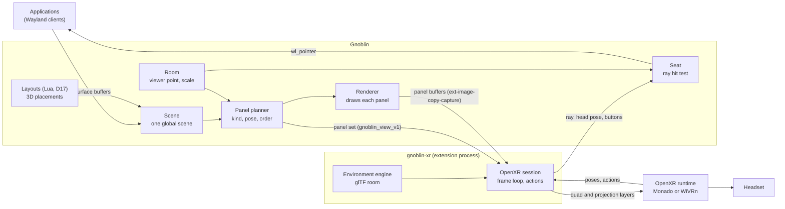

# XR extension: `gnoblin-xr`

Status: proposal (D34), revised 2026-11-08 after Kieran's second review. Nothing is built. This document replaces the
plan in the Doop frames XR 1 to XR 4 (three levels, portals, parked questions).

Labels: a claim with a file and line was read in this tree at `0becb6ae5`. A claim marked (unverified) was not read
in source, in a specification or in a test.

## The idea in five sentences

1. The headset shows Gnoblin's desktop as OpenXR composition layers: Gnoblin draws each panel, and the runtime places
   and reprojects it, as Meta, SteamVR overlays and the WebXR Layers API do.
2. A panel is the coarsest piece that stays correct: a whole output when its windows lie in its plane, one window
   with its frame and effects when a layout places windows in 3D, and one depth-tested projection when a layout
   declares that windows intersect.
3. Gnoblin keeps appearance, layout and input: it draws every panel buffer, states each panel's pose, size, space and
   order, and resolves every controller ray.
4. The `gnoblin-xr` extension runs the OpenXR session and turns Gnoblin's latest panel set into layers unchanged; it
   never edits, animates or keeps a position of its own.
5. Head-locked bars, notifications and overlays live on an output attached to the viewer, which layer-shell clients
   choose like any other output, and a separate VR space is still one optional virtual output.

## Where the control is

| Who             | Controls                                                                               |
| --------------- | -------------------------------------------------------------------------------------- |
| Gnoblin         | Appearance: every pixel of every panel, with frames, shadows, effects, popups, cursor. |
| Gnoblin         | Layout: placement (`Transform3`), panel pose and size in metres, space, order.         |
| Gnoblin         | Input: which window a ray hits, focus, grabs, bindings, the lock gate.                 |
| `gnoblin-xr`    | The OpenXR session, frame timing, swapchains, copies, and `xrEndFrame` as told.        |
| `gnoblin-xr`    | The environment drawing and the controller-to-button table.                            |
| Monado or WiVRn | Where each layer lands on the display at display time: reprojection and distortion.    |
| Monado or WiVRn | Head-locking of view-space layers, filtering, passthrough, display timing.             |

The split follows the OpenXR model: the application states layers, and the runtime composites them. Here the
application's "what and where" comes entirely from Gnoblin.

## Choosing the core idea

### The framings considered

| Framing                                                                | Verdict                                                             |
| ---------------------------------------------------------------------- | ------------------------------------------------------------------- |
| (a1) Gnoblin core runs the OpenXR session in its own process           | Rejected. The runtime's client library would run in the compositor. |
| (a2) Gnoblin renders one stereo image of the whole desktop (first D34) | Kept as a fallback only. See below.                                 |
| (a3) Gnoblin renders panels; the runtime composites them as layers     | **Chosen.**                                                         |
| (b) The extension draws windows itself from per-window captures        | Rejected. It cannot show what Gnoblin shows.                        |
| (c) Monado or WiVRn as a Wayland client, or Gnoblin inside Monado      | Rejected. It ties Gnoblin to one runtime's private interfaces.      |
| (d) Portals: ScreenCast monitors and RemoteDesktop input (old level 1) | Rejected. Flat pictures only, and stream matching is a guess.       |

Why (a1) fails:

- An OpenXR runtime loads its client library into the calling process. A runtime fault would end the session.
  D22 rejects in-process native code for third parties (`design/rust-compositor.md:2830`).
- The OpenXR frame loop blocks in `xrWaitFrame`. The compositor loop must not block on anything outside it.

Why (b) fails:

- A window capture holds the client buffer only. Popups are excluded (`design/capture-api.md:17`).
- Window frames are a layer the compositor draws around the window (`design/layers.md:204-206`). Effects (D24, D26),
  the cursor and lock covers are compositor drawing too. The extension would have to copy Gnoblin's compositing.
- Input has no standard path to a window that is not on an output. libei regions are output rectangles, and an
  absolute event outside every region is refused (`crates/gnoblin-input-eis/src/lib.rs:63-65`).

Why (c) and (d) fail:

- (c) Gnoblin would speak a runtime's internal IPC. WiVRn and Monado differ there, and neither is a standard.
- (d) The portal gives flat monitor pictures, asks for consent each session, and matches streams to outputs by
  position. The backend does not offer `VIRTUAL` (`crates/xdg-desktop-portal-gnoblin/src/iface/capture.rs:412-417`).

### Why panels, and not one stereo image

The first D34 drew the whole desktop into one projection layer per frame. Four problems, in order of weight:

1. **Head-locked content swims.** A runtime reprojects a projection layer as world content. A bar drawn locked to the
   head at render time moves against the head during reprojection. A layer in the OpenXR `VIEW` space is head-locked
   by the runtime itself (OpenXR specification, `spaces.adoc`, "head-locked").
2. **Gnoblin's cost follows the head, not the content.** Every head movement needs two new eye renders at the display
   rate. With quad layers, a still desktop costs Gnoblin nothing while the head moves: the runtime moves the layers.
3. **World panels lag Gnoblin's frame.** A projection layer is drawn with the eye poses Gnoblin had. A quad layer is
   placed by the runtime with the pose at display time, so it stays still even when Gnoblin is late.
4. **Text.** On a runtime that draws layers straight into the distorted output, a quad is sampled once instead of
   twice. Meta documents this for Quest (Meta, "Compositor layers", checked).

Point 4 is weaker on Linux. Monado's compositor first squashes layers into scratch images and then runs distortion
(Monado documentation, `chl_frame_state`, checked). So a quad is sampled twice there too. The gain on Monado and
WiVRn comes from points 1 to 3, and from a panel drawn at its own density rather than at the eye buffer's.

What panels cost, and how the design answers each:

| Cost                                     | Answer                                                                                 |
| ---------------------------------------- | -------------------------------------------------------------------------------------- |
| Layers have no depth test between them   | Gnoblin sets the order. Intersecting layouts declare `depth` and get a projection.     |
| Layer counts are limited                 | Gnoblin plans within a budget the extension reports, and falls back to one projection. |
| One buffer and one swapchain per panel   | A planar output is one panel, so the common case costs one panel per output.           |
| Backdrop blur cannot see the environment | Blur covers Gnoblin content only. The environment is never blurred.                    |

## What each wish forces

| Wish                                 | What it forces in this design                                                |
| ------------------------------------ | ---------------------------------------------------------------------------- |
| A mirror, not an extension           | Every output appears as it is now, at the place the room gives it.           |
| Switch monitors and workspaces       | Ordinary Gnoblin verbs and bindings. The panels follow Gnoblin.              |
| A separate VR output, with a policy  | One virtual output while the headset runs, with a removal policy.            |
| Head-locked panels and overlays      | An output attached to the viewer, drawn as `VIEW`-space layers.              |
| Purely translational, deterministic  | The extension passes measurements in and panels through. Gnoblin owns poses. |
| Gnoblin draws decorations and layout | Every panel buffer is Gnoblin's drawing. Every pose is Gnoblin's statement.  |
| Embedded engine, not a separate app  | The engine is a library in the extension. It draws the room only.            |
| User-made environments               | A glTF room for the look, and a Lua layout for the windows.                  |
| Industry practice and standards      | OpenXR quad and projection layers, `VIEW` space, Wayland, glTF, XDG paths.   |

The OpenXR runtime (`monado-service` or `wivrn-server`) is a separate process. It is system infrastructure, as
PipeWire is for audio. It is not a VR desktop app.

## Panels

A panel is one buffer Gnoblin draws, plus the pose, size, space and order Gnoblin gives it. Gnoblin picks the
panel kind per output, by these rules, first match wins:

| Rule | Condition                                            | Panels for that output                                        |
| ---- | ---------------------------------------------------- | ------------------------------------------------------------- |
| 1    | The workspace's layout declares `depth = true` (G13) | One **projection** panel: the output's content, depth-tested. |
| 2    | Every drawn node on the output is planar             | One **output** panel: the output's own frame.                 |
| 3    | Otherwise                                            | **Window** panels, plus band, popup and cursor panels.        |

- **Planar** is the existing test `Mat4::is_planar`: no depth offset and no perspective row
  (`crates/gnoblin-render/src/matrix.rs:180-186`). A 2D layout is planar, so a normal desktop is rule 2.
- **Output panel:** the frame the output already composes, with the cursor, frames, effects and layer-shell
  surfaces in it. For a real monitor this is the frame it presented, so the headset adds no render, only a copy.
- **Window panel:** one window's node subtree drawn flat and front-on: the window, its frame and its effect padding
  (`crates/gnoblin-render/src/scene.rs:175-176`), with shadows inside the padding. Opacity is baked in.
- **Band panels:** the output's `background` and `bottom` bands as one panel below the windows, and `top` and
  `overlay` as one panel above them (`design/layers.md:153-156`). Each is cropped to the bounds of its surfaces.
- **Popup panel:** each popup is its own panel in its parent's plane, placed after its parent. A menu opening
  does not resize the parent's buffer.
- **Cursor panel:** a small panel at the pointer, in the plane of the surface under it, last in its space.
- **Projection panel:** both eyes drawn by Gnoblin from eye poses the extension sends, as in the first D34.

Order, back to front:

1. The environment layers (extension).
2. World panels. Groups (one per output) by distance of the group's centre from `room.viewer`, farthest first,
   ties by output id. Within a group: band below, windows in stacking order with each popup after its parent, band
   above, cursor.
3. View-space panels, in the same within-group order.

OpenXR draws layers in submission order with a painter's algorithm, whether or not a later layer is nearer
(OpenXR specification, `rendering.adoc`, "Composition layers must be drawn in the same order", checked). So the
order Gnoblin states is the order the user sees.

Order follows the room's viewer point, not the live head. A rule-3 layout whose windows overlap from some other
viewpoint can look wrong when the user walks around it. That layout should declare `depth`. A layout that keeps
windows apart, such as a ring around the viewer, does not need to.

Layer budget:

- The extension reports a budget: the runtime's `maxLayerCount` less its own environment layers. OpenXR guarantees at
  least 16 (`XR_MIN_COMPOSITION_LAYERS_SUPPORTED`, `openxr.h`, checked). Monado allows 128 on Linux
  (`xrt_limits.h`, `XRT_MAX_LAYERS`, checked). Quest allows 16 (Meta, checked).
- If the planned panels exceed the budget, Gnoblin draws all world content as one projection panel. View-space
  panels stay as they are. The rule is fixed, so the same desktop and budget give the same plan.

## Architecture



### What is built where

| Part                                    | Where                      | Kind                                  |
| --------------------------------------- | -------------------------- | ------------------------------------- |
| Window placement in 3D                  | Gnoblin layouts (D17, D25) | Exists                                |
| One global scene for every output       | `gnoblin-backend` composer | Exists                                |
| Output frames, output capture           | Gnoblin                    | Exists (SHM only)                     |
| Depth pass on GLES                      | `gnoblin-render-gles`      | Exists (tested)                       |
| Hit test, ray pointer, views, room      | Gnoblin                    | New general features (G1, G2, G3, G5) |
| Panel drawing, head-locked outputs      | Gnoblin                    | New general features (G11, G12)       |
| Layout `depth` key, off-axis projection | Gnoblin                    | New (G13, G8)                         |
| Client DMA-BUF, DMA-BUF capture         | Gnoblin                    | Planned protocol coverage (G4)        |
| Virtual outputs, removal policy         | Gnoblin                    | Approved; policy is new (G6)          |
| Extension process and grants            | Gnoblin (D22)              | Decided; process tier proposed (G7)   |
| DRM lease (wired headsets only)         | Gnoblin                    | Planned protocol coverage (G10)       |
| OpenXR session, engine, environment     | `extensions/gnoblin-xr`    | The extension                         |
| Composition, reprojection, display      | Monado or WiVRn            | OpenXR standard                       |

### First frame: from a window to the headset

The case shown is a normal 2D desktop, so the output is one panel (rule 2).

1. The app attaches a buffer and commits its `wl_surface`. Standard: Wayland core, and `zwp_linux_dmabuf_v1` for GPU
   buffers (G4).
2. The layout returns a `Placement` (D17). `place_tiled` puts it on the window's scene node
   (`crates/gnoblin-wayland/src/state.rs:2148-2192`). The output composes its frame as for the monitor.
3. Gnoblin plans the panels (G3) and sends the panel set: one panel with its pose and size in metres, space `world`,
   order 0, then `done(serial)`. New: the view (G3), with the room (G5).
4. The extension creates a capture session from the panel's source and asks for a frame. Gnoblin copies the output's
   frame into the extension's DMA-BUF and sends `ready`. Standard: ext-image-copy-capture.
5. The extension copies the buffer into the panel's OpenXR swapchain image. Standard: `XR_KHR_vulkan_enable2`,
   `VK_EXT_external_memory_dma_buf`.
6. Each frame, the extension calls `xrWaitFrame` and `xrEndFrame` with the environment layer, then one
   `XrCompositionLayerQuad` in its `LOCAL` space at Gnoblin's pose and size. Standard: OpenXR core.
7. The runtime places the quad with the head pose at display time, distorts and presents. WiVRn encodes and streams.
   Standard: the runtime's own job.

Nothing in steps 3 to 5 repeats while the desktop does not change. Head movement is steps 6 and 7 only.

### A click: from the headset to the window

1. The runtime reports the aim pose, the head pose and the trigger. Standard: OpenXR actions (`xrSyncActions`,
   `xrLocateSpace`).
2. The extension sends `gnoblin_view_pointer_v1.ray` with the head pose, then `button`, then `frame`, on one
   connection. Gnoblin handles them in that order. New: the view pointer (G2, G3).
3. Gnoblin maps the ray through the room (G5). It enters the seat through the seam EIS uses, so the lock gate, grabs
   and bindings apply (`crates/gnoblin-input-eis/src/lib.rs:39-47`).
4. Gnoblin finds the last panel in submission order whose rectangle the ray crosses. That is the panel the user sees
   on top. View-space panels are tested with the head pose sent with the ray.
5. Inside that panel Gnoblin resolves the point. An output panel gives a point on the output, and the scene's hit
   test finds the window (G1). A window panel gives the window directly. A projection panel uses the nearest depth.
6. Gnoblin sends `wl_pointer.enter`, `motion`, `button` and `frame` to the app. Standard: Wayland core. Click focus
   moves keyboard focus, so the physical keyboard types into that window.
7. Gnoblin sends `gnoblin_view_pointer_v1.hit` with the distance, for the beam, and draws the cursor at the hit.

## Head-locked bars, notifications and overlays

A head-locked surface needs a place with a size, edges to anchor to and a pose. Two shapes were weighed:

| Option                               | Verdict                                                               |
| ------------------------------------ | --------------------------------------------------------------------- |
| An output attached to the viewer     | **Chosen.** Layer-shell already places surfaces on outputs.           |
| A per-surface "head-locked" property | Rejected. The surface still needs an output-sized frame to anchor in. |

The chosen shape (G12):

- A virtual output with `attach = "viewer"` and a `distance` in metres. Its plane faces the viewer at that distance
  in the `VIEW` space, at `room.scale` metres per pixel.
- It holds layer-shell surfaces only. With `windows = false`, Gnoblin never places or moves a window there.
- A layer-shell client picks it like any output, with the standard `output` argument of `get_layer_surface`. A bar
  runs one instance per output, so it can run one on the head-locked output too.
- A client that leaves the output to the compositor gets one from a window rule that matches layer surfaces by
  namespace, with a new `output` action. That rule works for every output, not only this one.
- It is created when the headset session starts, if `xr.hud` names it, and removed when the session ends.
- It is drawn as rule 2 panels in the `VIEW` space, after every world panel, so it is always on top.
- The ray reaches it through step 4 of the click path. It wins whenever it is crossed, because it is drawn on top.
- A monitor's own bar stays on that monitor in the room. That is the mirror.

Example:

```lua
gnoblin.configure.xr = { hud = "XR-HUD" }
gnoblin.configure.outputs = {
  { output = "XR-HUD", virtual = { width = 1600, height = 900, scale = 2 },
    attach = "viewer", distance = 1.0, windows = false },
}
gnoblin.window_rule {
  match = { type = "layer", layer = "^notifications$" },
  output = "XR-HUD",
}
```

## What Gnoblin must gain

Each item stands on its own merits. None names XR in its interface.

### G1: pointer hit testing through the scene

- **What:** the seat picks the window under the pointer with `Scene::hit_test`, not with window rectangles.
- **Why general:** a rotated or tilted window on a monitor is clickable where it is drawn. D17 already requires this
  (`design/rust-compositor.md:2171-2173`).
- **Code today:** `surface_under` tests plain rectangles and ignores transforms
  (`crates/gnoblin-wayland/src/state.rs:2979-3016`). `Scene::hit_test` maps a point through the inverse transform
  (`crates/gnoblin-render/src/scene.rs:645-653`, `:821-826`).

### G2: a ray pointer

- **What:** a pointer position may be a ray in scene space, with the head pose it was measured with. A 2D position on
  an output is the special case. Ray intersection with node planes is added beside `hit_test`.
- **Pick order:** the topmost panel crossed, in the stated order, as step 4 of the click path.
- **Implicit grab:** while a button is held, the ray meets the grabbed window's plane, as a 2D grab does.
- **Why general:** any 3D layout, and any 6-axis pointing device.
- **Code today:** EIS turns remote input into `gnoblin_backend::InputEvent`, the type libinput produces
  (`crates/gnoblin-input-eis/src/lib.rs:39-47`). A ray becomes one more event kind on that seam.

### G3: views and panel sets (`gnoblin_view_v1`)

A view is one consumer's window onto the scene. Gnoblin plans its panels and states them. It is a Gnoblin Wayland
protocol, like `gnoblin_window_frame_v1`.

| Interface                 | Request or event                              | Meaning                                                   |
| ------------------------- | --------------------------------------------- | --------------------------------------------------------- |
| `gnoblin_view_manager_v1` | `create_view`                                 | A new view.                                               |
| `gnoblin_view_v1`         | `set_layer_budget(count)`                     | How many panels the consumer can show.                    |
| `gnoblin_view_v1`         | event `panel(new panel)`                      | A panel exists from the next `done`.                      |
| `gnoblin_view_v1`         | event `done(serial)`                          | The panel set since the last `done` is complete.          |
| `gnoblin_view_v1`         | event `available`, `unavailable`              | Whether panels may be captured now, with a reason.        |
| `gnoblin_view_v1`         | `get_pointer(seat)`                           | A ray pointer on that seat.                               |
| `gnoblin_view_panel_v1`   | event `state(kind, space, pose, size, order)` | Double-buffered; applies at `done`.                       |
| `gnoblin_view_panel_v1`   | event `removed`                               | Gone at the next `done`.                                  |
| `gnoblin_view_panel_v1`   | `create_source`                               | An `ext_image_capture_source_v1` for this panel's pixels. |
| `gnoblin_view_panel_v1`   | `set_eyes(array)`                             | Projection panels only: eye poses for the next capture.   |
| `gnoblin_view_pointer_v1` | `ray`, `button`, `axis`, `frame`              | Input. `ray` carries the head pose.                       |
| `gnoblin_view_pointer_v1` | event `hit(distance)`, `miss`                 | Where the last ray landed.                                |

Rules:

- **Atomic sets.** Panel state is double-buffered and applies at `done(serial)`, as `wl_surface` state applies at
  commit. The consumer shows a whole set or the previous one.
- **Pixels before the set.** Gnoblin sends `done(serial)` only after the `ready` of every panel whose pixels changed
  in that set. Events on one connection arrive in order, so at `done` the last `ready` of each panel is its content.
  A consumer keeps one capture pending per panel.
- **On change only.** Gnoblin sends a set when the scene, the room or the budget changes. Head movement sends nothing.
  Animation sends a set per tween step, from Gnoblin's tween player.
- **Units.** Poses are in metres in the consumer's tracking space, after the room (G5). `world` panels use the
  `LOCAL` space; `view` panels use the `VIEW` space. Floats travel as little-endian `f32` arrays.
- **Density.** A panel's pixel size is its logical size times its output's scale. A virtual output's `scale` sets the
  density for its panels.
- **Background.** A physical display's output panel shows the session background. A virtual output's does not, so
  its windows float in the environment.
- **Secure windows** are drawn with the frame's existing mask (`crates/gnoblin-render-frame/src/frame.rs:97`).
- **Privacy and audit.** The privacy indicator is on while any panel capture runs. View creation is audited, as for
  capture streams (`design/capture-api.md:86-96`).
- **Latching for projection panels.** `set_eyes` applies to that panel's next capture. Wayland handles one client's
  requests in order, so each projection frame has exactly the eyes sent before it.

Why general: headsets, AR glasses, stereo displays, and any consumer that wants the desktop as separate pieces with
their places, such as a 3D overview or a test that checks placements without pixels.

Code today:

- The extension point is in the standard: ext-image-capture-source "may be extended to support more image capture
  sources" (protocol text at wayland.app, checked).
- A capture copies from the last frame an output presented
  (`crates/gnoblin-wayland/src/protocols/capture_shared.rs:13-20`). Output panels reuse that path unchanged.
- The composer keeps one scene in global logical coordinates for every output
  (`crates/gnoblin-backend/src/render/compose.rs:26-33`).

### G4: DMA-BUF for clients and for capture

- **What:** serve `zwp_linux_dmabuf_v1` to clients, and offer DMA-BUF buffers in ext-image-copy-capture.
- **Why general:** every GPU client, and every screencast at full frame rate.
- **Code today:** linux-dmabuf is in the plan's protocol coverage (`design/rust-compositor.md:673`). No
  `DmabufState` is wired in `crates/gnoblin-wayland` (searched). Capture is SHM only
  (`crates/gnoblin-wayland/src/protocols/ext_image_copy_capture_v1.rs:44`). The GLES renderer can import a DMA-BUF
  as a render target (`crates/gnoblin-render-gles/src/lib.rs:434-445`).

### G5: the room

- **What:** one Gnoblin object, `room`, with two properties. `viewer` is a point in scene pixels where the
  tracking-space origin sits. `scale` is metres per logical pixel.
- **Mapping:** a tracking-space point `(x, y, z)` in metres is `viewer + (x, -y, z) / scale` in the scene. Scene `z`
  grows toward the viewer (`crates/gnoblin-render/src/matrix.rs:139-149`), so no rotation is needed. Panel poses
  use the inverse.
- **Default:** `viewer` sits in front of the primary output's centre, at a distance equal to its width. An explicit
  value pins it.
- **Layouts:** `ctx.room` gives a layout the viewer point and scale, read-only, so it can ring windows around the
  viewer. This is an addition to the D17 snapshot.
- **Why general:** it is the one place where Gnoblin's pixels meet physical space.

### G6: virtual outputs with a removal policy

- **What:** the approved virtual outputs, created over the IPC by a holder of a grant, and owned by that connection.
  A new output property `on_remove` has two values: `move` and `close`.
- **`move`:** today's behaviour. Windows go to the first surviving output (`crates/gnoblin-wm/src/wm.rs:1138-1190`).
- **`close`:** Gnoblin asks each window to close. A window that stays open moves as for `move`. Nothing is lost.
- **Code today:** no virtual output exists. `design/outputs.md:41` excludes them from the first API.

### G7: extension processes with a connection Gnoblin creates

- **What:** the D22 process power starts the extension and hands it a connected Wayland socket (`WAYLAND_SOCKET`, the
  libwayland convention for a compositor-started client) and the IPC socket (`{socket}`,
  `design/rust-compositor.md:2766`). The connection's role comes from the package's grants.
- **Grants used:** `capture` (panels), `input.inject` (view pointer), and a grant to create a virtual output, needed
  only for the VR output and the head-locked output. Names follow D22 (`design/rust-compositor.md:2791-2810`).
- **Code today:** a frame renderer is started by the compositor and sees one global only
  (`crates/gnoblin-wayland/src/access.rs:205-213`, `:240-251`). Its role is promised by pid before spawn
  (`crates/gnoblin-wayland/src/server.rs:991-1000`). The guardian supervises with restart limits
  (`crates/gnoblin-session/src/guardian.rs:875`).
- **Not used:** the privileged socket. It trusts any process of the same user (`design/capture-protocols.md:12-18`).

### G8: off-axis projection

- **What:** a projection from four angles (left, right, up, down), as OpenXR reports them. Projection panels only.
- **Code today:** `Mat4::perspective` is symmetric about a centre (`crates/gnoblin-render/src/matrix.rs:151-162`).

### G9: frame callbacks for content only a view shows

- **What:** a surface drawn into a captured panel gets its frame callbacks from that capture.
- **Why:** windows on a virtual output have no display. Without this, their clients would stop drawing.
- **Code today:** callbacks are sent from the output frame path (`crates/gnoblin-wayland/src/frame.rs:237`).

### G10: wired headsets only

- **What:** `wp_drm_lease_device_v1`, and connectors marked non-desktop are left out of the output layout.
- **Why:** a wired headset is driven through a DRM lease by the runtime (unverified detail). WiVRn and the simulated
  headset do not need it.
- **Code today:** drm-lease is in the plan's coverage list (`design/rust-compositor.md:673`). It is not wired.

### G11 (new): drawing one subtree into its own buffer

- **What:** the composer draws one window's node subtree (the window, its frame and its effect padding) flat and
  front-on into a buffer, at the output's scale. Band groups and popups are drawn the same way.
- **Backdrop blur** in a window panel blurs the Gnoblin content behind it in the same plane. It cannot blur the
  environment, which Gnoblin never sees.
- **Why general:** window thumbnails and previews, and window capture that includes the frame the user sees. The
  current window still excludes it (`design/capture-api.md:17`).
- **Code today:** the composer composes per output only (`crates/gnoblin-backend/src/render/compose.rs:1114`). The
  scene already knows each node's padded bounds (`crates/gnoblin-render/src/scene.rs:175-176`).

### G12 (new): outputs attached to the viewer, and an `output` rule action

- **What:** an output property `attach` (`"world"` or `"viewer"`) with a `distance`, and a property `windows`
  (`true` or `false`). A window rule gains an `output` action, so a rule matching a layer surface can pick its
  output when the client left the choice to Gnoblin.
- **Why general:** any spatial display needs a head-locked surface place. The `output` action helps every
  multi-monitor setup where a client cannot name an output.
- **Code today:** the wm ends output-scope layer surfaces with their output (`crates/gnoblin-wm/src/wm.rs:1147-1149`).
  The legacy rule contract matches layer surfaces (`type = "layer"`, `layer` namespace pattern,
  `design/window-rules.md:24`, `:28`). The Rust reference lists `type = "window"` only
  (`docs/config/window_rule.md:21`). No rule has an `output` action.

### G13 (new): a layout declares `depth`

- **What:** a layout module may set `depth = true` beside `kind` and `extent` (D25). It means its windows can
  intersect or overlap in depth, so a consumer must not order them by stacking alone.
- **Why general:** it tells any per-window consumer, and the renderer, that painter's order is not enough.
  `gnoblin.layouts.carousel3d` sets it.
- **Code today:** D25 validates `kind` and `extent` at load (`design/rust-compositor.md:3012`). `depth` adds one key.

### What is not needed

- No portal. Portals serve sandboxed apps that ask the user. A host-granted extension is not one.
- No `window.read` or `window.write`. The extension sees panels, never windows.
- No foreign-toplevel list.
- No cylinder layers. Gnoblin has no curved placement, so nothing would state a curve. Quads and projection cover
  every panel kind above.
- No positions exposed to ordinary clients. D25 keeps placement internal (`design/rust-compositor.md:2999`). Panel
  poses go only to a view holding the `capture` grant.

## What the extension contains

`extensions/gnoblin-xr` is its own Cargo workspace, in Rust. It ships as its own package, as D22 requires.

| Module        | Job                                                                               |
| ------------- | --------------------------------------------------------------------------------- |
| `session`     | OpenXR instance, session, `LOCAL` and `VIEW` spaces, frame loop, session states.  |
| `view`        | Wayland client: `gnoblin_view_v1`, one capture session per panel, linux-dmabuf.   |
| `layers`      | The pure function from the applied panel set to `xrEndFrame` layers.              |
| `gpu`         | One Vulkan device shared with OpenXR; DMA-BUF import; copy into swapchain images. |
| `input`       | OpenXR actions to ray, head pose, buttons and scroll, by a fixed table.           |
| `environment` | Loads an environment and draws it with the engine.                                |
| `output`      | Creates and removes the VR and head-locked outputs over the IPC.                  |

What it holds, and why that is not a position store:

- It holds the last applied panel set and one swapchain per panel. A new `done` replaces the set whole. The set is
  never edited, interpolated or derived from.
- This is the same relation a Wayland client has to its last configure, or a display to its last frame.
- `layers` is a pure function: `Layers(panel set, environment, eyes for projection panels)`. A test feeds it recorded
  sets and checks that every pose and size in the output came from the input set.

The engine draws a glTF 2.0 scene into a Vulkan image for two given eye matrices. The extension, not the engine,
owns the OpenXR session, so there is one frame loop. The first choice is Bevy rendering offscreen on the shared
device, as bingux-vr uses Bevy (unverified: that Bevy can draw into an external Vulkan image).

Manifest:

```toml
id = "gnoblin.xr"
version = "0.1.0"
gnoblin = ">=0.2.0, <0.3.0"

[powers.process]
command = ["gnoblin-xr", "--socket", "{socket}"]
restart = "on-failure"
max_restarts = 3

[powers.hooks]
config = "config.toml"

[capabilities]
requests = ["capture", "input.inject", "config.schema", "model.output.create_virtual"]
```

The last capability name is a proposal under D22's `model.<object>.<member>` form.

### Controller table

| OpenXR action    | Sent to Gnoblin                 |
| ---------------- | ------------------------------- |
| Aim pose         | `ray`, with the head pose       |
| Trigger (select) | `BTN_LEFT`                      |
| Grip (squeeze)   | `BTN_RIGHT`                     |
| Thumbstick click | `BTN_MIDDLE`                    |
| Thumbstick       | `axis`, vertical and horizontal |
| A or X           | `BTN_SIDE`                      |
| B or Y           | `BTN_EXTRA`                     |

- One ray at a time. The hand that pressed a button last sends the ray. The right hand sends it at start.
- Workspace and monitor switching are Gnoblin bindings on these buttons. Bindings already match pointer buttons
  (`crates/gnoblin-input/src/chord.rs:404`).

## Settings

Proposed keys. The output section's shape follows the virtual-output work when it lands.

```lua
gnoblin.configure.xr = {
  environment = "void",   -- directory name, see "User-made environments"
  output = nil,           -- or "XR-1": add that virtual output while the headset runs
  hud = nil,              -- or "XR-HUD": add that head-locked output while the headset runs
}

gnoblin.configure.room = { scale = 0.0006 }

gnoblin.configure.outputs = {
  { output = "XR-1", virtual = { width = 3840, height = 2160, scale = 2 }, on_remove = "move" },
}
```

| Key                | Values                      | Default             | Effect                                               |
| ------------------ | --------------------------- | ------------------- | ---------------------------------------------------- |
| `xr.environment`   | an environment name         | `"void"`            | The room drawn behind the desktop.                   |
| `xr.output`        | `nil` or an output name     | `nil` (mirror only) | Adds that virtual output while the session runs.     |
| `xr.hud`           | `nil` or an output name     | `nil`               | Adds that head-locked output while the session runs. |
| `room.viewer`      | `{x, y, z}` in scene pixels | in front of primary | Pins where the headset origin sits.                  |
| `room.scale`       | metres per logical pixel    | `0.0006`            | Size of the desktop in the room.                     |
| output `on_remove` | `"move"`, `"close"`         | Decision 1          | What happens to windows when the output goes.        |
| output `attach`    | `"world"`, `"viewer"`       | `"world"`           | Whether the output follows the head.                 |
| output `distance`  | metres                      | `1.0`               | How far a `viewer` output sits from the eyes.        |
| output `windows`   | `true`, `false`             | `true`              | Whether windows may be placed on the output.         |
| layout `depth`     | `true`, `false`             | `false`             | Whether the layout needs a depth-tested panel.       |

## User-made environments

An environment has two parts, and neither needs code or a build.

| Part            | What it is                                  | Who owns it            |
| --------------- | ------------------------------------------- | ---------------------- |
| The look        | A glTF 2.0 room and an optional sky image   | The extension draws it |
| The arrangement | A Lua layout for the VR output's workspaces | Gnoblin runs it (D17)  |

The look lives in a directory found by the XDG base-directory rules:

```text
$XDG_DATA_HOME/gnoblin-xr/environments/cabin/
  environment.toml
  cabin.glb
  sky.hdr
```

```toml
name = "Cabin"
scene = "cabin.glb"     # glTF 2.0 binary, metres, +Y up, origin on the floor below the viewer
sky = "sky.hdr"         # optional equirectangular image
passthrough = false     # true: draw nothing, use the headset's camera view where the runtime offers it
```

The steps for a user:

1. Build a room in Blender, with the viewer at the origin, and export it as `.glb`.
2. Write `environment.toml` beside it.
3. Set `gnoblin.configure.xr.environment = "cabin"`.
4. Optional: copy a shipped layout, edit it to place windows around `ctx.room.viewer`, and set it on the VR output's
   workspace. Set `depth = true` only if windows may cross each other.

An environment holds no window positions. Panels are always drawn after the environment, so a room cannot hide a
window.

## Behaviour

| Event                                   | Result                                                                                       |
| --------------------------------------- | -------------------------------------------------------------------------------------------- |
| Runtime found, session starts           | View created. The VR and head-locked outputs named in `xr` are created. A panel set follows. |
| Headset taken off (session not visible) | No captures are requested. Gnoblin draws nothing for panels. The outputs stay.               |
| Head moves                              | Nothing reaches Gnoblin, except for projection panels.                                       |
| Headset disconnects or runtime stops    | View destroyed. The virtual outputs are removed and their `on_remove` runs.                  |
| Extension crashes                       | Its connections close: same as a disconnect. The guardian restarts it per policy.            |
| Workspace switch                        | A new panel set and new pixels. The next submitted frame shows them.                         |
| Layout changes between 2D and 3D        | The panel kind changes in one set, by the panel rules.                                       |
| Monitor added or removed                | A new panel set. Unless `room.viewer` is pinned, the default viewer moves with the primary.  |
| Budget too small for the plan           | World content becomes one projection panel in the next set.                                  |
| Session locks                           | Decision 2.                                                                                  |
| Session unlocks                         | `available` arrives, and a new panel set follows.                                            |

Lock, the two outcomes of decision 2:

- **Dark:** panels are captures under today's embargo and stop at lock
  (`crates/gnoblin-wayland/src/protocols/capture_shared.rs:22-31`). The panel set becomes empty. The headset shows the
  room and a lock notice drawn by the extension.
- **Lock screen:** output panels continue and show the lock scene only, by the existing granted-stream rule
  (`crates/gnoblin-capture/src/lib.rs:33-39`). Window, band and popup panels are removed. The head-locked output gets
  its own lock surface, as every output does, so the lock screen can sit in view. The ray stays refused while locked.

## Determinism

- A panel set is `Plan(scene revision, room, budget)`, computed by Gnoblin. The same inputs give the same set: the
  panel rules, the order rule and the budget rule are fixed.
- The submitted layers are `Layers(last applied set, environment, eyes)`. Eyes matter only for projection panels and
  the environment.
- Pixels pair with poses by the "pixels before the set" rule, on one ordered connection.
- The runtime places each layer with the head pose at display time. That pose is a measurement, not state.
- A pick is `Pick(scene revision, room, panel order, ray, head pose)`, computed by Gnoblin in input order.
- The extension adds only measurements (poses, rays, buttons) and a fixed button table.
- Replay test: a recorded scene, room, budget, eye list and ray list give the same sets, layers and picks.
- Late frame rule: if a panel has no new `ready`, the previous pixels stay. A projection panel whose frame is late is
  resubmitted with the eyes it was drawn with.

## Failure modes

| Failure                                      | Outcome                                                                                                            |
| -------------------------------------------- | ------------------------------------------------------------------------------------------------------------------ |
| No OpenXR runtime installed or active        | The extension reports `no-runtime` and retries every 2 seconds.                                                    |
| Runtime and Gnoblin on different GPUs        | The extension refuses with `gpu-mismatch`. No cross-GPU copy.                                                      |
| Grant `capture` missing                      | The view global is not offered. The extension reports `capability-not-granted`.                                    |
| Grant `input.inject` missing                 | `get_pointer` is refused. Panels still show.                                                                       |
| A panel swapchain or buffer cannot be made   | The extension sets the budget to 1. Gnoblin sends one projection panel.                                            |
| Budget below the view-space panels           | View-space panels beyond it are not drawn, and the view reports `layer-budget`.                                    |
| A rule-3 layout overlaps windows in depth    | Wrong order from some angles. The layout should declare `depth`.                                                   |
| Renderer without a depth pass (Vulkan today) | Projection panels refuse 3D as `unsupported-3d`, as on monitors (`crates/gnoblin-render-vulkan/src/frame.rs:441`). |
| Pointer object destroyed with a button held  | Gnoblin releases the button, as for a removed EIS device.                                                          |
| Window closes under a held ray               | The grab ends as for a 2D pointer.                                                                                 |
| Virtual output removal with unsaved windows  | `close` asks, and a window that stays open moves.                                                                  |
| Bad environment file                         | The extension falls back to `void` and reports the parse error.                                                    |

## Costs

Estimates, not measurements:

- **Common case:** one output panel per monitor. For a real monitor, Gnoblin adds a GPU copy per changed frame and
  no render. Memory per panel is two capture buffers and the runtime's swapchain images, about 5 frames: 165 MB for
  a 4K output, 40 MB for 1080p.
- **3D layout without `depth`:** one panel per window, sized to the window. Memory grows with window area.
- **Projection panel:** two eye renders per displayed frame while it exists, as in the first D34.
- **Copies:** only panels whose pixels changed are copied, each once per change.

## Phased plan

### Phase 1: one output as one quad, in a simulated headset

Testable on an Agent37 instance with Monado's simulated headset.

- Gnoblin: G1, G2 (output panels), G3 (output panels only), G5 (defaults only). SHM buffers are allowed in this
  phase; the capture protocol defines them.
- Connection: Gnoblin starts the extension and promises its pid a single-purpose role that sees the view global
  only, as it does for frame renderers today. G7 replaces this in phase 2.
- Extension: session, view, layers, gpu, input. No engine: the environment is a solid colour.
- Monado: simulated driver and the null compositor (exists in Monado's documentation; how to select it is
  unverified).
- Tests:
    1. A test client creates a view. The headless output gives one panel whose pose and size equal the room mapping
       of the output rectangle, the same on every run.
    2. A ray aimed at a window's centre gives `wl_pointer.enter` at the surface centre. A button gives a click.
    3. The extension runs against the simulated headset. `xrEndFrame` accepts one `XrCompositionLayerQuad` at
       Gnoblin's pose, and a dump of its swapchain image equals the output frame.
    4. Head movement from the simulated driver sends no request to Gnoblin.
    5. Lock gives `unavailable`, and unlock gives `available`.

### Phase 2: 3D layouts, head-locked surfaces, the VR output

- G11 (window, band, popup and cursor panels), G13 and G8 (projection panels), the budget rule, G12 (head-locked
  outputs, the `output` rule action), G4, G6, G7, G9, and `ctx.room`.
- A shipped example layout that rings windows around the viewer.
- Tests on Agent37 with the simulated headset:
    1. A ring layout gives one quad per window, in stacking order.
    2. `carousel3d` gives one projection layer.
    3. A budget of 1 gives one projection layer for the whole world.
    4. A notification on the head-locked output gives a `VIEW`-space quad after every world layer.
    5. The VR output appears with the session and goes with it; `move` and `close` behave as specified.

### Phase 3: environments

- The engine, `environment.toml`, two shipped environments (`void`, `room`) and passthrough where offered.
- User guide and environment author guide in `docs/`.

### Phase 4: real headsets

- WiVRn with the Quest 3S on fsociety, where `wivrn-server` is installed.
- Wired headsets through G10.

## Risks

| Risk                                                               | Mitigation                                                                |
| ------------------------------------------------------------------ | ------------------------------------------------------------------------- |
| On Monado, quads are sampled twice, as projection is               | The gains claimed are head-locking, display-time pose and cost.           |
| Minified panels alias at a distance                                | Mip levels in the swapchain where the runtime supports them (unverified). |
| Memory for many window panels                                      | Planar outputs are one panel; the budget rule caps the rest.              |
| Order is wrong for a 3D layout seen from far off the viewer point  | The layout declares `depth`.                                              |
| The pixels-before-set rule stalls a set behind a slow capture      | One capture pending per panel; measure in phase 2.                        |
| D22 process tier and grants are not built                          | Phase 1 uses the existing pid promise, as frame renderers do.             |
| WiVRn layer count and quad support (unverified)                    | The budget rule adapts to `maxLayerCount`.                                |
| Bevy cannot draw into an external Vulkan image (unverified)        | The engine contract is small; another glTF renderer can fill it.          |
| Interaction profiles differ between runtimes                       | Bind `khr/simple_controller` first, then known profiles.                  |
| Multi-seat work changes the seat model (`design/multi-seat.md`)    | The view pointer names its seat from the start.                           |
| D33 moves z-order into layouts (`design/layout-owns-placement.md`) | Window panel order reads the stacking order, whoever sets it.             |

## Decisions for Kieran

The panel kind is not a decision: the panel rules pick it from the layout. Two choices remain.

### Decision 1: what happens to the VR output's windows when the headset goes

Applies only when you choose a separate VR output.

- **Move (my lean):** the windows go to your main screen. Nothing is lost. This is what Gnoblin does today when a
  monitor is unplugged.
- **Close:** Gnoblin asks each window to close. A program with unsaved work asks you first. If it stays open, it moves
  to the main screen, so nothing is lost either way.

You can set either per output. This picks the default.

### Decision 2: what the headset shows when the session locks

- **Dark:** the headset shows only the room and a "locked" notice. You unlock at a monitor or by typing blind. No
  rule changes.
- **Lock screen (my lean):** the headset shows the lock screen, and nothing behind it. With a head-locked output, the
  lock screen sits in view. You type your password without taking the headset off. This uses the rule Gnoblin already
  has for granted streams. D22 says capture is refused while locked, so D22 gets a one-line exception for views.

## What I could not verify

- The Monado null compositor's selection at run time, and whether the simulated driver reports stable poses.
- Monado and WiVRn support for mip levels in swapchains, and WiVRn's `maxLayerCount`.
- WiVRn session states when the headset disconnects.
- DMA-BUF import of a compositor-filled buffer into the runtime's Vulkan device without a CPU copy, and its cost.
- Bevy rendering into an external Vulkan image on a device shared with OpenXR.
- Whether Agent37 instances have a GPU. Without one, phase 1 uses the software renderer and SHM.
- That no Gnoblin code applies a layout reply's camera to the scene. I found only `Camera::Orthographic` in
  `crates/gnoblin-compositor/src/layout.rs:427`. Panels ignore the layout camera either way.
- Whether repository gates (`xtask`, hooks) scan `extensions/`.
- SteamVR overlay and xrdesktop details, from memory.

Checked during this revision:

- The painter's rule and the 16-layer minimum: OpenXR specification (`rendering.adoc`, `system.adoc`) and `openxr.h`.
- The `VIEW` space as head-locked: OpenXR `spaces.adoc`.
- Monado's 128-layer limit on Linux: `xrt_limits.h`.
- Monado's squash-then-distort path: the `chl_frame_state` documentation.
- Meta's single-sample claim and its 16-layer limit: Meta, "Compositor layers".
- The `space` attribute of WebXR quad layers: WebXR Layers API Level 1.

## What this replaces

| Old item                                     | Now                                                               |
| -------------------------------------------- | ----------------------------------------------------------------- |
| Level 1: mirror monitors through ScreenCast  | Output panels, at the room's place, with Gnoblin's own frames.    |
| Level 2: every window as a panel             | Window panels, drawn by Gnoblin with frames, when a layout is 3D. |
| Level 3: separate VR output                  | Kept, as `xr.output` and G6.                                      |
| First D34: one stereo image of the desktop   | Projection panels, for `depth` layouts and the budget fallback.   |
| RemoteDesktop and libei input                | The view pointer (G2, G3).                                        |
| Parked: how a screen's pose and curve arrive | The panel set from Gnoblin (G3) and the room (G5). No curves.     |
| Parked: configured or per-session VR output  | Configured by name, created for each headset session.             |
