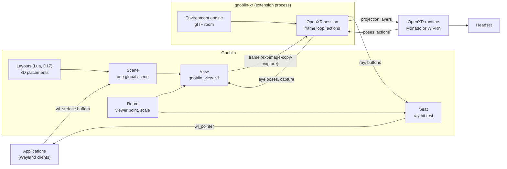

# XR extension: `gnoblin-xr`

Status: proposal, 2026-11-08. Nothing is built. This document replaces the plan in the Doop frames XR 1 to XR 4
(three levels, portals, parked questions).

Labels: a claim with a file and line was read in this tree at `5e5870cbb`. A claim marked (unverified) was not read
in source or tested.

## The idea in five sentences

1. A headset is a camera that looks at the desktop Gnoblin already has.
2. Gnoblin draws what that camera sees with the renderer, scene and 3D placements it uses for monitors, so popups,
   frames, effects, the cursor and the lock rules are the same.
3. The `gnoblin-xr` extension is the headset's driver: it runs the OpenXR session, gives Gnoblin the eye and
   controller poses for each frame, and passes Gnoblin's picture to the OpenXR runtime.
4. Gnoblin decides everything you see and everything you click, and the extension stores no window, position or
   layout, so the picture is a function of Gnoblin's state and the head pose.
5. A separate VR space is one optional virtual output, and a user-made environment is a glTF room drawn behind the
   desktop plus an ordinary Gnoblin layout for the windows.

## Choosing the core idea

### The framings considered

| Framing                                                                 | Verdict                                                             |
| ----------------------------------------------------------------------- | ------------------------------------------------------------------- |
| (a1) Gnoblin core runs the OpenXR session in its own process            | Rejected. The runtime's client library would run in the compositor. |
| (a2) The headset is a camera on Gnoblin's scene; an extension drives it | **Chosen.**                                                         |
| (b) The extension draws windows itself from per-window captures         | Rejected. It cannot show what Gnoblin shows.                        |
| (c) Monado or WiVRn as a Wayland client, or Gnoblin inside Monado       | Rejected. It ties Gnoblin to one runtime's private interfaces.      |
| (d) Portals: ScreenCast monitors and RemoteDesktop input (old level 1)  | Rejected. Flat pictures only, and stream matching is a guess.       |

Why (a1) fails:

- An OpenXR runtime loads its client library into the calling process. A runtime fault would end the session.
  D22 rejects in-process native code for third parties (`design/rust-compositor.md:2828`).
- The OpenXR frame loop blocks in `xrWaitFrame`. The compositor loop must not block on anything outside it.

Why (b) fails:

- A window capture holds the client buffer only. Popups are excluded (`design/capture-api.md:17`).
- Window frames are a layer the compositor draws around the window (`design/layers.md:204-206`). They are not in the
  client buffer. Effects (D24, D26), the cursor and lock covers are compositor drawing too.
- The extension would have to copy Gnoblin's compositing to look right. Two compositors give two answers, so the
  view would not be deterministic against what the monitors show.
- Per-window capture streams are design only (`design/capture-api.md:86-96`).
- Input has no standard path to a window that is not on an output. libei regions are output rectangles, and an
  absolute event outside every region is refused (`crates/gnoblin-input-eis/src/lib.rs:63-65`).

Why (c) and (d) fail:

- (c) Gnoblin would speak a runtime's internal IPC. WiVRn and Monado differ there, and neither is a standard.
- (d) The portal gives flat monitor pictures, so a 3D layout is seen flattened. It asks for consent each session.
  Matching a stream to an output by position and size is a heuristic. The backend does not offer `VIRTUAL`
  (`crates/xdg-desktop-portal-gnoblin/src/iface/capture.rs:412-417`).

Prior art (unverified detail): Collabora's wxrd is a wlroots compositor that draws windows in VR itself, which is
model (a). xrdesktop's compositor plugins exported window textures to a separate client, which is model (b).

### What each wish forces

| Wish                                | What it forces in this design                                                |
| ----------------------------------- | ---------------------------------------------------------------------------- |
| A mirror, not an extension          | The headset sees the whole scene: every output as it is now.                 |
| Switch monitors and workspaces      | Ordinary Gnoblin verbs and bindings. The view follows Gnoblin.               |
| A separate VR output, with a policy | One virtual output while the headset runs, with a removal policy.            |
| Purely translational, deterministic | The extension passes measurements in and pixels out. Gnoblin owns positions. |
| Gnoblin 3D positioning              | Layout placements (`Transform3`) are drawn in true 3D in the headset.        |
| Embedded engine, not a separate app | The engine is a library in the extension. It draws the room only.            |
| User-made environments              | A glTF room for the look, and a Lua layout for the windows.                  |
| No hacks, standards                 | Wayland, OpenXR, glTF and XDG directories. Gaps become Gnoblin features.     |

The OpenXR runtime (`monado-service` or `wivrn-server`) is a separate process. It is system infrastructure, as
PipeWire is for audio. It is not a VR desktop app.

## Architecture



### What is built where

| Part                                | Where                      | Kind                                          |
| ----------------------------------- | -------------------------- | --------------------------------------------- |
| Window placement in 3D              | Gnoblin layouts (D17, D25) | Exists                                        |
| One global scene for every output   | `gnoblin-backend` composer | Exists                                        |
| Depth pass on GLES                  | `gnoblin-render-gles`      | Exists (tested)                               |
| Hit test, ray pointer, views, room  | Gnoblin                    | New general features (G1, G2, G3, G5, G8, G9) |
| Client DMA-BUF, DMA-BUF capture     | Gnoblin                    | Planned protocol coverage (G4)                |
| Virtual outputs, removal policy     | Gnoblin                    | Approved; policy is new (G6)                  |
| Extension process and grants        | Gnoblin (D22)              | Decided; process tier proposed (G7)           |
| DRM lease (wired headsets only)     | Gnoblin                    | Planned protocol coverage (G10)               |
| OpenXR session, engine, environment | `extensions/gnoblin-xr`    | The extension                                 |
| Composition, reprojection, display  | Monado or WiVRn            | OpenXR standard                               |

### First frame: from a window to the headset

1. The app attaches a buffer and commits its `wl_surface`. Standard: Wayland core, and `zwp_linux_dmabuf_v1` for
   GPU buffers (G4).
2. The workspace's layout returns a `Placement` with a `Transform3` (D17). `place_tiled` puts its depth, rotation and
   scale on the window's scene node (`crates/gnoblin-wayland/src/state.rs:2122-2156`).
3. The extension calls `xrWaitFrame` for the predicted display time, then `xrLocateViews` in the `LOCAL` space. It gets
   two eye poses and four field-of-view angles per eye. Standard: OpenXR core.
4. The extension sends `gnoblin_view_v1.set_eyes`, then `ext_image_copy_capture_frame_v1.attach_buffer` and
   `capture` on a session made from the view's source. Standard: ext-image-copy-capture. New: the view (G3).
5. Gnoblin maps the eyes through the room (G5). It draws the scene twice, once per eye half, with off-axis
   projections (G8) and the GLES depth pass. It draws into the client's buffer.
6. Gnoblin sends `ready` and `presentation_time` after its GPU work completes. Standard: ext-image-copy-capture.
7. The extension imports the DMA-BUF into Vulkan and copies it into the acquired swapchain image. Standard:
   `XR_KHR_vulkan_enable2`, `VK_EXT_external_memory_dma_buf`.
8. The extension calls `xrEndFrame` with two projection layers: the environment, then the desktop with source alpha.
   Each layer carries the eye poses from step 3. Standard: `XrCompositionLayerProjection`.
9. The runtime composites, reprojects to the newest head pose and presents. WiVRn encodes and streams. Standard:
   the runtime's own job.

### A click: from the headset to the window

1. The runtime reports the aim pose and the trigger. Standard: OpenXR actions (`xrSyncActions`, `xrLocateSpace`).
2. The extension sends `gnoblin_view_pointer_v1.ray`, then `button`, then `frame`. They travel on one connection, so
   Gnoblin handles them in that order. New: the view pointer (G2, G3).
3. Gnoblin maps the ray through the room (G5). It enters the seat as an input event through the same seam EIS uses,
   so the lock gate, grabs and bindings apply (`crates/gnoblin-input-eis/src/lib.rs:40-47`).
4. Gnoblin intersects the ray with the scene. The nearest window wins, with the point in its own surface
   coordinates (G1, G2).
5. Gnoblin sends `wl_pointer.enter`, `motion`, `button` and `frame` to the app. Standard: Wayland core. Click focus
   moves keyboard focus, so the physical keyboard types into that window.
6. Gnoblin sends `gnoblin_view_pointer_v1.hit` with the distance, for the beam. The next view frame draws the cursor
   at the hit point.

## What Gnoblin must gain

Each item stands on its own merits. None names XR in its interface.

### G1: pointer hit testing through the scene

- **What:** the seat picks the window under the pointer with `Scene::hit_test`, not with window rectangles.
- **Why general:** a rotated or tilted window on a monitor is clickable where it is drawn. D17 already requires
  this (`design/rust-compositor.md:2169-2171`).
- **Code today:** `surface_under` tests plain rectangles and ignores transforms
  (`crates/gnoblin-wayland/src/state.rs:2948-2974`). `Scene::hit_test` maps a point through the inverse transform
  (`crates/gnoblin-render/src/scene.rs:645-653`, `:821-826`).

### G2: a ray pointer

- **What:** a pointer position may be a ray in scene space. A 2D position on an output is the special case: the ray
  through that output's camera. Ray intersection with node planes is added beside `hit_test`.
- **Implicit grab:** while a button is held, the ray meets the grabbed window's plane, as a 2D grab does.
- **Why general:** any 3D layout, and any 6-axis pointing device.
- **Code today:** EIS turns remote input into `gnoblin_backend::InputEvent`, the type libinput produces
  (`crates/gnoblin-input-eis/src/lib.rs:40-47`). A ray becomes one more event kind on that seam.

### G3: views (`gnoblin_view_v1`)

A view is a camera on the scene that draws into a client's buffer. It is a Gnoblin Wayland protocol, like
`gnoblin_window_frame_v1`.

| Interface                 | Request or event                 | Meaning                                                 |
| ------------------------- | -------------------------------- | ------------------------------------------------------- |
| `gnoblin_view_manager_v1` | `create_view`                    | A new view.                                             |
| `gnoblin_view_v1`         | `set_size(width, height)`        | Buffer size for all eyes together.                      |
| `gnoblin_view_v1`         | `set_eyes(array)`                | Per eye: position, orientation, four angles, rectangle. |
| `gnoblin_view_v1`         | `create_source`                  | An `ext_image_capture_source_v1` for this view.         |
| `gnoblin_view_v1`         | `get_pointer(seat)`              | A ray pointer on that seat.                             |
| `gnoblin_view_v1`         | event `available`, `unavailable` | Whether frames may be captured now, with a reason.      |
| `gnoblin_view_pointer_v1` | `ray`, `button`, `axis`, `frame` | Input, in the view's space.                             |
| `gnoblin_view_pointer_v1` | event `hit(distance)`, `miss`    | Where the last ray landed.                              |

Rules:

- **Latching.** `set_eyes` is double-buffered. The next `capture` on a session of this view's source takes it.
  Wayland handles one client's requests in order, so each frame has exactly the eyes sent before it.
- **One revision per frame.** All eyes of one frame are drawn from one scene revision into one buffer.
- **Space.** Poses and rays are in metres in the client's tracking space. Gnoblin converts them with the room (G5).
  Floats travel as little-endian `f32` arrays; `wl_fixed` is too coarse for metres.
- **What is drawn.** Every visible node of the scene, unclipped, with depth. The cursor is drawn at the 2D pointer
  on its output, or at the ray's hit point.
- **Background.** The clear colour is transparent. A physical display's rectangle is filled with the session
  background. A virtual output's rectangle is not, so its windows float in the environment.
- **Secure windows** are drawn with the frame's existing mask (`crates/gnoblin-render-frame/src/frame.rs:97`).
- **Privacy and audit.** The privacy indicator is on while a view session runs. View creation is audited, as for
  capture streams (`design/capture-api.md:86-96`).

Why general: VR and AR headsets, stereo and light-field displays, deterministic render tests of 3D layouts, and
3D previews.

Code today:

- The extension point is in the standard. ext-image-capture-source "may be extended to support more image capture
  sources" without changing the capture protocols (checked in the protocol text at wayland.app).
- A capture crops the last frame an output presented (`crates/gnoblin-wayland/src/protocols/capture_shared.rs:13-20`).
  A view needs a render on request, with its own camera.
- The composer keeps one scene in global logical coordinates for every output (`crates/gnoblin-backend/src/render/compose.rs:26-33`).
  A view is a second way to compose that scene.
- The GLES renderer draws planes with depth under perspective (`crates/gnoblin-render-gles/src/tests.rs:917`).
  The Vulkan renderer has no depth pass yet and does not draw them (`crates/gnoblin-render-vulkan/src/frame.rs:441`).

### G4: DMA-BUF for clients and for capture

- **What:** serve `zwp_linux_dmabuf_v1` to clients, and offer DMA-BUF buffers in ext-image-copy-capture.
- **Why general:** every GPU client, and every screencast at full frame rate.
- **Code today:** linux-dmabuf is in the plan's protocol coverage (`design/rust-compositor.md:673`). No
  `DmabufState` is wired in `crates/gnoblin-wayland` (searched). Capture is SHM only
  (`crates/gnoblin-wayland/src/protocols/ext_image_copy_capture_v1.rs:44`). The GLES renderer can already import a
  DMA-BUF as a render target (`crates/gnoblin-render-gles/src/lib.rs:434-445`).

### G5: the room

- **What:** one Gnoblin object, `room`, with two properties. `viewer` is a point in scene pixels where the
  tracking-space origin sits. `scale` is metres per logical pixel.
- **Mapping:** a tracking-space point `(x, y, z)` in metres maps to `viewer + (x, -y, z) / scale`. Scene `z` grows
  toward the viewer (`crates/gnoblin-render/src/matrix.rs:139-149`), so no rotation is needed.
- **Default:** `viewer` sits in front of the primary output's centre, at a distance equal to its width. An explicit
  value pins it.
- **Layouts:** `ctx.room` gives a layout the viewer point and scale, read-only. A layout can then put windows
  around the viewer. This is an addition to the D17 snapshot.
- **Why general:** it is the one place where Gnoblin's pixels meet physical space, for any spatial view.

### G6: virtual outputs with a removal policy

- **What:** the approved virtual outputs, created over the IPC by a holder of a grant, and owned by that
  connection. A new output property `on_remove` has two values: `move` and `close`.
- **`move`:** today's behaviour. Windows go to the first surviving output (`crates/gnoblin-wm/src/wm.rs:1069-1119`).
- **`close`:** Gnoblin asks each window to close. A window that stays open, for example with unsaved work, then
  moves as for `move`. Nothing is lost.
- **Code today:** no virtual output exists. `design/outputs.md:41` excludes them from the first API.

### G7: extension processes with a connection Gnoblin creates

- **What:** the D22 process power starts the extension and hands it a connected Wayland socket (`WAYLAND_SOCKET`,
  the libwayland convention for a compositor-started client) and the IPC socket (`{socket}`,
  `design/rust-compositor.md:2764`). The connection's role comes from the package's grants.
- **Grants used:** `capture` (views), `input.inject` (view pointer), and a grant to create a virtual output, needed
  only for the separate VR output. Names follow D22 (`design/rust-compositor.md:2789-2808`).
- **Why general:** every process extension needs an identity that is bound at connection time.
- **Code today:** a frame renderer is started by the compositor and gets one global only
  (`crates/gnoblin-wayland/src/access.rs:205-213`, `:240-251`). Its role is promised by pid before spawn
  (`crates/gnoblin-wayland/src/server.rs:968-977`). Supervision with restart limits exists in the guardian
  (`crates/gnoblin-session/src/guardian.rs:875`).
- **Not used:** the privileged socket. It trusts any process of the same user (`design/capture-protocols.md:12-18`).

### G8: off-axis projection

- **What:** a projection from four angles (left, right, up, down), as OpenXR reports them.
- **Code today:** `Mat4::perspective` is symmetric about a centre (`crates/gnoblin-render/src/matrix.rs:151-162`).

### G9: frame callbacks for content only a view shows

- **What:** a surface drawn in a view frame gets its frame callbacks from that frame.
- **Why:** windows on a virtual output have no display. Without this, their clients would stop drawing.
- **Code today:** callbacks are sent from the output frame path (`crates/gnoblin-wayland/src/frame.rs:237`).

### G10: wired headsets only

- **What:** `wp_drm_lease_device_v1`, and connectors marked non-desktop are left out of the output layout.
- **Why:** Monado drives a wired headset through a DRM lease (unverified detail). SteamVR does the same. WiVRn and
  the simulated headset do not need it.
- **Code today:** drm-lease is in the plan's coverage list (`design/rust-compositor.md:673`). It is not wired.

### What is not needed

- No portal. Portals serve sandboxed apps that ask the user. A host-granted extension is not one.
- No `window.read` or `window.write`. The extension never sees a window.
- No foreign-toplevel list and no per-window capture.
- No positions exposed to clients. D25 keeps placement internal (`design/rust-compositor.md:2997`), and that stays.

## What the extension contains

`extensions/gnoblin-xr` is its own Cargo workspace, in Rust. It ships as its own package, as D22 requires for
extensions.

| Module        | Job                                                                                |
| ------------- | ---------------------------------------------------------------------------------- |
| `session`     | OpenXR instance, session, swapchains, frame loop, session states.                  |
| `view`        | Wayland client: `gnoblin_view_v1`, ext-image-copy-capture, linux-dmabuf.           |
| `gpu`         | One Vulkan device shared with OpenXR; DMA-BUF import; copy to the swapchain image. |
| `input`       | OpenXR actions to ray, buttons and scroll, by a fixed table.                       |
| `environment` | Loads an environment and draws it with the engine as a projection layer.           |
| `output`      | Creates and removes the optional VR output over the IPC.                           |

Its state is OpenXR handles, buffers, the environment it loaded and its settings. It holds no window list, no
position and no layout.

The engine draws a glTF 2.0 scene into a Vulkan image for two given eye matrices. The extension, not the engine,
owns the OpenXR session, so there is one frame loop. The first choice is Bevy rendering offscreen on the shared
device, as bingux-vr uses Bevy (unverified: that Bevy can draw into an external Vulkan image).

Manifest:

```toml
id = "gnoblin.xr"
version = "0.1.0"
gnoblin = ">=0.2.0, <0.3.0"

[powers.process]
command = ["gnoblin-xr", "--socket", "{socket}"]
restart = "on-failure"
max_restarts = 3

[powers.hooks]
config = "config.toml"

[capabilities]
requests = ["capture", "input.inject", "config.schema", "model.output.create_virtual"]
```

The last capability name is a proposal under D22's `model.<object>.<member>` form.

### Controller table

| OpenXR action    | Sent to Gnoblin                 |
| ---------------- | ------------------------------- |
| Aim pose         | `ray`                           |
| Trigger (select) | `BTN_LEFT`                      |
| Grip (squeeze)   | `BTN_RIGHT`                     |
| Thumbstick click | `BTN_MIDDLE`                    |
| Thumbstick       | `axis`, vertical and horizontal |
| A or X           | `BTN_SIDE`                      |
| B or Y           | `BTN_EXTRA`                     |

- One ray at a time. The hand that pressed a button last sends the ray. The right hand sends it at start.
- Workspace and monitor switching are Gnoblin bindings on these buttons. Bindings already match pointer buttons
  (`crates/gnoblin-input/src/chord.rs:404`).

## Settings

Proposed keys. The output section's shape follows the virtual-output work when it lands.

```lua
-- The look, and whether the headset gets its own output.
gnoblin.configure.xr = {
  environment = "void",            -- directory name, see "User-made environments"
  output = nil,                    -- or "XR-1": add that virtual output while the headset runs
}

-- Where the desktop sits in the room. Unset values use the defaults in G5.
gnoblin.configure.room = { scale = 0.0006 }

-- The VR output is an ordinary output, configured by name.
gnoblin.configure.outputs = {
  { output = "XR-1", virtual = { width = 3840, height = 2160 }, on_remove = "move" },
}
```

| Key                | Values                      | Default             | Effect                                           |
| ------------------ | --------------------------- | ------------------- | ------------------------------------------------ |
| `xr.environment`   | an environment name         | `"void"`            | The room drawn behind the desktop.               |
| `xr.output`        | `nil` or an output name     | `nil` (mirror)      | Adds that virtual output while the session runs. |
| `room.viewer`      | `{x, y, z}` in scene pixels | in front of primary | Pins where the headset origin sits.              |
| `room.scale`       | metres per logical pixel    | `0.0006`            | Size of the desktop in the room.                 |
| output `on_remove` | `"move"`, `"close"`         | Decision 1          | What happens to windows when the output goes.    |

## User-made environments

An environment has two parts, and neither needs code or a build.

| Part            | What it is                                  | Who owns it            |
| --------------- | ------------------------------------------- | ---------------------- |
| The look        | A glTF 2.0 room and an optional sky image   | The extension draws it |
| The arrangement | A Lua layout for the VR output's workspaces | Gnoblin runs it (D17)  |

The look lives in a directory found by the XDG base-directory rules:

```text
$XDG_DATA_HOME/gnoblin-xr/environments/cabin/
  environment.toml
  cabin.glb
  sky.hdr
```

```toml
name = "Cabin"
scene = "cabin.glb"     # glTF 2.0 binary, metres, +Y up, origin on the floor below the viewer
sky = "sky.hdr"         # optional equirectangular image
passthrough = false     # true: draw nothing, use the headset's camera view where the runtime offers it
```

The steps for a user:

1. Build a room in Blender, with the viewer at the origin, and export it as `.glb`.
2. Write `environment.toml` beside it.
3. Set `gnoblin.configure.xr.environment = "cabin"`.
4. Optional: copy `gnoblin.layouts.carousel3d` to the config directory, edit it to place windows around
   `ctx.room.viewer`, and set it on the VR output's workspace.

An environment holds no window positions. Windows are always in front of the room, because the desktop layer is
composited over the environment layer. A room cannot hide a window.

## Behaviour

| Event                                   | Result                                                                                        |
| --------------------------------------- | --------------------------------------------------------------------------------------------- |
| Runtime found, session starts           | View created. If `xr.output` is set, that virtual output is created.                          |
| Headset taken off (session not visible) | No captures are requested, so Gnoblin draws nothing for the view. The output stays.           |
| Headset disconnects or runtime stops    | View destroyed. The virtual output is removed and its `on_remove` runs.                       |
| Extension crashes                       | Its connections close: same as a disconnect. The guardian restarts it per policy.             |
| Session locks                           | Decision 2.                                                                                   |
| Session unlocks                         | `available` arrives. The extension opens a new capture session.                               |
| Workspace switch                        | Gnoblin changes the scene. The next view frame shows it.                                      |
| Monitor added or removed                | The scene changes. Unless `room.viewer` is pinned, the default viewer moves with the primary. |
| Ray on a window, button pressed         | The window gets a normal Wayland click and keyboard focus.                                    |

Lock, the two outcomes of decision 2:

- **Dark:** the view is a capture under today's embargo. It stops at lock (`crates/gnoblin-wayland/src/protocols/capture_shared.rs:22-31`).
  The headset shows the room and a lock notice drawn by the extension. You unlock at a monitor or by typing.
- **Lock screen:** the view continues and shows the lock scene only, by the existing granted-stream rule
  (`crates/gnoblin-capture/src/lib.rs:33-39`). The ray pointer stays refused while locked, so you type the password.

## Determinism

- Frame `n` is `Render(scene revision, room, eyes n)`. The extension submits the layer with `eyes n`, the same poses
  Gnoblin drew with, so the runtime's reprojection is exact.
- A pick is `HitRay(scene revision, room, ray)`, computed by Gnoblin in input order.
- The environment layer is `Draw(environment file, eyes n)`.
- The extension adds only measurements (poses, rays, buttons) and a fixed button table. It keeps nothing that moves
  a window.
- Replay test: a recorded scene, room, eye list and ray list give the same images and the same picks.
- Late frame rule: if `ready` has not arrived by the submit deadline, the extension submits the last completed image
  with the eyes it was drawn with. The runtime reprojects it.

## Failure modes

| Failure                                      | Outcome                                                                         |
| -------------------------------------------- | ------------------------------------------------------------------------------- |
| No OpenXR runtime installed or active        | The extension reports `no-runtime` and retries every 2 seconds.                 |
| Runtime and Gnoblin on different GPUs        | The extension refuses with `gpu-mismatch`. No cross-GPU copy.                   |
| Grant `capture` missing                      | The view global is not offered. The extension reports `capability-not-granted`. |
| Grant `input.inject` missing                 | `get_pointer` is refused. The view still draws.                                 |
| Requested size above Gnoblin's limit         | `set_size` fails with a named error. No frame.                                  |
| Gnoblin misses the frame deadline            | The previous image is resubmitted with its own eyes.                            |
| Renderer without a depth pass (Vulkan today) | 3D nodes refused as `unsupported-3d`, as on monitors.                           |
| Pointer object destroyed with a button held  | Gnoblin releases the button, as for a removed EIS device.                       |
| Window closes under a held ray               | The grab ends as for a 2D pointer.                                              |
| Virtual output removal with unsaved windows  | `close` asks, and a window that stays open moves.                               |
| Bad environment file                         | The extension falls back to `void` and reports the parse error.                 |

## Phased plan

### Phase 1: one window in a simulated headset

Testable on an Agent37 instance with Monado's simulated headset.

- Gnoblin: G1, G2, G3, G5 (defaults only), G8. SHM buffers are allowed in this phase; the protocol defines them.
- Connection: Gnoblin starts the extension and promises its pid a single-purpose role that sees the view global
  only, as it does for frame renderers today. G7 replaces this in phase 2.
- Extension: session, view, gpu, input. No engine: the environment is a solid colour.
- Monado: simulated driver and the null compositor (exists in Monado's documentation; how to select it is
  unverified).
- Tests:
    1. A test client creates a view with fixed eyes. A red window with a 40° Y rotation lands exactly on its
       computed quad in both eye halves.
    2. A ray aimed at the window centre gives `wl_pointer.enter` at the surface centre. A button gives a click.
    3. The extension runs against the simulated headset. `xrEndFrame` accepts the layer, and a debug dump of the
       submitted image matches test 1 for the simulated pose.
    4. Replay on the software renderer gives identical bytes twice.
    5. Lock gives `unavailable`, and unlock gives `available`.

### Phase 2: speed and the separate output

- G4 (client and capture DMA-BUF), G6 (virtual output, `on_remove`), G7 (process power with a handed connection),
  G9, and `ctx.room` for layouts.
- A shipped example layout that rings windows around the viewer.
- Tests on Agent37: the output appears with the session and goes with it; `move` and `close` behave as specified.

### Phase 3: environments

- The engine, `environment.toml`, two shipped environments (`void`, `room`) and passthrough where offered.
- User guide and environment author guide in `docs/`.

### Phase 4: real headsets

- WiVRn with the Quest 3S on fsociety, where `wivrn-server` is installed.
- Wired headsets through G10.

## Risks

| Risk                                                               | Mitigation                                                                           |
| ------------------------------------------------------------------ | ------------------------------------------------------------------------------------ |
| Small text looks soft: one resample by Gnoblin, one by the runtime | Mipmaps or supersampling in the view render; measure in phase 4.                     |
| Two 2k eye images at 90 Hz load the compositor's GPU and loop      | Render only on capture; measure in phase 2.                                          |
| One extra hop adds latency                                         | Reprojection hides head rotation. Measure motion-to-photon.                          |
| D22 process tier and grants are not built                          | Phase 1 uses the existing pid promise, as frame renderers do.                        |
| WiVRn handling of two projection layers with alpha (unverified)    | Check in phase 4; one layer with the environment drawn first is the fallback design. |
| Bevy cannot draw into an external Vulkan image (unverified)        | The engine contract is small; another glTF renderer can fill it.                     |
| Interaction profiles differ between runtimes                       | Bind `khr/simple_controller` first, then known profiles.                             |
| Multi-seat work changes the seat model (`design/multi-seat.md`)    | The view pointer names its seat from the start.                                      |

## Decisions for Kieran

### Decision 1: what happens to the VR output's windows when the headset goes

Applies only when you choose a separate VR output.

- **Move (my lean):** the windows go to your main screen. Nothing is lost. This is what Gnoblin does today when a
  monitor is unplugged.
- **Close:** Gnoblin asks each window to close. A program with unsaved work asks you first. If it stays open, it
  moves to the main screen, so nothing is lost either way.

You can set either per output. This picks the default.

### Decision 2: what the headset shows when the session locks

- **Dark:** the headset shows only the room and a "locked" notice. You unlock at a monitor or by typing blind.
  No rule changes.
- **Lock screen (my lean):** the headset shows the lock screen, and nothing behind it. You type your password
  without taking the headset off. This uses the rule Gnoblin already has for granted streams. D22 says capture is
  refused while locked, so D22 gets a one-line exception for views.

## What I could not verify

- The Monado null compositor's selection at run time, and whether the simulated driver reports stable poses.
- That `xrEndFrame` accepts two projection layers on Monado and WiVRn, and the maximum layer count.
- WiVRn session states when the headset disconnects.
- DMA-BUF import of a compositor-rendered buffer into the runtime's Vulkan device without a CPU copy, and its cost.
- Bevy rendering into an external Vulkan image on a device shared with OpenXR.
- Whether Agent37 instances have a GPU. Without one, phase 1 uses the software renderer and SHM.
- That no Gnoblin code applies a layout reply's camera to the scene. I found only `Camera::Orthographic` in
  `crates/gnoblin-compositor/src/layout.rs:427`. The view ignores the layout camera either way.
- Whether repository gates (`xtask`, hooks) scan `extensions/`.
- wxrd and xrdesktop details, from memory.

## What this replaces

| Old plan item                                | Now                                                           |
| -------------------------------------------- | ------------------------------------------------------------- |
| Level 1: mirror monitors through ScreenCast  | The view of the whole scene, in true 3D.                      |
| Level 2: every window as a panel             | Not needed. Gnoblin draws windows where its layouts put them. |
| Level 3: separate VR output                  | Kept, as `xr.output` and G6.                                  |
| Quad and cylinder layers per screen          | One projection layer for the desktop.                         |
| RemoteDesktop and libei input                | The view pointer (G2, G3).                                    |
| Parked: how a screen's pose and curve arrive | The room (G5). Screens are flat; layouts give depth.          |
| Parked: configured or per-session VR output  | Configured by name, created for each headset session.         |
