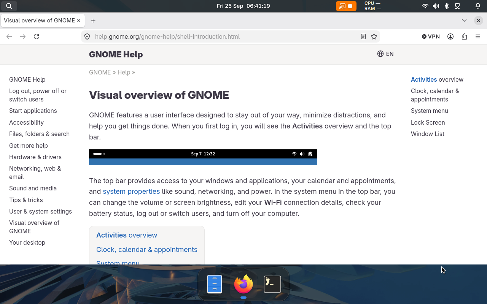
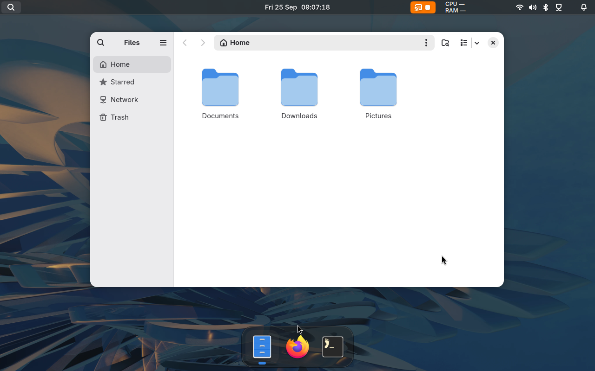

# Bingux

Bingux is a desktop for Gnoblin. It provides the top bar, dock, application search, notifications, media controls and
a sidebar for notes, a terminal and system information.





## Install

1. Add the Gnoblin and Bingux package repositories:

    ```sh
    curl -fsSL https://repo.gnoblin.org/setup.sh | sh -s -- --bingux
    ```

    [Install Gnoblin](installation.md) explains the script and the steps it replaces.

2. Install the `bingux` package with your package manager, for example `sudo dnf install bingux` or
   `sudo apt install bingux`. Bingux installs Gnoblin with it.

3. Log out. At the login screen, choose your user, open the session menu and choose **Gnoblin**. Bingux starts with
   the session.

## Apps

Install the apps you want with your package manager.

| Package           | What it is                                    |
| ----------------- | --------------------------------------------- |
| `bingux-files`    | Files, the file manager                       |
| `bingux-settings` | Settings                                      |
| `bingux-taxonomy` | A window that shows every Bingux UI component |

To open an app, search for it in Bingux or run its name, for example `bingux-settings`.

## Update and remove

Update Bingux with the rest of your system. To remove it, remove the `bingux` package and the apps with your package
manager. This keeps your settings and data.

## More information

- [Bingux on GitHub](https://github.com/kierandrewett/bingux) has the source, issues and the full documentation
- [Package management](https://github.com/kierandrewett/bingux/blob/main/docs/package-management.md) lists every
  Bingux package and repository
- [Standalone install](https://github.com/kierandrewett/bingux/blob/main/docs/standalone.md) builds Bingux for
  your own user from source
- [Choose a shell](bring-your-own-shell.md) lists other shells that work with Gnoblin
