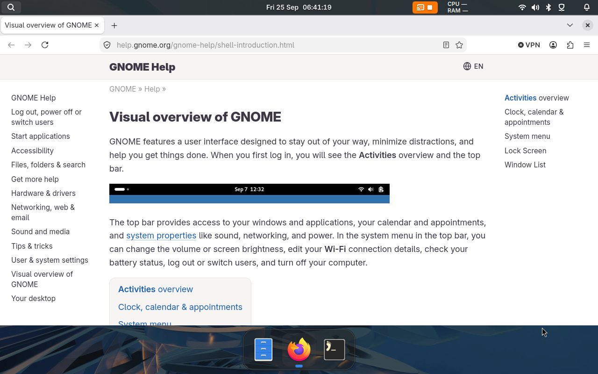
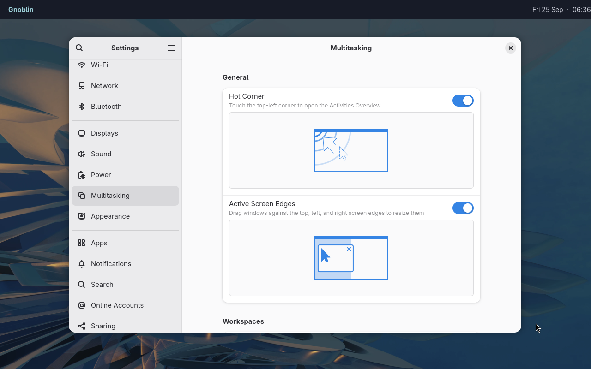

# Build a desktop

A Gnoblin desktop is a compositor plus a shell. The compositor is always the same; the shell decides what the desktop
looks like and does. You can write the shell as a Rust library, a Python script, or a JavaScript or TypeScript file, or
assemble a desktop from separate programs.

This page shows how the pieces fit together, builds two small Rust shells, lists the example shells, and then covers
assembling a desktop from existing programs.

## How the layers fit together

```text
  your shell     a Rust library, or a Python, JavaScript or TypeScript file
      |
      |  optional
      v
  libgnoblin-std.so.1    workspaces, layouts, window policy, styles, animation
      |
      v
  libgnoblin-core.so.1   the compositor: windows, outputs, input, the node tree, shell loader
```

Gnoblin has two libraries and a shell chooses which it uses:

| Layer | Library           | Required | What it provides                                                                  |
| ----- | ----------------- | -------- | --------------------------------------------------------------------------------- |
| Core  | `libgnoblin-core` | Yes      | Windows, outputs, input claims, programs, timers, the lock card.                  |
| Std   | `libgnoblin-std`  | No       | Workspaces, layouts, move and resize bindings, snapping, stock window management. |

With only the core, windows are placed where your shell puts them and nothing arranges them otherwise: with no shell
placing a window, it opens at the top-left corner. Add std when you want the library to do the arranging.

Choose by what the shell needs:

- **Core only** when your shell is a window manager of its own, such as a tiler, with its own rules for where windows go.
  It runs on an install that has no std library.
- **Core and std** when you want workspaces and ready-made layouts, or to write a layout and let the library place windows
  with it.

An install without `libgnoblin-std` runs core-only shells. A shell that imports std there fails to load, and the message
names the library.

## A tiling window manager on the core alone

This shell gives every window an equal column of the screen, in the order the windows opened. It needs no workspaces and no
library other than the core.

Make the project as described in [Write a shell in Rust](rust-shell.md#create-the-project), then put this in `lib.rs`, in the `src` directory:

```rust
use gnoblin_core as gnoblin;
use gnoblin_core::{Gnoblin, Rect};

const GAP: f64 = 10.0;

/// The first screen's rectangle, or a default before the compositor has published one.
fn screen(g: &Gnoblin) -> Rect {
    let find = || -> gnoblin::Result<Option<Rect>> {
        let class = g.class("screen")?;
        for node in g.root()?.children()? {
            if node.class()? == class {
                return Ok(Some(Rect::new(
                    node.get_f64("x")?,
                    node.get_f64("y")?,
                    node.get_f64("width")?,
                    node.get_f64("height")?,
                )));
            }
        }
        Ok(None)
    };
    find().ok().flatten().unwrap_or(Rect::new(0.0, 0.0, 1920.0, 1080.0))
}

/// Gives every window an equal column of the screen, in the order the windows opened.
fn retile(g: &Gnoblin) {
    let result = (|| -> gnoblin::Result<()> {
        let windows = g.windows()?;
        let area = screen(g);
        let width = (area.width - GAP) / windows.len().max(1) as f64 - GAP;
        for (index, window) in windows.iter().enumerate() {
            let x = area.x + GAP + index as f64 * (width + GAP);
            window.set_geometry(Rect::new(x, area.y + GAP, width, area.height - 2.0 * GAP))?;
        }
        Ok(())
    })();
    if let Err(error) = result {
        g.log(&format!("cannot tile the windows: {error}"));
    }
}

#[gnoblin::main]
fn main(g: &Gnoblin) -> gnoblin::Result<()> {
    retile(g);
    g.on_client_created(move |_window| retile(g))?;
    g.on_client_destroyed(move |_window| retile(g))?;

    g.bind("<Super>Return", move || {
        if let Err(error) = g.spawn("foot") {
            g.log(&format!("cannot start a terminal: {error}"));
        }
    })?;
    Ok(())
}
```

Build and run it with `cargo build` and `gnoblin ./target/debug/libmyshell.so`. Press `Super+Return` twice: the two
terminals sit side by side, and closing one gives the other the whole width.

How it works:

- `g.windows()` lists the windows of the session, including ones open before the shell started.
- `window.set_geometry(rect)` places a window. A rectangle is `x`, `y`, `width` and `height` in pixels.
- `g.on_client_created` and `g.on_client_destroyed` call your function when a window opens or closes.
- The screen is a node of class `screen`; its `x`, `y`, `width` and `height` properties are its rectangle.

The [`08-no-workspaces`](#the-examples) example takes this further with a master-and-stack layout and a key that chooses the
master window.

## A shell that uses std

Add `gnoblin-std` to `Cargo.toml` next to `gnoblin-core`:

```toml
[dependencies]
gnoblin-core = { path = "/path/to/gnoblin/crates/gnoblin-core" }
gnoblin-std = { path = "/path/to/gnoblin/crates/gnoblin-std" }
```

Then use the library's workspaces and layouts instead of placing windows yourself:

```rust
use gnoblin_std::prelude::*;

#[gnoblin::main]
fn main(g: &Gnoblin) -> gnoblin_std::Result<()> {
    // One workspace; every window that opens joins it and the library tiles it.
    Workspace::builder("main")?
        .name("Main")
        .layout(MasterStackLayout::new().ratio(0.6))
        .gaps(12.0, 20.0)
        .add()?;

    g.bind("<Super>Return", move || {
        if let Err(error) = g.spawn("foot") {
            g.log(&format!("cannot start a terminal: {error}"));
        }
    })?;

    g.log("std shell is running");
    Ok(())
}
```

| Setting                    | Accepted values                                                                                                                                                       | Effect                                                       |
| -------------------------- | --------------------------------------------------------------------------------------------------------------------------------------------------------------------- | ------------------------------------------------------------ |
| `Workspace::builder(id)`   | A non-empty string                                                                                                                                                    | Names the workspace. The id is also its name by default.     |
| `.name(text)`              | Any string                                                                                                                                                            | The name people see.                                         |
| `.layout(layout)`          | `FloatingLayout` (default), `MasterStackLayout`, `GridLayout`, `MonocleLayout`, `DwindleLayout`, `StripLayout`, `ArcLayout`, `Carousel3dLayout`, or your own `Layout` | How windows are arranged.                                    |
| `.gaps(inner, outer)`      | Two numbers of at least 0, in pixels                                                                                                                                  | Space between windows, then between windows and the edge.    |
| `MasterStackLayout::ratio` | 0.1 to 0.9                                                                                                                                                            | The share of the width the master window takes. Default 0.5. |

Windows that open join the workspace and the library tiles them. Your shell links `libgnoblin-std.so.1`, which links the
core, and a session loads one copy of each. If Gnoblin is installed outside the system library path, give the shell a
library path: see [Link to the installed libraries](rust-shell.md#link-to-the-installed-libraries).

To write a layout yourself, implement the `Layout` trait: the library calls `compute` whenever the workspace changes and
applies the rectangles you return. The [`06-rust-layout`](#the-examples) example does this.

## The examples

The `examples/` directory of the source tree holds the example shells. Each is a project you can build and run as it
stands. Rust ones build with `cargo build -p <package>` from the source tree; scripts run directly with
`gnoblin ./examples/<directory>/shell.ts` (or `shell.py`, `shell.js`).

| Directory               | Language                 | Layers    | What it shows                                                                                        |
| ----------------------- | ------------------------ | --------- | ---------------------------------------------------------------------------------------------------- |
| `01-minimal-core-shell` | Rust                     | Core      | Places every window in a cascade, starts a terminal on a chord, closes the focused window.           |
| `02-std-prelude`        | Rust                     | Core, std | One workspace per output, and chords that step through workspaces.                                   |
| `03-python-std`         | Python                   | Core, std | A workspace with a layout of your own, a listener on windows, a chord.                               |
| `03-typescript-std`     | TypeScript               | Core, std | The same shell in TypeScript.                                                                        |
| `04-js-esm`             | JavaScript               | Core, std | ES modules: imports `gnoblin-core` and `gnoblin-std`, and a relative module.                         |
| `05-ts-types`           | TypeScript               | Core, std | Three files with types; an error points at the `.ts` line that wrote it.                             |
| `06-rust-layout`        | Rust                     | Core, std | A `Layout` written in Rust: equal columns, and a chord that swaps two windows.                       |
| `07-script-binding`     | TypeScript, Python       | Core      | A key binding written entirely in a script that moves the focused window.                            |
| `08-no-workspaces`      | Rust, Python             | Core      | A master-and-stack tiler of raw windows with no workspaces and no scene graph.                       |
| `09-native-linked`      | Rust                     | Core, std | Links the installed libraries and says which ones its process maps and which ABI each has.           |
| `10-hot-reload`         | Rust                     | Core      | A shell built to be rebuilt while it runs: kept state, adopted nodes, no duplicate listeners.        |
| `19-shader-tint`        | Rust, TypeScript, Python | Core, std | A shader filter that tints every window, and a chord that says why one is not drawn.                 |
| `20-native-object`      | Rust, TypeScript, Python | Core, std | The typed object API of std: an entry model edited and heard, a focus decision.                      |
| `22-native-ui`          | Rust                     | Core, std | The toolkit of std: a text and a focused entry over the windows; Return is heard with what was typed |

The numbers also name behaviours that are not shells of their own:

- **Reload of a script (11):** edit `03-python-std/shell.py` or `03-typescript-std/shell.ts`, or a module it imports, and
  the shell reloads in place. See the [Python shell](python-shell.md#reload) and the [TypeScript shell](typescript-shell.md).
- **Linking the installed libraries (9):** [`09-native-linked`](#the-examples) logs the libraries its process maps and the ABI
  it was built for and finds installed. Any Rust shell that uses `gnoblin-std` links the same way. See
  [Write a shell in Rust](rust-shell.md#link-to-the-installed-libraries).
- **Update without rebuilding (12):** a shell built for one version of the libraries keeps running when they are upgraded.
  See [ABI compatibility](abi-compatibility.md).
- **Discovery and failures (13 to 16):** how `gnoblin` finds a shell, picks one by name, lists several and fails with none.
  See [Start Gnoblin and choose a shell](starting-gnoblin.md).
- **Core only (17):** a shell on an install with no std library runs; one that needs std says which library is missing.
- **Failed reload (18):** a replacement that cannot load leaves the running shell serving. See
  [Write a shell in Rust](rust-shell.md#limits).

## Assemble a desktop from existing programs

Gnoblin supplies the compositor, window management and interfaces that desktop
components can use. A shell supplies the visible controls. The shell can be one
program or a collection of smaller clients; it is independent of Gnoblin.
Bingux is one separate project built on these interfaces.

| Piece            | Gnoblin provides                                       | Your desktop chooses                                           |
| ---------------- | ------------------------------------------------------ | -------------------------------------------------------------- |
| Windows          | Focus, move, resize, workspaces, rules and decorations | Dock grouping, switcher order and menus                        |
| Input            | Keybindings and input-source control                   | Launcher, search and popup design                              |
| Surfaces         | Layer-shell placement, exclusive zones and effects     | Bar, dock, wallpaper and overlays                              |
| Desktop services | Portal routing, and optional native features           | Portal backend, notification daemon and other visible controls |



_Bingux is one separate shell example; Gnoblin provides the compositor and window management._

The [configuration reference](/config/configure) describes the
settings. The [CLI](cli/index.md) is convenient for commands; the
[compositor bridge](bridge/index.md) supplies subscriptions and shortcuts
to a long-running shell. [Wayland protocols](wayland-protocols.md) serve native
clients, and [event handlers](user-scripts.md) react to compositor events.

### Assemble a small desktop

Install a bar, launcher, notification daemon and terminal. This example uses
Waybar, Fuzzel, Mako and Foot. They are independent applications; replace any
of them with a component you prefer. Put this in a **new**
`~/.config/gnoblin/shell.ts`:

```ts
gnoblin.spawn(["waybar"]);
gnoblin.spawn(["mako"]);

const input = gnoblin.input.primary;
input.bind("Super+d", () => {
    gnoblin.spawn(["fuzzel"]);
});
input.bind("Super+Return", () => {
    gnoblin.spawn(["foot"]);
});
```



_A settings app beneath Waybar._

The cursor uses your system's default theme.

A shell or package ships its settings as a TypeScript module that your `shell.ts` imports; there are no system
drop-in directories.

Log in to Gnoblin. The active file is `~/.config/gnoblin/shell.ts`. Run
`gnoblinctl config reload` to apply edits; Gnoblin reports any
configuration errors.

Waybar's Sway and Hyprland modules expect those compositors' own IPC and do
not gain that IPC merely by running under Gnoblin. Configure supported generic
modules or write a module using [window data](bridge/session-and-windows.md#read-snapshots).

### Give each visible function an owner

Start one notification daemon from your shell or the session. Configure window
switchers and keyboard-layout popups in your shell. Gnoblin's input API selects
the active input source.
Use [shortcut guidance](/guides/shortcuts#avoid-conflicts) to resolve binding
conflicts.

A dock can use the foreign toplevel protocols for basic window handles or the
bridge for records, previews, activation and shortcut sessions. Keep window IDs
only for the lifetime of their windows. Refresh snapshots after windows close
or workspaces change. [Bridge examples](bridge/examples.md) show clients in
several languages.

### Choose the right interface

| Task                                 | Interface                                                         |
| ------------------------------------ | ----------------------------------------------------------------- |
| Change a window from a script        | `gnoblinctl window ...`                                           |
| Maintain a live switcher or dock     | Compositor bridge `windows` subscription                          |
| Place a bar or dock                  | `zwlr_layer_shell_v1`                                             |
| Capture output with a native client  | `zwlr_screencopy_manager_v1`, subject to its protocol gate        |
| Apply per-app styling                | `gnoblin.clients.where({ ... }).style` in [`shell.ts`](/js-style) |
| React to a window or workspace event | A listener in `shell.ts` (see [event handlers](/user-scripts))    |

The desktop portal backend decides what each app may do. Disabling a Wayland
protocol does not change what a portal backend allows for screen sharing or
remote control; see [portal routing](/config/configure/portals).

### Work on the desktop in a nested session

`GNOBLIN_BACKEND=nested gnoblin` starts Gnoblin in a window of your desktop (see
[run on a desktop](backends.md#run-on-a-desktop)). Use it to try a bar or rule
before logging out.

For screenshots and demos, give it fresh home and XDG config, data, cache,
state, and runtime directories. Launch only the applications that belong in
the example.

For packaging or a final session check, use a real Gnoblin login. A nested
image proves what appeared in that nested run, not what is installed in a
login session.

### Continue from here

- [Window rules](/guides/window_rules) and [effects](/guides/window_effects)
- [Shell integration](shell-integration.md), [window menus](/guides/window_menu) and [snapping](/guides/window_snapping)
- [Protocol catalog](wayland-protocols.md) and [compositor bridge](bridge/index.md)
- [Troubleshooting](troubleshooting.md) when a component does not appear
