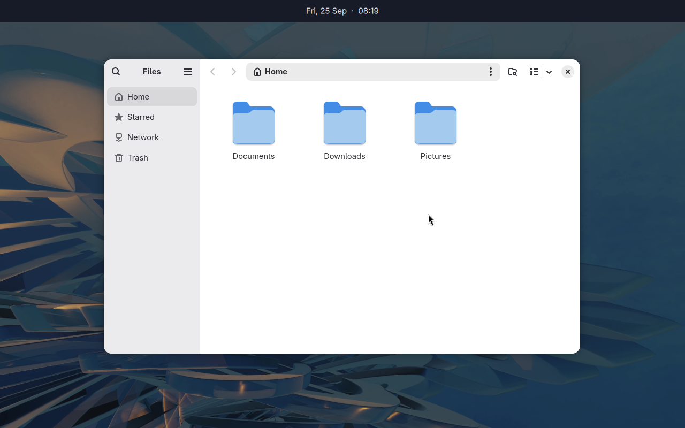

# Layer-shell settings

The `layerShell` key sets how Gnoblin handles an active window when a layer-shell client opens.

The setting is accepted and checked, and nothing reads it: the compositor logs `not applied: ...` for it.

| Setting                | Values  | Default | Effect                                                                                                              |
| ---------------------- | ------- | ------- | ------------------------------------------------------------------------------------------------------------------- |
| `preserveActiveWindow` | Boolean | `true`  | Keeps the active application window focused when a layer-shell surface opens. Set `false` to allow focus to change. |

```ts
import { defineConfig } from "gnoblin";

export default defineConfig({
    layerShell: { preserveActiveWindow: true },
});
```

See the [layer-shell protocol catalog](/wayland-protocols).



_Quickshell draws the panel as a layer surface; Files remains a regular app window._
