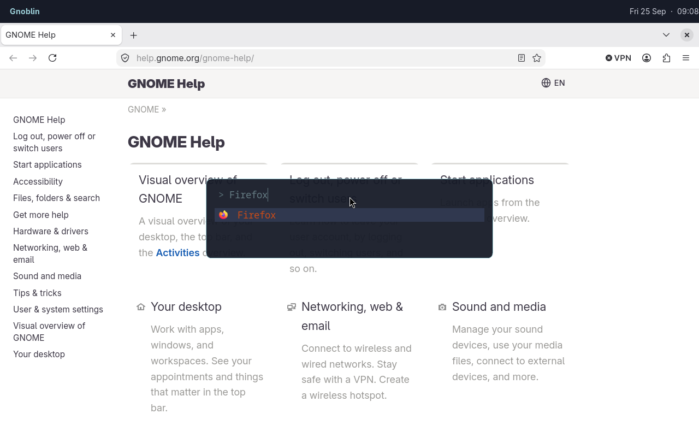

# Cursor themes

Gnoblin draws the pointer with an installed Xcursor or compiled Hyprcursor theme.

No shell, whether `shell.ts`, `shell.py` or Rust, can set the cursor theme or size. See [dropped settings](/js-settings#dropped-settings).

- `theme` accepts an installed Xcursor or Hyprcursor theme name. Its default is `default`, the system cursor theme. If the
  named theme is not installed, Gnoblin shows the default cursor instead.
- `size` accepts an integer from `1` to `256` logical pixels. Its default is `24`.

## Hyprcursor themes

Gnoblin reads compiled Hyprcursor themes itself. The upstream
[theme guide](https://github.com/hyprwm/hyprcursor/blob/main/docs/MAKING_THEMES.md) describes theme files and cursor
metadata.

Install a compiled theme in `~/.local/share/icons/<theme>/` or `~/.icons/<theme>/`, then select its installed name as the
theme. The theme and size apply to compositor cursors and the launch wait cursor. Animated frames retain their hotspots
and timing.

If the selected theme or shape is unavailable through Hyprcursor, Gnoblin tries Xcursor. Client applications that supply
their own cursor surfaces continue to draw those surfaces themselves.
