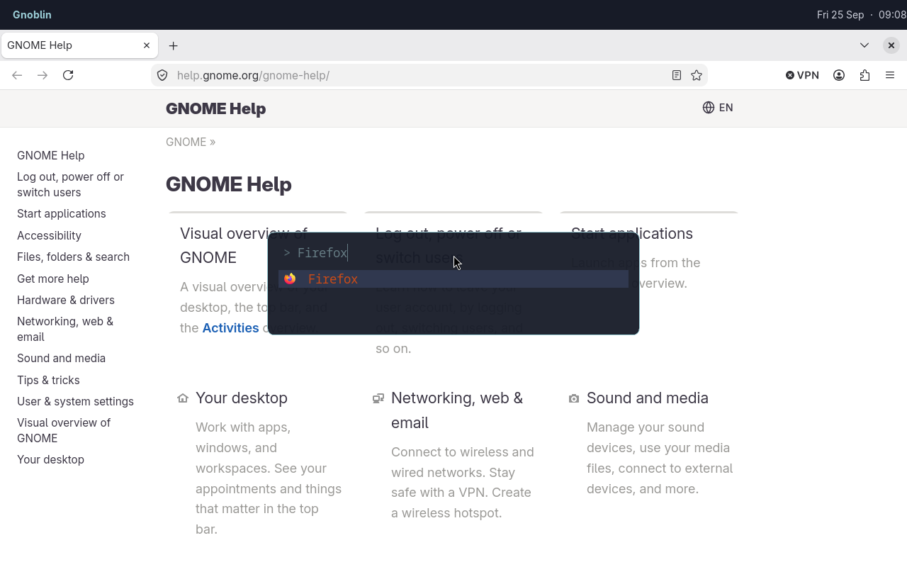

# Keyboard shortcuts

[Configuration reference](/config/configure)

Bind a key in your shell and it starts a program or runs a function of yours. A save reloads the file. The calls are in [keyboard shortcuts](/shell-api/keyboard-shortcuts).

- TypeScript: `gnoblin.input.primary.bind(trigger, function)` in `~/.config/gnoblin/shell.ts`.
- Python: `@gnoblin.bind(trigger)` on a function in `shell.py`.
- Rust: `g.bind(trigger, closure)` in your shell's `main`.

## Launch a command

This opens a terminal with Super+Enter and a launcher with Super+D:

::: tabs

```typescript
const input = gnoblin.input.primary;

input.bind("Super+Return", () => {
    gnoblin.spawn(["foot"]);
});
input.bind("Super+d", () => {
    gnoblin.spawn(["fuzzel"]);
});
```

```python
from gnoblin import gnoblin


@gnoblin.bind("Super+Return")
def terminal():
    gnoblin.spawn(["foot"])


@gnoblin.bind("Super+d")
def launcher():
    gnoblin.spawn(["fuzzel"])
```

```rust
use gnoblin_core as gnoblin;
use gnoblin_core::Gnoblin;

#[gnoblin::main]
fn main(g: &Gnoblin) -> gnoblin::Res<()> {
    let shell = g.clone();
    g.bind("Super+Return", move || shell.spawn(&["foot".to_owned()], None))?;
    let shell = g.clone();
    g.bind("Super+d", move || shell.spawn(&["fuzzel".to_owned()], None))?;
    Ok(())
}
```

:::

Replace `foot` and `fuzzel` with installed programs. The spawn call takes the program and then each argument as a
separate string in one list. Spaces inside a string stay in that argument. In Rust, `spawn` takes only the program;
use `spawn_with` to pass arguments.



_The shortcut opens Fuzzel; Firefox is the selected search result._

## Run a function

A key is a function, so it can do more than start a program:

::: tabs

```typescript
const input = gnoblin.input.primary;

input.bind("Super+q", () => {
    input.focusedClient?.close();
});
input.bind("Super+m", () => {
    gnoblin.spawn(["notify-send", "Gnoblin", "hello"]);
});
```

```python
from gnoblin import gnoblin


@gnoblin.bind("Super+q")
def close_focused():
    focused = next((w for w in gnoblin.windows if w.focused), None)
    if focused:
        focused.close()


@gnoblin.bind("Super+m")
def greet():
    gnoblin.spawn(["notify-send", "Gnoblin", "hello"])
```

```rust
use gnoblin_core as gnoblin;
use gnoblin_core::Gnoblin;
use gnoblin_std::prelude::*;

#[gnoblin::main]
fn main(g: &Gnoblin) -> gnoblin::Res<()> {
    let shell = g.clone();
    g.bind("Super+q", move || -> gnoblin_std::Result<()> {
        if let Some(client) = shell.clients()?.focused()? {
            client.close()?;
        }
        Ok(())
    })?;
    let shell = g.clone();
    g.bind("Super+m", move || shell.spawn(&["notify-send".to_owned(), "Gnoblin".to_owned(), "hello".to_owned()], None))?;
    Ok(())
}
```

:::

`input.focusedClient` is the window that has the focus, or `null`. In Python, the focused window is the one whose
`focused` is true, and in Rust it is `focused()` on the clients collection. A function runs when the key is pressed. A
key acts on press only: there is no release trigger.

## Trigger syntax

A trigger is modifiers and one key, joined by `+`: `Super+Return`, `Alt+Shift+Tab`, `XF86AudioMute`.

| Trigger                  | Keys                                       |
| ------------------------ | ------------------------------------------ |
| `"Super+Return"`         | Super + Enter                              |
| `"Super+Shift+q"`        | Super + Shift + Q                          |
| `"Alt+F8"`               | Alt + F8                                   |
| `"XF86AudioMute"`        | The mute key, with no modifier             |
| `"Super+MouseLeft+Drag"` | A drag with Super held and the left button |
| `"WheelUp"`              | The scroll wheel up                        |
| `"Swipe3"`               | A three-finger swipe                       |

- The modifiers are `Super`, `Alt`, `Ctrl`, `Shift`, `Meta` and `Hyper`. Super is usually the Windows-logo key.
- The key is one XKB keysym name, such as `Return`, `F9`, `q` or `XF86AudioMute`. A letter key is the same trigger in
  either case, so write `Super+q`.
- Triggers are compared in their canonical spelling, so `"super+1"` and `"Super+1"` are the same trigger.
- A trigger with a wrong shape fails the load, and the message names the key.

The compositor's own `<Super>Return` spelling is also accepted by `input.bind`, `@gnoblin.bind` and `g.bind`, and
means the same chord. Write `Super+Return`, the usual form in this guide.

## Chord syntax

The three `bind` calls use the `+` triggers above. A few settings that go to the compositor take its own chord spelling,
which writes each modifier in angle brackets before the key: the tablet and stylus `keybinding` values and the
accelerators of the compositor socket.

| Chord               | Keys                                         |
| ------------------- | -------------------------------------------- |
| `"<Super>Return"`   | Super + Enter                                |
| `"<Super><Shift>q"` | Super + Shift + Q                            |
| `"<Alt>F8"`         | Alt + F8                                     |
| `"XF86AudioMute"`   | The mute key, with no modifier               |
| `"Super"`           | Super press and release, without another key |

- The modifiers are `<Shift>`, `<Control>`, `<Alt>`, `<Super>`, `<Hyper>` and `<Meta>`, in any case and any order, but
  not twice. The older GTK names `<Primary>`, `<Ctrl>` and `<Ctl>` read as `<Control>`, `<Shft>` as `<Shift>`, and
  `<Mod1>` as `<Alt>`. `<Mod2>` to `<Mod5>` depend on the keymap, so they are refused.
- The key is one XKB keysym name, such as `Return`, `F9`, `q` or `XF86AudioMute`. You can leave out the `XF86` prefix.
  `Above_Tab` is the key above Tab on any layout. `0x` and two hex digits, such as `0x3f`, is a hardware key code.
- `Super` alone, with no angle brackets, is a chord only where the page for that mechanism says so.
- A pointer chord ends with a button, `Button1` to `Button9`, for example `<Super>Button1`. It needs at least one
  modifier, except `Button8` and `Button9`.
- The plus form is the same chord: `Super+Alt+F9` is `<Super><Alt>F9`, `Ctrl+q` is `<Control>q`, and `Super++` is `<Super>`
  and the plus key (`plus`). Write whichever you like; both spellings are read the same way, in the configuration and in a
  shell's `bind`. A chord with brackets and plus signs together, or with spaces or dashes, is refused with the form to write.

## Media keys

The stock file binds the volume and microphone mute keys through WirePlumber's `wpctl`, and playback through
`playerctl`. Install those commands if you use the matching keys. Brightness keys are not bound. Bind them to a
command such as `brightnessctl` if your hardware and permissions support it:

::: tabs

```typescript
const input = gnoblin.input.primary;

input.bind("XF86MonBrightnessUp", () => {
    gnoblin.spawn(["brightnessctl", "set", "5%+"]);
});
input.bind("XF86MonBrightnessDown", () => {
    gnoblin.spawn(["brightnessctl", "set", "5%-"]);
});
```

```python
from gnoblin import gnoblin


@gnoblin.bind("XF86MonBrightnessUp")
def brighter():
    gnoblin.spawn(["brightnessctl", "set", "5%+"])


@gnoblin.bind("XF86MonBrightnessDown")
def dimmer():
    gnoblin.spawn(["brightnessctl", "set", "5%-"])
```

```rust
use gnoblin_core as gnoblin;
use gnoblin_core::Gnoblin;

#[gnoblin::main]
fn main(g: &Gnoblin) -> gnoblin::Res<()> {
    let shell = g.clone();
    g.bind("XF86MonBrightnessUp", move || shell.spawn(&["brightnessctl".to_owned(), "set".to_owned(), "5%+".to_owned()], None))?;
    let shell = g.clone();
    g.bind("XF86MonBrightnessDown", move || shell.spawn(&["brightnessctl".to_owned(), "set".to_owned(), "5%-".to_owned()], None))?;
    Ok(())
}
```

:::

Gnoblin handles shortcuts inside the compositor and does not need systemd or the GNOME Settings Daemon.

## Avoid conflicts

- A trigger is bound once. Binding a trigger that is already bound is refused, and the load reports it.
- Your shell file replaces the stock file as a whole. The stock keys are lines of `gnoblinctl config init`'s starter, so
  to change one, edit that line in your copy: for a smaller volume step, change `5%+` to `2%+` on the
  `XF86AudioRaiseVolume` line.
- To drop a stock key, delete its line.

See the [add a shortcut recipe](/recipes/add-a-shortcut) for a worked example.

## Commands and shell syntax

Commands run directly. `$HOME`, `~`, pipes and redirection are not expanded. Use an absolute path, a program on PATH,
or explicitly run a shell:

::: tabs

```typescript
gnoblin.input.primary.bind("Super+Shift+t", () => {
    gnoblin.spawn(["sh", "-c", 'date >> "$HOME/shortcut.log"']);
});
```

```python
from gnoblin import gnoblin


@gnoblin.bind("Super+Shift+t")
def log_time():
    gnoblin.spawn(["sh", "-c", 'date >> "$HOME/shortcut.log"'])
```

```rust
use gnoblin_core as gnoblin;
use gnoblin_core::Gnoblin;

#[gnoblin::main]
fn main(g: &Gnoblin) -> gnoblin::Res<()> {
    let shell = g.clone();
    g.bind("Super+Shift+t", move || shell.spawn(&["sh".to_owned(), "-c".to_owned(), "date >> \"$HOME/shortcut.log\"".to_owned()], None))?;
    Ok(())
}
```

:::

This appends the current time to `~/shortcut.log` when you press Super+Shift+T.

See also [restore-or-minimise bindings](/guides/window_state_shortcuts).
