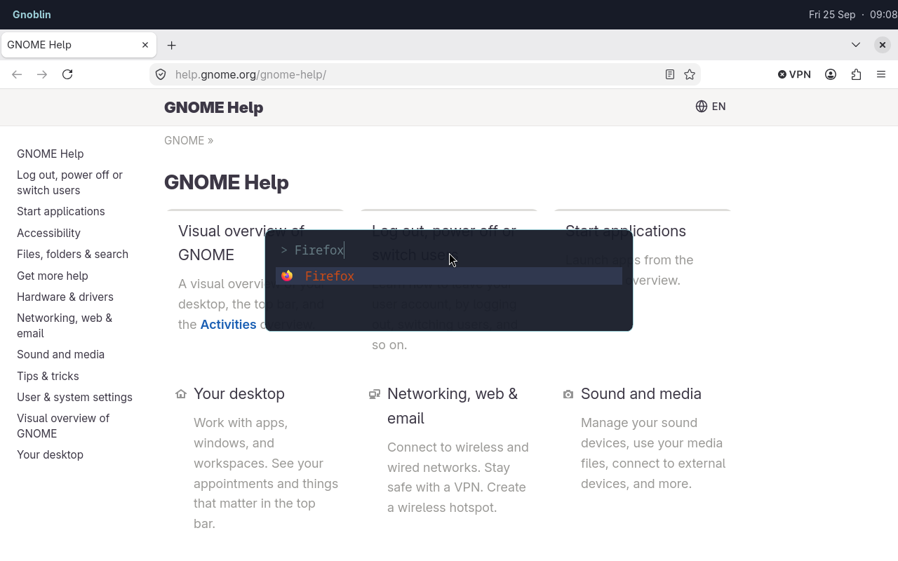

# Keyboard shortcuts

[Configuration reference](/config/configure)

Gnoblin reads global shortcuts from its Lua config. Use
`gnoblin.configure.keybindings.keyboard` for a binding and its Lua callback.
The callback can run a command, manage a window, or return `"forward"` to
leave the input for the focused app. Add the examples to
`~/.config/gnoblin/init.lua`; changes apply when the config reloads.

## Launch a command

Add this after any `gnoblin.load(...)` lines. It opens a terminal with
Super+Enter:

```lua
gnoblin.configure {
    keybindings = {
        keyboard = {
            my_terminal = {
                binding = "<Super>Return",
                callback = function()
                    gnoblin.process.spawn({"ptyxis", "--new-window"})
                end,
            },
        },
    },
}
```

Replace `ptyxis` with an installed terminal. Each command argument is a separate
string. Spaces inside a string stay in that argument.

Binding names use lowercase letters, numbers and `_`.

### Callback fields

| Field      | Accepted value           | Default   | Effect                                      |
| ---------- | ------------------------ | --------- | ------------------------------------------- |
| `binding`  | One chord                | Required  | Chooses the key combination.                |
| `callback` | Lua function             | Required  | Runs when the binding matches.              |
| `trigger`  | `"press"` or `"release"` | `"press"` | Chooses key press or release.               |
| `enable`   | `true` or `false`        | `true`    | `false` disables an imported named binding. |

The callback can return `"consume"` to keep the event in Gnoblin or
`"forward"` to route it to the focused app. A missing return is `"consume"`.

Release triggers consume the whole pair, including the reserved press.
Use a press trigger when the callback must choose whether to forward input.

Run `gnoblinctl config reload` after changing the config.

## Open an application launcher

Bind Fuzzel to Super+D:

```lua
gnoblin.configure {
    keybindings = {
        keyboard = {
            launcher = {
                binding = "<Super>d",
                callback = function()
                    gnoblin.process.spawn({"fuzzel"})
                end,
            },
        },
    },
}
```



_The shortcut opens Fuzzel; Firefox is the selected search result._

## Disable a Lua binding

Set `enable = false` to disable a named binding added by another config file:

```lua
gnoblin.configure {
    keybindings = {
        keyboard = {
            my_terminal = {enable = false},
        },
    },
}
```

The config is rebuilt on every reload. Disabling a binding releases its key.
Shortcuts registered by other programs are unaffected.

Put the removal after the file that adds the shortcut. See
[load order](/guides/files_and_load_order#override-or-append).

## Chord syntax

One syntax names a key combination everywhere in Gnoblin. These all use it:
`gnoblin.configure.keybindings`, `gnoblin.configure.shortcuts`,
`gnoblin.input.on`, `gnoblin.shortcuts.bind`, the tablet button keybindings and
the compositor socket. A key combination in this syntax is a chord.

A chord is zero or more modifiers in angle brackets, then one key:

| Chord               | Keys                                         |
| ------------------- | -------------------------------------------- |
| `"<Super>Return"`   | Super + Enter                                |
| `"<Super><Shift>q"` | Super + Shift + Q                            |
| `"<Alt>F8"`         | Alt + F8                                     |
| `"XF86AudioMute"`   | The mute key, with no modifier               |
| `"Super"`           | Super press and release, without another key |

- The modifiers are `<Shift>`, `<Control>`, `<Alt>`, `<Super>`, `<Hyper>` and
  `<Meta>`. They can be in any case and in any order, but not twice.
  Super is usually the Windows-logo key.
- Gnoblin also reads the older GTK names `<Primary>`, `<Ctrl>` and `<Ctl>` as
  `<Control>`, `<Shft>` as `<Shift>`, and `<Mod1>` as `<Alt>`. The X11 names
  `<Mod2>` to `<Mod5>` depend on the keymap, so they are refused.
- The key is one XKB keysym name, such as `Return`, `F9`, `q` or
  `XF86AudioMute`. You can leave out the `XF86` prefix. `Above_Tab` is the key
  above Tab on any layout. `0x` and two hex digits, such as `0x3f`, is a
  hardware key code.
- `Super` alone, with no angle brackets, is a chord only where the page for
  that mechanism says so. It means Super pressed and released with no other
  key between.
- A pointer chord ends with `Button1`, `Button2` or `Button3`, for example
  `<Super>Button1`. It needs at least one modifier.
- A chord has no spaces.

Gnoblin reads a chord with one parser, and refuses everything else. A word
that GTK and Mutter would skip, such as `<Windows>`, is an error. So is a
chord that uses plus signs. The message names the form to write:

```text
"Super+Alt+F9" is not a chord: put each modifier in angle brackets before the key. Write <Alt><Super>F9
```

Gnoblin writes a chord back with the modifiers in the order
`<Shift><Control><Alt><Meta><Super><Hyper>`, then the key. A `Shortcut` from
`gnoblin.shortcuts.bind` and the configured shortcuts use that order.

## Which mechanism to use

Four mechanisms bind a chord. They do different jobs and take the same chord
syntax.

| Mechanism                       | Use it to                                                                                        | Runs                                                       |
| ------------------------------- | ------------------------------------------------------------------------------------------------ | ---------------------------------------------------------- |
| `gnoblin.configure.shortcuts`   | Start a command, or rebind a built-in action, by name.                                           | In the compositor. It works while the Lua runtime is down. |
| `gnoblin.configure.keybindings` | Run a Lua callback from a named binding that later files can override or disable.                | In the Lua runtime, through an input handler.              |
| `gnoblin.input.on`              | Handle any input event, such as a key, a button or a gesture, and consume or forward it.         | In the Lua runtime, through an input handler.              |
| `gnoblin.shortcuts.bind`        | Own a shortcut at run time as a `Shortcut` object, with held-modifier sessions and trust tokens. | The compositor grabs the chord; Lua receives the event.    |

`keybindings.keyboard` and `keybindings.pointer` are named declarations over
`gnoblin.input.on`: use `input.on` when the handler must match more than a chord.
A key grab (`gnoblin.input.grab`) is not a binding: it takes the whole keyboard
for a time and reports every key. See [keyboard shortcuts](/shell-api/keyboard-shortcuts)
and [input](/shell-api/input).

## Declarative shortcuts and built-in actions

Use `gnoblin.configure.shortcuts` for a declarative command shortcut when a
Lua callback is unnecessary. Use [`gnoblin.process.spawn`](/shell-api/processes) inside a
callback when the action needs Lua logic.

Use `keybindings.wm`, `keybindings.mutter` or `keybindings.wayland` to override
an existing Mutter action:

```lua
gnoblin.configure {
    keybindings = {
        wm = {close = {"<Super>q"}},
    },
}
```

Built-in actions accept a list of accelerator strings. Use an empty list to
disable one. The group must be `wm`, `mutter`, or `wayland`; each group maps to
a Mutter GSettings keybinding schema. The action names and defaults depend on
your installed desktop schemas; Gnoblin does not define a fixed list for every
version.

Find the schema and action names on your system with
`gsettings list-schemas` and `gsettings list-keys SCHEMA`. Run
`gsettings describe SCHEMA KEY` to read an action's description. The
[keybinding reference](/config/configure/keybindings) lists the three supported
Mutter groups and gives examples.

Desktop Settings edits do not change Gnoblin's active bindings. Removing an
override restores the default on reload.

## Media keys

Media keys use Lua keyboard callbacks. The starter config includes volume and
microphone mute through WirePlumber's `wpctl`, and playback through
`playerctl`. Install those commands if you use the matching keys. Brightness
keys are not handled by the standalone session; bind them to a command such as
`brightnessctl` if your hardware and permissions support it.

Gnoblin handles shortcuts inside the compositor. It does not require systemd
or GNOME Settings Daemon’s MediaKeys service.

The config file is `~/.config/gnoblin/init.lua`. The packaged starter config is
`init.lua.example` in `share/gnoblin/`. For example, a volume key can run `wpctl`
directly:

```lua
gnoblin.configure {
    keybindings = {
        keyboard = {
            volume_up = {
                binding = "XF86AudioRaiseVolume",
                callback = function()
                    gnoblin.process.spawn({"wpctl", "set-volume", "@DEFAULT_AUDIO_SINK@", "5%+"})
                end,
            },
        },
    },
}
```

Edit or remove these entries in your Lua config to change the media-key
behavior. The commands they call must be installed.

## Avoid conflicts

To override an imported callback binding, use the same map key and supply
its complete declaration. Use different bindings for independent shortcuts. See the
[override example](/recipes/add-a-shortcut).

A Mutter action may already use the key. Change or disable it through
`gnoblin.configure.keybindings` before assigning the same key to a command.
Legacy command declarations reject duplicate bindings and keep the previous
working registrations if reload fails.

Lua input callbacks run in registration
order until one consumes the event; a later callback can use the same selector
when earlier handlers return forward.

## Commands and shell syntax

Commands run directly. `$HOME`, `~`, pipes and redirection are not expanded.
Use an absolute path, a program on PATH, or explicitly run a shell:

```lua
gnoblin.configure {
    shortcuts = {
        ["log-time"] = {
            binding = "<Super><Shift>t",
            command = {"sh", "-c", "date >> \"$HOME/shortcut.log\""},
        },
    },
}
```

This appends the current time to `~/shortcut.log` when you press Super+Shift+T.
The declarative form is retained for configurations that do not need a Lua
callback.

## Popups that capture typing

For a shell popup that needs keys typed after bare Super, configure a named
shortcut with `capture_input = true`, `binding = "Super"`, and
`trigger = "release"`. Handle `gnoblin.shortcut.session.key` events in Lua.
Only one command-free, action-free bare Super capture binding can be active at
a time. See the [shortcut configuration reference](/config/configure/shortcuts)
and [shortcut state and capture](/shell-api/#shortcut-state-and-capture)
for the event fields and session behavior.

See also [restore-or-minimise bindings](/guides/window_state_shortcuts).
