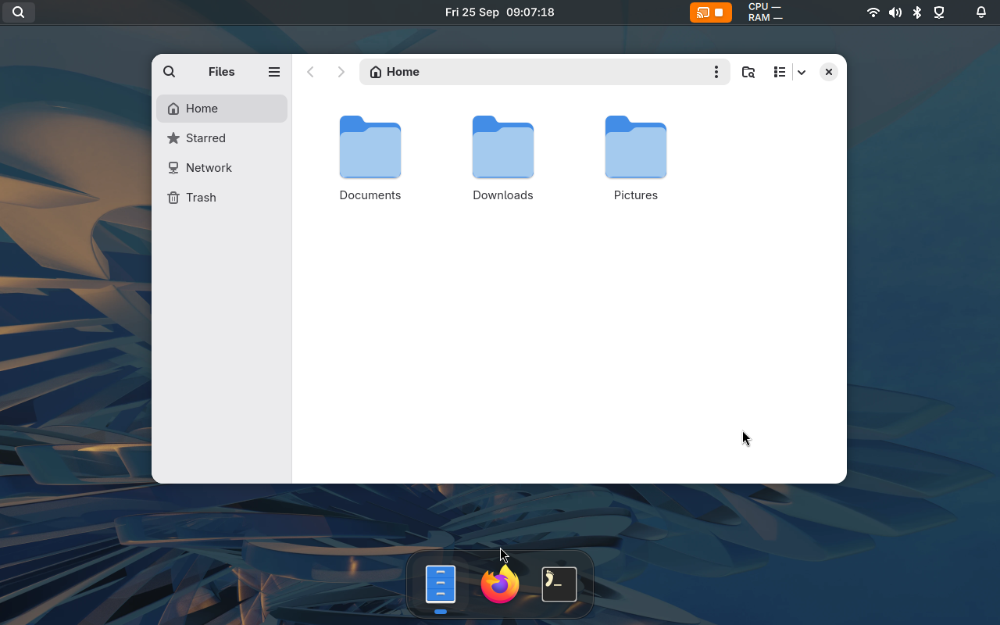
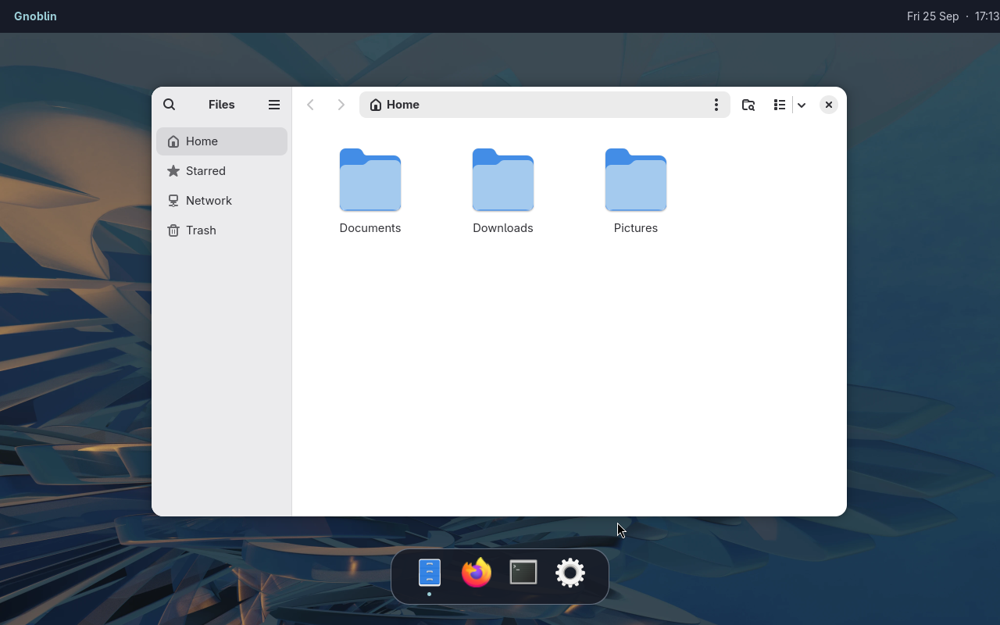

# Gnoblin

Gnoblin is a standalone Wayland compositor session built on Mutter. Its shell API controls compositor state, and you
write the shell in TypeScript, Python or Rust, with the same objects in each language. Independent shell
projects such as Bingux provide the panels, launchers, and other desktop UI.
Build your own shell or try Bingux, a separate project that uses Gnoblin.

_Bingux is one separate shell project that uses Gnoblin. Its packaged rules round the Files window, fill its CSD corner gaps and draw the window shadow._

_Waybar provides the top bar; [Quickshell](/bring-your-own-shell#quickshell) provides the dock._

The [configuration API](/config) links each setting to a detailed reference.

## Get started

- [Install Gnoblin](/installation)
- [Choose a shell](/bring-your-own-shell)
- [Build a desktop](/build-a-desktop)

## Configure

- [Configuration API](/config)
- [Configuration recipes](/recipes/)
- [Configuration guides](/guides/window_rules)

## Develop

- Write a shell in [TypeScript](/typescript-shell), [Python](/python-shell) or [Rust](/rust-shell)
- [Shell integration](/shell-integration)
- [Compositor bridge](/bridge/)
- [Wayland protocols](/wayland-protocols)

## Help

- [Troubleshooting](/troubleshooting)
