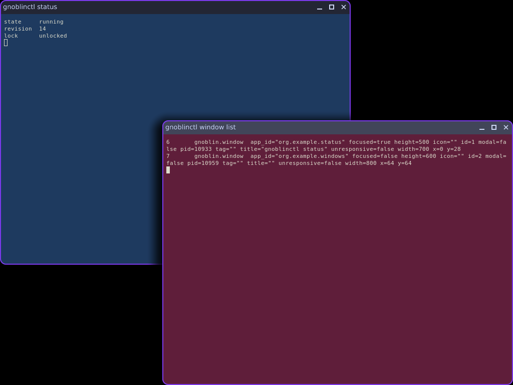

# JavaScript window style

A window's look is a style: plain objects you set from `defineConfig`, from a `setup` function or from any listener.
Import the classes from `gnoblin`:

```ts
import { ClientStyle, Shadow, defineConfig } from "gnoblin";

defineConfig({
    style: { opacity: 0.95, shadows: [{ y: 8, blur: 24, color: "#00000066" }] },
    setup: (gnoblin) => {
        gnoblin.clients.where({ appId: "firefox" }).style.shadows = [];
        gnoblin.clients.get("42").style.opacity = 0.8;
    },
});
```

## Scopes

Style is set where it should apply, and a client takes the highest scope that sets each property. From lowest to
highest:

| Scope                          | Applies to                               |
| ------------------------------ | ---------------------------------------- |
| the built-in defaults          | every client                             |
| `gnoblin.clients.style`        | every client, current and future         |
| `workspace.clients.style`      | the clients of that workspace            |
| `clients.where({ ... }).style` | the clients that match, while they match |
| `client.style`                 | that one client                          |

Inheritance is per property. A workspace that sets only `cornerRadius` leaves the shadows to the global style.

A `where()` selection takes a second argument, `{ priority }`:

- The higher priority wins.
- Selections of equal priority rank by the order their `style` was first used, and the later one wins.
- A client that stops matching a selection loses that selection's values at once and keeps its own.

`defineConfig({ style })` sets `gnoblin.clients.style`. A window rule's `style` (`opacity`, `cornerRadius`, `shadows`)
sets the matched client's own style, so it beats every scope above it.

A scope's style holds only what was set on it. Reading a property that was not set gives `undefined`, and
`computedStyle` gives the resolved value:

```ts
client.style.cornerRadius; // undefined: the client does not override it
client.computedStyle.cornerRadius; // 12
client.computedStyle.origin.cornerRadius; // "global"
```

`computedStyle` is a frozen snapshot. `origin` names the scope each property came from: `default`, `global`,
`workspace:<id>`, `where({...})` or `client`.

## Setting, unsetting and null

```ts
client.style.opacity = 0.5; // an override
client.style.unset("opacity"); // inherit again
client.style.opacity = undefined; // the same
client.style.reset(); // unset every property
client.style.background = null; // a value: no background, whatever the scopes above say
client.style.shadows = []; // a value: no shadows
```

`null` is never "inherit". A list you assign replaces the inherited list whole.

## Properties

| Property         | Accepts                                   | Default | Drawn                                 |
| ---------------- | ----------------------------------------- | ------- | ------------------------------------- |
| `opacity`        | a number from 0 to 1                      | 1       | by every renderer                     |
| `shadows`        | a list of `Shadow`, at most 8             | none    | outer shadows: GLES and software      |
| `backdropFilter` | a list of filters, at most 8              | none    | a blur: GLES                          |
| `cornerRadius`   | a number of at least 0, or one per corner | 0       | one radius: GLES, software and Vulkan |
| `borders`        | a list of `Border`, at most 8             | none    | GLES and software                     |
| `filter`         | a list of filters, at most 8              | none    | not drawn                             |
| `background`     | a colour or `null`                        | `null`  | not drawn                             |

A colour is `#rgb`, `#rgba`, `#rrggbb` or `#rrggbbaa`. A property that no renderer draws is still stored and reported
in `computedStyle`; see "What is drawn" below.

### Shadow

- `x` and `y` offset the shadow. Default 0.
- `blur` is the softness of the edge, from 0 to 100. Default 12.
- `spread` grows the shadow, from -100 to 100. Default 0.
- `color` defaults to `#00000080`.
- An `inset` shadow is kept and not drawn.

The first shadow of the list is on top.

### Border

`width` (at least 0, default 1), `color` (default `#ffffff`), `offset` (default 0) and `inset` (default false).

### Filters

A filter is one of four classes. In a list you can write the shorthand, which becomes the class:

- `BlurFilter` has a `radius` from 0 to 100. Default 12.
- `SaturateFilter`, `BrightnessFilter` and `ContrastFilter` have an `amount` from 0 to 2. Default 1.

```ts
client.style.backdropFilter = [{ blur: 18 }, { saturate: 1.25 }];
client.style.backdropFilter[0] instanceof BlurFilter; // true
```

## Elements are live objects

The entries of a list are objects, and changing one changes the style:

```ts
gnoblin.clients.style.shadows = [{ blur: 10 }];
gnoblin.clients.style.shadows[0].blur = 20; // every client that inherits the list follows
```

Writing to an element of a list the scope does not override copies the list into that scope first, so the write
reaches that scope and nobody else:

```ts
client.style.shadows[0].blur = 40; // client now has its own list [40]; other clients still inherit [20]
```

After that the client does not follow later edits of the inherited list. You can also change an array in place with
`push` or `splice`. The shell checks each array once per frame and takes the change then.

## Invalid values

An invalid value is refused with the path of the property, and the previous value stays:

```text
Client#42.style.borders[2].width: must be finite and >= 0
Client#42.style.shadows: holds at most 8 entries, got 9
```

A window's node carries at most 8 effects (the backdrop blur and the outer shadows together). A style that makes more
is reported when it is applied and the node keeps the effects it had.

## What is drawn

The tree has three effect kinds (blur, shadow and border), a node `corner_radius` and a node opacity. A style becomes:

- `opacity` as the window node's `opacity`.
- `cornerRadius` as the node's `corner_radius`. It rounds the window's whole frame: the content, the titlebar above it,
  the borders and the shadow share one rounded shape, so a rounded decorated window has four rounded corners. One
  radius serves every corner: a per-corner radius is drawn as the largest of the four and reported
  `not applied: style.cornerRadius: ...`.
- The outer `shadows` as `shadow` effects with `frame` set, painted from the last to the first so the first is on top.
  A shadow follows the window's frame, the titlebar included, not the content alone.
- `borders` as `border` effects in list order, after the shadows. A border is a stroke of `width` along the frame's
  rounded edge: outside it by default, inside it with `inset`, moved `offset` pixels from the edge. Borders with
  different offsets make concentric rings.
- `backdropFilter` as one `blur` effect when it has a `BlurFilter` of radius above 0. The compositor blurs at a fixed
  radius of 12, so the radius only switches the blur on. The `SaturateFilter`, `BrightnessFilter` and `ContrastFilter`
  of the chain multiply into the blur's saturation, brightness and contrast, each at most 2. Without a blur in the
  chain they have nothing to draw.

| Kind or property | GLES | Software                         | Vulkan                 |
| ---------------- | ---- | -------------------------------- | ---------------------- |
| `corner_radius`  | yes  | yes (hard edge)                  | yes                    |
| `shadow`         | yes  | yes (hard edge, stepped falloff) | no, reported `skipped` |
| `border`         | yes  | yes (hard edge)                  | no, reported `skipped` |
| `blur`           | yes  | no, reported `skipped`           | no, reported `skipped` |

Two decorated windows on the GLES renderer with `cornerRadius: 12`, a 2 pixel inset border and a shadow. The corners are
cut from the frame, the titlebar included, the border runs over the titlebar's top edge and round the arc, and the shadow
surrounds the whole frame:



A node placed in 3D (a rotation about x or y, a `z`, or a perspective camera above it) draws no shadow, border or blur,
and its `skipped` list says `unsupported-effect-on-3d`; its corner radius is still drawn.

What the active renderer does not draw stays on the node, and the node's `skipped` list names it
(`border: unsupported-by-renderer`). A client reads it as `client.styleWarnings`; `seat.effect_kinds` lists the kinds
the renderer draws. The style itself reports only what no renderer could draw.

`background`, `filter` and inset shadows have no effect kind. They stay in `computedStyle`, and each one a style sets is
reported once per reload as `not applied: style.<property>: <reason>`.

A window holds at most 16 effects (at most 8 shadows and 8 borders, and the blur).

```ts
defineConfig({
    style: {
        cornerRadius: 12,
        borders: [{ width: 1, color: "#ffffff33", inset: true }],
        shadows: [{ y: 8, blur: 24, color: "#00000066" }],
    },
});
```

## Reload

A reload runs the new config in a fresh generation. Style lines you removed are gone: the new generation takes the
effects and the opacity off the windows the old one styled.
