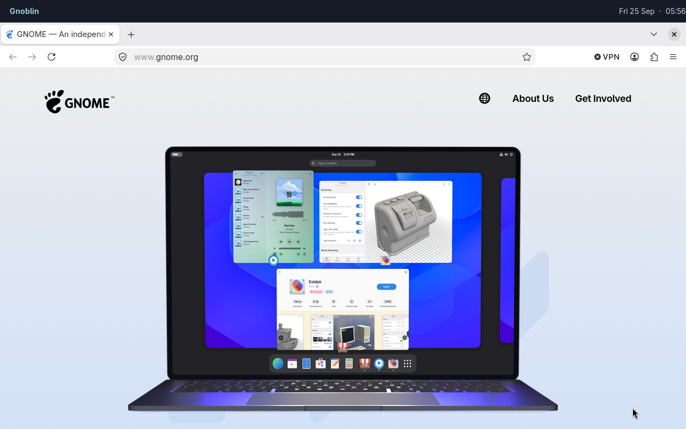

# Build a small desktop

This setup starts Waybar and Mako with the session, binds a launcher and terminal, and selects a larger cursor. It gives
you a usable bar, notifications and two ways to open applications while leaving the shell itself to your choice.



_Firefox is an ordinary window; Waybar runs as a separate desktop client._

Save this as `~/.config/gnoblin/init.ts`. Replace any command with an application installed on your system.

```ts
import { defineConfig, spawn } from "gnoblin";

export default defineConfig({
    cursor: { theme: "default", size: 28 },
    autostart: ["waybar", "mako"],
    keys: {
        "Super+d": spawn("fuzzel"),
        "Super+Return": spawn("foot"),
    },
});
```

Install the selected applications first. The cursor uses the system's default theme; its size is in logical pixels.
`autostart` launches each command once per session; it does not install or configure the applications themselves.

If the stock config already uses one of these triggers, your key replaces it. Check for key conflicts with your shell,
then save the file. See [shell setup](/bring-your-own-shell) for choosing the programs that provide the visible
desktop.
