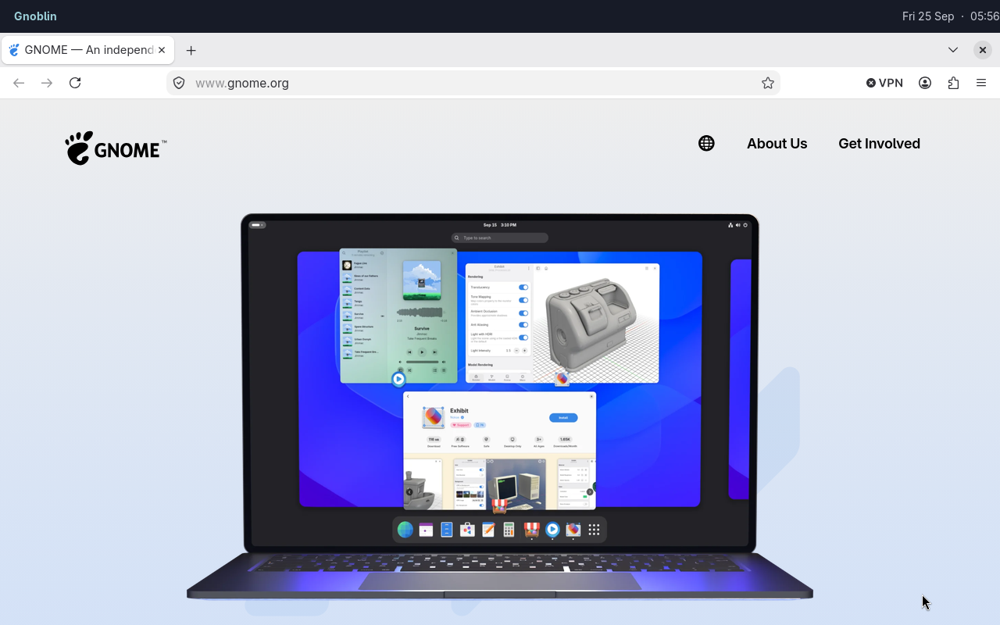

# Build a small desktop

This setup binds a launcher and a terminal, and leaves the shell itself to your choice: a bar and notifications are
separate programs that you start with the session. It gives you two ways to open applications.



_Firefox is an ordinary window; Waybar runs as a separate desktop client._

Put the bindings in your shell, in whichever language you write it in. Replace any command with an application installed
on your system.

- TypeScript: `~/.config/gnoblin/shell.ts`
- Python: `~/.config/gnoblin/shell.py`
- Rust: `src/lib.rs` of a shell library; see [write a shell in Rust](/rust-shell)

::: tabs

```typescript
const input = gnoblin.input.primary;

input.bind("Super+d", () => {
    gnoblin.spawn(["fuzzel"]);
});
input.bind("Super+Return", () => {
    gnoblin.spawn(["foot"]);
});
```

```python
from gnoblin import gnoblin


@gnoblin.bind("Super+d")
def launcher():
    gnoblin.spawn(["fuzzel"])


@gnoblin.bind("Super+Return")
def terminal():
    gnoblin.spawn(["foot"])
```

```rust
use gnoblin_core as gnoblin;
use gnoblin_core::Gnoblin;

#[gnoblin::main]
fn main(g: &Gnoblin) -> gnoblin::Res<()> {
    let shell = g.clone();
    g.bind("Super+d", move || shell.spawn(&["fuzzel".to_owned()], None))?;
    let shell = g.clone();
    g.bind("Super+Return", move || shell.spawn(&["foot".to_owned()], None))?;
    Ok(())
}
```

:::

Install the selected applications first. Start Waybar and Mako with the session: see [autostart](/guides/autostart).
A shell file can start them too; [Waybar, Fuzzel and Mako](/bring-your-own-shell#waybar-fuzzel-and-mako) shows how.
No shell can set the cursor theme either: see [cursor themes](/guides/cursors).

A trigger is bound once, so if the starter that `gnoblinctl config init` wrote already binds one of these, edit that
line instead of adding another. See [shell setup](/bring-your-own-shell) for choosing the programs that provide the
visible desktop.
