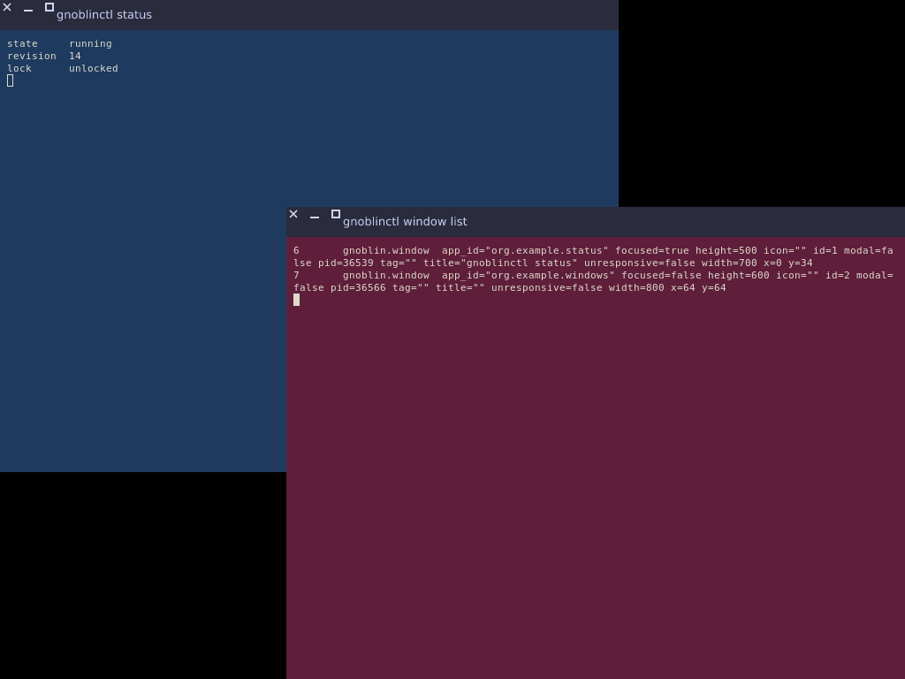

# Fill a window frame with your own parts

Each example sets the frame callback of `Decorations`, then starts the decorations. The
[window frame reference](/js-window-frame) names every outlet and part. The callback goes in your shell file:
`shell.ts` for TypeScript, `shell.py` for Python, or the `main` of a Rust shell library. A save reloads the shell and
frames every window again, so a change shows at once.

A file that never sets a frame callback keeps the stock titlebar. A callback runs for every window: it returns `false`
to leave a window with no frame, and it reads the frame's `server` flag to tell a window the shell frames from one that
draws its own.

Every example here is mounted over the fake compositor by `crates/gnoblin-js/tests/window_frame.rs`, which reads the code
from this page.

The pictures are the shipped shell on the software renderer, taken by `scripts/js-shell-screenshots.sh` from the code on this
page.

## A bar with the buttons on the left

The window buttons in the traffic-light order, the title in the middle, and a bar you can drag.

::: tabs

```typescript
import { Decorations, DragArea, TitleText, WindowButtons } from "gnoblin-std/generated/objects";

const decorations = Decorations.get();
decorations.frame = (_client, frame) => {
    const { top, start, center } = frame;
    if (!frame.server || !top || !start || !center) return false;
    top.size = 34;
    top.fill = "#2a2b3c";
    // `start` is the left end of the top edge. It is as wide as what it holds.
    start.add(new WindowButtons(frame, ["close", "minimise", "maximise"], { gap: 8 }));
    // `center` takes the rest. A drag area moves the window, and a double click on it does what the seat says.
    const bar = new DragArea(frame, { grow: 1, direction: "row" });
    bar.add(new TitleText(frame));
    center.add(bar);
    return true;
};
decorations.start();
```

```python
from gnoblin.objects.std import Decorations, DragArea, TitleText, WindowButtons

decorations = Decorations.get()


def frame(client, frame):
    if not frame.server:
        return False
    frame.top.size = 34
    frame.top.fill = "#2a2b3c"
    # `start` is the left end of the top edge. It is as wide as what it holds.
    frame.start.add(WindowButtons(frame, ["close", "minimise", "maximise"], gap=8))
    # `center` takes the rest. A drag area moves the window, and a double click on it does what the seat says.
    bar = DragArea(frame, grow=1, direction="row")
    bar.add(TitleText(frame))
    frame.center.add(bar)
    return True


decorations.frame = frame
decorations.start()
```

```rust
use gnoblin_std::objects::{Decorations, Direction, DragArea, TitleText, WindowButtonName, WindowButtons};
use gnoblin_std::prelude::*;

#[gnoblin::main]
fn main(g: &Gnoblin) -> gnoblin_std::Result<()> {
    let objects = g.std()?.objects()?;
    let decorations = Decorations::get(&objects)?;
    decorations.set_frame(move |_client, frame| {
        if !frame.server()? {
            return Ok(false);
        }
        let top = frame.top()?.expect("the frame has a top edge");
        top.set_size(34.0)?;
        top.set_fill("#2a2b3c")?;
        // `start` is the left end of the top edge. It is as wide as what it holds.
        let buttons = WindowButtons::new(&objects, &frame, &[WindowButtonName::Close, WindowButtonName::Minimise, WindowButtonName::Maximise])?;
        frame.start()?.expect("the frame has a start").add(&buttons.as_canvas()?)?;
        // `center` takes the rest. A drag area moves the window, and a double click on it does what the seat says.
        let bar = DragArea::new(&objects, &frame)?;
        bar.set_grow(1.0)?;
        bar.set_direction(Direction::Row)?;
        bar.add(&TitleText::new(&objects, &frame)?.as_canvas()?)?;
        frame.center()?.expect("the frame has a center").add(&bar.as_canvas()?)?;
        Ok(true)
    })?;
    decorations.start()?;
    Ok(())
}
```

:::



The top edge is 34 pixels, so the layouts leave 34 pixels above the content of every window. A node in an outlet reads
the window once a frame, so the title follows a rename and the maximise button follows `maximised`.

## A border and a glow without a titlebar

A 2 pixel ring that follows the focus, and a soft halo behind the window. No edge is touched, so the window keeps its whole
frame and nothing is taken from it.

::: tabs

```typescript
import { Decorations, FrameBorder, FrameGlow } from "gnoblin-std/generated/objects";

const decorations = Decorations.get();
decorations.frame = (_client, frame) => {
    const { underlay, overlay } = frame;
    if (!underlay || !overlay) return false;
    // The underlay is behind the window and reaches 24 pixels past it. It takes no room and no pointer.
    underlay.bleed = 24;
    underlay.add(new FrameGlow({ color: "#000000", strength: 0.45, radius: 12 }));
    // The overlay is in front of the window and as large as its frame.
    overlay.add(
        new FrameBorder(frame, {
            thickness: 2,
            radius: 12,
            colorOf: (client) => (client.focused ? "#89b4fa" : "#45475a"),
        }),
    );
    return true;
};
decorations.start();
```

```python
from gnoblin.objects.std import Decorations, FrameBorder, FrameGlow

decorations = Decorations.get()


def frame(client, frame):
    # The underlay is behind the window and reaches 24 pixels past it. It takes no room and no pointer.
    frame.underlay.bleed = 24
    frame.underlay.add(FrameGlow(color="#000000", strength=0.45, radius=12))
    # The overlay is in front of the window and as large as its frame.
    frame.overlay.add(
        FrameBorder(
            frame,
            thickness=2,
            radius=12,
            color_of=lambda client: "#89b4fa" if client.focused else "#45475a",
        )
    )
    return True


decorations.frame = frame
decorations.start()
```

```rust
use gnoblin_std::objects::{Decorations, FrameBorder, FrameClient, FrameGlow};
use gnoblin_std::prelude::*;

#[gnoblin::main]
fn main(g: &Gnoblin) -> gnoblin_std::Result<()> {
    let objects = g.std()?.objects()?;
    let decorations = Decorations::get(&objects)?;
    decorations.set_frame(move |_client, frame| {
        // The underlay is behind the window and reaches 24 pixels past it. It takes no room and no pointer.
        let underlay = frame.underlay()?.expect("the frame has an underlay");
        underlay.set_bleed(24.0)?;
        let glow = FrameGlow::new(&objects)?;
        glow.set_color("#000000")?;
        glow.set_strength(0.45)?;
        glow.set_radius(12.0)?;
        underlay.add(&glow.as_canvas()?)?;
        // The overlay is in front of the window and as large as its frame.
        let border = FrameBorder::new(&objects, &frame)?;
        border.set_thickness(2.0)?;
        border.set_radius(12.0)?;
        border.set_color_of(|client: FrameClient| Ok(if client.focused { "#89b4fa" } else { "#45475a" }.to_string()))?;
        frame.overlay()?.expect("the frame has an overlay").add(&border.as_canvas()?)?;
        Ok(true)
    })?;
    decorations.start()?;
    Ok(())
}
```

:::


This works for a window that draws its own frame too, because only the two layers are used. Without a titlebar a window
moves with `Super+MouseLeft+Drag`.

## A status strip at the bottom and a dock handle at the side

The stock titlebar on top, a strip under the window that shows its application and size, and a handle on the right that
resizes it.

::: tabs

```typescript
import { gnoblin } from "gnoblin-core/generated/objects";
import { Decorations, ResizeHandle, Text, Titlebar } from "gnoblin-std/generated/objects";

const decorations = Decorations.get();
decorations.frame = (_client, frame) => {
    // The stock titlebar fills the top edge, then this callback adds its own outlets.
    if (!Titlebar.install(frame)) return false;
    const { bottom, right } = frame;
    if (!bottom || !right) return false;
    const status = new Text({ grow: 1, size: 11, color: "#a6adc8" });
    bottom.size = 22;
    bottom.fill = "#181825";
    bottom.padding = 4;
    bottom.hideWhen = (window) => window.maximised;
    // `onRefresh` runs once a frame, so the text follows the window.
    bottom.onRefresh = () => {
        const window = gnoblin.clients.get(frame.client);
        if (window !== undefined) {
            status.text = `${window.appId}  ${Math.round(window.width)} x ${Math.round(window.height)}`;
        }
    };
    bottom.add(status);
    // The right edge is 12 pixels of frame that belongs to the handle. It is inside the frame, so it takes room.
    right.size = 12;
    right.fill = "#313244";
    right.add(new ResizeHandle(frame, "right", { grow: 1 }));
    return true;
};
decorations.start();
```

```python
from gnoblin.objects.model import Gnoblin
from gnoblin.objects.std import Decorations, ResizeHandle, ResizeSide, Text, Titlebar

gnoblin = Gnoblin.get()

decorations = Decorations.get()


def frame(client, frame):
    # The stock titlebar fills the top edge, then this callback adds its own outlets.
    if not Titlebar.install(frame):
        return False
    status = Text(grow=1, size=11, color="#a6adc8")
    frame.bottom.size = 22
    frame.bottom.fill = "#181825"
    frame.bottom.padding = 4
    frame.bottom.hide_when = lambda window: window.maximised

    # `on_refresh` runs once a frame, so the text follows the window.
    def refresh():
        window = gnoblin.clients.get(frame.client)
        if window is not None:
            status.text = f"{window.app_id}  {round(window.width)} x {round(window.height)}"

    frame.bottom.on_refresh = refresh
    frame.bottom.add(status)
    # The right edge is 12 pixels of frame that belongs to the handle. It is inside the frame, so it takes room.
    frame.right.size = 12
    frame.right.fill = "#313244"
    frame.right.add(ResizeHandle(frame, ResizeSide.RIGHT, grow=1))
    return True


decorations.frame = frame
decorations.start()
```

```rust
use std::rc::Rc;

use gnoblin_core::objects::ModelRoot;
use gnoblin_std::objects::{Decorations, FrameClient, ResizeHandle, ResizeSide, Text, Titlebar};
use gnoblin_std::prelude::*;

#[gnoblin::main]
fn main(g: &Gnoblin) -> gnoblin_std::Result<()> {
    let objects = g.std()?.objects()?;
    let model = ModelRoot::get(&g.objects()?)?;
    let clients = Rc::new(model.clients()?);
    let decorations = Decorations::get(&objects)?;
    decorations.set_frame(move |_client, frame| {
        // The stock titlebar fills the top edge, then this callback adds its own outlets.
        if !Titlebar::install(&objects, &frame, None)? {
            return Ok(false);
        }
        let status = Text::new(&objects)?;
        status.set_grow(1.0)?;
        status.set_size(11.0)?;
        status.set_color("#a6adc8")?;
        let bottom = frame.bottom()?.expect("the frame has a bottom edge");
        bottom.set_size(22.0)?;
        bottom.set_fill("#181825")?;
        bottom.set_padding(4.0)?;
        bottom.set_hide_when(|window: FrameClient| Ok(window.maximised))?;
        bottom.add(&status.as_canvas()?)?;
        // `on_refresh` runs once a frame, so the text follows the window.
        let (id, clients) = (frame.client()?, Rc::clone(&clients));
        bottom.set_on_refresh(move || {
            if let Some(window) = clients.get_by_id(&id)? {
                status.set_text(&format!("{}  {:.0} x {:.0}", window.app_id()?, window.width()?, window.height()?))?;
            }
            Ok(())
        })?;
        // The right edge is 12 pixels of frame that belongs to the handle. It is inside the frame, so it takes room.
        let right = frame.right()?.expect("the frame has a right edge");
        right.set_size(12.0)?;
        right.set_fill("#313244")?;
        let handle = ResizeHandle::new(&objects, &frame, ResizeSide::Right)?;
        handle.set_grow(1.0)?;
        right.add(&handle.as_canvas()?)?;
        Ok(true)
    })?;
    decorations.start()?;
    Ok(())
}
```

:::


The bottom and right edges take their room from the window, so a tiled window is smaller by 22 pixels below and 12 on the
right, and the strip gives its 22 pixels back while the window is maximised.

See [resize handles outside the frame](/js-window-frame#resize-handles) for handles that take no room.
