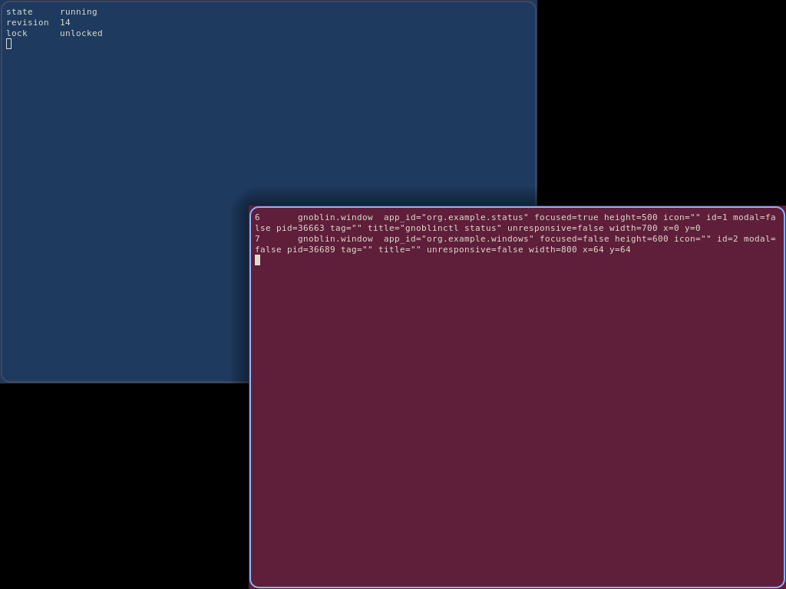
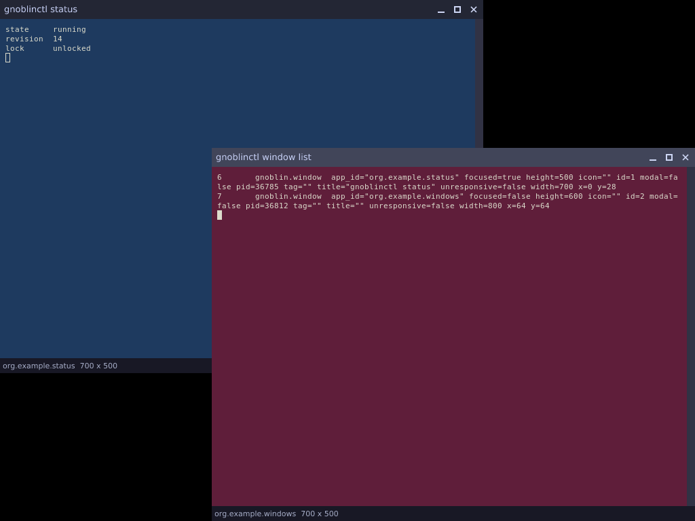

# Fill a window frame with your own parts

Each example sets the `frame` callback of `Decorations` for `~/.config/gnoblin/shell.ts`, then starts the decorations. The
[window frame reference](/js-window-frame) names every outlet and part. A save reloads the shell and frames every window
again, so a change shows at once.

A file that never sets a `frame` callback keeps the stock titlebar. A callback runs for every window: it returns `false`
to leave a window with no frame, and it reads `frame.server` to tell a window the shell frames from one that draws its
own.

Every example here is mounted over the fake compositor by `crates/gnoblin-js/tests/window_frame.rs`, which reads the code
from this page.

The pictures are the shipped shell on the software renderer, taken by `scripts/js-shell-screenshots.sh` from the code on this
page.

## A bar with the buttons on the left

The window buttons in the traffic-light order, the title in the middle, and a bar you can drag.

```ts
import { Decorations, DragArea, TitleText, WindowButtons } from "gnoblin-std";

const decorations = Decorations.get();
decorations.frame = (_client, frame) => {
    if (!frame.server) return false;
    frame.top.size = 34;
    frame.top.fill = "#2a2b3c";
    // `start` is the left end of the top edge. It is as wide as what it holds.
    frame.start.add(new WindowButtons(frame, ["close", "minimise", "maximise"], { gap: 8 }));
    // `center` takes the rest. A drag area moves the window, and a double click on it does what the seat says.
    const bar = new DragArea(frame, { grow: 1, direction: "row" });
    bar.add(new TitleText(frame));
    frame.center.add(bar);
    return true;
};
decorations.start();
```


The top edge is 34 pixels, so the layouts leave 34 pixels above the content of every window. A node in an outlet reads
the window once a frame, so the title follows a rename and the maximise button follows `maximised`.

## A border and a glow without a titlebar

A 2 pixel ring that follows the focus, and a soft halo behind the window. No edge is touched, so the window keeps its whole
frame and nothing is taken from it.

```ts
import { Decorations, FrameBorder, FrameGlow } from "gnoblin-std";

const decorations = Decorations.get();
decorations.frame = (_client, frame) => {
    // The underlay is behind the window and reaches 24 pixels past it. It takes no room and no pointer.
    frame.underlay.bleed = 24;
    frame.underlay.add(new FrameGlow({ color: "#000000", strength: 0.45, radius: 12 }));
    // The overlay is in front of the window and as large as its frame.
    frame.overlay.add(
        new FrameBorder(frame, {
            thickness: 2,
            radius: 12,
            colorOf: (client) => (client.focused ? "#89b4fa" : "#45475a"),
        }),
    );
    return true;
};
decorations.start();
```



This works for a window that draws its own frame too, because only the two layers are used. Without a titlebar a window
moves with `Super+MouseLeft+Drag`.

## A status strip at the bottom and a dock handle at the side

The stock titlebar on top, a strip under the window that shows its application and size, and a handle on the right that
resizes it.

```ts
import { Decorations, ResizeHandle, Text, Titlebar } from "gnoblin-std";

const decorations = Decorations.get();
decorations.frame = (_client, frame) => {
    // The stock titlebar fills the top edge, then this callback adds its own outlets.
    if (!Titlebar.install(frame)) return false;
    const status = new Text({ grow: 1, size: 11, color: "#a6adc8" });
    frame.bottom.size = 22;
    frame.bottom.fill = "#181825";
    frame.bottom.padding = 4;
    frame.bottom.hideWhen = (window) => window.maximised;
    // `onRefresh` runs once a frame, so the text follows the window.
    frame.bottom.onRefresh = () => {
        const window = gnoblin.clients.get(frame.client);
        if (window !== undefined) {
            status.text = `${window.appId}  ${Math.round(window.width)} x ${Math.round(window.height)}`;
        }
    };
    frame.bottom.add(status);
    // The right edge is 12 pixels of frame that belongs to the handle. It is inside the frame, so it takes room.
    frame.right.size = 12;
    frame.right.fill = "#313244";
    frame.right.add(new ResizeHandle(frame, "right", { grow: 1 }));
    return true;
};
decorations.start();
```



The bottom and right edges take their room from the window, so a tiled window is smaller by 22 pixels below and 12 on the
right, and the strip gives its 22 pixels back while the window is maximised.

See [resize handles outside the frame](/js-window-frame#resize-handles) for handles that take no room.
