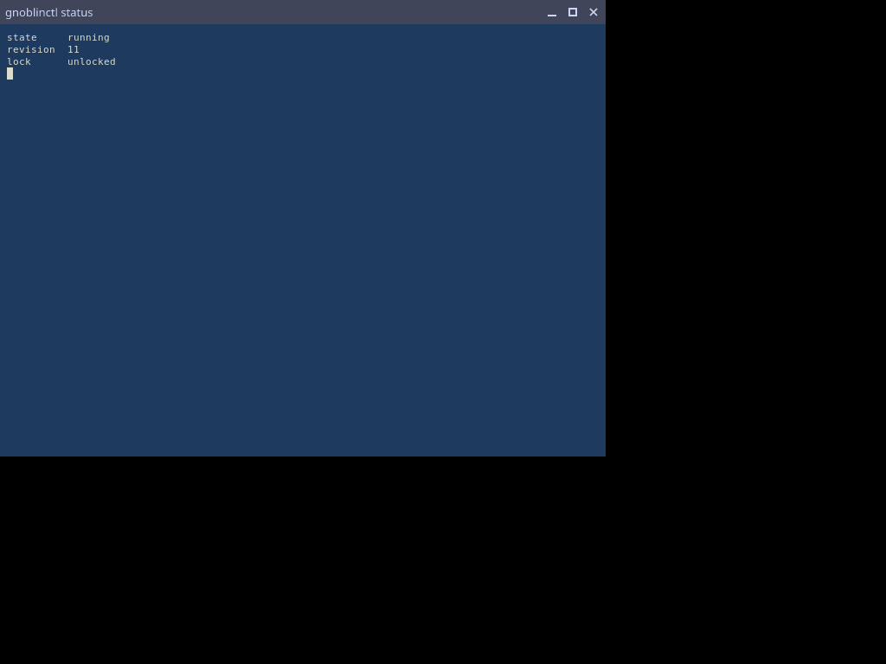
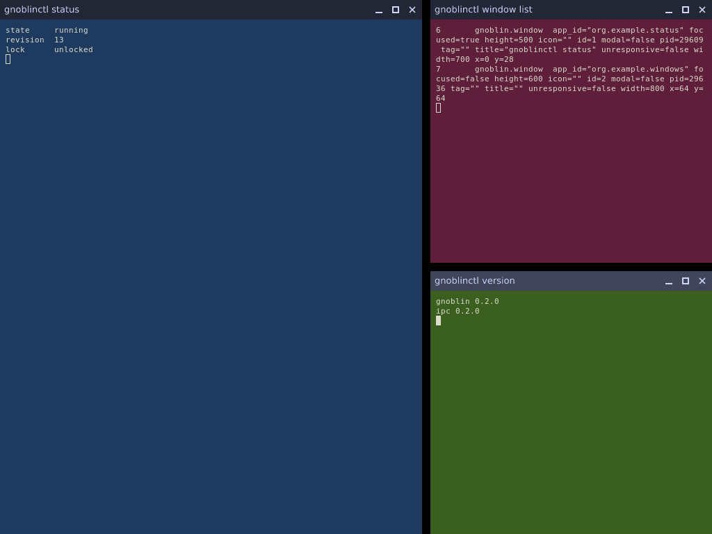
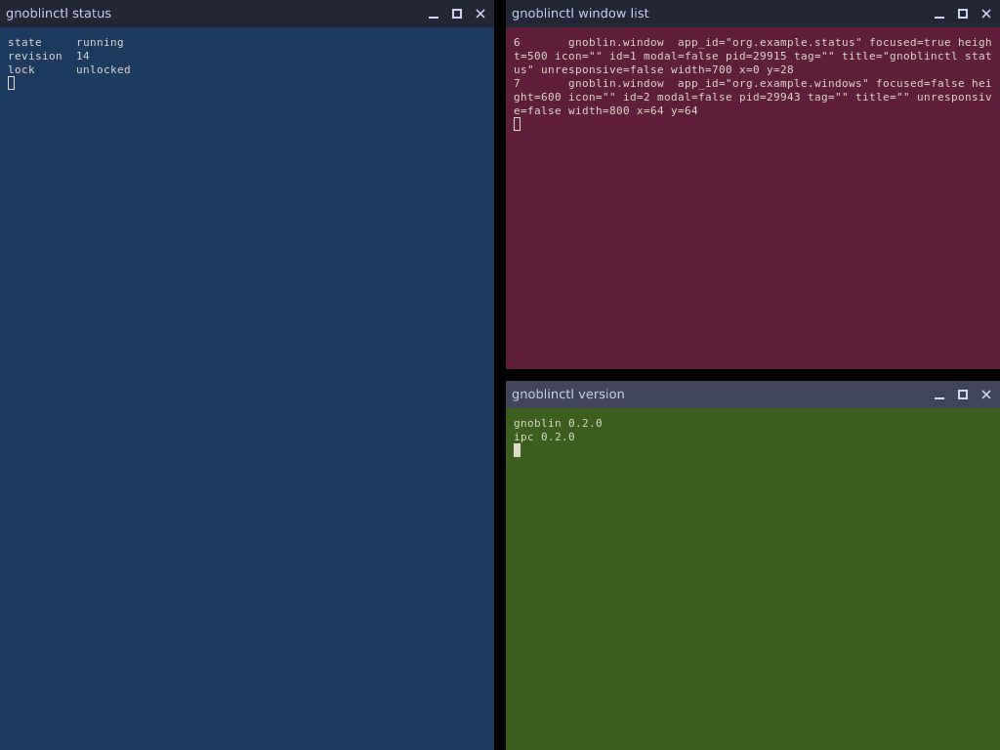
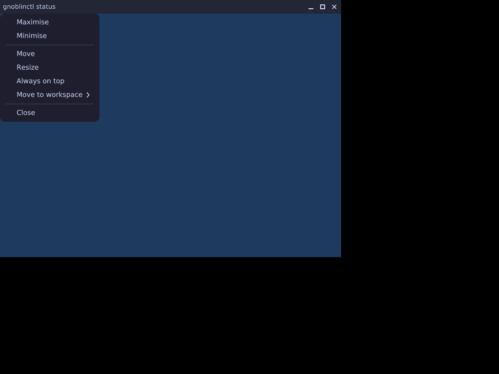

# TypeScript shell

Configure the shell with one TypeScript file, `init.ts`. You install nothing and run no build step: the shell reads the
file as it is, and reloads it when you save.

The session runs this shell. Nothing selects it: `gnoblin` starts it unless you still have only an `init.lua` (see [Which shell runs](#which-shell-runs)).

## Write your first config

Run this once. It writes a short, commented `init.ts` to `~/.config/gnoblin` (`$XDG_CONFIG_HOME/gnoblin` when that is set)
and the files your editor needs for completion:

```sh
gnoblinctl config init
```

```text
ok  init.ts written: /home/me/.config/gnoblin/init.ts
ok  gnoblin.d.ts refreshed: /home/me/.config/gnoblin/gnoblin.d.ts
ok  tsconfig.json created: /home/me/.config/gnoblin/tsconfig.json

Next:
  1. Open /home/me/.config/gnoblin/init.ts in your editor.
  2. Check it with `gnoblinctl check --types /home/me/.config/gnoblin/init.ts`.
  3. Save it: a running shell reloads the file on save, and `gnoblinctl config reload` does it on request.
```

`config init` never replaces a config. If `init.ts` or `init.js` is already there it stops and says so. Add `--force`
to write the starter over it. An `init.lua` does not stop it: the new `init.ts` takes precedence over it.

Open the file. As written it is the config the shell runs when there is no `init.ts` at all, so nothing changes until you
edit it. The lines that start with `// ` are examples. Remove the `// ` to switch one on:

```ts
workspaces: [
    { id: "1", name: "Workspace 1", layout: "floating" },
    { id: "2", name: "Workspace 2", layout: "floating" },
    { id: "3", name: "Workspace 3", layout: "floating" },
    { id: "4", name: "Workspace 4", layout: "floating" },
    { id: "work", layout: "master-stack" },
],
keys: {
    "Super+Return": spawn("foot"),
},
```

Save the file. The shell reloads it after a short pause, and the windows you have open stay where they are. Press
`Super+2` and you are on the new workspace.

## Where the config lives

The shell reads one file from one directory: `$XDG_CONFIG_HOME/gnoblin` when that is an absolute path, else
`~/.config/gnoblin`. In that directory it takes the first of these that exists:

1. `init.ts`
2. `init.js`
3. `init.lua`, which the TypeScript shell does not read (see [Which shell runs](#which-shell-runs))

When two exist, the first wins and the log says which others it ignored, for example
`init.lua is not read: init.ts takes precedence in the same directory`. `GNOBLIN_CONFIG` names one file instead, and its
extension (`.ts`, `.mts`, `.js`, `.mjs` or `.lua`) says which shell reads it.

The shell loads the file, validates the whole document `defineConfig` makes and commits it to the compositor as one
revision. Every start and every reload commits the document the file describes and nothing else. A setting you delete
from `init.ts` is gone after the next reload or restart.

Your `autostart` commands are part of that document:

- The session starts each in a process group of its own.
- A command that is still running is left alone when you reload or the shell restarts.
- A command a reload drops from the list is stopped.
- A command that exits is not started again.

A save reloads the file. So does `gnoblinctl config reload`, which prints the revision it committed or the error it
refused, with the file, line and column. `GNOBLIN_JS_WATCH=0` turns the reload on save off, and then only the command
reloads.

## Which shell runs

`GNOBLIN_SHELL_VM` chooses the shell. Leave it unset for the TypeScript shell.

| `GNOBLIN_SHELL_VM`                        | The session runs                                                                                  |
| ----------------------------------------- | ------------------------------------------------------------------------------------------------- |
| unset or empty                            | The TypeScript shell, unless you have an `init.lua` and no `init.ts` or `init.js` (next section). |
| `js`                                      | The TypeScript shell, always.                                                                     |
| `js:/path/to/gnoblin`                     | The TypeScript shell, reading its stock library from that directory instead of the built-in one.  |
| `lua`                                     | The Lua shell. It is deprecated and stays for one more release.                                   |
| `0`, or the path of a Lua shell directory | The Lua shell, with no shell VM or with that directory's.                                         |

### If you still have an `init.lua`

An update does not start you on the stock config and lose yours. When `GNOBLIN_SHELL_VM` is unset and the config
directory has an `init.lua` but no `init.ts` or `init.js`, the session runs the Lua shell for this release and logs one
warning:

```text
init.lua is a Lua config and there is no init.ts or init.js beside it, so this session runs the deprecated Lua shell
for this release. ... move your config to init.ts (see docs/migrating-from-lua.md)
```

[Migrating from Lua](migrating-from-lua.md) maps each Lua construct to its TypeScript equivalent. Run
`gnoblinctl config migrate` to convert your `init.lua` to an `init.ts`, or `gnoblinctl config init` to write a starter:
from then on the TypeScript shell runs, and the `init.lua` beside it is ignored. Setting `GNOBLIN_SHELL_VM=js` with only
an `init.lua` starts the TypeScript shell on the stock config and says that the Lua file is not read.

## Check a file

```sh
gnoblinctl check --types ~/.config/gnoblin/init.ts
```

`check` loads the file the way the shell does. `gnoblinctl config validate FILE` runs the same check for a `.ts` or `.js` file. It reports a syntax error, an import that does not resolve or a throw at
the line you wrote.

With `--types` it also runs a TypeScript compiler when one is installed. That catches a key that does not exist or a value
of the wrong type. Without a compiler it says so and exits 0. See [Check and types](gnoblinctl.md#check-and-types).

## Editor support

`gnoblinctl config init` runs `gnoblinctl types init`, which writes `gnoblin.d.ts` and `tsconfig.json` beside `init.ts`.
An editor that understands TypeScript then completes every key and underlines a wrong one. Run `gnoblinctl types init`
again after an upgrade to refresh `gnoblin.d.ts`. It never replaces a `tsconfig.json` you have.

## What the keys are

Every key of `defineConfig`, with its accepted values, its default and an example, is in the
[defineConfig reference](typescript-config.md). The ones the starter shows are these:

- `gaps`, `decorations` and `workspaces` shape the desktop.
- `keys` binds keys, and `rules` places windows.
- `autostart` starts programs once per session.
- `setup` is a function for anything else, with the whole object API.

A mistake in a key name fails the reload, and the message suggests the key you meant:

```text
config has no "autostrt" (did you mean "autostart"?); expected one of gaps, style, outputs, ...
```

## With no `init.ts`

A session with no `init.ts` is not a bare shell. It runs the stock config:

- four floating workspaces, `1` to `4` (named `Workspace 1` to `Workspace 4`), the same four the Lua stock config had;
- `Super+1` to `Super+9` show the workspace at that position, sliding over a quarter of a second, and do nothing when
  there is none, so `Super+1` to `Super+4` work until you declare more;
- `Super+Left` and `Super+Right` move focus between the columns of a `strip` workspace;
- a three-finger swipe slides between workspaces, and the windows follow the fingers;
- the volume, microphone and media keys run `wpctl` and `playerctl`;
- `Super` with a left drag moves a window, and `Super` with a right drag resizes it;
- a titlebar on every window, with a window menu on a right click;
- an alert with Wait and Force quit for a window that stops answering;
- `Super+space` opens a launcher entry that starts what you type.

Creating `init.ts` later loads it at once. An `init.ts` that fails to load when the shell starts is reported in the log,
and the stock config runs until the file is fixed.

## What it looks like

A session with no `init.ts` shows each window under its titlebar on an empty screen. The stock config has no wallpaper
and no bar.



A workspace with a layout tiles its windows. This config tiles three terminals with a master on the left and a gap of 12
pixels. It sets `decorations: true` because a `defineConfig` that leaves the key out draws no titlebars:

```ts
import { MasterStackLayout, defineConfig } from "gnoblin";

export default defineConfig({
    decorations: true,
    workspaces: [{ id: "dev", layout: new MasterStackLayout({ ratio: 0.6, gap: 12 }) }],
});
```



`DwindleLayout({ gap: 12 })` splits the space of the focused window in two for each new window:



The window menu opens on a right click on a titlebar, and with `Alt+Space`:



## Window requests

A client asks the compositor for a change of its window: fullscreen, minimise, maximise, raise, activate, move, resize.
The compositor changes nothing until the shell answers, and the stock shell answers every kind:

| Request          | What the shell does                                                                                              |
| ---------------- | ---------------------------------------------------------------------------------------------------------------- |
| `maximize`       | Fills the area the bars leave and keeps the floating rectangle. `unmaximize` puts the window back.               |
| `fullscreen`     | Covers the whole output, bars included, and goes on top. `unfullscreen` returns the rectangle.                   |
| `minimize`       | Hides the window and hands the keyboard focus to the topmost window left, or to nobody.                          |
| `unminimize`     | Shows the window, and focuses it only when nothing holds the focus.                                              |
| `activate`       | On the shown workspace: shows a minimised window, focuses it and raises it. On another workspace: nothing.       |
| `raise`, `lower` | Puts the window on top of its siblings or under them. A fullscreen window stays on top.                          |
| `move`, `resize` | Starts the drag of `Super` with the left or right button. A tiled, maximised or fullscreen window is left alone. |
| `close`          | Asks the client to close.                                                                                        |

A fullscreen window hides the bars on its output while it shows on the workspace that output shows, and they return when
it leaves, minimises or closes. A tiling layout leaves a fullscreen or maximised window where it is.

### Answering a request yourself

A `ClientListener` with an `onRequest(client, request)` method hears every request first. Call `request.handle()` to
answer it yourself: the built-in answer does not run, and no later listener hears it.

```ts
import { ClientListener, gnoblin, windowState } from "gnoblin";

class KeepOnTop extends ClientListener {
    onRequest(client, request) {
        if (request.kind === "minimize" && client.appId === "org.example.Clock") {
            request.handle(); // this window never minimises
        } else if (request.kind === "maximize") {
            request.handle();
            windowState.enterFullscreen(client); // answer a maximise as a fullscreen
        }
    }
}
gnoblin.clients.addListener(new KeepOnTop());
```

The listeners attached to the client itself are asked first, then those of the collections that hold it, each in the
order it was attached. The first one to call `request.handle()` wins. A listener that throws is reported and skipped.
`request.kind` is one of:

- `maximize` and `unmaximize`
- `fullscreen` and `unfullscreen`
- `minimize` and `unminimize`
- `close`, `raise`, `lower` and `activate`
- `move`, `resize` and `menu`

`windowState` is the policy the built-in answer calls. Its methods return whether they ran, so a listener can answer a
request with the stock behaviour of another kind:

- `maximise` and `unmaximise`
- `enterFullscreen` and `leaveFullscreen`
- `minimise` and `unminimise`
- `present`, `raise` and `lower`

## Outputs

With more than one output each shows its own workspace, bars sit on one output, a window moves between outputs with
`client.moveToOutput(output)`, and the windows of an unplugged output move to another output or wait hidden for the next.
A dialog stays centred in its parent and goes wherever the parent goes. The page is
[Outputs](/shell-api/outputs).

[Window policy in TypeScript](/js-window-policy).

[Animation in TypeScript](/js-transitions): `gnoblin.requestTransition` draws a change of state as one animation.

## Reloading

Saving `init.ts`, or any module it imports, reloads the shell after a short pause. `gnoblinctl config reload` reloads it on
request: see [`gnoblinctl config reload`](/gnoblinctl#config). Windows keep their identity through a reload, and the new
config is told about every window that exists.

Your keys keep working through a reload. The shortcuts, touchpad gestures, pointer chords and binding-only devices of the
old config are given up and the new config's are taken in one step, so a key is never refused for being held.

A key you removed from the file stops working at that reload and reaches the focused application again.

A file that fails to load (a syntax error, a throw, a script that runs away) leaves the running config in place. The failure
is logged once as `file:line:column: message`, in your `.ts` coordinates, and `gnoblinctl config reload` exits 1 with the
same text.

Set `GNOBLIN_JS_WATCH=0` to turn the watcher off, for a config directory on a file system that cannot be watched. The shell
then reloads only when asked.

## Debugging

`console` is a global, so `console.log("hi")` works anywhere in your config, in a listener and in the
[console](/js-console). `log` and `info` write at info level, `warn` at warn, `error` at error and `debug` at debug:

```ts
import { ClientListener, gnoblin } from "gnoblin";
import type { Client } from "gnoblin";

class Trace extends ClientListener {
    onFocusChanged(client: Client, focused: boolean) {
        console.log("%s focus is %j", client.appId, focused);
        if (!focused) console.warn("lost focus:", client.title);
    }
}
gnoblin.clients.addListener(new Trace());
```

Each call is one record in the log, component `js` and field `area=script`, and its message starts with where the call
was, as `init.ts:6:53` (the file relative to your config directory, the line and column in your `.ts`):

```text
INFO  runtime/js  init.ts:6:53: foot focus is true  area=script
```

Read it with `gnoblinctl log --follow` (see [Logging](/guides/logging)). The console prints what an expression printed
before the value, so you can try a call at the prompt.

What a call prints:

- Strings print as they are. `%s`, `%d`, `%i`, `%f`, `%j`, `%o`, `%O`, `%c` and `%%` in a first string format the arguments
  after it, as in Node; the arguments that are left follow, separated by spaces.
- An object prints as one line of JSON, with `[Circular]` where it contains itself and `[Function name]` for a function.
- An `Error` prints its message and its stack, with every frame in your `.ts` coordinates.
- `console.assert(condition, ...)` logs at error level, starting with `Assertion failed`, when the condition is false. It
  never throws.
- `console.table(data)` logs the data as one line of JSON. It does not draw a table.

How much a script can print:

- A call logs at most 4 KiB. A longer text is cut and says how many bytes it dropped.
- A generation logs at most 200 calls in a second, so a loop cannot flood the log. The rest are dropped, and when the next
  second begins one line says how many: `801 console lines dropped: a generation logs at most 200 a second`.

The line is the line of the call. The column is the position the engine reports, rounded to the nearest token of your
source: the last argument when it is a name, else the method (`log`). A call that spans lines reports the line it ends on.

## Session, processes and timers

The shell has more than windows:

- `gnoblin.session` logs out, suspends, powers off and locks.
- `gnoblin.process` starts programs and reports how they end.
- `gnoblin.timers` runs a function later, and `gnoblin.on` listens for the compositor's signals.
- `gnoblin.find`, `gnoblin.focus.history` and `gnoblin.version()` read what the shell holds.

See [Session and runtime](/shell-api/session-runtime), [Processes](/shell-api/processes) and [Events](/events/).

## Console and inspector

`gnoblinctl console` opens a live prompt into the running shell, and `inspect.clients()`, `inspect.workspaces()`,
`inspect.bindings()` and `inspect.config()` return what the shell holds as plain data. See
[Console and inspector](/js-console).

## Idle, authentication and launches

`gnoblin.idle.watch(ms, { onIdle, onResume })` runs code when the session has had no input for a while,
`gnoblin.authentication.addListener(listener)` watches polkit authentication requests and may refuse one (the compositor
draws the password dialog and checks the password itself), and
`gnoblin.launches.begin(token, application)` tracks the busy state between a launch and its window. See
[Idle watches](/shell-api/idle), [Authentication prompts](/shell-api/authentication) and [Launch feedback](/shell-api/launch-feedback).

## XR

`gnoblin.extensions.xr` is `null` until the XR program has a session, so a config guards it and works without a headset.
The stock shell builds the room and places the panels when the session starts. See
[XR mode](/xr#scripting-xr-in-typescript) for the room, the viewport and the bindings that move and resize a panel.

## When the shell stops

The shell is a client of the compositor. If it exits or is killed, the compositor keeps running and answers every client.
With no shell holding the tree:

- a window that maps is placed by the compositor's own policy, a cascade from 32, 32;
- windows the shell had moved go back to the places the compositor gave them.

The session restarts the shell. It attaches again, learns of every window and applies the config again. No window changes
its identity, and programs listed in `autostart` are started again.
