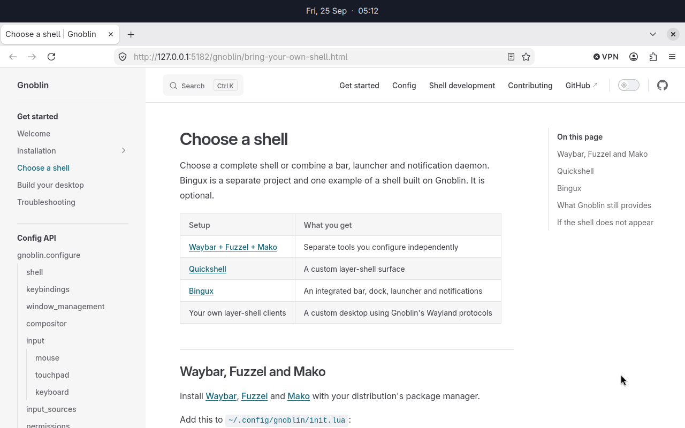
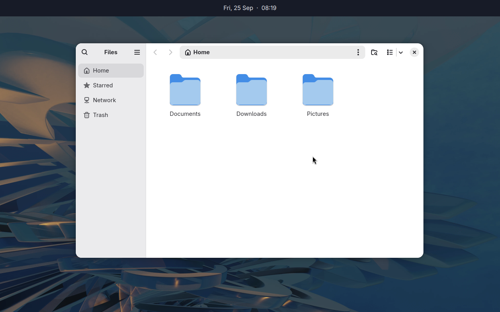

# Wayland protocol catalogue

This page lists every global a Gnoblin session advertises. A test keeps it true: it starts a headless session and
reads the registry on the privileged and the ordinary socket.

The test compares each registry with the table below, so a global cannot be added, removed, re-versioned or made
restricted without this page changing (`crates/gnoblin-wayland/tests/protocol_list.rs`). A client must bind the interface the running compositor
advertises; vendored XML alone does not mean a protocol is available.

## Availability

Every listed interface is on by default. A setting under `protocols` switches off the ones that name one in the
Notes column, and a global switched off is advertised to nobody. Clients that already bound an interface keep their
existing connection until they disconnect.

`shell.ts`, `shell.py` and a Rust shell cannot turn one off: no object of the shell API carries the choice (see
[Settings with no object](/js-settings)).

## Access

The Access column says which clients see a global.

- **Everyone** means every client that is not inside an application sandbox. A sandboxed client sees none of the
  restricted globals and also none of the input-emulation ones.
- **Restricted** means only the session's own processes, on the privileged socket or marked trusted. An application
  on the ordinary socket does not see the global, and a guessed bind is refused.

A row whose notes begin with `Conditional:` is advertised only by some sessions, so a headless test session does not
have it.

## Available interfaces

| Advertised interface                                   | Version | Use it for                                                                      | Access     | Notes                                                                                                                                                         |
| ------------------------------------------------------ | ------- | ------------------------------------------------------------------------------- | ---------- | ------------------------------------------------------------------------------------------------------------------------------------------------------------- |
| `wl_compositor`                                        | 5       | Surfaces and regions                                                            | Everyone   |                                                                                                                                                               |
| `wl_subcompositor`                                     | 1       | Subsurfaces                                                                     | Everyone   |                                                                                                                                                               |
| `wl_shm`                                               | 2       | Shared-memory buffers                                                           | Everyone   |                                                                                                                                                               |
| `wl_output`                                            | 4       | Outputs and their modes                                                         | Everyone   |                                                                                                                                                               |
| `wl_seat`                                              | 9       | Keyboard, pointer and touch input                                               | Everyone   |                                                                                                                                                               |
| `wl_data_device_manager`                               | 3       | Clipboard and drag and drop                                                     | Everyone   |                                                                                                                                                               |
| `xdg_wm_base`                                          | 7       | Application windows, popups and configure                                       | Everyone   |                                                                                                                                                               |
| `xdg_activation_v1`                                    | 1       | Activation tokens a launcher hands to a new window                              | Everyone   | A token a privileged or trusted client asks for marks the window it opens as launched.                                                                        |
| `zxdg_decoration_manager_v1`                           | 1       | Negotiate client or server titlebars                                            | Everyone   | Server-side only while a shell that holds the node tree declares decorations; otherwise every client is told client-side. Switch: `protocols.xdg-decoration`. |
| `org_kde_kwin_server_decoration_manager`               | 1       | The older KDE form of the same negotiation, for toolkits without xdg-decoration | Everyone   | Answered by the same policy as xdg-decoration. Switch: `protocols.kde-server-decoration`.                                                                     |
| `org_kde_kwin_appmenu_manager`                         | 2       | A window's application menu address (DBus service and object path)              | Everyone   | Published on the window node as `appmenu_service` and `appmenu_path`; cleared when the client releases it.                                                    |
| `xdg_wm_dialog_v1`                                     | 1       | Modal dialogs                                                                   | Everyone   |                                                                                                                                                               |
| `zxdg_exporter_v2`                                     | 1       | Name a window so another client can parent to it                                | Everyone   |                                                                                                                                                               |
| `zxdg_importer_v2`                                     | 1       | Parent a window to one another client exported                                  | Everyone   |                                                                                                                                                               |
| `zxdg_output_manager_v1`                               | 3       | Logical size and place of each output                                           | Everyone   |                                                                                                                                                               |
| `xdg_system_bell_v1`                                   | 1       | The system bell                                                                 | Everyone   | A ring flashes the screen when the visual bell is on.                                                                                                         |
| `xdg_toplevel_icon_manager_v1`                         | 1       | Window icons                                                                    | Everyone   | Stored per window and published; not drawn by the compositor.                                                                                                 |
| `xdg_toplevel_tag_manager_v1`                          | 1       | Window tags                                                                     | Everyone   | Stored per window and published; placement does not read it.                                                                                                  |
| `zwlr_layer_shell_v1`                                  | 5       | Bars, docks, launchers, overlays and exclusive zones                            | Restricted | See the notes below. Switch: `protocols.wlr-layer-shell`.                                                                                                     |
| `zwlr_foreign_toplevel_manager_v1`                     | 3       | Inspect and control windows                                                     | Restricted | Switch: `protocols.wlr-foreign-toplevel-management`.                                                                                                          |
| `ext_foreign_toplevel_list_v1`                         | 1       | Enumerate toplevel windows                                                      | Restricted | Read-only. Switch: `protocols.ext-foreign-toplevel-list`.                                                                                                     |
| `zwlr_screencopy_manager_v1`                           | 3       | Native output capture                                                           | Restricted | Served on the privileged socket only. Switch: `protocols.wlr-screencopy`.                                                                                     |
| `ext_image_copy_capture_manager_v1`                    | 1       | Capture an output or a window into a client buffer                              | Restricted | Switch: `protocols.ext-image-copy-capture`.                                                                                                                   |
| `ext_output_image_capture_source_manager_v1`           | 1       | Name an output as a capture source                                              | Restricted | Part of the image-copy-capture capability.                                                                                                                    |
| `ext_foreign_toplevel_image_capture_source_manager_v1` | 1       | Name a window as a capture source                                               | Restricted | Part of the image-copy-capture capability.                                                                                                                    |
| `ext_data_control_manager_v1`                          | 1       | Clipboard managers                                                              | Restricted | Switch: `protocols.ext-data-control`.                                                                                                                         |
| `zwlr_data_control_manager_v1`                         | 2       | Clipboard managers (wlroots form)                                               | Restricted | Switch: `protocols.ext-data-control`, which covers both spellings.                                                                                            |
| `zwp_primary_selection_device_manager_v1`              | 1       | The primary selection                                                           | Everyone   |                                                                                                                                                               |
| `ext_idle_notifier_v1`                                 | 2       | Idle and resume notifications                                                   | Everyone   | Switch: `protocols.ext-idle-notify`.                                                                                                                          |
| `zwp_idle_inhibit_manager_v1`                          | 1       | Keep the session awake while a surface shows                                    | Everyone   |                                                                                                                                                               |
| `zwlr_gamma_control_manager_v1`                        | 1       | Per-output gamma ramps                                                          | Restricted | Switch: `protocols.wlr-gamma-control`.                                                                                                                        |
| `zwlr_output_power_manager_v1`                         | 1       | Output power state                                                              | Restricted | Switch: `protocols.wlr-output-power-management`.                                                                                                              |
| `zwlr_output_manager_v1`                               | 4       | Read outputs and apply a new layout                                             | Restricted | Switch: `protocols.wlr-output-management`.                                                                                                                    |
| `ext_session_lock_manager_v1`                          | 1       | Secure session locking with an external locker                                  | Everyone   | See [Session locking](/session-lock). Switch: `protocols.ext-session-lock`.                                                                                   |
| `ext_background_effect_manager_v1`                     | 1       | Client-defined background blur regions                                          | Everyone   | See [Background blur](background-effects.md). Switch: `protocols.ext-background-effect-v1`.                                                                   |
| `ext_workspace_manager_v1`                             | 1       | The workspace list a panel shows                                                | Restricted | Partial: it lists the declared workspaces, and none is active unless a shell writes `active_workspace`. Requests are ignored.                                 |
| `zwlr_virtual_pointer_manager_v1`                      | 2       | Move, click and scroll the session's pointer                                    | Restricted | Events take the same path as a mouse's, so a modal, the lock and a shell's grabs see them.                                                                    |
| `zwp_virtual_keyboard_manager_v1`                      | 1       | Type into the focused window                                                    | Everyone   | A sandboxed client never sees it.                                                                                                                             |
| `zwp_input_method_manager_v2`                          | 1       | Input methods                                                                   | Everyone   | A sandboxed client never sees it.                                                                                                                             |
| `zwp_text_input_manager_v3`                            | 1       | Text fields tell the input method what they hold                                | Everyone   |                                                                                                                                                               |
| `zwp_keyboard_shortcuts_inhibit_manager_v1`            | 1       | Ask the compositor to pass shortcuts through                                    | Everyone   |                                                                                                                                                               |
| `zwp_pointer_constraints_v1`                           | 1       | Lock or confine the pointer                                                     | Everyone   |                                                                                                                                                               |
| `zwp_relative_pointer_manager_v1`                      | 1       | Relative pointer motion                                                         | Everyone   |                                                                                                                                                               |
| `zwp_pointer_gestures_v1`                              | 3       | Swipe, pinch and hold gestures                                                  | Everyone   |                                                                                                                                                               |
| `zwp_tablet_manager_v2`                                | 1       | Drawing tablets                                                                 | Everyone   |                                                                                                                                                               |
| `wp_cursor_shape_manager_v1`                           | 2       | Named cursor shapes                                                             | Everyone   |                                                                                                                                                               |
| `wp_viewporter`                                        | 1       | Crop and scale a surface                                                        | Everyone   |                                                                                                                                                               |
| `wp_fractional_scale_manager_v1`                       | 1       | The fractional scale a surface is drawn at                                      | Everyone   |                                                                                                                                                               |
| `wp_content_type_manager_v1`                           | 1       | Mark a surface as video or a game                                               | Everyone   |                                                                                                                                                               |
| `wp_tearing_control_manager_v1`                        | 1       | Ask for tearing presentation                                                    | Everyone   |                                                                                                                                                               |
| `wp_single_pixel_buffer_manager_v1`                    | 1       | Buffers of one colour                                                           | Everyone   |                                                                                                                                                               |
| `wp_alpha_modifier_v1`                                 | 1       | A per-surface opacity factor                                                    | Everyone   |                                                                                                                                                               |
| `wp_fifo_manager_v1`                                   | 1       | In-order commits                                                                | Everyone   |                                                                                                                                                               |
| `wp_presentation`                                      | 2       | Presentation feedback                                                           | Everyone   |                                                                                                                                                               |
| `wp_security_context_manager_v1`                       | 1       | Mark an application sandbox                                                     | Everyone   | Hidden from a connection that is already sandboxed.                                                                                                           |
| `zwp_linux_dmabuf_v1`                                  | 4       | GPU buffers from clients                                                        | Everyone   | Conditional: served only when the renderer can import them (GLES on a render node); version 3 without a node.                                                 |
| `xwayland_shell_v1`                                    | 1       | Associate X11 windows with surfaces                                             | Everyone   | Conditional: only in a session that runs Xwayland, and only Xwayland uses it.                                                                                 |
| `zwp_xwayland_keyboard_grab_manager_v1`                | 1       | Keyboard grabs for X11 clients                                                  | Everyone   | Conditional: only in a session that runs Xwayland.                                                                                                            |

The version is the highest the compositor serves. Bind the version the running compositor advertises, or a lower one.

Standard requests, events, and enums are documented in the
[Wayland book](https://wayland.freedesktop.org/docs/book/) and the
[wayland-protocols source](https://gitlab.freedesktop.org/wayland/wayland-protocols).

A layer-shell client names its layer, anchors, margins, size, exclusive zone,
and keyboard interactivity, and Gnoblin answers as the protocol says:

- It configures the surface against its output's edges. An axis anchored to
  both edges is the output's length less the margins, an axis anchored to one
  edge is the size the client asked for, and an unanchored axis is centred.
- It takes an exclusive zone along one anchored edge out of the work area, so
  a maximised window is the space the bars leave. The zones of the surfaces on
  an output add up, and a surface that exits, or an output that is
  disconnected, gives its strip back.
- A second bar on the same edge sits against the first. A surface with a zone
  of `0` is placed in the space the bars leave, and one with a zone of `-1` is
  placed against the whole output.
- It draws the surface in its layer: `background` and `bottom` are under every
  window, `top` and `overlay` above them, and a popup of a layer surface is
  drawn above all of them. A surface that has not drawn a buffer is not drawn.
- The pointer goes to the surface it is over, so a window under a bar hears
  nothing of a click on the bar. A surface that is not drawn takes no pointer.
- A surface on the `top` or `overlay` layer that asks for exclusive keyboard
  interactivity keeps the keyboard until it exits, even when a new window
  would take focus. A surface on `background` or `bottom` does not. A surface
  that asks for keyboard focus on demand gets it when you click it, and gives
  it back when you click anything else.
- A popup that belongs to a layer surface is placed against that surface, and
  a repositioned popup stays inside it.

The protocol is the whole interface for a client. A layer surface is not a
window, so window rules do not match it, and Gnoblin keeps no registry of layer
surfaces to configure, list or subscribe to.

A shell that holds the node tree sees each layer surface as a `surface` node and
may place it itself: see
[Place popups, subsurfaces and layer surfaces](shell-api/scene.md#place-popups-subsurfaces-and-layer-surfaces).

_Quickshell positions the panel with the layer-shell protocol._

_Layer-shell panels remain separate from ordinary application windows._

Screen capture through `wlr_screencopy` is separate from the desktop portal.
It is served only on the privileged socket, never on the ordinary one. The
session names that socket in `GNOBLIN_PRIVILEGED_DISPLAY`, so a capture tool
runs as `WAYLAND_DISPLAY=$GNOBLIN_PRIVILEGED_DISPLAY grim`.

A capture tool can ask for the frame in a buffer on the GPU as well as in shared
memory (`zwlr_screencopy` `linux_dmabuf`, `ext_image_copy_capture` `dma_buf`).
The frame is then copied on the GPU and never crosses to the CPU.

A session offers this only when it draws with GLES on a render node. The
software and Vulkan renderers, the hardware backend and a session with no GPU
offer shared memory only.

A GPU capture follows the same rules as a shared-memory one: the session lock,
secure windows and the supersampled size. It has not run on a real GPU yet.

The privileged socket is owner-only (mode `0600`). That limits connections to
your user, not to capture tools. Any process running as your user that can
find the socket gets every privileged global, including screencopy, data-control
(clipboard read and write), layer-shell and foreign-toplevel management.
A same-user program can therefore read the screen and the clipboard.

Sandboxed clients never see the privileged globals through the protocol. Whether
a sandbox can reach the socket path depends on the files it exposes.

Checked: a bubblewrap sandbox with a tmpfs over `$XDG_RUNTIME_DIR` hides the
socket. Flatpak 1.16.6 with the default permissions of `app.drey.Warp` hides it.

Not checked: other Flatpak apps, apps with `xdg-run` or a runtime-directory
bind, and the session's own sandboxes. Any of these may reach the socket if it
exposes `$XDG_RUNTIME_DIR`.

The portal path depends on the selected backend. Disabling this global does not
block screen sharing.

## Inspect a running session

Inspect the running compositor when you package or debug a client. Use a
registry tool such as `wayland-info` inside the Gnoblin session or a nested
session's terminal, so it reaches the right `WAYLAND_DISPLAY`.

A source checkout or XML file does not show which globals a login session
advertises.
